## 1 暴论与建议

### 1.1 [OpenAI 宣称指数时间假设是假的](https://openai.com/index/building-scientific-understanding-with-academic-communities/)

这一讲的开场不是软件，而是一篇论文的首页：OpenAI 宣称指数时间假设（Exponential Time Hypothesis, ETH）是假的，摘要里给出的算法并不是多项式算法——如果真找到了多项式算法，$P=NP$ 就成立了，那才是世界崩塌——但它把原来「必须 $2^{n}$ 才能做」的那条界线往下压了一点。

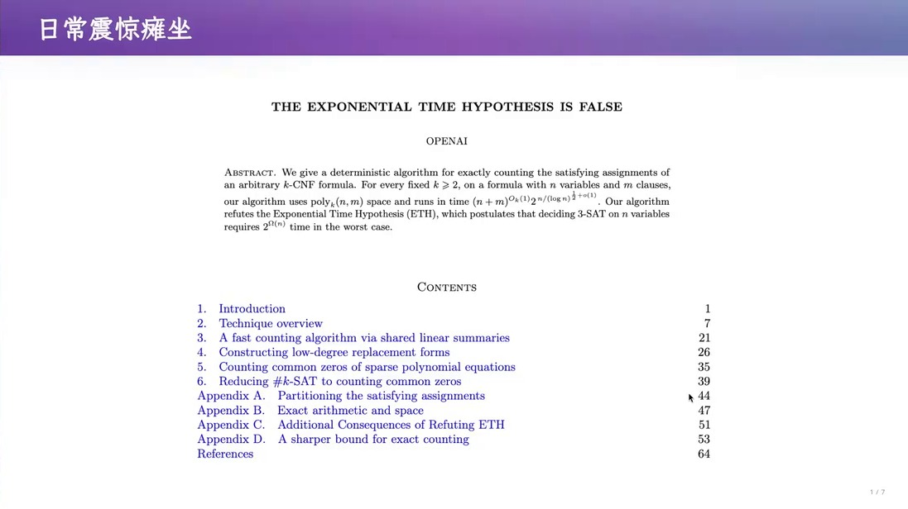

老师把这种感受叫「日常震惊瘫坐」：早上起来刷到一条结果，瘫在椅子上。之所以要塞进课上，是因为它推翻的不是某个定理，而是人对「什么是难」的直觉。理论计算机科学的美感，很大程度上来自多项式时间这个定义好用到不像话的性质：它对函数调用封闭。

具体地说，如果一个算法是多项式时间的，它内部调用的子程序也是多项式时间的，那么无论你嵌套调用多少次，整体仍然是多项式时间的——输入是多项式长的，返回还是多项式长的，平方嵌三方、三方嵌四次，最后都还在同一个集合里。这个「reduction closure」让所有现成算法库可以被无脑复用，也让推导可以写得很干净。

$n^2$ 和 $n^{100}$ 被放进了同一个抽屉。

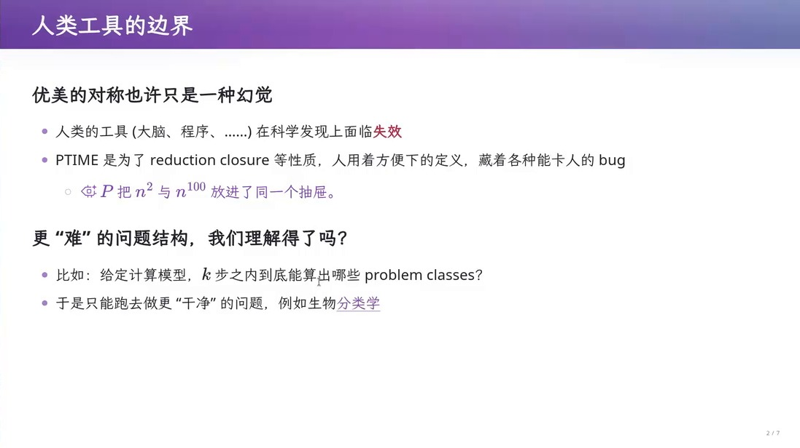

一旦认真问「我们到底想知道什么」，问题就变成了另一个样子：给定一个可以被形式化的计算模型——比如带有 load/store 指令、每条指令花一个周期的 RAM 模型——在 $k$ 步之内，这台机器能解决哪些 problem class？这个问题是 well-defined 的，而且它才是造一台计算机时真正关心的东西：什么问题能做，什么不能做。

$k$ 步的模型把 PTIME 抹掉的东西全留了下来：数据放在内存哪个位置、要不要压缩、循环怎么排布，都会显著改变 $k$ 的常数。而 PTIME 里这些都不重要，因为它鼓励的是「随便调用别的函数，好像不付出代价」。这就是老师那句判断的来源——**PTIME 是人类为了弥补自己大脑装不下这么多抽象而做的 work around**，它好用，但它是一种近似，而近似就会藏 bug。

### 1.2 人类只解决「干净」的问题

如果 PTIME 是一种近似，那么被这种近似驯化过的人类，会系统性地偏好某些问题。

最典型的例子是生物分类学：门、纲、目、科、属、种，这棵树人类建了几千年，优雅得像一件艺术品；但一旦看到微观层面，界限立刻模糊——两个东西算不算同一个祖先来的，可能根本不是树，而是图。

物理上也有这个例子：我们从「物理规律在不同时空保持一致」这一条第一性原理推出守恒量，再把它叫能量。这当然是对的，但它之所以能成为一条能被记住、被压缩、被传授的规律，是因为我们恰好生活在一个结构足够「平坦」的区域里。

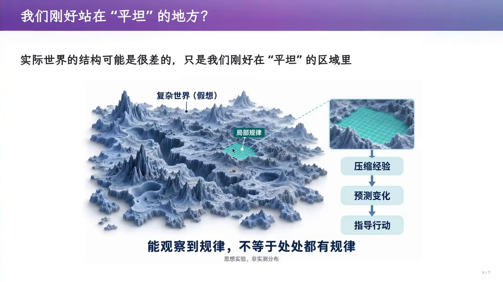

老师把这条推理链推到了 AI 上：因为世界在这个尺度上是平坦的，经验可以被压缩，压缩才能产生智能，所以我们才会有 scaling law。他明确说这是推测而不是结论——世界结构可以是「很差的」，我们只是刚好站在一块平地上。这个推测的好处是它解释了另一件事：为什么我们以为的「难」，总是在被推翻。近年的近似线性时间网络流算法、今天的 ETH 论文，都是同一类事件——人类对问题结构的理解有缺陷，而那些缺陷正在被反过来利用。

### 1.3 教育循环正在松动

过去的教育是一条稳定的循环：家庭投资教育，大学培养人才，企业购买劳动。它的有效性建立在两个前提上，一个明说、一个没说。

明说的那个是能力：花几年时间练出来的本领。没说的那个是信号：大学既帮人获得能力，也帮企业识别能力——后一半对应 Spence 的教育信号理论，文凭的价值有相当一部分来自「它证明了什么」，而不只是「它教了什么」。

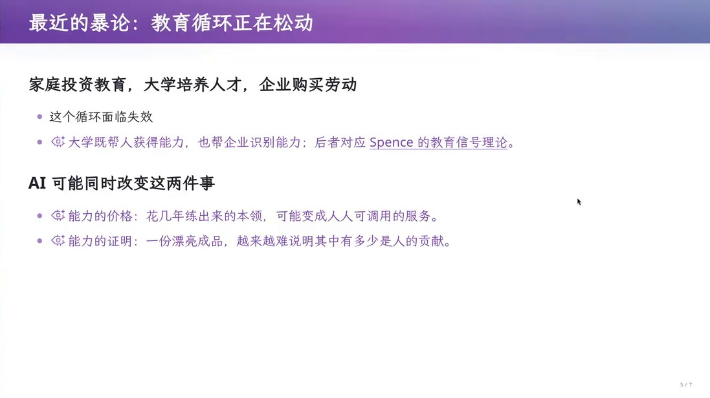

AI 同时动了这两件事。
- 能力的价格在塌：原来要几年练出来的东西，正在变成人人可调用的服务。
- 能力的证明也在塌：一份漂亮的成品，越来越难说明其中有多少是人的贡献。

  一个 senior 带着 agent，产出超过一个 junior，那么站在企业角度，先稳住自己的优势、不再招应届生，是一个理性的选择,不是学生不努力，是循环的两个前提同时失效了。

  他给的答案同样是个暴论：**用你的 AI trajectory 证明自己**。

意思是现在开始把所有与 AI 的轨迹保存下来，做一个压缩——把模型的原始输出、调试噪音删掉，把有用的资产、图片、结论留下——你就得到一条属于自己的时间轴。这条时间轴上，你想过什么、AI 给了什么、你怎么反驳、最后写出的代码能不能跑，都是可审计的。

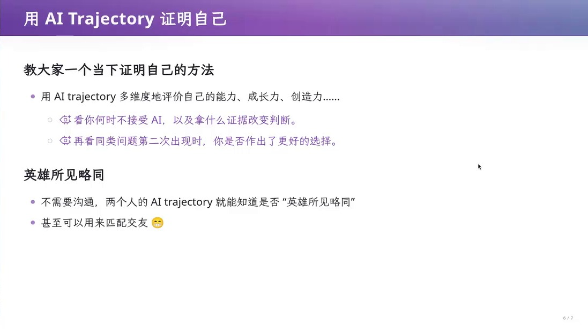

这个想法的关键在于不可变性。

用人单位不需要相信简历，它可以随机采样：2026 年 3 月 10 日你跟 AI 讨论了这么一件事，你还有印象吗，用今天的眼光怎么看？如果你真有那段记忆，你几乎无法造假——伪造了轨迹也进不了面试，进了面试也会被打回原形。

反过来，这条时间轴还能看出成长：同类型问题第二次出现时，你是否做出了更好的选择；你什么时候把某个 skill 沉淀进了自己的 harness；你的人生观在哪一段发生了改变。

老师自己也不回避这个东西的另一面。这套机制对个人是「出卖灵魂换一张简历」：它比任何面试都更彻底地窥探你的内心，而且能相当准确地预测你的潜力。

他觉得这里有一种无法抵御的诱惑——AI 一边窥探你，一边给你正反馈，让你在竞争里拿到优势——但也给出了一个最低限度的隐私策略：只和一家模型共享你的秘密，最后用一个好的 skill 把轨迹蒸馏成简历或网站。

>这样做真恐怖

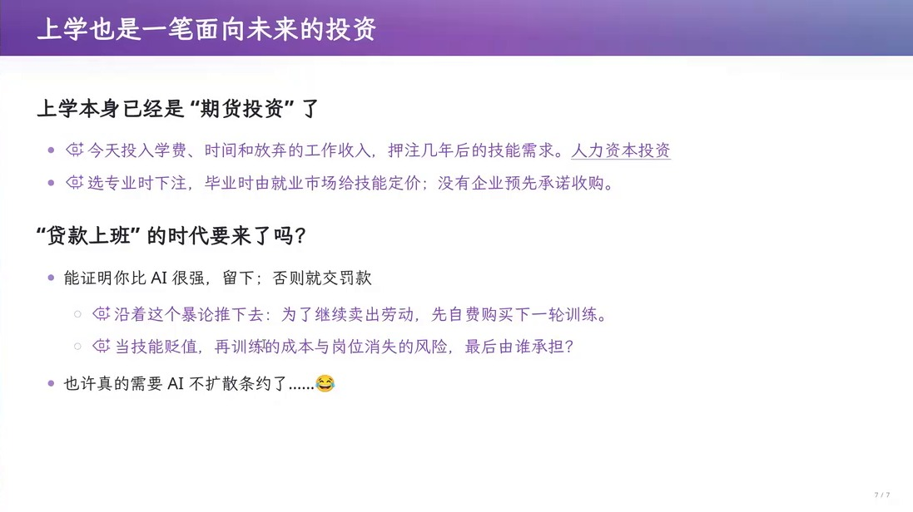

顺着这条线还能推出更远的一步：上学本身就是一笔期货投资

今天交学费、交出时间、放弃几年的工资，押注的是几年后的技能价格，而没有任何企业预先承诺收购。

如果这个押注继续失效，「贷款上班」就不是玩笑：为了继续卖出劳动，先自费购买下一轮训练；

一旦证明不了自己比 AI 强，保证金不退。这一段他讲得很轻，但结论不轻：如果能力本身不再稀缺，那么需要被管制的就不是模型，而是能力的扩散速度。

## 2 [航母的建造](https://jyywiki.cn/GSE/2026/p10/ships.html)

### 2.1 中途岛号上的一本操作手册

2019 年，老师在圣迭戈参观了中途岛号（USS Midway）。这艘船 1945 年服役，服役时二战已经结束，它在 1970 年代经历过一次现代化改造，一直服役到 1992 年。站在甲板上，他作为做软件的人首先感到的是不解：这样的一个复杂系统，到底是怎么被构建出来的？

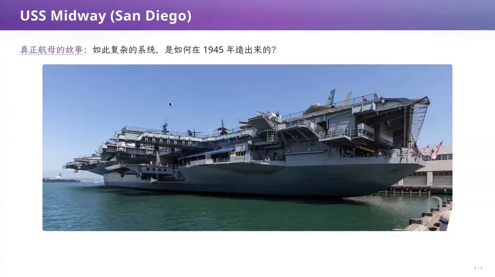

他在船上问了一位志愿者——那是真正在这条船上服过役的老兵。老兵不知道整艘船是怎么设计的，但他知道一件事：

每个人上船都会拿到一本操作手册，手册上明确写着遇到什么情况该做什么

说明设计者已经推演过各种可能发生的情况，并且把「人在压力下的操作」也当成系统的一部分来设计。

### 2.2 四个时间点：帆、锅炉、飞行甲板、航空作业

甲板最底层有一个陈列柜：从美国海军第一艘航母到最新一代航母，一代一代排开。

所有航母都不是第一天就造出来的；如果一路追溯到最原始的那个点，那个点是非常简单的,软件也是如此

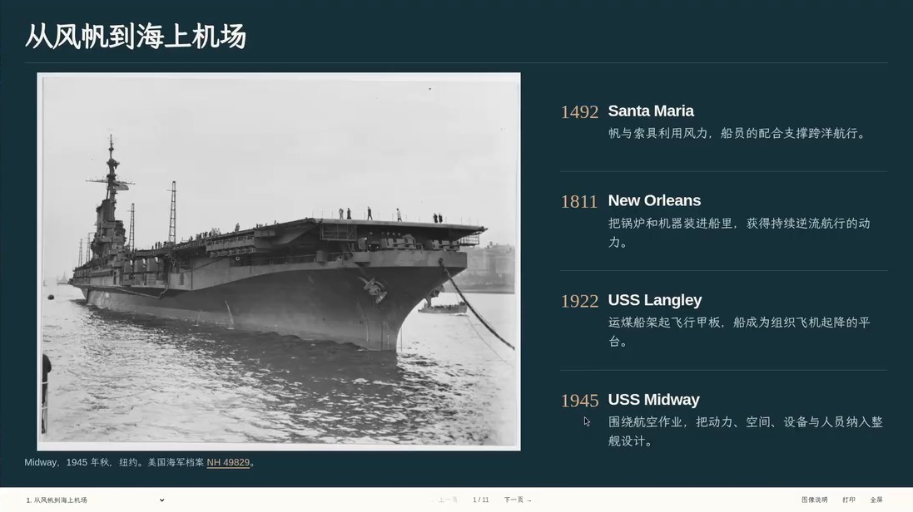

**1492，Santa Maria。** 它原本是一艘商船，成为哥伦布首次横渡大西洋的旗舰。帆与索具提供控制，船员调整帆的姿态与航向，把不断变化的风转化为可用的推力。注意这里的结构：动力来自船外，人要做的只是「驾驭」；约束是天气、航海经验与物资储备。


**1811，New Orleans。** 这艘船由 Robert Fulton 设计、Robert Livingston 出资，沿俄亥俄河与密西西比河南下，1812 年抵达新奥尔良，随后在新奥尔良与 Natchez 之间跑运输。它的动力链变成：燃料 → 锅炉 → 蒸汽机 → 明轮。轮子是在外面的,不像今天用的是划桨,所以叫轮船

>设计一个物件,每次只进一小步,按需求做加减法,人类就是这样一点一点把巨大的东西造出来的


这一版的妙处在于画面上同时留着两个时代：明轮是新动力的出口，而桅杆还立在那里——帆船的影子没有被删掉。从「利用外部的风」变成「携带燃料、运行机器」，代价是船上多了一整套需要每天照顾的东西：燃料、供水、维护。动力从自然变成库存，工程的重心也就从操帆变成了值班。

**1913 → 1922，Jupiter 改名为 Langley。** 运煤船改为航母,这是同一艘舰改变任务：1913 年服役时它是运煤船，1922 年成为美国海军第一艘航母。

运煤船的空间结构恰好合适——上层是货舱口与吊架，下层是大舱；于是上层架起连续甲板安排起降，下层承担存放与转运。

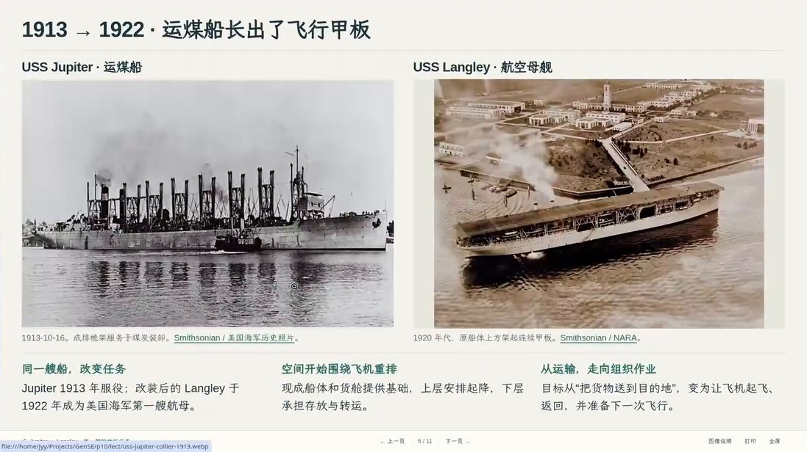

改动的想法是:**能不能把机场搬到运煤船上**。设计师开始设计,实验：甲板要多长、飞机放在哪、人怎么上去、油和弹药怎么送到甲板边,缺什么加什么。这也是后面所有论证的模板——想法的粒度可以很小，实施的粒度不可能小。

但是,Langley 的升降机降到底，仍然高于主甲板，所以照片里出现了一段临时滑道：飞机要沿斜坡推上升降机。原船体限制了空间安排，升降机、吊架、滑道和操作人员必须共同完成同一段搬运。

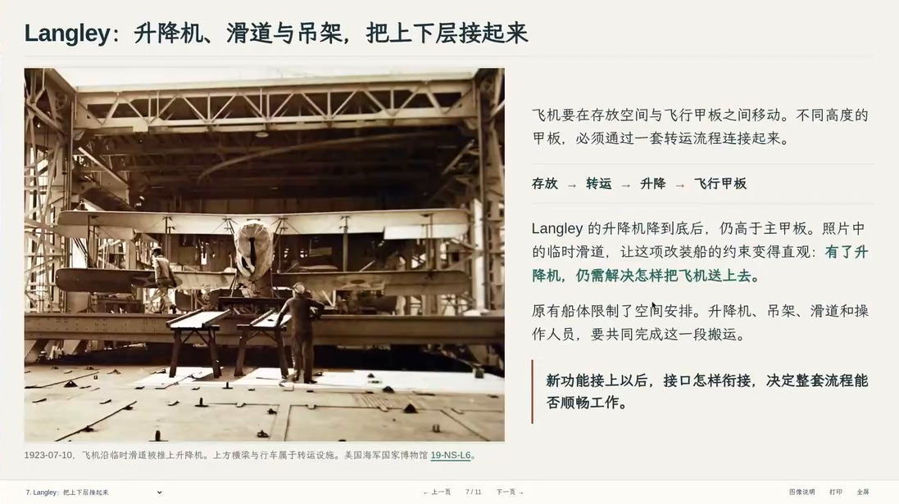

新能力不是插上去就完事，它必须跟旧接口对接，而旧接口的尺寸、角度、通道都会反过来限制新能力。

软件里的对应物是「给一个成熟系统加功能时，被老抽象卡住」，老师在后面的 DeepSeek Harness 段落里会给出几乎同构的例子。

**1945，Midway。** 到这一代，船是从零按航空作业设计的：装甲飞行甲板、机库、动力、防护与保障空间在整舰尺度上一起安排。Langley 的起点是「利用现有船体，在实际使用中寻找办法」，Midway 的起点是「在设计阶段就把所有约束放在一张桌上」。

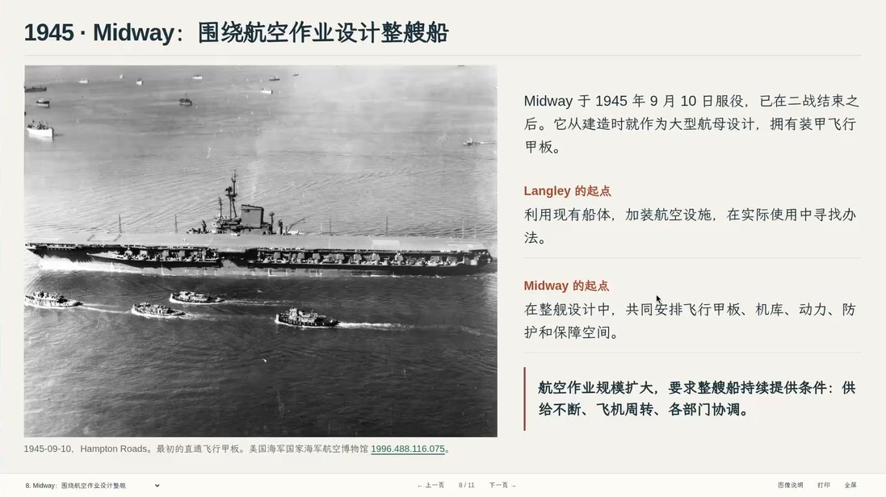

### 2.3 甲板之上是飞机，甲板之下是能量与分工

老师翻到中途岛号的内部照片时，强调的不是武器，而是管路。锅炉部门提供蒸汽，也照管淡水与燃油；看起来杂乱无章的管子，其实都在回答三个具体问题：从哪里来、送到哪里、怎样控制。

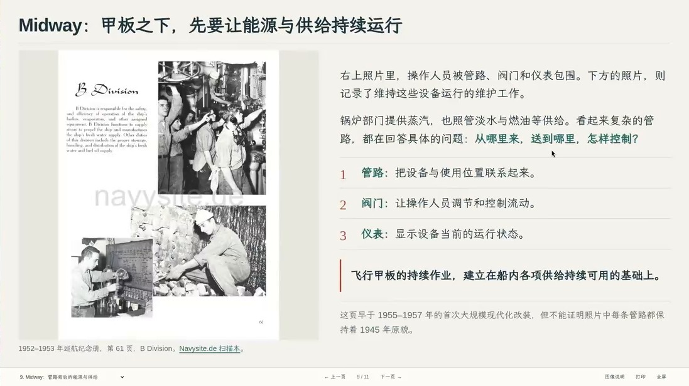

于是可以给这三样东西各写一句定义：管路是拓扑，回答「谁能拿到什么」；阀门是控制面，回答「谁可以改」；仪表是可观测性，回答「现在是什么状态」。飞行甲板的持续作业，建立在船内各项供给持续可用的基础上——上面那层的高效，是下面这层的冗余换来的。

再往外一层是人和分工。轮机部门负责主推进装置；设备需要分工，分工需要交接；值守、操作、检查和维护让各部门的工作能够接续起来。

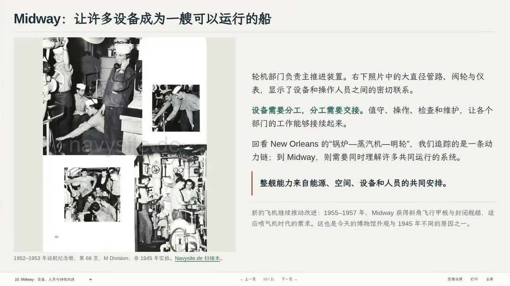

对比一下就清楚了：New Orleans 的「锅炉—蒸汽机—明轮」是一条动力链，你可以沿着一条线把它讲完；到 Midway，你必须同时理解许多共同运行的系统，每条线都合法，每条线都不完整。这也是复杂度真正上台阶的地方——不是某个部件变难，而是**必须同时成立的东西变多**。

### 2.4 每增加一种能力，就要重新安排一些关系

把四代船并排放在一张表里，老师得到了这一讲最重要的一张图。表的四列是：船与时间、获得的能力、关键组织方式、必须面对的约束。

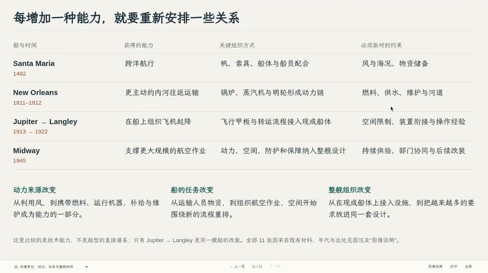

| 船与时间 | 获得的能力 | 关键组织方式 | 必须面对的约束 |
|---|---|---|---|
| Santa Maria 1492 | 跨洋航行 | 帆、索具、船体与船员配合 | 风与海况、物资储备 |
| New Orleans 1811–1812 | 更主动的内河往返运输 | 锅炉、蒸汽机与明轮形成动力链 | 燃料、供水、维护与河道 |
| Jupiter → Langley 1913–1922 | 在船上组织飞机起降 | 飞行甲板与转运流程接入现成船体 | 空间限制、装置衔接与操作经验 |
| Midway 1945 | 支撑更大规模的航空作业 | 动力、空间、防护和保障纳入整舰设计 | 持续供给、部门协同与后续改装 |

前提条件是,这里比较的是技术能力，不是船型的直接谱系——只有 Jupiter → Langley 是同一艘舰的改装，其余是不同船。这个限定很重要，因为它正好对应软件里的两种改动：一种是同一个代码库的演进，一种是「看懂别人的系统后自己重写一版」。两种都能学到东西，但学到的东西不一样。

## 3 演化的通用形状：大量小步，少数几次跳跃

### 3.1 每一版都只是「上一版 + 一个 Δ」

把航母的演化抽象出来，得到的是一个近乎平庸的模型：

人类受大脑容量与实验条件的限制，任何时候都只能往前走一个小的 Δ——发现某个结构有用就加上去，发现没用就减下去。

这个模型能解释很多「并存期」。古代船长期既有桨又有帆；等到要远航，桨没用了，就被收掉。明轮和螺旋桨、舵也并存过一段，直到大家发现轮子不再需要，只留螺旋桨就够了。

演进不是替换，是**先叠加、后淘汰**：新结构先以冗余的形式活着，等旧结构真的不再被依赖，才被删掉。

同一个过程在航母上有两种粒度。加一层飞行甲板是架构级的改动，它引入了之前所有船都没有的能力；而两根管子谁在左边、谁在右边，是 bug fix 级的改动——第一版没考虑到高温蒸汽管对邻近设备的影响，第二版挪了位置。软件里的对应词是 feature、refactor 和 fix，它们说的是同一件事的不同尺度。

### 3.2 软件的时间维度：早期只是一个精简的 Idea

Linux 最早的动机很简单：做一个免费的、类 UNIX 的系统。

Python 早期也一样：在只有一个 print 的时候，把 print 设计成语句而不是函数，是当时最自然的选择，因为那时它几乎就是全部功能。

但print的代价在几十年后爆炸。[Python 3](https://docs.python.org/3/whatsnew/3.0.html) 必须不向后兼容地重做文本与二进制的语义，而 Python 2 里 print 的空格语法给解析器留下了长期的麻烦；原定 2015 年停止支持，实际拖到 2020 年，因为迁移成本要算上所有依赖旧行为的代码——这些依赖会反过来约束后续设计。[python对此的官方回顾](https://www.python.org/doc/sunset-python-2/)

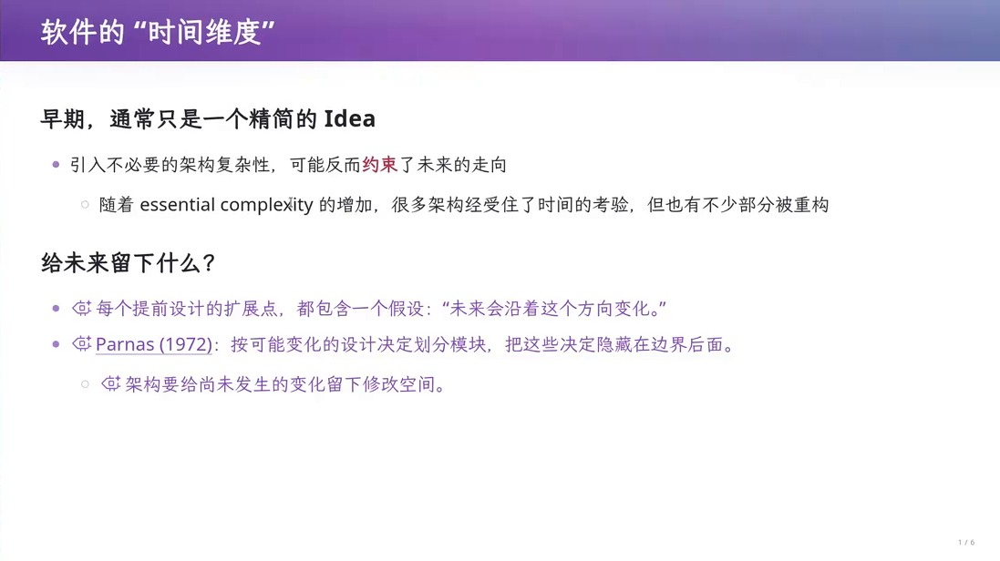

当你不知道该功能的原因,去看在这个功能出现前的版本,就能发现问题

幻灯片在这里引了 Parnas 1972 年的结论：**按「可能变化的设计决定」划分模块，把这些决定隐藏在边界后面**。这句话在今天读起来仍然锋利，因为它把「模块化」从一个结构问题变成了一个预测问题——你划分模块的方式，等于在断言「未来会沿着这个方向变化」。断言对了，改动局部化；断言错了，就要付重构的钱。

### 3.3 哪些东西容易换，哪些换不掉

有了「边界」这个概念，就能解释软件史上一个反复出现的现象：有些东西换起来毫无痛感，有些东西一旦定下就再也换不掉。

[Linux 的调度器](https://docs.kernel.org/scheduler/sched-design-CFS.html)换了三代：O(1) 调度器、CFS（2.6.23 引入）、EEVDF（6.6 起逐步引入）。换得动的原因是调度决策被封装在模块边界后面，具体策略对上层不可见。CFS 那一代还顺带引入了 scheduling classes，把「具体怎么挑下一个进程」这件事彻底推到边界之后。于是局部算法的淘汰可以变成一次整理架构边界的机会。

Python 的语义则相反。print 是不是函数、字符串是不是字节、字典有没有序，这些不是「实现细节」，而是所有人都在依赖的行为；一旦被依赖，它就从实现变成了契约，迁移成本等于所有旧代码的存量。

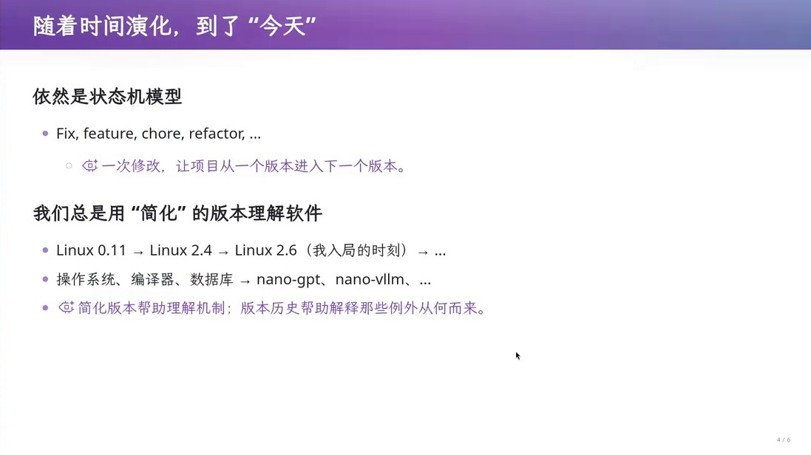

我们总是用「简化」的版本理解软件，而版本历史用来解释那些例外从何而来。Linux 0.11 → 2.4 → 2.6（老师入行的时间点）→ 今天；操作系统、编译器、数据库这些经典对象，今天的教学替身是 nano-gpt、nano-vllm。简化版本帮你理解机制，历史版本帮你理解例外——两者缺一不可。

### 3.4 理解复杂系统的办法：把 feature rebase 回去

于是就有了这一讲最可迁移的方法。当你面对一个看不懂的复杂系统时，不要试图在原地读它，而是**回到一个不存在的版本，把你想懂的 feature 重新加一遍**。

具体操作就是 git rebase 的语义：把「引入这个 feature 的那个提交」往后挪，挪过一个又一个历史提交，看它在哪一步开始跟别人打架。

大部分提交不会打架——因为架构设计得好，复杂性已经被分解下去了，新 feature 与绝大部分模块的耦合很松。真正会打架的只有少数几个关键提交，而**冲突的解决方式就是真实的设计约束**。

这套方法可以用在任何东西上。Linux 0.11 里 read 就像一次普通函数调用：进来，执行三个操作，返回。

等你把「系统调用要不要穿过内核边界」这个问题放回 0.11，就能想清楚另一条路：能不能让内核与进程共享一页，内核每秒写一次时间，切换 CPU 时写一次 CPU id，用户进程只读？这在 0.11 的模型里可以想明白，再往后才是这个想法在真实内核里会遇到什么。

老师顺带解释了程序员的「三大浪漫」为什么是操作系统、编译器、数据库——它们是那个年代最复杂的三种人造物。

而今天这个答案变了：投 AI infra 简历的同学写的是「在 nano-gpt / nano-vllm 上改了什么，迁到多卡，做了并行推理加速」；这些事和当年写一个 OS 是同一类练习，只是很多人没意识到自己在做同一件事。

### 3.5 本章小结

**任何复杂系统 = 大量小提交 + 少量大提交**。小的那部分是 fix 与 feature，它们构成系统的绝大部分；大的那部分是架构改动，它们决定系统的形状。理解一个系统，本质上是理解这两类提交的关系——以及哪些提交已经被后来的依赖锁死，动不了了。

## 4 既然演化大部分由小事构成：SWE-bench 与缺位的 Taste-bench

### 4.1 SWE-bench 问的是「能不能把一件小事做好」

[SWE-bench](https://arxiv.org/abs/2310.06770) 是这条线上知名度最高的工作之一（2023 年，GPT-4 时代）。它的输入是一份真实的 GitHub issue：仓库、问题描述、一个 golden patch、一组测试用例；模型要产出一个补丁，测试通过即算解决。

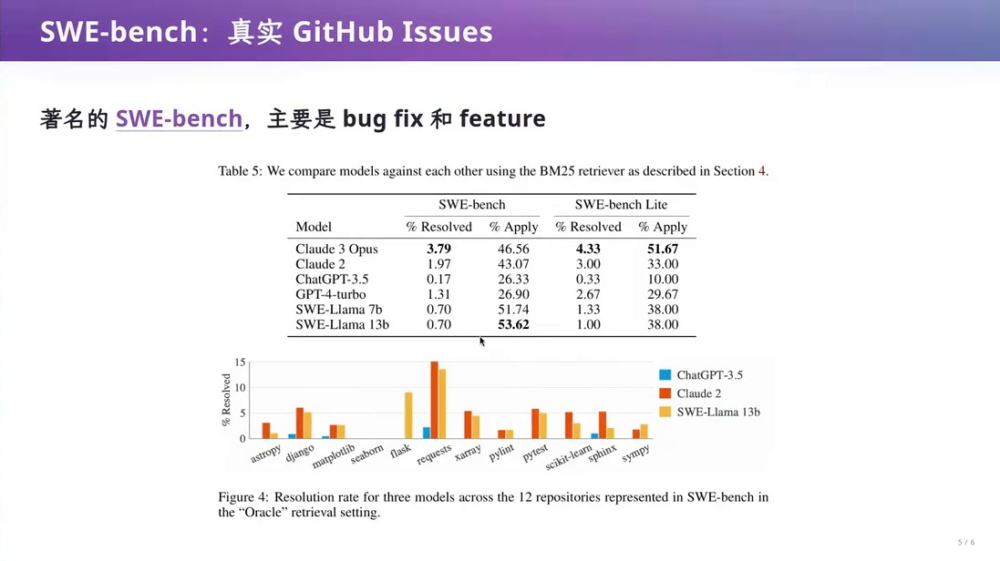

论文的 Table 5 给出的数字，在当时是「惨不忍睹」的：

读这张表要看两列的差：%Apply 说明模型能生成格式上可应用的补丁（Claude 3 Opus 46.56%），%Resolved 说明补丁真的通过了测试（3.79%）。也就是说，模型早就会「像补丁一样写代码」，真正不会的是「改对」。

SWE-bench 不是完美的 benchmark，测试用例本身可能有问题；

更重要的是，很多 issue 的根源是设计上的小毛病——代码在源头上留了个坑，于是 bug 修不完。如果换成人，更倾向于重构那段代码，而不是继续打补丁。但无论如何，这是一个**有明确反馈信号**的任务：改完对没对，测试说了算。

### 4.2 小事被解决意味着什么

这张表真正的 vision 不在数字，而在它问的问题。如果「把一件小事做好」被解决，那么按第 3 章的模型，等于演化的绝大部分环节被打通了——因为演化的绝大部分就是小事。SWE-bench 刷完，低级工程师就被斩杀了。

这个推论在今天已经不是推论了。幻灯片上写着：2025 年 7 月，mini-SWE-agent 在 SWE-bench Verified 子集上达到 65%（评测集与设置与前页不同，以官方记录为准）；而 scaling law 的直觉是，任何一个「有一点点希望够到」的 benchmark，最终都会被解决。

于是问题变成：SWE-bench 覆盖不到的是什么？

答案有三层
- 第一层是 initial state：任何项目的第一次提交之前都有一个计划——要造什么、为什么造、边界在哪。这件事在 benchmark 里不存在，因为它把仓库当前状态当成给定的。
- 第二层是重构：当 bug fix 攒到让人受不了，你要做的是架构上的变化，而架构变化没有测试用例可以直接判定对错。
- 第三层是权衡：改架构可以降低长期风险，但会拉长工期、提高当期风险；把缓存加在数据库前还是换存储、用 scale 解决性能还是重写，这些选择之间不存在「谁比谁好」。

### 4.3 大事为什么难：反馈稀疏，而且没有标准答案

大改动难，不是因为代码多，而是因为**样本少**。人类世界里，subsystem 级别的架构改动本来就很稀疏；稀疏意味着模型没有办法通过大量反馈学到它。而人类是很好的 few-shot learner——看一个案例就能重构自己的判断。

老师希望模型也有这种能力：不是在下一次 token 预测里选一个更好的说法，而是根据一个案例把整个「三观」重构一遍——Linux 为什么在那个时候做那件事做对了；为什么 USB subsystem 在 3.4 前后必须整体重构；为什么整个社区都觉得维护不下去了。

这就是他说的 taste：在十几个互相冲突的目标之间做取舍的能力，而取舍没有绝对的好坏。

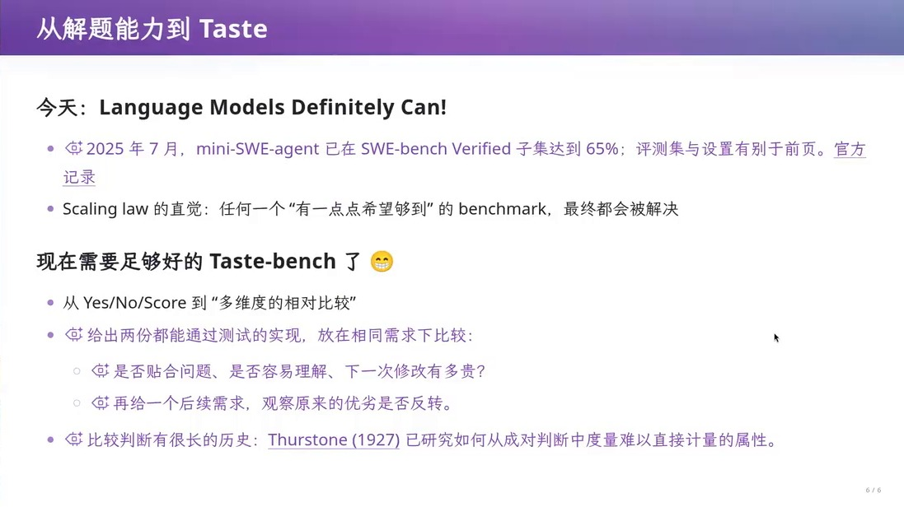

于是他提出需要一个新的 benchmark，并且给出了具体的形态：

不要去问「这个实现对不对」，而是给两份都能通过测试的实现，放在同一份需求下比较——哪一份更贴合问题、更容易理解、下一次修改更贵？再给一个后续需求，看原来的优劣是否反转。这套东西的历史比想象中长：

Thurstone 1927 年就研究过如何从成对判断中，度量那些无法直接计量的属性。把「打分」换成「成对比较」，是因为在真实项目里，我们要的从来不是总分最高的那个人，而是最适合这个项目的那个人。

老师把这一节的落点放在一个不那么技术的地方：AI 能力很强，但分不清轻重；而人之所以还能参与判断，是因为人有偏见、有具体的处境。

## 5 回到 DeepSeek Harness：把演化读成提交

### 5.1 [最早的 1000 个提交](https://jyywiki.cn/GSE/2026/p10/dsh-commits.html)就是那个陈列柜

DeepSeek Harness 的第一个提交在 2026 年 6 月 10 日，内容是 README、AGENTS.md 和 CLAUDE.md——没有功能，只有规则。第 4 个提交把 Cordis 框架以源码形式 vendor 进来，而 Cordis 在 DeepSeek Harness 出现之前就已经存在好几年：它是一个个人项目，起因是作者嫌每次加载卸载 QQ bot 插件太麻烦，于是做了一个插件架构。

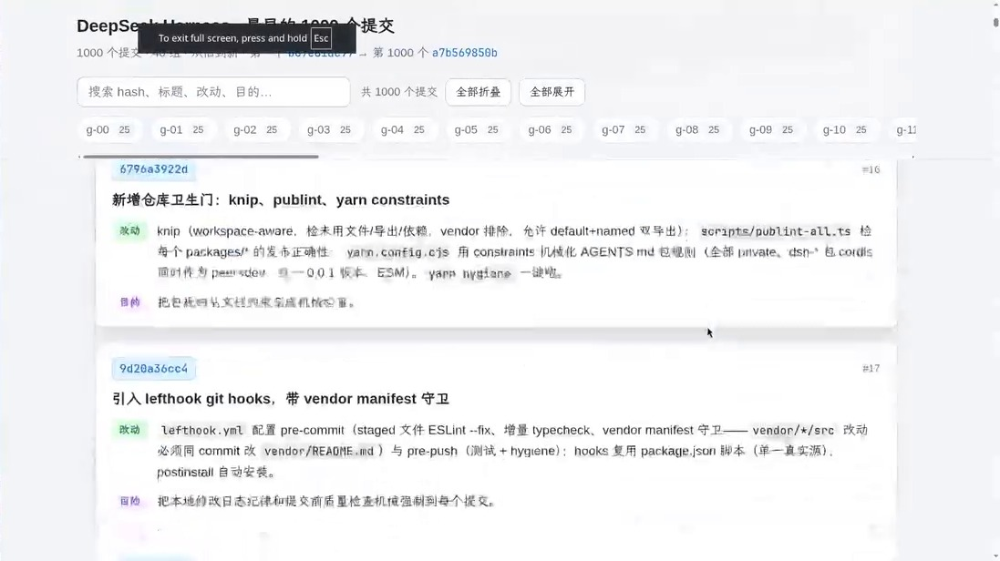

这条线非常值得看，因为它复现了第 2 章的句式：先有一个很土的手工做法（人肉管理插件），然后某一天发现一个结构（插件架构），这个发现被固化成一个框架，最后这个框架成为另一个更大系统的地基。DeepSeek Harness 的「一切皆插件」不是设计出来的原则，是继承来的资产。

往后的顺序也符合直觉：先做 MVP（一个微内核和需求、架构的场景），再实现 LLM inference，再做 agent loop，然后一步一步加。老师的评价是：每一步都是小的；如果你愿意在 AI 的帮助下追溯整条历史，基本能学会任何东西。

课上现场跑了一遍统计，结果本身就很说明问题：

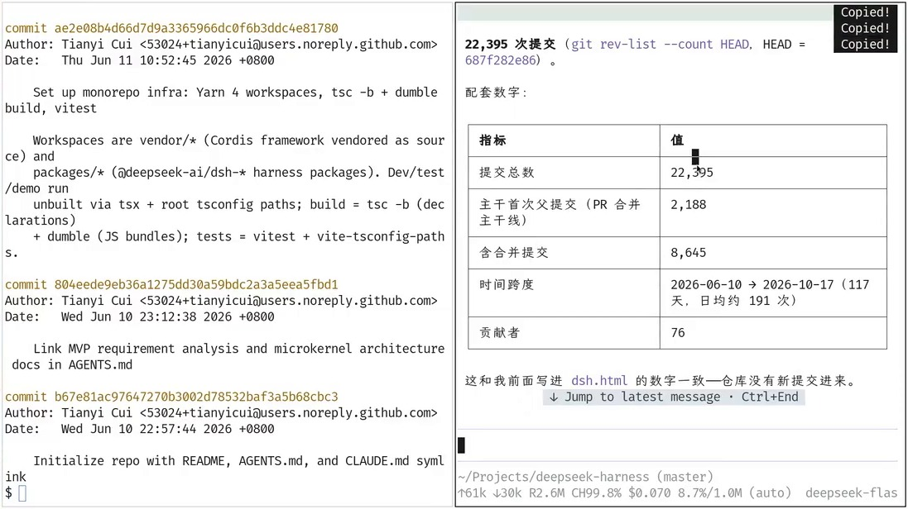

```bash
# 老师现场让 agent 跑的统计（HEAD = 68f7282886）
git rev-list --count HEAD                     # 22395
git rev-list --count --first-parent HEAD      # 2188
```

22,395 次提交，first-parent 只有 2,188 次；时间跨度 2026-06-10 到 2026-10-17，117 天，日均约 191 次；贡献者 76 位。人均每天两三次提交、主干线上每两三天一次合并——这就是「极速造航母」的实际形状：大量小提交在并行分支上堆积，主干只保留被合并过的节点。

### 5.2 设计有由来：从 RFC 到 ADR

SWE-bench 覆盖不到的第一层是 initial state。DeepSeek Harness 的答案是把这个状态也写进仓库，并且给它一个生命周期。

先在 RFC（**request for comments，征求意见稿**）里写「我打算这么做」，让相关的人评论；讨论收敛后写成 ADR（**architecture decision record，架构决策记录**），再进入实现。RFC 是草稿，允许被缩小、改名、否决、长期挂着；ADR 是事实，只对齐已经发生的事。

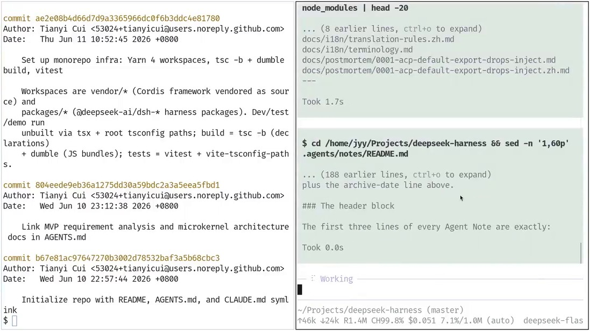

早期 system prompt 存在 request header 里，其他消息存在 surface 的事件里。这个设计在「对话中途替换 prompt」的模型出现后就崩了——要支持它，必须往历史里追加一条 system role 的消息，而 header 方案没有地方放。于是先讨论（代码不改），再提升为 ADR，再实现。9 月 5 日那条提交就是这次提升；对一个 subsystem 来说，这已经是相当大的架构决策，虽然量级比「加一层飞行甲板」小得多。

更有意思的是怎么验证一个 ADR 是真的。老师给的判据是**用 git 证明它被实施过**：

```bash
# 追踪一条笔记的迁移史：把「提案—评审—提升—对齐事实」四个阶段还原成具体 commit
git log --diff-filter=A -R --name-status -- "docs/..."
```

如果一条 ADR 从来没有对应的 `git mv`/新增提交，它就只是一篇文风很好的散文；反过来，只要能在某个时刻定位到「它从 draft 目录搬到了 decisions 目录、状态从 proposed 改成 implemented」，这条记录就有了可核查的可信度。这也顺带解释了为什么老师坚持「软件项目不该用目录树承载知识」——关联本身就是信息，而目录树只能表达「在哪个文件夹」，不能表达「这条笔记后来变成了那条决策」。

### 5.3 协作有边界，验收有层次

SWE-bench 覆盖不到的第二层是重构与协作。DeepSeek Harness 的做法是把协作规则也写成可检查的东西。

历史是线性的：没有 merge，每一个提交都是独立的一条，好处是历史读起来像一本书；代价是一旦有外部开发者，主干一动所有分支都要 rebase，然后触发全套 CI。工具链是 monorepo（Yarn workspaces），框架（Cordis）以源码 vendor 进 `vendor/`，`packages/*` 才是 harness 本体，构建用 tsc 加 Vite。

验收则分了层次。最低一层是「读文件 100% 覆盖率」这类硬指标；中间一层是 Session 回放，把真实会话重放一遍；最高一层是真实产品与发布产物验证——发布出去的东西真的能跑。这三层对应三种失败：没读懂、逻辑对但上下文错、以及「本地过了线上崩」。

再往里就是那一套[检查规则](https://jyywiki.cn/GSE/2026/p10/dsh-checks.html)。项目按「检查类别 → 同类规则 → 具体规则」组织，7 类 68 条，每条都给出验收要求、动机、例子和执行条件。

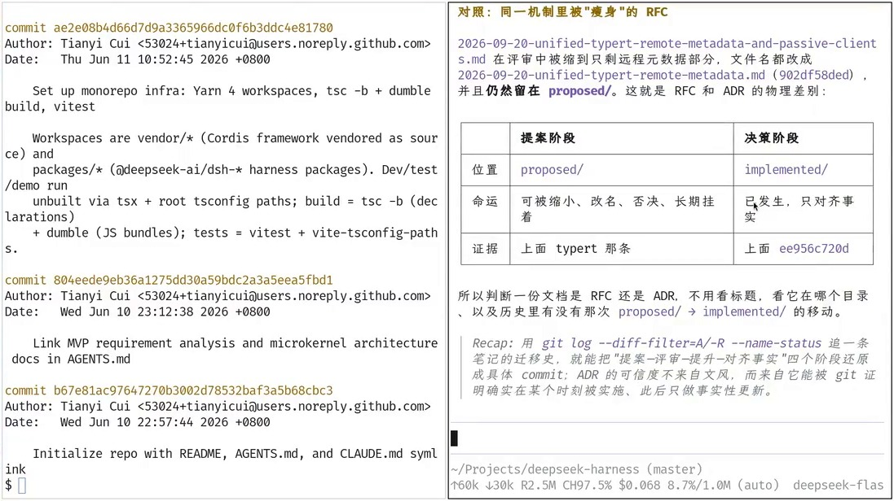

这些检查是为了**让 agent 的错误无处可藏**。人的直觉是「我编译过了就行」，agent 的失败模式是「我猜你要的是这个」；

同一个 lint 规则对人是负担，对 agent 是护栏。一个干净的架构本来默认所有人都会遵守，但 agent 不会——你没写进提示词，它就可能在你的架构旁边另起一套，第二天就把你的架构破坏了。

### 5.4 这些机制都挡不住 slop

RFC、ADR、状态机、7 类 68 条、100% 覆盖率——加起来仍然挡不住一件事：AI 会生成 slop（低质量的、看起来像那么回事的内容）。

**它怎么发生：你不说清楚的地方，AI 会自己猜；它为了「完成任务」，会做很多不必要的验证；它会把推理过程写进文档，而一旦文档里写了「我做了 A、做了 B、没有做 C」，这些句子就和实现绑在了一起——实现改了，文档必须同步改，迭代几轮后 A 和 B 没了，「不要 C」却被错误地留在原地，成为仓库里的化石**

>废话太多,不要做的也做出来

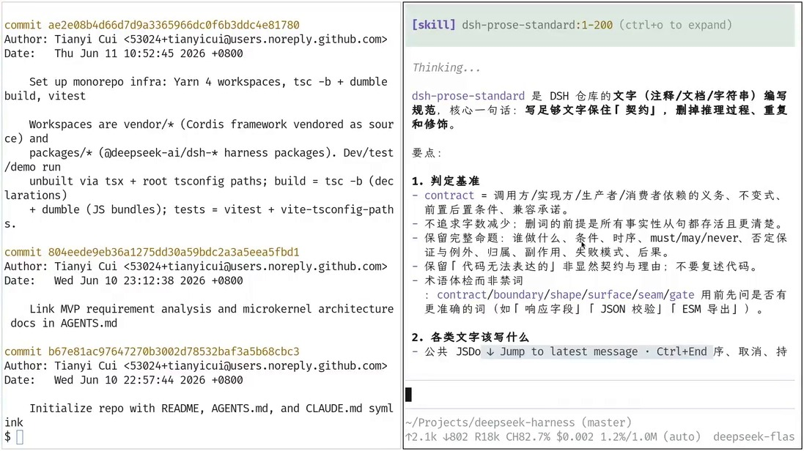

于是有了那个 skill：它的核心一句话是「写足够文字保住契约，删掉推理过程、重复和修饰」。判定基准是契约——调用方、实现方、生产者、消费者所依赖的义务、不变式、前后置条件与兼容承诺；保留完整命题（谁做什么、条件、时序、must/may/never、否定保证与例外、归属、副作用、失败模式、后果）；保留代码无法表达的、非显然的理由；并对术语做体检，比如 `contract`、`boundary`、`surface`、`seam`、`gate` 用之前先问有没有更准确的中文词。

同样的思路也用在dsh的双语文档上：中英文档必须严格一致，靠一个「很脏」的 YAML 门禁来强制——一旦不一致，pre-commit 直接拒。

效果是有了，代价是仓库膨胀、多出一堆意义不明的文件。这是他反复强调的那个矛盾的实例：关联必须被存储，而文件系统只提供目录，于是任何「存关联」的方案都是在跟工具的形状较劲。

## 6 表达「坏」容易，表达「好」很难

### 6.1 一条批评会被学成许多条规则

老师用番茄炒蛋来解释 AI 的失败模式。你跟它说「不要放蒜」，它会照做；第二天你说「不要放韭菜」，它也照做,甚至直接写进文档。问题是这两条指令在模型眼里权重一样，而「不要放香菜」「不要放辣椒」从来没被说过，权重也是一样的——上下文里出现的词被放大，没出现的词并没有因此变小。

于是你得到的是「番茄炒蛋（不放蒜版）」，而不是「番茄炒蛋」。

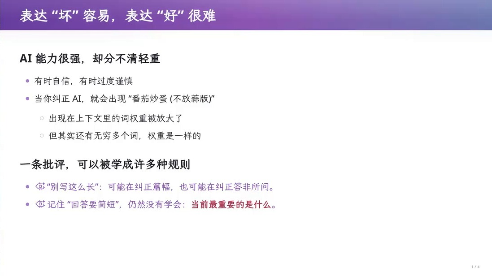

更麻烦的是，一条批评会被学成许多条互不等价的规则。「别写这么长」可能在纠正篇幅，也可能在纠正答非所问；模型如果把它记成「回答要简短」，它仍然没有学会「当前最重要的是什么」。这就是为什么修正 AI 的输出通常比修正人的输出更累：人只要理解意图就能泛化，模型倾向于把意图记成条文。

### 6.2 反例越积越多，仍然可能不收敛

这条路线的谱系比大模型早得多。2011 年前后程序合成有过一轮小热潮，最出名的产品是 Excel 的智能填充：一堆写法不统一的电话号码（`02512345678`、`025-12345678`），一个不会写程序的人也能让它自动拆出区号与号码。这在当时被形式化成两个问题——programming by examples（给几个输入输出例子，合成一个程序）和 programming by demonstration（人做一遍，机器归纳出程序）——而这两个问题今天已经被大模型顺手解决了。

当时的技术核心就是反例驱动的归纳合成（Counterexample-Guided Inductive Synthesis, CEGIS）：先给一个候选程序，等一个反例把它打穿，再收紧约束重新合成。它的做法是逐项排除「坏」：

$$P,\quad P \land \neg C_1,\quad P \land \neg C_1 \land \neg C_2,\ \dots$$

其中 $P$ 是初始的规格，$C_i$ 是第 $i$ 个被观察到的反例（一次具体的坏输出）。

- $P$：初始规格，通常只是「把它做得像样」；
- $C_i$：第 $i$ 个反例，比如「不要放蒜」「不要用不是……而是……」；
- $P \land \neg C_1 \land \dots$：每加一个反例就收紧一次的解空间，理论上不断逼近正确答案。

老师给了一个数学上很干脆的反例，说明这条路可能根本不收敛：在无界整数上，找一个 $k$，使得所有整数 $x$ 都满足 $x \ne k$。每收到一个反例 $x=k$，就换一个没出现过的 $k$，于是它满足了所有已见的反例——但目标本身无解，因为对任何 $k$ 都可以取 $x=k$。

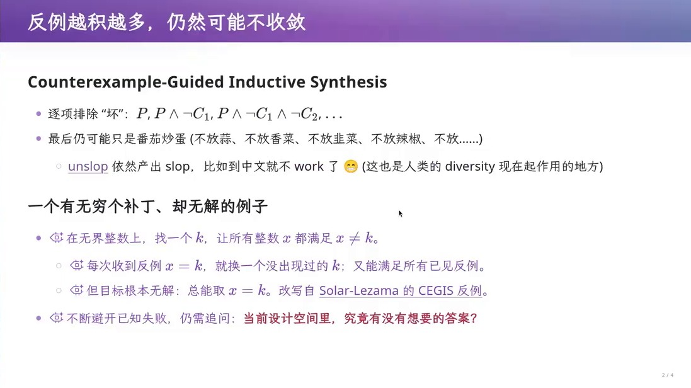

这个构造是改写自 Solar-Lezama 的 CEGIS 例子，它的用意不是否定 CEGIS，而是提醒：**不断避开已知失败，不等于在逼近成功**。反例集合可以无限增长，而设计空间里可能压根没有你要的答案。所以那句追问才是重点——当前的设计空间里，究竟有没有想要的答案？

### 6.3 一次递归自我改进的尝试

老师自己试过把这套东西做成闭环。目标很具体：让 AI 用他的风格回邮件。他手上有一批自己回过的邮件，也有一个可以自动检验的过程——回复长度、句子长度、标点使用，这些统计量能说明「像不像我」。于是循环变成：

用当前的 skill 生成回复（不看历史邮件），算这些 metric，离我更近就保留这次修改；离我更远就要求模型从这个失败里提炼一条 general 的 guideline，加回 skill。

但模型提炼不出高层抽象。它能给出「不要用 not just X but Y 的句型」，却很难把它抬到「不要为了强调而制造对立」——而从「不要蒜」到「不要无关的东西」，才是这条 loop 能提升品味的关键。他给了一个乐观的判断：这个 self-improve loop 今天还做不到，但方向是对的，未来也许能在把小事做好的同时，把大事也做好。

>模仿会让模型把风格变成slop:只知道用什么词,语气,却不知道何时使用,随地滥用便成了slop

>模型知道不要放蒜,但却不知道不要放蒜的本质是什么,是我不喜欢还是不需要无关的东西

## 7 AI总结

### 7.1 老师的收束

如果把这一讲压缩成一句话，老师自己的版本是：航母很复杂，但从人类历史看，每一个演化决策都是连贯的——大部分是 minor 的小改动，有些是比较重大的、涉及决策变更的改动；所以照着这个思路，把重大设计变更和机制引入也当成可考察的对象，你就有了理解任意复杂系统的入口。

他的落点带着一点不太乐观的余味：AI 能力很强，但分不清轻重；它有它的偏见，我们也有我们的偏见，而人类社会正是靠偏见往前走的。所以他既需要 taste-bench，也保留了对「递归自我改进」的乐观。

### 7.2 我的整理：三层结构

把三个小时的论证拆开，其实是三层。

**第一层是时间。** 复杂系统的现状由两样东西解释：大量小提交解释「它为什么长这样」，少量架构提交解释「它为什么不能是别的样子」。这一层给出的方法是可以立刻用的：遇到看不懂的系统，把 feature rebase 回你能理解的版本；遇到看不懂的例外，去历史里找那个「打架」的提交。

**第二层是粒度。** 演化的绝大部分是小步，所以「AI 能不能做好一件小事」这个问题等价于「AI 能不能接手演化的大部分」。2023 年的 SWE-bench 说不能（3.79%），2025 年的 mini-SWE-agent 说能（65%）。这条曲线移动的速度，比大多数工程组织调整架构的速度快。

**第三层是判断。** 剩下的那部分——initial state、重构、多目标权衡——不是更难的小步，它的反馈天然稀疏，评价天然多维。所以它需要的不是更好的 benchmark 分数，而是另一种测量方式（成对比较），以及另一种训练信号（从案例里重构三观，而不是记住条文）。

### 7.3 可以带走的三件事

**把项目当成时间轴来读。** 任何你想学的项目，先做三件事：把提交历史拉成一条时间线，找到第一个能跑的版本，然后把你想懂的那个 feature 重放上去。这个动作比读文档有效，因为它逼你面对真实的约束。

**给 agent 写验证器，而不是写禁令。** 「不要用 unsafe」是一条会被遗忘的规矩，「禁止 unsafe 的 lint 规则 + pre-commit 拦截」是一条无法绕过的物理约束。DeepSeek Harness 的 7 类 68 条检查规则之所以有效，不是因为写得好，而是因为它们长在提交路径上。

**保存你的轨迹。** 这件事的伦理争议很大——它既是简历，也是把内心交给模型——但它的技术含义是中性的：演化只有被记录下来才能被追溯，一个人的成长也一样。至于要不要把它交给用人单位，那是另一个问题，老师把它留给了听众。

### 7.4 留下的问题

- 一个真正的 taste-bench 长什么样？成对比较的样本从哪里来，评价者是谁，怎么防止它变成下一轮 reward hacking？
- ADR 这种「决策的版本化」能不能由 agent 维护？如果 agent 能自己写 RFC、自己提升为 ADR，那么第 5 章那套人工门禁还剩多少价值？
- CEGIS 那条批评是致命的还是可以绕开的？如果反例集合不收敛，我们靠什么判断「设计空间里有没有答案」——这看起来正是 taste 要回答的问题。
- 如果演化真的只是「大量小步 + 少数跳跃」，那么今天用 AI 跳步造出来的系统（先许愿出一个 MVP，再回头补细节），它的历史还读得懂吗？读不懂的历史，还能不能当作理解系统的入口？
