## 1 回顾

航母的建造是通过演化：船体、动力、甲板调度、损管，都是在一代代型号上叠出来的，每一个改动都建立在上一版「已经能跑」的基础上，踩过的坑被记录、被绕开、变成下一条设计约束。

从 GitHub 上拉一个操作系统内核、一个编译器，或者一个大厂的应用服务器，看到的都是五六十万行代码：README 好像能看懂，进去之后却不知道从哪下手。某种程度上，**今天所有能在工业级使用的软件都是航母**，它们是随着演化不断加入新需求而变成现在这个形态的。

于是有了那张幻灯片上的演化模型：最开始时只是一个能在水上漂的独木舟，这就是整个 Repository 的状态；人开始不断地 commit，加 feature，船就一点点变大。有意思的是，历史里推动演化的不只是一个人：造船的人会做推导，会多个人协作，甚至会形成专门的组织——这跟今天 Agent 做 long-horizon task 的样子很像。

这也解释了许愿编程「好用，但总觉得差一点」的根源。你只说一句「我要一个能起降最先进战斗机的航母」，AI 并不知道你真正的意图是什么；它理论上知道航母该长什么样，但它没有经历过从独木舟到航母的每一次思考。直接上手造，就会忘掉演化历史里的那些坑。**所以许愿编程的产物大概率不符合你的预期。问题不在模型够不够强：intent、specification、implementation 之间的 gap 一直存在。**


## 2 从某个「能理解」的历史时刻开始 rebase

许愿编程的后果:人类不再掌控软件，只了解它展现的一些表象。

理解一个已经演化得很复杂的系统，可行的办法是从某个自己还能理解的历史时刻开始，沿着后续变化重建认识。

从这个提交开始 rebase。想知道某个 feature 是怎么工作的，就先找到引入它的那次提交，然后一路 rebase 回软件最简单的时候；在那个「独木舟」版本上追问「让它起降飞机合理吗」，答案往往是不合理，直到某一天船足够大了，这件事才突然成为合理需求，甲板的改造也才有了具体的形状。

以前软件生产慢，一个提交只做一小件事，于是每个提交都可审计、可追踪、可以 git blame 到人；这些在小步提交上积累起来的可理解性，正好是 rebase 得动的前提。现在 Agent 一次改动一两万行，两三百个提交就造出一艘航母，人连「它到底是什么」都说不清楚，之前那套靠小步演进建立起来的可理解性就不存在了。


Bainbridge 在 1983 年讨论工业自动化时指出一个反讽：日常操作交给机器之后，人并没有因此轻松，因为人仍然要在异常时刻接管；而正因为日常操作都交给了机器，人的练手机会减少了，接管所需的本领反而更高。

AI 说「我构造了一个高质量、设计优雅的软件」，可高在哪里、还能不能扩展？只要你不真的把新需求交给它做，你其实没有办法评估。你能确认的只有「测试通过了、基本功能正常、它看起来像那么一艘航母」；至于让它起降一架飞机，你只能赌。

## 3 任何程序员都有幻觉

在讲错误怎么发生之前，先承认一件事：写错是人类常态。Shell 命令会敲错，变量名会看错，从上一段复制过来的代码会漏改一个字母。幻灯片上放了一个专门收这类错误的小工具——[`nvbn/thefuck`](https://github.com/nvbn/thefuck)，一条敲错的命令它替你纠正

代码里的手滑更隐蔽。下面这段循环，几乎每个写过双重循环的人都觉得眼熟：

```c
for (int i = 0; i < n; i++)
    for (int j = 0; j < n; i++) {
        // 对每一对 (i, j) 做点事情
    }
```

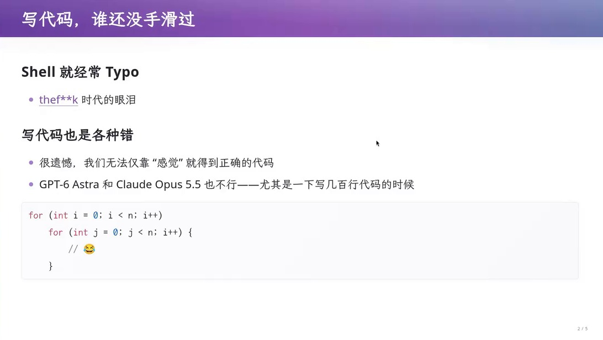

**人的眼睛很容易把实际写出的代码自动补全成自己以为写出的代码**，你读它的时候在脑内修正了它，所以通读三遍也发现不了。

模型并没有豁免。「很遗憾，我们无法仅靠『感觉』就得到正确的代码」，并且点名 GPT-6 Astra 和 Claude Opus 5.5 也不行,尤其是一下写几百行代码的时候。这句判断有数据支撑：幻灯片把 SWE-bench 的 Table 5 放了上来，Claude 3 Opus 在 SWE-bench 上的解决率是 3.79%（Lite 版 4.33%），SWE-Llama 13b 是 0.70%。

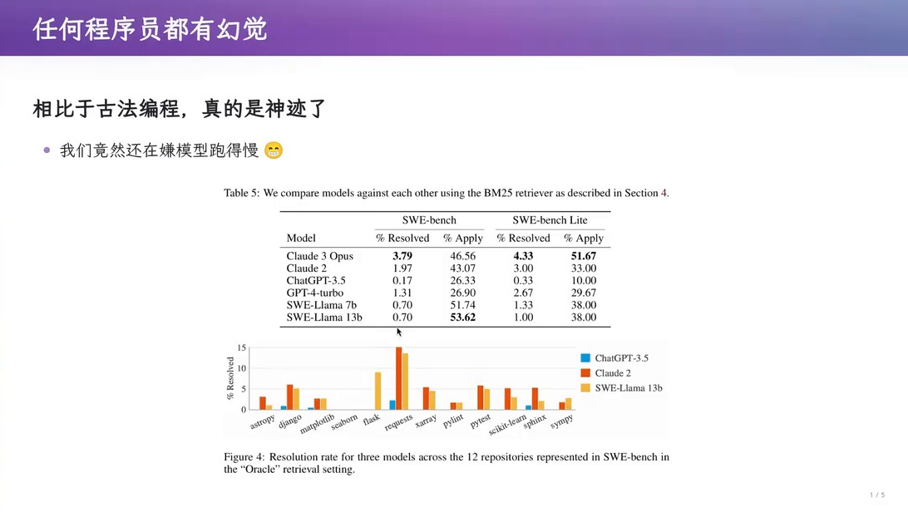

## 4 Fault、Error、Failure：三个不能互换的词

要讨论错误怎样出现，得先把三个常被混用的词分开。

- **Fault**：程序中存在的缺陷，也就是通常说的 bug，比如把 `j++` 写成 `i++`。
- **Error**：程序执行时进入了违反规格的状态，比如循环变量没有按要求更新。
- **Failure**：在选定的观察边界上能够看到的异常，比如程序卡住、崩溃，或者输出错误结果。

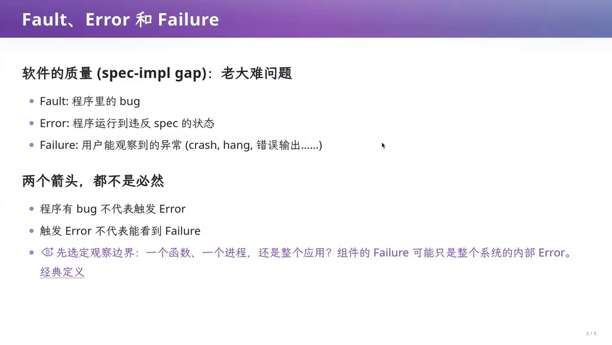

它们不是三个同义词，也不是一条必然发生的链。程序里有 fault，不代表这次运行一定出现 error；出现了 error，也不代表用户立刻就能看到 failure。

这条链之所以难，是因为 **error 是 silent 的**。CPU 是一台无情的执行指令的机器：`load` 就 `load`，`store` 就 `store`，它不会跳出来说「你这个状态已经违反规格了」。状态错了以后程序继续往后跑，只有当你看到某个本应在 0.0001 秒结束的东西跑了几秒钟还没结束时，你才隐约觉得不对。那一刻你观察到的才是 failure，而它离最初那条写错的语句可能已经很远。

**bug 是程序的实现与 specification 的不一致。** 

麻烦在于 specification 常常不存在，或者存在但没写清楚。课上举的例子很短：用无符号整数存余额，从 0 块扣 100 块，结果变成一个极大的数——于是你有了花不完的钱。这就是一次实现与规格的不一致，而且它在纸面上看起来完全正常。

如果 `n = 0`，循环体根本不会执行，错误代码就静静躺在那里——这是有 fault 而没有 error。再设想一个购物车：添加商品时，程序错误地把缓存中的总价算成了两倍。如果结账前总价会从商品清单重新计算，内部确实出现过违反规格的状态，最终账单却可能是对的；如果界面直接显示那个缓存值，错误就暴露给了用户。**有没有 failure，既取决于后续执行，也取决于你在观察什么。**

课上把这个过程讲成一个「发现失败」的现场：一个本应在 0.0001 秒内结束的程序跑了几秒钟还没结束，你才意识到不对——但这个「不对」依赖你心里本来有一个预期，而人并不能为每一行代码都建立预期。同理，即使 fault 被触发、程序真的写坏了内存，如果那段内存本次执行里本来没人用，整个程序的输出看起来也完全正常。

所以链条上的每一环都可能断掉：**有 bug 不代表触发 error，触发了 error 也不代表你能看到 failure。**

顺带说一句，这条链的存在也值得对程序员多一点同情：**写代码的人写的是 fault，而写的时候他往往已经尽了最大努力。** 他不知道自己写错了，就像你在数 1 到 300 时一定会数错——和用心与否无关：人的短时记忆和注意力本来就会漏。幻灯片上那句自我调侃很准确：人也有 self-attention，写内层循环时眼睛往上一瞟，`j++` 就跟着变成了 `i++`。

## 5 备份也复制了 Bug

把这三个词放到真实事故里会更清楚。1996 年，Ariane 501 首飞失败，原因是一次看起来无害的类型转换

- **Fault**：起飞后仍运行已无用途的对准代码，其中浮点数转 16 位整数的操作缺少越界保护。
- **Error**：新的飞行轨迹使数值越界，异常触发惯导停机；诊断数据又被当成飞行数据。
- **Failure**：错误的控制指令使火箭急剧偏转，随后解体。

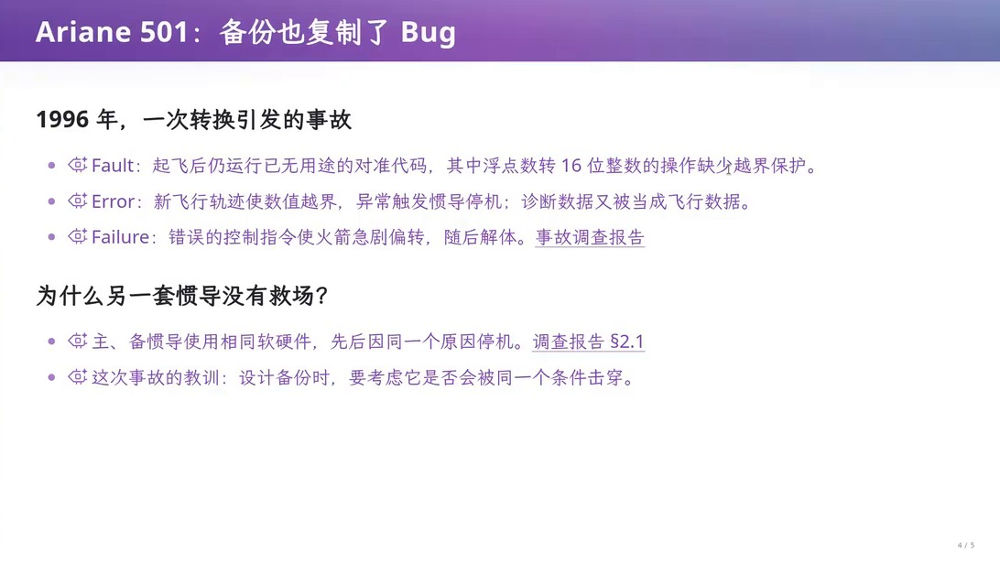

虽然做了备份以防计算不稳定,但为什么备份没有救场？调查报告 §2.1 的答案是，主、备惯导使用相同的软硬件，于是先后因同一个原因停机。**设计备份时，要考虑它会不会被同一个条件击穿。** 这条教训今天在 Agent 身上也成立：让两个模型互相检查，如果它们的训练数据、提示词和对规格的理解都相同，它们会一起对，也会一起错。

## 6 质量保障的基本方法：先降低出错机会，再让错误尽早可见

面对 bug，工程上有两种完全不同性格的手段。

第一种是不让它产生：更好的架构、不容易伤人的编程语言、防御性编程。

**架构和设计永远是决定软件质量的第一因素**，而不是你写了多少测试用例。火箭上的软件已经是全世界最尽力的一批工程师做的，bug 依然没被消灭。

Java 是最好的例子。它之所以那么快地取代 C++ 成为主流的面向对象语言，是因为它消灭了所有 pointer-based undefined behavior。

指针一时爽：可以把任意整数 cast 成指针，可以存函数指针，可以用函数指针实现面向对象——这个能力同时也是一个永远开着的犯错入口。真正难的是它背后的规格：每一次 `malloc` 必须有一个配对的 `free`，而且 `free` 之后这块内存永远不能再被解引用。听起来简单，但一个函数可能有不同的入口、不同的分支、不同的返回点，甚至还有 `setjmp`/`longjmp` 跳回去，**执行路径有无穷多条，而规格要求在每一条上都恰好配对**。

use-after-free 之所以严重，是因为这块内存会被别人复用：

如果浏览器里有这个漏洞，一个关键数据结构或用户页面可能被分配到你还握着指针的那块内存上，你只要读它就能读到密钥。所以真正的问题在于**该不该把这种信任交给一个连 Shell 命令都会打错的人类**，而不在于某个程序员会不会忘。

Java 的取舍很清楚：牺牲一点性能，换来所有行为都是 defined behavior；它无法阻止空指针（Tony Hoare 自己说这是「billion dollar mistake」），但空指针至少是 defined behavior，而不是「编译器想怎样都行」。同样的思路在 Safe Rust 上更进一步：它几乎消灭了所有的内存安全问题，代价是把这部分检查提前到编译期。

这类进步是真实的，但它有一个前提：**假设 bug 仍然不能被消除。**

于是有了第二条路

- **Fault → Error：测试。** 通过遍历 spec 空间，找到能真正触发缺陷的输入。
- **Error → Failure：断言。** 在错误状态刚出现时就检查 spec，把它立刻变成可观察的失败。

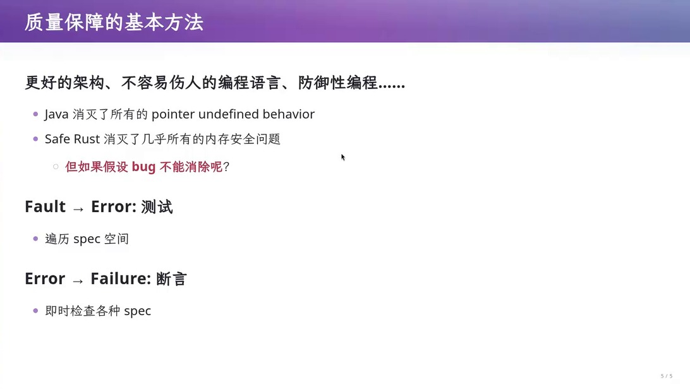

断言这条箭头常被低估。在更新购物车之后检查「缓存总价等于各项金额之和」，就不必等到错误账单出现才发现问题；而一旦这个检查失败，你拿到的是错误发生的位置，不是错误扩散之后的一堆症状。主动暴露 failure，是为了**及时定位错误、避免错误状态继续扩散**，不是为了让程序更容易崩。

## 7 测试：「在我机器上能跑」到底说明了什么

测试看起来是最便宜的质量保障手段,但运行一个程序需要的条件，比命令行参数多得多。

首先是环境。你的环境不是别人的环境：Windows、macOS 和 Linux 不同，硬件、操作系统、编译器、库版本、解释器、应用程序都可能不同。一份源码在开发者电脑上能跑、搬到另一台电脑启动失败，并不稀奇。

一个 `int32` 在内存里到底是从低位放到高位还是反过来，大小端两种机器都曾经很常见。如果你用 `& 0xFF` 这种位运算去取低位，就默默假设了小端；换一台大端机器，程序就不工作了。同理，写网络编程的人一定要做 host-to-network 的字节序转换，因为你根本无法知道对面那颗 CPU 是哪一种。

语言层面能解决一部分：JavaScript 基本不管你是 Windows、macOS 还是 Linux，一个在 Mac 上写的 three.js 游戏搬到 Linux 上也能跑。

但它没有解决全部，因为你有大量第三方库，而**每一个库的每一个版本行为都可能略微不同**。

比如Python 的 `lxml`：它在某次升级里改变了处理某些 Unicode 字符（比如 emoji）的行为，于是一个只是 `import lxml` 的程序，什么都没改，就突然 crash 了。这也是环境的一部分。

锁文件就是用来拦住其中一类变化的。以 npm 为例，`package.json` 描述项目的依赖要求，`package-lock.json` 记录实际解析出的依赖树，包括直接和间接依赖的具体版本、下载来源与完整性校验值。把锁文件随代码一起提交，可以减少「同一份源码在不同时间装出不同依赖」的情况。但要注意边界：**锁住依赖树不等于锁住整个运行环境**，操作系统与 Node.js 版本仍需另行考虑。

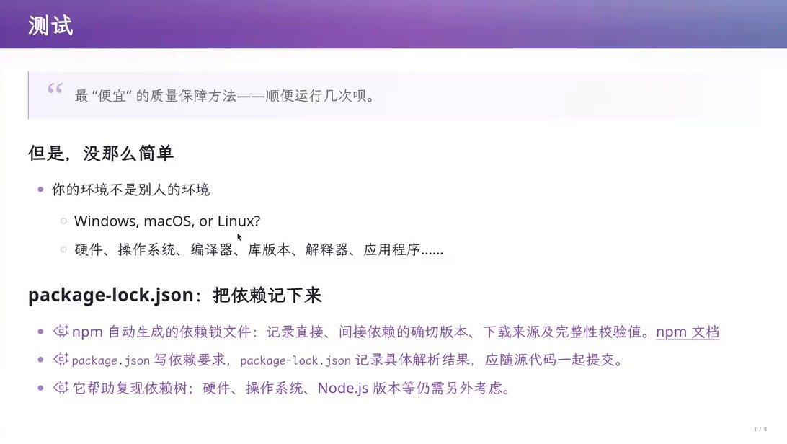

即使环境相同，你的运行也不是别人的运行：文件内容、系统负载、`gettimeofday()` 返回的时间、网络延迟与中断，都会改变执行结果。

我们写程序时总以为「执行下去就会往前推进」，但操作系统除了实时系统并不保证你下一条指令什么时候被执行。程序跑得慢一点，超时就可能触发；队列处理得慢一点，队列就满了、开始丢东西；内存分配得慢一点，后面的行为也跟着变。

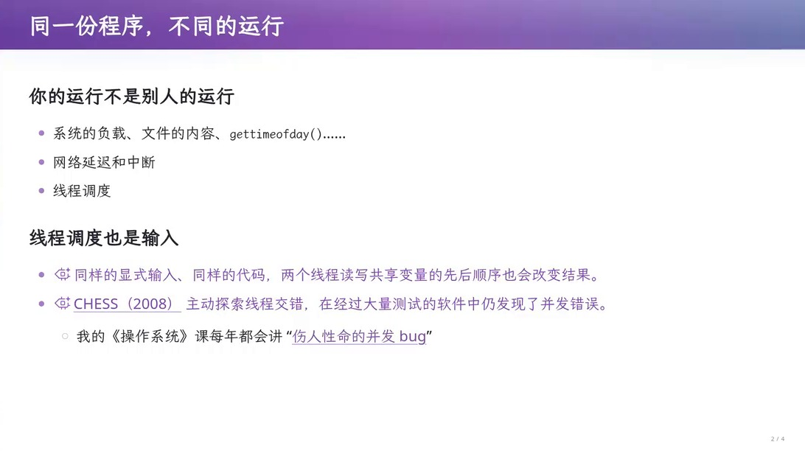

**时间、网络响应和线程调度也是程序的输入。** 测试要探索的空间，远远不止函数参数的取值范围。

CHESS（2008）的工作——主动探索线程交错，在经过大量测试的软件中仍然发现了并发错误。这也解释了为什么「在我机器上能跑」几乎不构成证据：它只说明在某一次具体的交错、某一台具体的机器、某一个具体的负载下，程序没有出事。

## 8 程序的正确性：一个 spec 的问题

在任何环境、任何输入下都符合 specification。它包含两类要求：
- 功能性要求，例如结果符合设计、合法操作不会导致崩溃；
- 非功能性要求，例如性能和安全性。登录功能能成功一次，与高负载下仍能及时响应、用户无法越权访问，是完全不同的要求。

Dijkstra 在 1972 年的 The Humble Programmer 里那句判断至今仍在被引用：

> Testing shows the presence, not the absence of bugs.

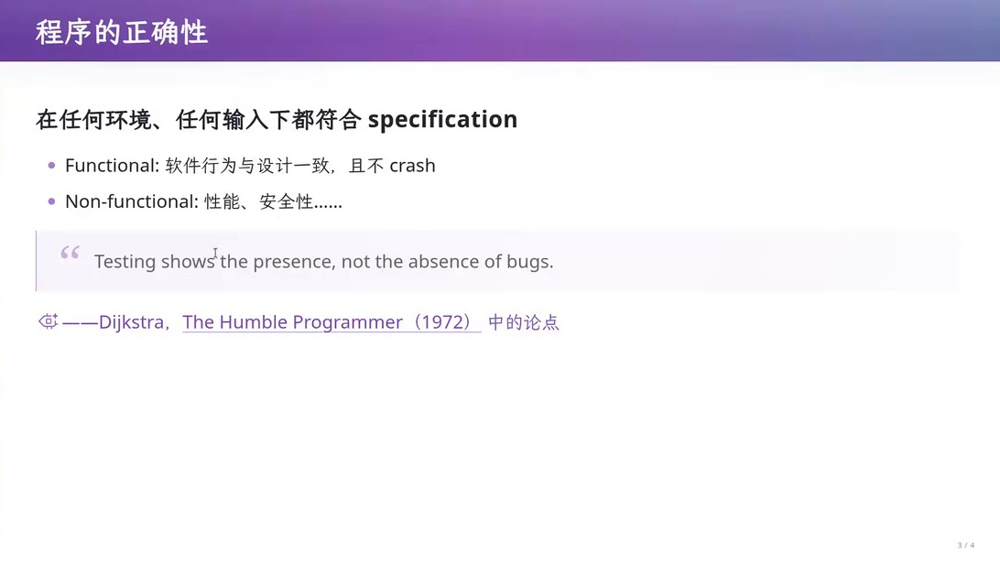

线程调度尤其隐蔽：两个线程同时执行「读取计数器、加一、写回」，如果都先读到 0，最后可能只得到 1。这种交错在单线程测试里重复一万次也覆盖不到。[伤人性命的并发bug,Therac-25事故]( https://www.bilibili.com/video/BV1E1NL6xErQ/?share_source=copy_web&vd_source=fb57864f29130309145dc81e9eab0012)
老师在操作系统课上每年都拿这个当「伤人性命的并发 bug」的例子：操作员打得快的时候，输入与机器状态之间会出现一个不一致的瞬间，错误的模式被接受下来，剂量被放大到致命。**整条路径上，没有一条检查在问「我现在真的处于我以为的那个模式吗」。** 这正是断言那条箭头要解决的问题。

## 9 但测试仍然极为有效

承认「测试不能证明无 bug」之后，很容易滑向另一个极端：既然测不完，那测试还有什么用？但是测试它仍然极为有效。

理由是关于错误实现的概率。程序是严格的数学过程，一个错误的程序在典型输入上「蒙对」的概率很低。

如果一个所谓的排序函数原样返回输入，遇到已经排好序的数组时会蒙混过关；而对 `n` 个不同元素的均匀随机排列，它碰巧正确的概率只有 $1/n!$。取 $n = 10$，这个概率已经小于三百万分之一。

但这个针对的是这种具体的错误实现，不能推广成「所有 bug 都很难通过随机测试」。它真正说明的是另一件事：**选择有区分力的输入，比增加测试数量更重要。**

写程序不是为了通过测试用例，而是带着需求说明书写的，所以它天生就该能泛化；

一个正常的实现不会只对「n 等于 1」成立。于是每一个典型场景通过，都在告诉你「与它相关、能泛化的那些情况大概也对」，而如果实现真的错了，它更可能是错在平时注意不到的边角（性能、并发、跨机器）。反过来说，靠 if 把期末考试的用例一个个打勾通过的代码，恰好是反例：它没有泛化能力，只有 overfit。

测试真正值钱的地方还有一半在失败的那一侧。一个失败的用例不只告诉你「有 bug」，它给出了很窄的条件：哪里炸的、什么输入炸的、哪一行栈顶。已知有 fault、又看到这个 failure，你对 fault 在哪里的判断会好得多，大量位置被直接排除。

剩下的靠 trace 二分：程序可以看成一个状态机，一旦某个状态变错了，后面就一直带着错，于是你可以二分找出第一条「从对的状态跳到错的状态」的语句——那条语句就是和 bug 相关的地方。回到那个 `i++` 的例子：代码把 `i` 从 0 变成了 1，而我们想要的是把 `j` 从 0 变成 1，所以错的就是这条改了 `i` 的语句。

对 Agent 来说，这些证据还有第二种用途。[SWE-agent 那篇论文（arXiv 2405.15793）](https://arxiv.org/abs/2405.15793)把「运行结果」做成了 Agent-Computer Interface（ACI）的一部分：让模型能够浏览仓库、编辑文件、执行测试和其他程序。这样一来，质量改进依赖于一个闭环——写代码、运行、观察结果、再修改——而不只是一次生成的自信程度。

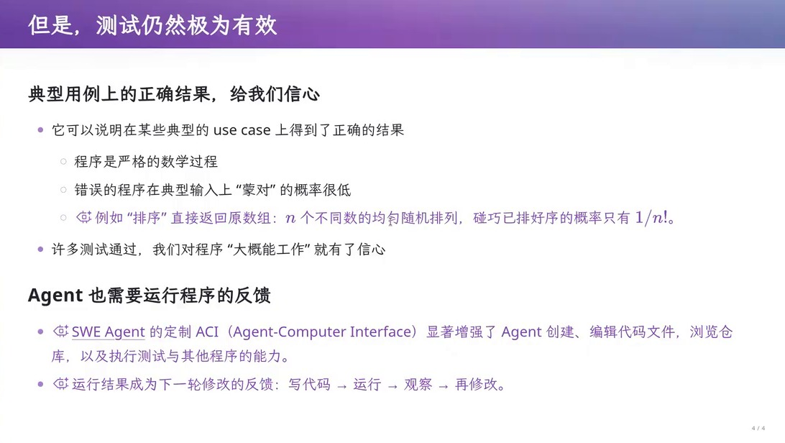

如果 Agent 只能生成、不能观察，那么再多的测试理论在它面前都是空转。

## 10 测试的层次：局部、连接、整体、需求

软件工程里，测试首先按观察范围分层。拿一个选课系统举例，四层分别在回答不同的问题。

**单元测试**检查一个函数或模块,若系统测试检查小模块功能,成本会浪费。比如输入学生已修课程和某门课的先修要求，判断函数是否给出正确结果。它应该尽量小、快，并且容易把错误定位到局部。

**集成测试**检查模块连接起来以后是否协作正确。先修检查返回的字段，选课服务是否理解？数据库记录的课程编号，与接口传来的编号是否一致？两个模块单独工作正常，不代表接起来一定正常。接口不只是数据能传过去，还包括双方对数据含义、单位、错误情况的理解。

**系统测试**面对完整系统，在目标环境中走完流程。学生登录、查询课程、选课、刷新页面，再确认结果仍然存在。真实的服务、存储、身份验证和界面共同参与，才能发现只在整合之后出现的问题。

**验收测试**进一步追问：这些行为满足用户需求和约定的验收标准吗？技术上「提交成功」，不代表业务上「选课成功」。如果课程已满时系统仍允许超额选课，或者选课结果没有对学生清楚呈现，系统就可能违背了用户真正关心的规则。

四个层次放在一起，差别其实非常具体：

| 层次 | 观察范围 | 回答的问题 | 失败时的代价 |
|---|---|---|---|
| 单元测试 | 一个函数或模块 | 这段逻辑本身对不对 | 秒级，直接定位到函数 |
| 集成测试 | 两个以上模块的接缝 | 接口、协议和数据对得上吗 | 分钟级，能定位到接口 |
| 系统测试 | 完整系统与目标环境 | 真实流程走得通吗 | 分钟到小时，要人看现象 |
| 验收测试 | 用户需求与验收标准 | 这真的是业务上要的结果吗 | 最贵，且难以判定失败原因 |

这四层是互补的，不是可以互相替代的四档严格程度。局部测试便于定位问题，整体测试验证连接和真实流程，验收把检查接回需求。**把所有检查都塞进完整界面流程，通常既慢，又难以解释一次失败到底发生在哪里。**

## 11 测什么，以及怎样知道测对了

挑选测试输入有两种基本视角：黑盒测试从规格出发，不依赖实现内部结构；白盒测试从代码出发，检查哪些逻辑实际被执行过。

**黑盒测试**可以先做**等价类划分**：把预计由同一种规则处理的输入分成一组，从每组挑代表。比如一个最多接受 100 个元素的接口，空数组、允许范围内的非空数组、超过上限的数组，就对应不同的处理规则。再做**边界值分析**，重点检查 0、1、99、100、101 这些容易出现差一错误的位置。规则涉及多个条件时，用**决策表**：选课里「是否有余量」和「是否满足先修要求」有四种组合，逐一写清应该接受还是拒绝，就不容易只测最顺利的那条路。

| 有余量 | 满足先修 | 期望结果 |
|---|---|---|
| 是 | 是 | 接受 |
| 是 | 否 | 拒绝，并说明缺少哪门先修课 |
| 否 | 是 | 拒绝，并说明已满 |
| 否 | 否 | 拒绝，且不能把两种原因说反 |

表格里最后一行常被漏掉：它既「满」又「不满足先修」，两套拒绝理由哪一套优先，是规格必须回答的问题；如果实现里先判断余量，用户就会看到错误的解释。

行为依赖历史时，用**状态转换**：未选可以变成已选，已选可以退回未选，那么重复选课、重复退课、退课后重新选课，各自应该怎样处理？

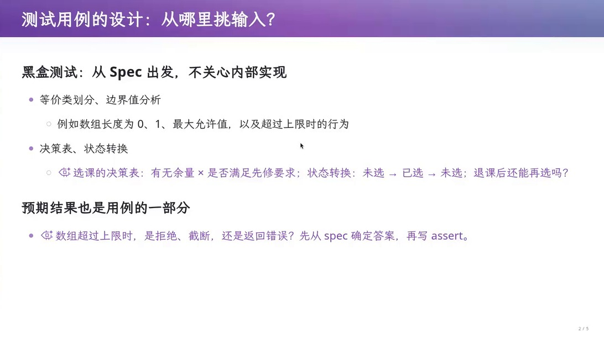

**预期结果也是用例的一部分。** 数组超过上限时，是拒绝、截断，还是返回某种错误？这是规格问题。若测试作者也不知道答案，那么运行程序只是观察现象，还没有完成验证。

**白盒测试**关注语句覆盖、分支覆盖和路径覆盖。执行过一行代码，叫覆盖了这条语句；一个条件的不同分支是否走过，是另一层问题；多次判断组合出的执行路径，又是更大的空间，循环和并发很快会让路径数量大到无法穷尽。

**机器永远是对的**，以及**未测代码永远是错的**。

第一次听到会觉得这是玩笑，但它的意思是：程序是严格按指令执行的，你看到的现象一定有原因；而一段从没被执行过的代码，你对它没有任何证据，只能认为它是错的。

覆盖率高不等于正确。假如加法函数被误写成了减法：

```python
def add(a, b):
    return a - b
```

调用 `add(1, 2)` 就覆盖了函数中的计算语句，但只有继续检查 `assert add(1, 2) == 3`，才抓住了错误。更糟的情况是用例只检查 `add(1, 0) == 1`：它甚至会通过，于是一个始终算错的函数就这样被「验证」了。覆盖告诉我们代码有没有被执行，断言告诉我们被观察到的结果是否符合要求，输入的选择则决定错误有没有机会暴露——三者缺一，用例就是残缺的。

所以每个完整用例都包含三个动作：准备环境和输入，执行操作，检查结果。

缺最后一步，就会出现 Agent 跑了一大堆命令、得到一大串日志、却没有真正核对核心行为的情况。


## 12 把测试变成日常工程

单次测试的价值有限，测试的组织方式决定了它能提供多少信心。

**测试金字塔**是一种常见的分工：
- 大量快速的单元测试，适量集成测试，少量端到端测试。越靠近局部，越容易控制条件、定位失败；
- 越靠近完整系统，涉及的真实因素越多，代价也越高。它强调的是分工，不是要求所有项目遵守一个固定比例。

对难以控制的依赖，可以用 stub 或 mock(虚拟环境测试) 做替身。

例如给智慧教室做软件，需要从摄像头收数据包，可你不会为了跑一次系统测试就去架一台摄像头。这时正确的做法是 mock 出一个假设备，让它稳定地往你这里送图像——Android 的 AVD 就是这么做的，没有真机也能开发需要摄像头的应用。

但要知道：替身正确模拟了什么、遗漏了什么，责任在开发者；最终仍然要用真实依赖检查集成,只通过虚拟测试是无法交付的

修复 bug 时，要把触发它的场景留下来，变成**回归测试**。最有说服力的检查，是确认同一个用例在修复前失败、修复后通过——否则一个从来抓不住原始错误的「回归测试」，只是在增加测试数量。

**持续集成（CI）**把这些检查变成每次修改后自动发生的事情。

反馈越早，越容易把失败与刚刚引入的改动联系起来。测试本身也需要维护：用例要尽量独立，环境和数据可重复，失败信息能帮助定位。如果每次失败都要先猜「是不是测试自己又抽风了」，测试提供的信心就会不断被削弱。

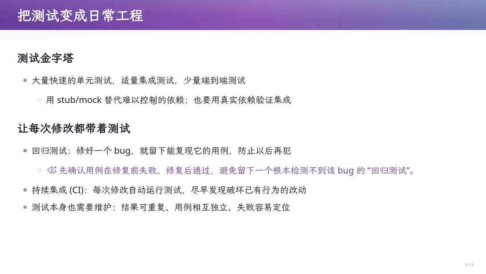

但是,当你把这些方法原封不动地搬到真实软件系统上，会立刻遇到麻烦。

## 13 许愿一个 CS:GO：long-horizon task 暴露了什么

在真实系统上，生成式编程已经能做出让人意外的东西。老师让deepseek-flash：仿照 Apple Watch 的一个小界面，跑在一颗 ESP32 上，里面有节拍器、to-do list，还有一个可以聊天的 AI；写完之后拿去 Mac 和 Linux 上跑，体验上没什么区别。

另一个例子是一个 CS:GO 风格的 FPS。prompt 只有一句话：「Vite + three.js 的第一人称射击复刻，全程由截图与模拟驱动迭代」，没有 skill、没有额外素材；结果是 232 次工具调用、12 个源文件、6321 行代码、0 个外部素材。

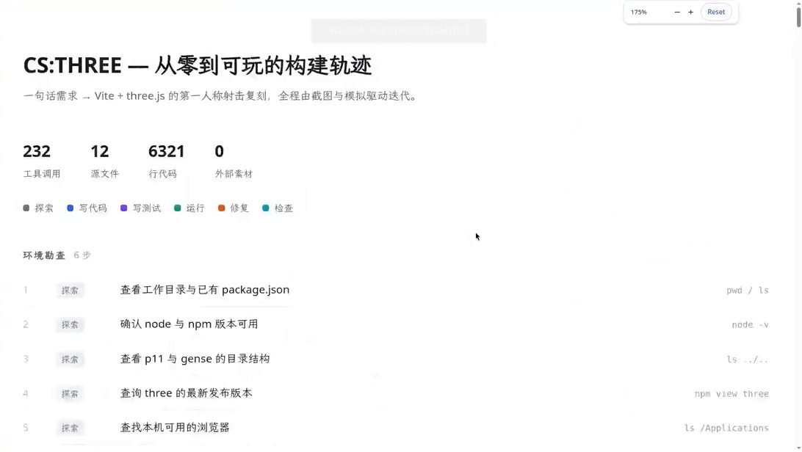

这就是所谓的 **long-horizon task**：需要很多步骤、跨越较长执行过程的任务——生成代码、启动程序、操作界面、截图检查，再根据观察继续修改。

agent 在轨迹里真的没偷懒：它写玩法脚本跑 12 秒看 AI 交火，写多机位截图，写测试检查再写测试检查；截图越积越多，直到每个 response 到 50 兆，服务端直接返回 413了

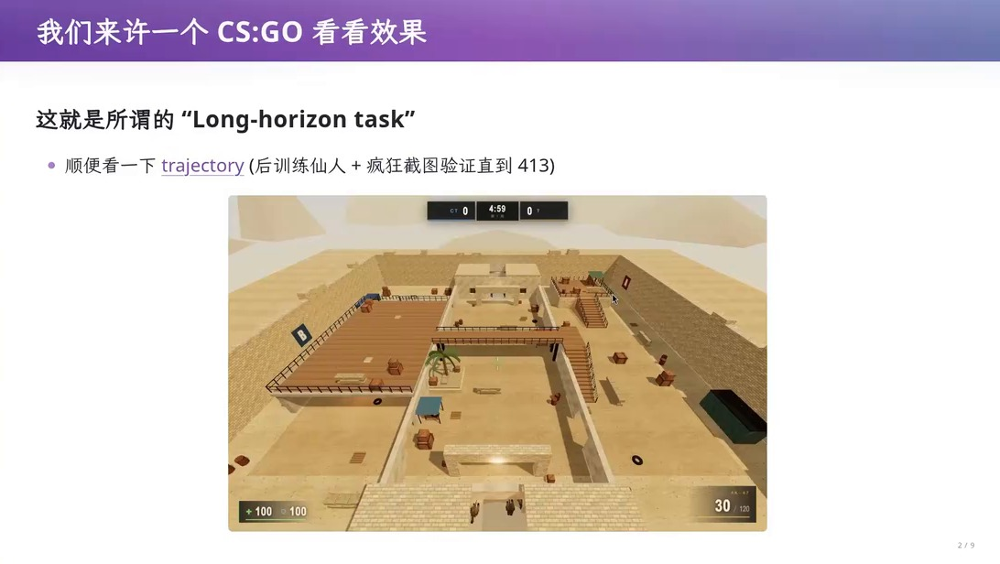

轨迹里还有一件更微妙的事：前五六十轮它已经搭出了一个能玩的东西，之后的大部分轮次都在「检查 → 写测试 → 检查 → 写测试」地转圈。

看起来它做了非常详尽的测试，可当进入游戏时,就能明显发现一些bug：漂浮的旗子、可以直接穿过去的栏杆、看起来浮空的人物、切枪动画不对。

一张截图可以判断场景有没有显示、角色是否出现在预期位置，却很难充分验证射击规则、弹药消耗、碰撞判定、计时和胜负条件。反复从整个游戏界面出发，意味着每次检查都要同时依赖渲染、输入处理、游戏逻辑三条链路——任何一条出问题，画面都会「看起来不对」，而你无法从这张图判断是哪一条。

**这就是全系统整合测试的代价：它同时观察一切，也因此什么都定位不了。**

## 14 软件系统越大，越难做全系统的整合测试

**架构决定了质量。**

这句话的分量在于两个方向。架构决定哪些错误容易发生；架构也决定错误发生以后，能不能被便宜而准确地检查出来。所有模块都应该尽量具备明确的接口，能够脱离系统其他部分单独测试。

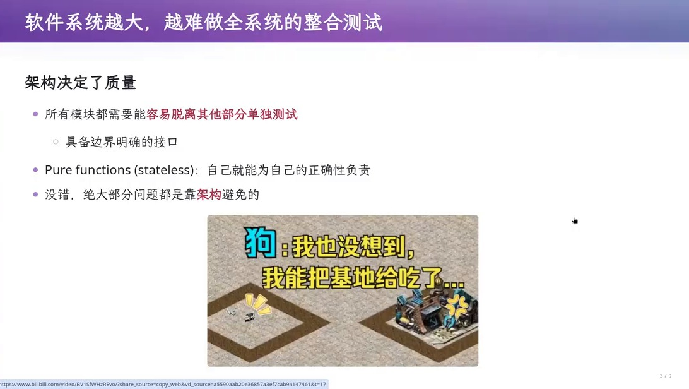

课上先用一个更古老的例子说明「引擎假设」有多脆。那个[红警 bug](https://www.bilibili.com/video/BV1SfWHzREvo/?share_source=copy_web&vd_source=fb57864f29130309145dc81e9eab0012) 里，一条狗会卡在基地正中间的那个格子上；而那个格子恰好是基地收起来以后会出现的位置，于是收基地的时候，基地被狗吃掉了。

它看起来像一个渲染错误，实际是引擎里的问题：地面有固定的一层、用 2D 模拟 3D、每个单位有一个高度。**设计时它就没打算对任意可能的游戏进程都成立，所以一旦碰到设计边界，整个东西就崩了。**

CS:THREE 的病例看起来是「画面不对」实际上是架构问题：

「穿过栅栏」在截图里表现为一个瞬时的位置异常，而在实现里根本没有对应的地方可以查——栏杆从来没有被登记成碰撞体。如果游戏逻辑被写成状态转换（输入旧状态和一个动作，输出新状态），那么「开枪后少一发子弹」「弹匣为空不能继续射击」「目标生命值为零以后不能再受伤」都可以直接检查状态，不需要启动渲染器、移动鼠标再观察画面。

所谓 pure function（纯函数），就是结果只由显式输入决定，不偷偷依赖、也不修改外部状态。同样输入得到同样输出，使局部推理和复现都容易得多。它不要求程序没有状态，而是把状态作为数据明确传入、返回，让状态变化有一个可检查的边界。架构不对,设计不对,怎么改都会逐渐陷入万劫不复的深渊

反面例子:函数式编程中,如果出现了 `global.get()`，它就不再满足「给定 x 就有确定结果」了：它对**所有可能的全局状态**都要正确，而且还要考虑两次 `global.get()` 之间会不会被别人改掉。对一个 CS:GO 来说，这意味着你测试这个函数之前得先把整个全局状态构造或 mock 出来——成本就是这样长出来的。

老师在这里顺便解释了为什么他喜欢 Rust。这和那些很恶心的变量生存期无关。而是是那个编译器会逼你重新思考「什么状态应该放全局」：

你一旦习惯性地写纯函数、写把对象 handoff 出去再拿回来的风格，代码就自然变得容易测试，甚至更容易证明。当然functional design 不是万能的,一旦写到高阶函数，返回一个函数甚至一个 lambda，它的规格就和别的函数产生了关联，「对谁负责」这件事会变得模糊。

## 15 让依赖可控制，让接口有保证

架构之外还有一层，「灵光一闪」。它列的都是同一件事的不同做法：**把不可控的依赖变成可传入、可推进、可重放的参数。**

- 游戏：把扣血、弹药和胜负判定写成状态转换，测试「开枪后少一发子弹」无需启动渲染器。
- 冷却与超时：把时钟作为依赖传入，测试直接推进时间；控制随机数序列，同一段战斗可以重放。
- 支付重试：同一笔操作沿用同一幂等键，由服务端识别重复请求，这是 Stripe 的设计思路。
- FoundationDB 把整个集群放进确定性模拟器，控制网络、磁盘和机器故障，使失败可以重放。

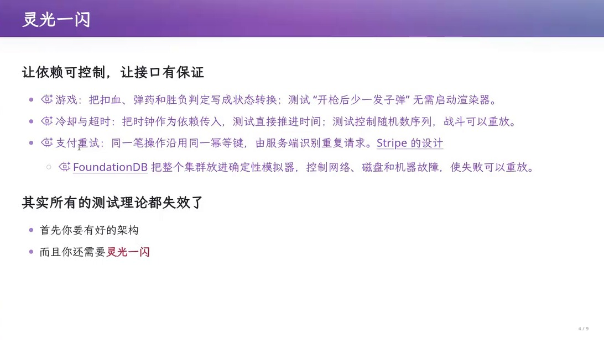

幻灯片的收尾很坦诚：「其实所有的测试理论都失效了。首先你要有好的架构，而且你还需要灵光一闪。」这句话并没有否定前面十几节：测试理论只负责「检查什么」，而「怎么让要检查的东西可检查」是设计问题，没有通用配方。

为什么这类能力很难被大模型直接学会。

deepseek堆史山的生产效率是「先高后崩」的曲线：一开始交付很快，随着需求增长越来越难维护,直到完全不可维护；

好架构的效率曲线相反，前期要搭脚手架、写验证和测试，看起来慢，但到很晚的时候会反超，并且有持续增长的潜力。

问题在于**反馈信号来得太晚**——只有等你真的把史山堆到崩了，才会理解好架构的好处。而强化学习拿的是「完成任务」的奖励，所以它自然会挑那条前期快的路。架构需要灵光一闪，也需要一点品位，而品位是现在的 Agent 还没完全学会的东西。

## 16 差分测试：让两个实现互相找茬

当被测试的对象是一个真实系统，「背完测试分类」仍然不足以知道下一步怎么做。

差分测试的想法很直接：让两份实现从对应的初始状态出发，处理相同的输入，再比较结果。对处理器，可以在每条指令执行后比较寄存器等体系结构状态，在首次出现分歧的位置停下来。原来的问题是「为什么游戏跑飞了」，现在变成「为什么执行完这一条指令之后，两边的状态不同」。

两份独立实现的 bug 偏好往往不同：一方把操作数写反，另一方漏处理符号扩展，错误未必发生在同一个地方。所以不需要先由人手工写出整个复杂程序每一步的正确答案，也有机会发现异常。

当然，两边也可能对手册里的同一句话产生同样的误解——**结果一致是有用证据，却不是绝对正确的证明**；出现分歧以后，仍然要分析是哪一方违反了规格。

这套东西的来历是个很好的工程故事。2013 年，余子濠的毕业设计做出了第一版 NEMU，并且很快被搬进了第一年的计算机系统基础实验。于是同学们一片哀嚎：要在没有任何参照物的情况下把一个全系统模拟器调对，惨不忍睹。

几个老师在闲聊时许愿:让 CPU 像动态链接库一样可以插拔——接口就是一根总线，一个握手协议加上总线上的数据；core 与外设、内存彻底分开。这样就能在同一份内存上挂两个 CPU，把同样的状态往两边各送一份，然后比较。当时的参考实现选的是 X86 的 QEMU：把寄存器与内存状态放进去，让它 step 一条指令，再把结果拿出来对比。

有了这个机制，找 bug 变得异常容易。以前你只知道程序算出了一个值、没崩，于是只能假设它是对的；现在可以立刻看出是哪一条指令把 `EFLAGS` 里的 zero flag 或 parity flag 算错了——这种错误靠单条输出的对错几乎不可能发现，查一下手册就能改。但用差分比编译器时要小心 C/C++ 的 undefined behavior，否则会出现「两边输出不同」不等于「编译器有 bug」的情况

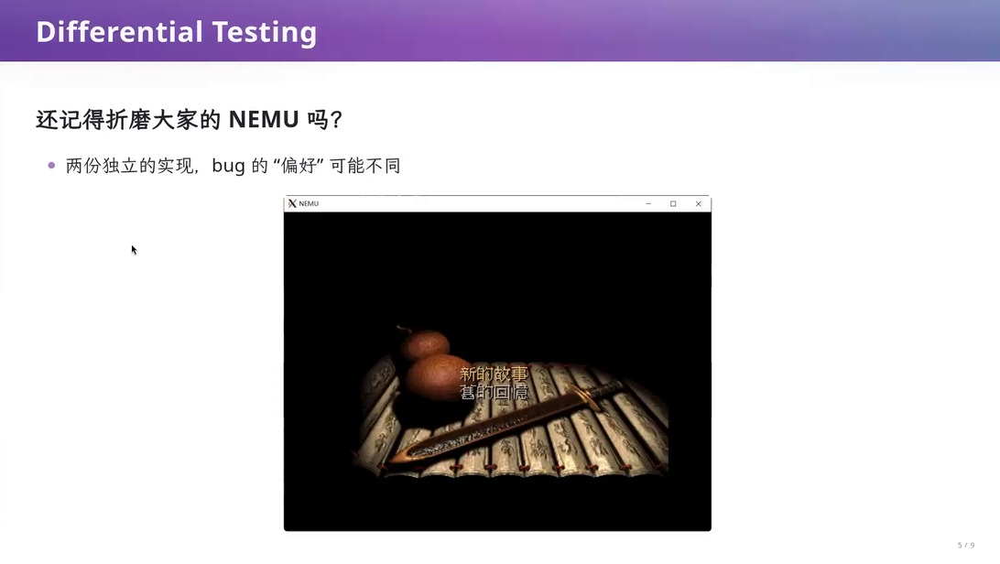

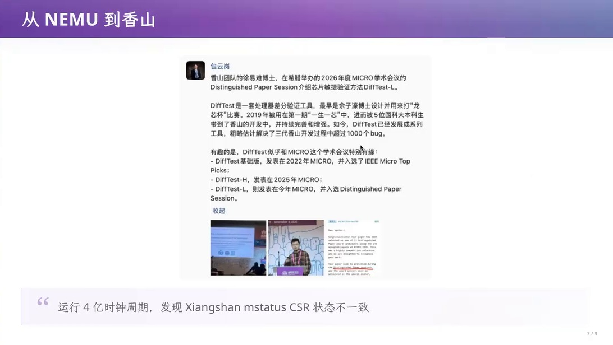

课上的那个例子是：运行了 4 亿个时钟周期之后，才发现香山的 `mstatus` CSR 状态不一致。CSR 是控制与状态寄存器，`mstatus` 保存处理器的一些关键运行状态。

这样的故事说明，错误可能藏在很长的执行过程深处，而**自动比较提供了持续观察它的办法**——不必等到最终应用表现异常再从海量历史里倒查，而是沿执行过程持续追问：两边是否仍然一致？

## 17 模糊测试：给输入搜索一点方向

有了检查机制，还要让程序经历足够多、足够有价值的情况。模糊测试（Fuzz Testing）可以形象地理解为把软件按在地上「摩擦」：不断生成、变异输入，试着把隐藏的错误逼出来。

它本质上是一个搜索问题。所有文件内容、参数组合和操作序列构成巨大的输入空间，我们只能搜索其中很小一部分。

课上把这件事算得很具体：一个 `a.out` 带四个参数 `S1..S4`，加上环境变量、再加一个被读取的 `A.txt`，看上去是一堆复杂的东西，实际上无非是在搜五六个字节序列。如果把它们拼成一个一百四十字节的输入串，把这 140 个字节的所有组合都跑一遍，理论上就「所有程序行为都跑过一遍」了——但那是个天文数字。所以真正的问题在于**怎样用有限的尝试覆盖尽量多的行为**，穷举本身从来不是一个选项。

如果每次都完全盲目地随机生成，许多输入可能刚到格式检查就被拒绝，根本进不到复杂逻辑。

AFL 提供了一种带覆盖反馈的搜索思路：从已有输入出发进行变异，执行程序，观察是否到达了新的执行路径或状态转移；把有价值的输入留下，继续变异。幻灯片把它类比成遗传算法——输入发生变化，执行反馈提供「选择压力」，让搜索逐步进入新的区域。

至于怎么让搜索更有方向,例如

维护一个「种群」，每个成员是一份输入；每次挑一个改一改——把一个字节从 A 改成 B、把程序里出现过的常量替换进去、或者把两份输入的前后各切一半拼起来（crossover）；然后执行，看它有没有覆盖到以前没覆盖的代码。这套东西正确的名字叫反馈制导的测试（feedback-guided testing）。它的工程形态就是几百台机器的集群日夜不停地生成输入，专门找崩溃和安全漏洞。

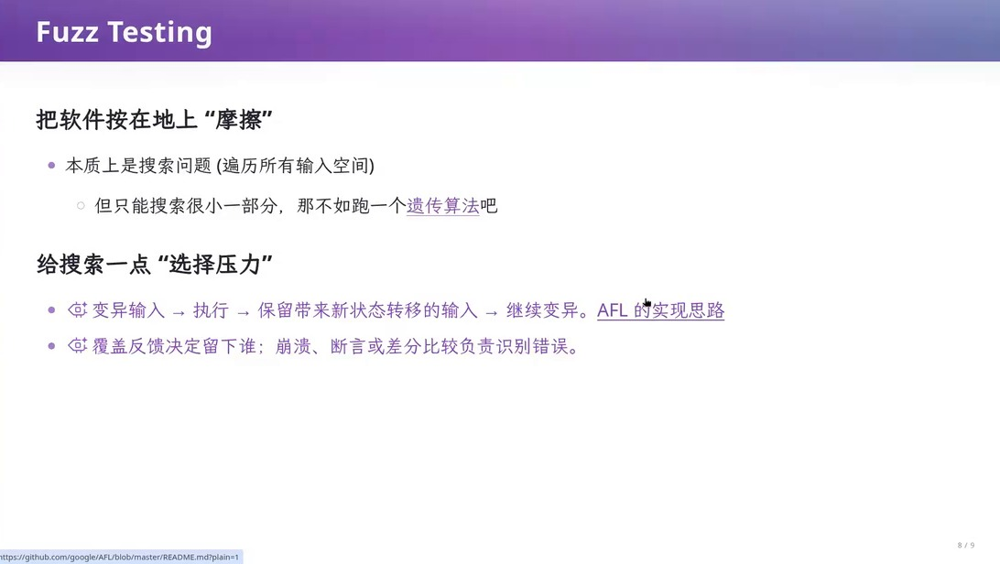

搜索和判定仍然是两件事。执行到新代码，只说明这个输入值得继续探索，并不说明它已经找到 bug；崩溃、超时、断言失败，或者与另一实现产生分歧，才提供了进一步检查错误的线索。因此模糊测试常与差分测试组合：一边负责找输入，一边负责比较结果。发现失败之后，留下能重现问题的输入，才能把偶然撞见的异常变成可以调试、可以回归的工程资产。

这门手艺在真实世界里的战果可以说明它的分量：Linux 内核的系统调用模糊测试（syzkaller）找到了数量极多的 bug，其中不少至今没法复现、甚至没法修；而在开源供应链上，OSS-Fuzz 每天对发布的软件做扫描，一个 release 能不能「Fuzz 通过」已经变成一种可交付的信号——反过来说，想在上游投毒的人，第一步就得想办法绕开它。

## 18 一台插拔 SD 卡的小机器人

有些重要的输入，甚至不在电脑屏幕里面。

San Mehat 向同事提出的一个愿望。

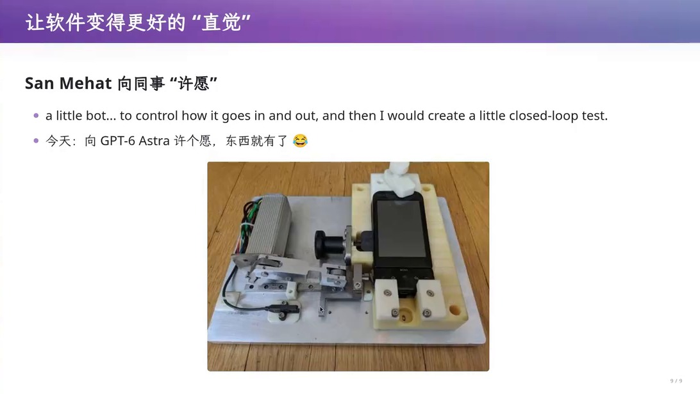

他们当时发现 G1 的 SD 卡插槽在 Linux 下的驱动不太稳定（后来整个重写了），需要反复插拔来测。

在 QEMU 里模拟当然可以，但那年头 QEMU 还不够成熟，模拟效果也不够好，于是答案变成了一台物理装置：一部分是 3D 打印件，接上电机与传感器，软件发一个信号，卡就拔出来再插进去，测试代码接着去读卡。

这个装置的价值不在于机械动作复杂，而在于它**把原本依赖人的操作，变成了程序能够重复安排的输入**。软件发出操作，装置执行插拔，测试观察系统反应，再进行下一轮。反复插拔时才会出现的问题，终于可以持续追踪，而不必靠一个人坐在那里碰运气。

沿着这个思路，测试者可以进一步安排「正在访问卡时拔出」「拔出后再次插入」这类操作序列，并记录出现异常时的条件。幻灯片补了一句很实在的话：这些是从装置得到的测试设计思路，不意味着只要有了机器人，所有错误都会自动被发现。仍然需要知道观察什么、怎样判断异常、怎样复现它。

今天，这样的愿望已经可以直接许给模型：让 Agent 编写测试程序、记录日志、控制设备或生成输入。现在所有东西都是许愿，但**许愿的前提是你有正确的概念**。AI 干不了你认知之外的事；你能做的是把「这个场景应该怎么被观察」这种判断提供给它。

## 19 AI总结

把这一讲压成一句话：**能运行，不等于能驾驭。**

三个概念的分工要记牢：fault 是代码里的缺陷，error 是运行中违反规格的状态，failure 是被观察到的异常。它们之间存在可以被打断的链条，而质量保障的所有手段，本质上都在链条的某一段上做工——架构和语言减少 fault 产生的机会，测试把 fault 推成 error，断言把 error 及时变成 failure，而好的接口让 failure 出现在离原因最近的地方。

四个测试层次回答四个不同的问题：单元测试问「这个函数对不对」，集成测试问「接口对得上吗」，系统测试问「在真实环境里走得通吗」，验收测试问「这真的是用户要的吗」。测试金字塔是对这四层的成本分配，不是对四层的价值排序。

关于测试的两个判断需要同时成立。Dijkstra 说测试只能显示 bug 的存在，不能显示它的不存在；但测试仍然极为有效，因为错误的实现在有区分力的输入上「蒙对」的概率极低，而 $1/n!$ 这类论证说明这个概率可以低到让人放心。既不迷信覆盖率，也不因为测不完就放弃测试。

最后是这一讲真正的立场。在生成式编程之前，这些方法论的约束就已经存在；在生成式编程之后，它们变得更要紧，因为**写代码的成本下降得比理解代码的成本快得多**。许愿编程的后果是「人类不再掌控软件，只了解它展现的一些表象」，而这一讲给出的所有手段——可测试的架构、注入的时钟、可控的随机数、幂等的接口、确定性的模拟器、差分与模糊——都是在把表象重新变成证据。

这条思路也解释了为什么这一讲反复回到「架构」这两个字。测试方法可以背，测试框架可以装，但一个模块能不能被单独测试、一次失败能不能被复现，是在写第一行代码时就已经决定的事情。

这也是为什么最后那个插拔 SD 卡的小机器人值得放在结尾。它没有用到任何新算法，它只是把一件原本只能靠人手做的事，变成了程序可以重复安排、可以观察、可以复现的输入。质量保障的进步，往往就是这样发生的：与其说找到了更强的验证方法，不如说是**把原本不可观察的东西重新设计成了可观察的**。

课上最后一段话说得很朴素：在生成式软件工程的时代，你们真正需要的是 knowledge——架构的知识、测试的基本原理，再加上别人三十年里做质量保障的经验。这些学到手之后，你自然能把它 generalize 到自己的项目上：你的项目未必需要差分测试，也未必需要 fuzzing，但你会知道「这个场景能不能被安排成一个可重复的输入」，而这往往就是问题解决的地方。
