## 1 回顾：一条会断的链条

上一讲留下了一张图：程序员在源码里留下缺陷（fault），测试用例把它跑起来，程序进入错误状态（error），错误再往前走一步，用户看到崩溃、超时或者错误的输出（failure）。

这条链在口语里被压成一句「程序有 bug」，但压掉了两个空档。

第一个空档在 fault 与 error 之间。写了 bug 不等于这次运行一定触发它。幻灯片里的例子很具体：某个内存地址被意外覆盖，而那段内存之后恰好没被再用到，程序于是「看起来挺对」。错误状态已经存在，观察者什么都没看到。

第二个空档在 error 与 failure 之间。进入错误状态不等于立刻出现可见症状。一个本该 0.01 秒跑完的程序跑了一分钟，或者干脆挂住不返回，用户才知道出了问题。

**程序有 bug，不代表能触发 error；触发了 error，也不代表能看到 failure。** 测试和断言的工作就是在这些空档上补观测点；而补得上补不上，取决于架构有没有把状态和副作用切在可观测的边界上。

这一讲从这个「补不上」的地方继续：如果不满足于采样，能不能像证明数学定理一样，证明程序是对的？

## 2 架构决定了系统怎么被测试

讲者用自己上课写的 CS:GO 演示说明这件事。游戏引擎持有世界状态：每颗子弹有坐标、速度、类型，每个玩家有输入，一个 tick 让状态往前走一步。这个引擎完全不产生图像，所以它可以单独测试——单元测试覆盖函数，replay 覆盖一段状态序列。渲染层再做一次投影，把无图形的状态投射成第一人称视角，或者 OB 的上帝视角。

回放和观战之所以成立，是因为所有人共享同一条状态时间轴，只是「视图」不同。**状态是唯一事实，视图是它的函数。** 能用状态解释世界，才可能用状态测试世界。

这个例子真正说明的是边界划分：引擎和渲染的边界清楚，测试就有地方落脚；边界模糊，「测试」就退化成给整个程序截图比对。

## 3 Agent 的「合理」答案，以及它的天花板

接下来是全课最有用的实验。讲者让人工智能为一个项目补一套分层测试，模型给出一份非常合理的目录:：`src/` 放源码，`tests/` 下面分 `unit/`、`module/`、`system/`，外面再放一个 `justfile` 当执行入口。


这份答案没有错。问题在于它是一次性补全，而不是重新设计信息的归属。幻灯片上的追问把天花板暴露出来：新增一类需要虚拟机的测试，目录、CI 配置、文档、执行脚本这四处要改几处？再往下还有一问——测试的分类与运行方式，究竟由谁定义？

模型很擅长复现一种常见的组织形式，却未必主动追问「这条规则应该由谁维护」。于是迟早会出现这样的状态：文档写着要跑，CI 却没跑；CI 跑着，执行脚本里的参数早已过期；新增的测试目录没人登记，于是永远不被执行。它们都不是单点错误，而是**同一份知识被抄成了多份**。

## 4 把测试策略变成一份可执行的事实

讲者的做法是把策略搬进文档：在 `docs` 目录下的 `testing.md` 里维护一张表。每一行声明一块目录（Scope）、测试层级（Level）、执行器（Runner）、参数（Args）和属性（Metadata，比如「快」「需要隔离」「依赖虚拟机」）。

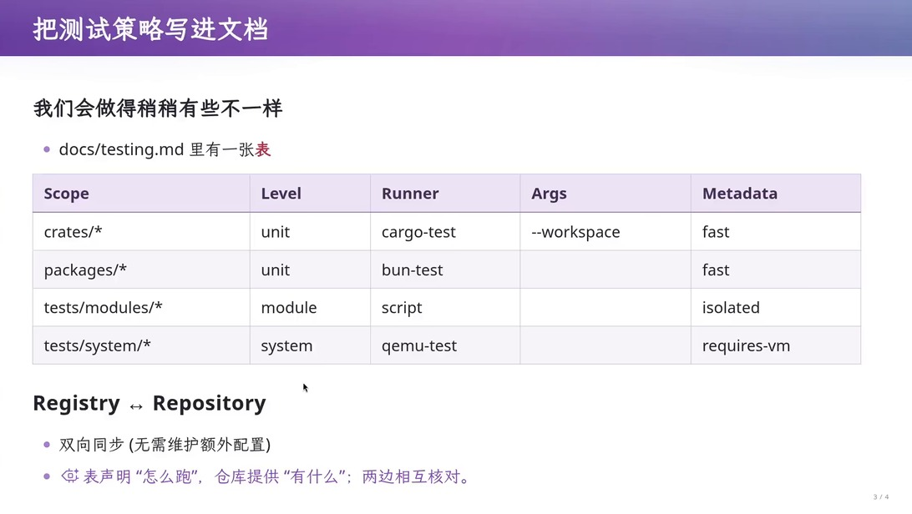

这张表同时是给人读的文档、给 Agent 维护的结构、给 CI 校验的对象、给执行器生成计划的输入。它比 `justfile` 多出来的东西只有一样：**人和机器读同一份描述**。一旦「怎么测」只有这一处，就不需要双向同步，也就不会出现两份副本各自漂移。

表要真的管用，还必须双向核对。「Registry ↔ Repository」指的是：表声明「应该怎么跑」，仓库提供「实际有什么」。既要检查表里的路径是否还存在，也要独立扫描仓库，检查新加入的测试有没有被登记。


只做单向遍历是这里最隐蔽的陷阱。执行器如果只遍历表中出现的 Scope，那些没登记的测试会安静地消失，而 CI 依然一片绿色。用一句话说清这个论断：**未被登记的测试，等价于不存在。**

## 5 比计算机还早的愿望

「证明程序是对的」不是新想法。1949 年 Turing 讨论如何检查一段大程序；1947 年 Goldstine 与 von Neumann 用流程图把控制流画清楚；1962 年 McCarthy 提出用数学规格描述计算，并且要求证明本身也能被计算机检查；1967 年 Floyd 把断言放到控制流的边上；1969 年 Hoare 给出程序推理的公理化框架。Dijkstra 那句「测试只能显示缺陷的存在、不能显示缺陷的不存在」则是 1970 年的事。

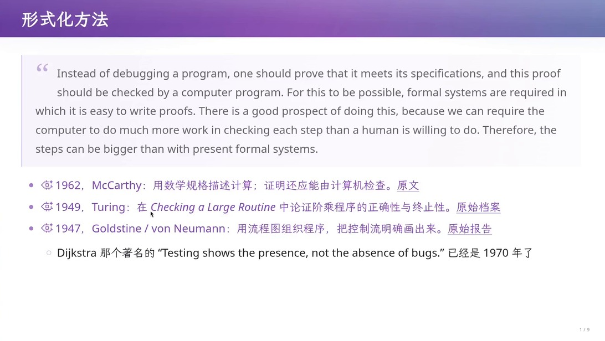

被反复引用的那段话说的是：不要调试程序，而应证明它满足规格，并且让计算机去检查这个证明；因为机器检查每一步比人更有耐心，所以证明的步子可以比当时的形形式系统更大。这段话里同时藏着这条路线的经济学——**把昂贵的人类注意力换成廉价的机器检查**。

## 6 程序为什么可以是「精确科学」

Hoare 的论文开篇有一句很强的断言：程序的性质，以及它在任何环境下执行的全部后果，原则上都能从程序文本本身、用纯演绎的方式得到。

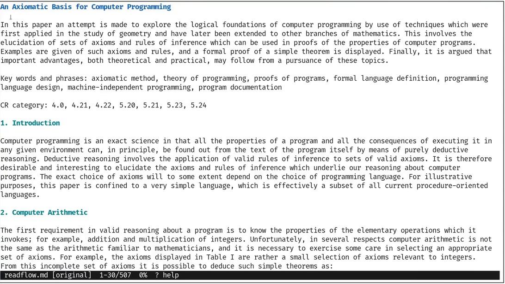

这句话成立的前提常被读者跳过：程序里的基本运算必须先有公理。数学上的整数可以无限相加，机器上的整数会溢出；同一个 `+`，在严格解释下越界即「不存在」，在带回绕的语义下要对 $2^{32}$ 取模。讲者用同一张加法表在三种解释下给出三张不同的表来说明这件事。

语义没定清楚，证明就没有对象。「证明程序正确」里的「正确」，永远相对于一套运算语义；把数学整数上的结论直接搬到机器整数上，是形式化工作里最常见的越界。

## 7 Hoare 三元组：把规格写成一行

Hoare 的写法是把一段程序夹在两组断言之间：

$$\{P\}\ C\ \{Q\}$$

读法是：如果 $P$ 在初始状态成立，并且 $C$ 终止，那么终止状态满足 $Q$。$P$ 是前置条件，$C$ 是程序，$Q$ 是后置条件。最朴素的例子是赋值：

$$\{x = n\}\ \ x := x + 1\ \ \{x = n + 1\}$$

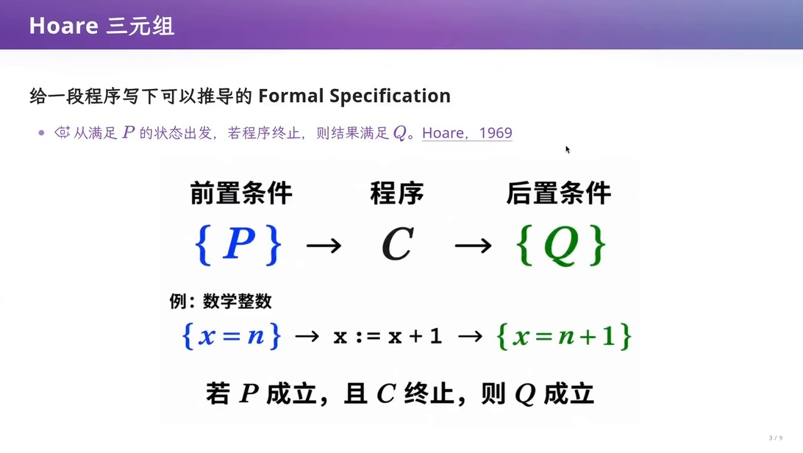

注意「并且 $C$ 终止」这个条件不是客套。只保证终止时结果正确，叫部分正确性；连终止一起保证，叫总正确性。一个永远不返回的排序程序在部分正确性意义下反而「合格」——它从不返回错误结果——但它显然没有完成我们想要的排序。

## 8 一个不变式抵过无数次运行

顺序语句可以顺着推，循环却可能执行任意多次。处理办法是找一个不变式（invariant）$I$：循环开始前成立，每执行一次循环体仍然成立。设循环条件为 $B$、循环体为 $C$，证明分成三步：

$$P \Rightarrow I, \qquad \{I \wedge B\}\ C\ \{I\}, \qquad I \wedge \neg B \Rightarrow Q$$

初始化说明进入循环时 $I$ 已经成立；保持说明只要条件还成立，一次循环体执行后 $I$ 不被破坏；退出说明条件不再成立时，$I$ 足以推出目标。

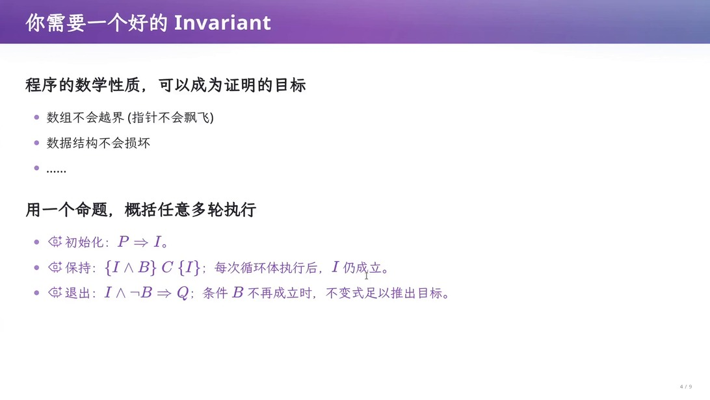

这三步之所以足够，是因为它没有枚举轮次，而是给了一条能贯穿任意多轮的规律。真正难的不是推，而是**找到一个恰好够用的 $I$**——这一步目前仍主要靠人。

## 9 两个例子：一棵带 parent 指针的树，一次多数投票

第一个例子最能让程序员共情：带 parent 指针的平衡二叉搜索树。旋转一次，指针就可能指向不该指的地方，而这种破坏往往不会立刻崩溃。可以写下来的性质是具体的：

$$\forall p.\quad p\texttt{->parent->left} = p \ \ \vee\ \ p\texttt{->parent->right} = p$$

也就是说，一个节点必须出现在父节点的某个子槽位里。这类断言平时以 `assert` 的形式写在代码里，运行到就检查一次。它已经是一种规格：把「结构没被扯坏」写成了可判定的命题。但它只在被执行到的时候检查——这正是后面所有内容要跨过去的门槛。

第二个例子是 Boyer–Moore 多数投票：逐张读票，只保留一个候选人和一个计数器；相同就加一，不同就减一，计数归零就换候选人。

```python
candidate, cnt = None, 0
for vote in votes:
    if cnt == 0:
        candidate = vote
    if vote == candidate:
        cnt += 1
    else:
        cnt -= 1
```

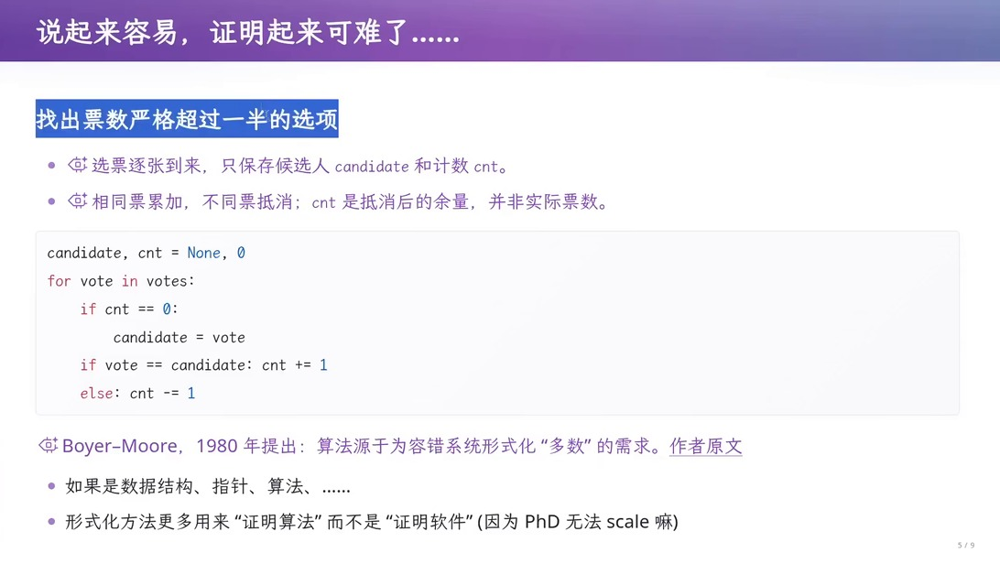

它看起来像变魔术，因为计数器显然不等于得票数。真正的不变式是：**已经读过的票，可以分解成若干对「选项不同」的票，外加 $cnt$ 张全部投给当前候选人的剩余票。** 新票与候选人相同就进剩余票，不同就吃掉一张剩余票，剩余为空就自己成为候选人——每一步都保持这个分解。

再叠加一条关于多数的引理：若某选项的票数严格超过其他选项之和，删掉一对不同的票不会消除它的优势（这对票至多包含一张多数票）。于是把不同选项的票对全部抵消之后，严格多数必然仍留在剩余票里，而剩余票全属于候选人。

这里的前提「存在严格多数」很重要。没有这个保证，第一遍只能产生候选人，还要第二遍统计它是否真的超过一半。例如 `A, B, C` 最后留下 `C`，但它并不是多数。**证明不仅告诉我们代码为什么正确，还准确指出了它在什么条件下正确。**

## 10 Everything is a state machine

手工寻找不变式太难，于是换一个角度：程序就是状态机。状态包含变量、内存和「执行到哪一行」，一次执行就是一次状态转移。编程语言的操作语义，正是在描述这样的转移规则。

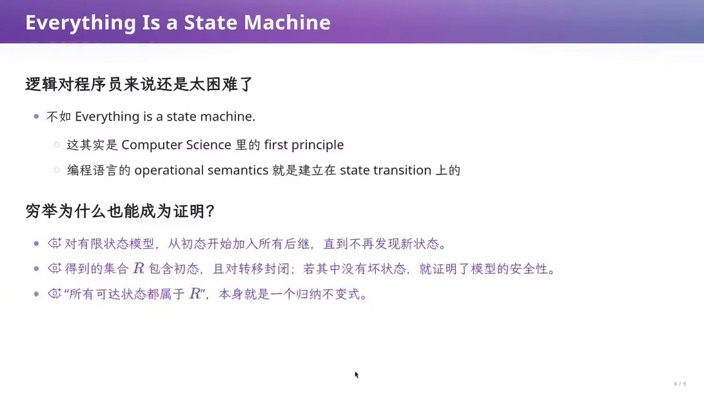

对有限状态模型，可以从初始状态出发，不断加入所有可能的后继，直到不再出现新状态。设探索得到的状态集合为 $R$：它包含初态，而且对转移封闭——其中任意状态的任意后继仍在 $R$ 中。于是「所有可达状态都在 $R$ 中」本身就是一个归纳不变式；只要 $R$ 里没有坏状态，坏状态就不可达。

这就是穷举能算证明、而多跑几次测试不算的原因：**区别在于是否覆盖了全部允许行为。**

## 11 一个只有三十行的反例

上一讲的并发计数器在这里变成最小模型：`sum` 初值为 0，两个线程各执行一次 `T_sum`，原子读写采用顺序一致语义，期望结束时 `sum == 2`。

```c
void T_sum() {
    for (int i = 0; i < N; i++) {
        int t = atomic_load(&sum);
        t++;
        atomic_store(&sum, t);
    }
}
```

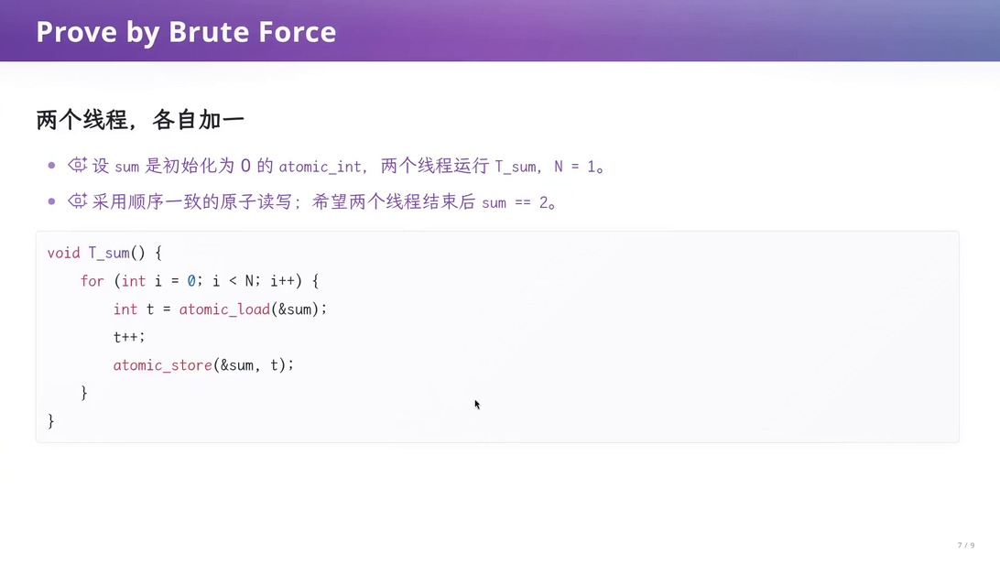

存在这样的交错：A 读到 0，B 也读到 0；A 在本地算出 1，B 也算出 1；两者先后写回，最终结果是 1。模型检查器会系统地探索这些交错，并给出通向坏状态的完整轨迹。修复方式有两种——把「加一」变成原子的读改写，或者用锁保护整段——修完之后必须针对新的转移规则重新检查。

需要注意的是，这个小模型并没有顺带证明「任意线程数、任意循环次数下都安全」。它准确回答的是交给它的那个问题；把模型结论当成对程序的普适保证，是这条路线最常见的误读。

## 12 状态爆炸，以及「改变表示方法」

穷举的麻烦是组合爆炸：组件各自线性增长，组合起来的状态数却可能指数增长。讲者把几十年的进展压成两个节点。

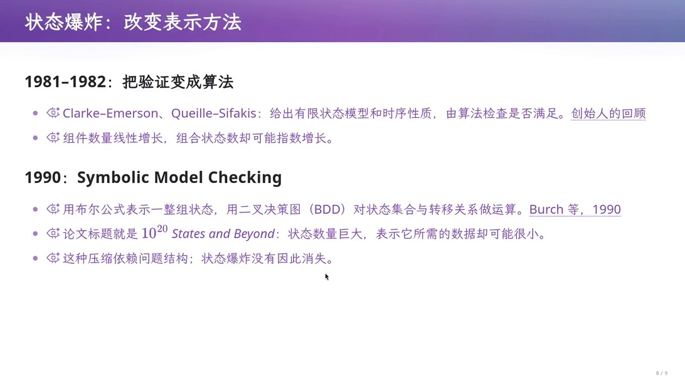

第一个节点是 1981–1982 年 Clarke 与 Emerson 等人的工作：给出有限状态模型和时序性质，由算法检查是否满足。第二个节点是 1990 年的符号模型检查：不再逐个存状态，而用布尔公式表示一整组状态，用二叉决策图（BDD）对状态集合与转移关系做运算。经典论文的标题里直接写着 **10²⁰ States and Beyond**——状态数量可以大到无法计数，而表示它们所需的数据却可能很小。

讲者在这里加了一句克制的判断：这种压缩依赖问题结构，状态爆炸并没有因此消失。另一条思路是把「是否存在若干步内出错的执行」编码成 SAT；找到解就得到反例，但在某个步数界限内无解，还不能推广到任意长度。

## 13 模型对了，代码不一定对

模型检查证明的是模型。要在工程里用它，必须回答一个额外问题：简化模型正确，为什么说明真实系统正确？答案叫 refinement（精化）：把实现的每一步映射到模型的一步，或者映射成抽象状态不变的「停顿」，并保持要证明的关系不变。

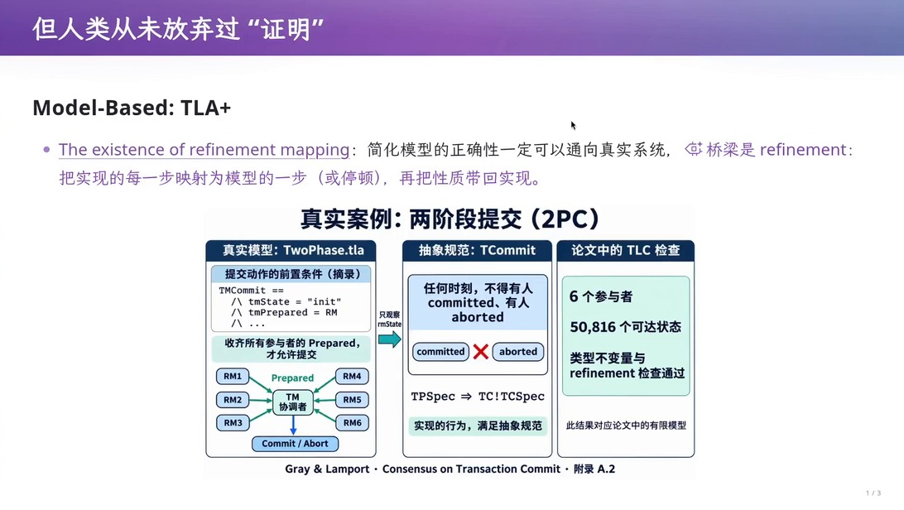

两阶段提交是最好的教学案例，因为它的坏性质一句话就能说清：不能出现一个参与者已提交、另一个已中止。幻灯片给出的是一个有限规模模型——**6 个参与者、50,816 个可达状态**——TLC 枚举完之后确认：类型不变量成立，refinement 检查通过，允许的行为满足抽象规范（TPSpec ⇒ TC!TCSpec）。

这个例子同时展示了能力与边界：能力是穷举了 6 个参与者的全部交错；边界是「6 个参与者、这一套转移规则」之外的东西，它没有说。

讲者还讲了一台老式自动售货机。它有纸币口、硬币口、退币口，还要识别面额、处理称重；控制程序可能有几千上万行。直接证明这段代码不现实，于是先抽象成状态机：投一元到 1，投五元到 5，退币进入专门状态，选完商品回到零。状态数降到几十到几百，就可以在这张图上做广度或深度优先搜索，检查「从初始状态到坏状态是否存在路径」。

但这套做法有一个不肯消失的空档：代码第一行写一句 `return` 就不是这个模型了；模型里没有建模「称重传感器读数异常」，代码就可能在这个分支上崩溃。讲者讲了自己的真实经历——买东西没掉下来，机器自动退款，他又买了一次，结果掉下来两瓶。

**模型正确性不等于代码正确性。** 模型对了只完成一半，另一半是「代码确实实现了这个模型」。除零、内存越界、未建模的传感器分支，都可能在模型之外把系统弄坏。工程上的折中很实际：如果没资源证完整映射，就退一步——让代码和模型跑同一个测试用例，比较两者打印出的状态迁移日志是否一致。这不能保证百分之百，但能排除「第一行就 return」这类离谱偏离。

## 14 KLEE：把输入留成符号

第二条路线不在模型上搜索，而在程序路径上搜索。普通执行给输入一个具体值；符号执行把输入保留为符号，遇到分支就把分支条件加进路径约束。

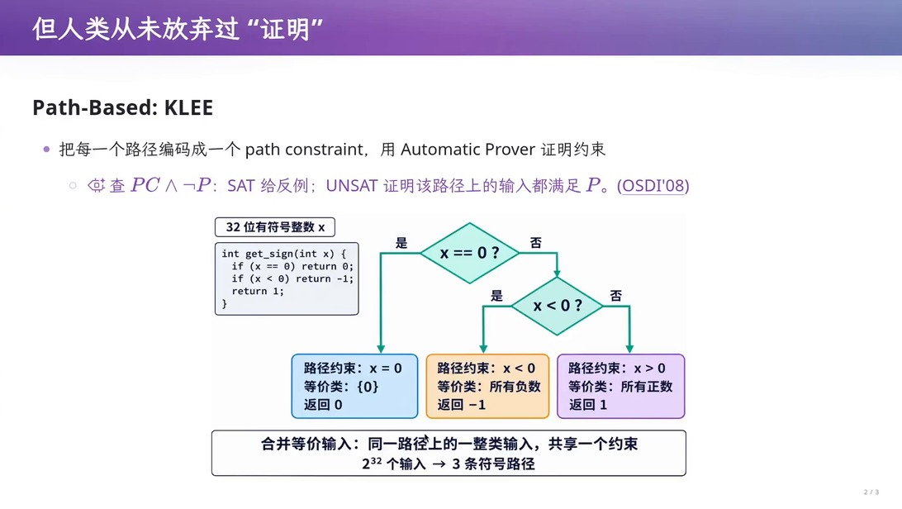

判据是一句可满足性询问。假设当前路径约束为 $\mathrm{PC}$，我们想确认这条路径上是否满足性质 $P$：问 $\mathrm{PC} \wedge \neg P$ 是否可满足。SAT 表示存在违反 $P$ 的输入，也就是反例；UNSAT 表示在所采用的语义和约束下，这条路径上的输入不会违反 $P$。

把输入按路径分组，并不意味着所有相似路径都能自动合并。路径数量会随分支与循环增长，外部环境也会不断引入新的符号；三条路径对应一个三分支函数很轻松，对应一个带循环的解析器就未必。KLEE 这类工具真正的工程量在于把真实程序编译成可符号执行的中间表示，并为每条指令建立约束。

## 15 被证明的编译器与内核

第三条路线最贵：不建模，直接证明真实代码。讲者挑了编译器和内核两个目标，理由是它们是许多软件共同依赖的地基——一个编译错误就可能破坏上层费力证明的性质，而证明成本能在每次编译、每次系统调用中反复摊薄。

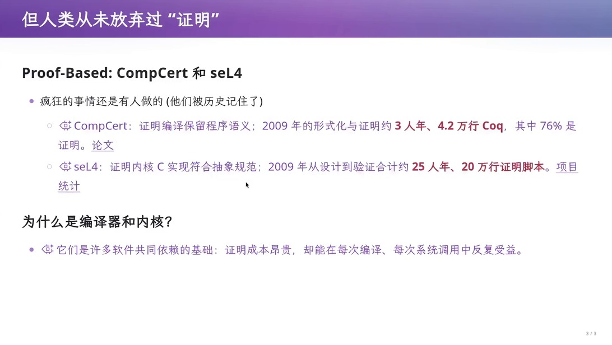

具体数字来自幻灯片：CompCert 的 2009 年版本，形式化与证明约 3 人年、4.2 万行 Coq，其中 76% 是证明；seL4 从设计到验证约 25 人年，证明脚本约 20 万行。这些数字描述的是当时的项目范围，不是今天所有版本的统一统计。

| 路线 | 证明的对象 | 没有证明的部分 | 主要代价 |
|---|---|---|---|
| 模型检查（TLA+） | 有限模型上的时序性质，可给出反例轨迹 | 模型与代码之间的 refinement 需单独建立 | 建模与抽象判断 |
| 符号执行（KLEE） | 单条路径上的约束蕴含性质 | 路径爆炸、外部环境与库函数建模 | 中间表示与求解器工程 |
| 被证明的基础软件（CompCert/seL4） | 真实实现满足抽象规范 | 规范本身是否符合意图 | 数人年至数十年的证明劳动 |

表格最后一行是全讲的伏笔：即使把实现证到底，也只剩下「规范是否符合意图」。

## 16 证明助手：铁面无私的反馈

中学数学的证明并不严格。选择题可以猜，草稿纸上的中间步骤可以写错，只要最后结果对、改卷人愿意通融，就能过关。证明助手换掉了这个前提：你仍然写「草稿纸」，但要求纸上的每一小步都是机器能检查的，而且你只能声明用了哪条规则，剩下的事由计算机完成。

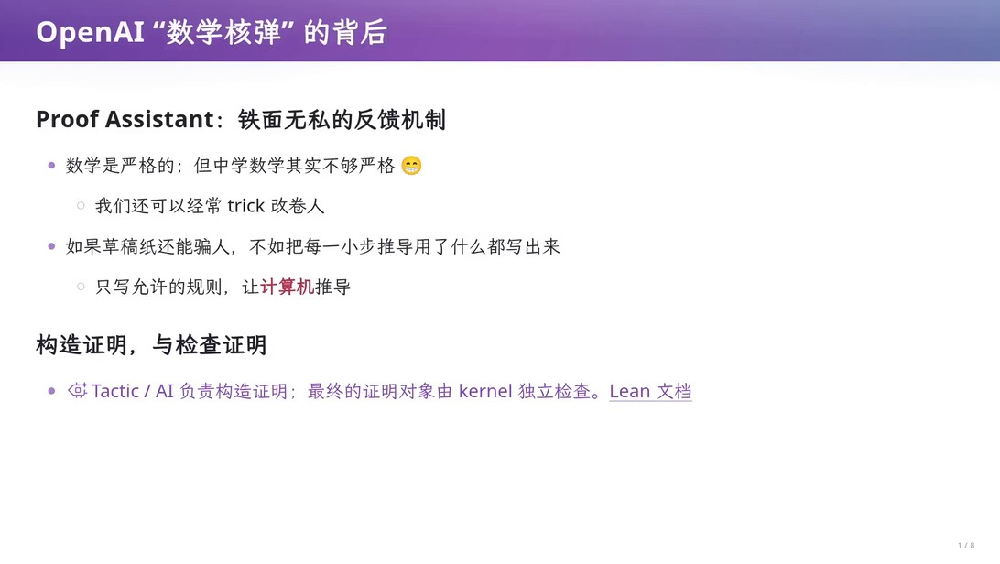

这里的「铁面无私」有非常直接的工程含义。如果声明对一个乘号用分配律，而表达式里根本没有乘法，计算机直接拒绝；如果没说清对哪个子表达式做替换，下一步就推进不下去。**证明助手不是帮你猜，而是不许你含糊。**

把证明状态摊开，只有两栏：左边是「已知什么」，右边是「还要证明什么」。

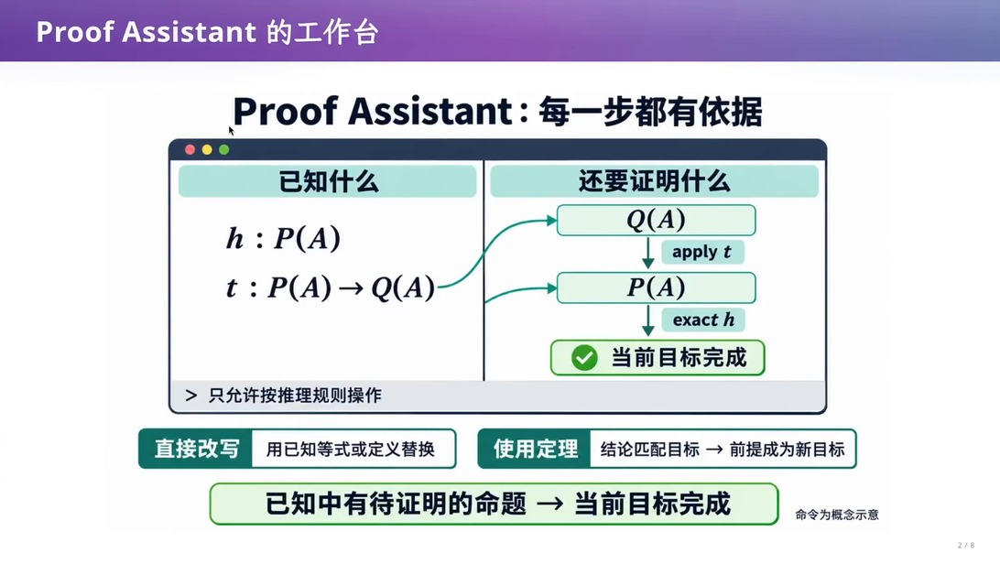

图里的两步操作就是全部机制。已知 $t: P(A) \to Q(A)$，而当前目标恰好是 $Q(A)$；用 $t$ 改写目标，就把「证明 $Q(A)$」换成了「证明 $P(A)$」。已知里正好有 $h : P(A)$，于是目标关闭。每一步都用了一条允许的规则，没有一步是「显然」。所有推导最终都要归到「逐字符相等」这样的原子判断上。

四条基本操作规则可以用一组「班级成绩」的例子讲完，它们是 Hoare 逻辑那些规则的操作化版本：

- 要证 $\exists x. P(x)$（存在一个满分的同学），先 `choose A`，选出一个具体见证，再证明 $P(A)$。只报名字不够，还得拿出他满分的证据。
- 要证 $\forall x. P(x)$（所有同学都及格了），先 `intro x`，任取一名同学，再证明 $P(x)$。这里的「任取」意味着不能偷偷假定他是班里的学霸。
- 要证 $P(x) \Rightarrow Q(x)$（保研的同学都及格了），先 `intro h`，把 $P(x)$ 加入已知，再在这个假设下证明 $Q(x)$。
- 要证 $\forall n \in \mathbb{N}. P(n)$，用 `induction n` 拆成基础情形 $P(0)$ 和从 $P(n)$ 推出 $P(n+1)$ 的归纳步。

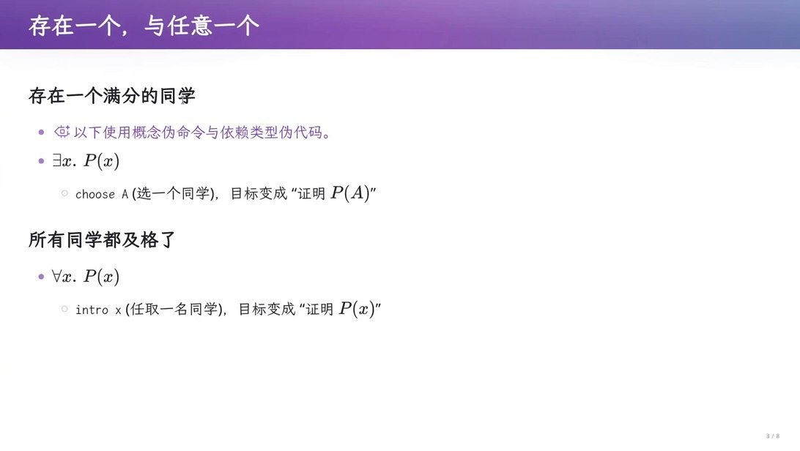

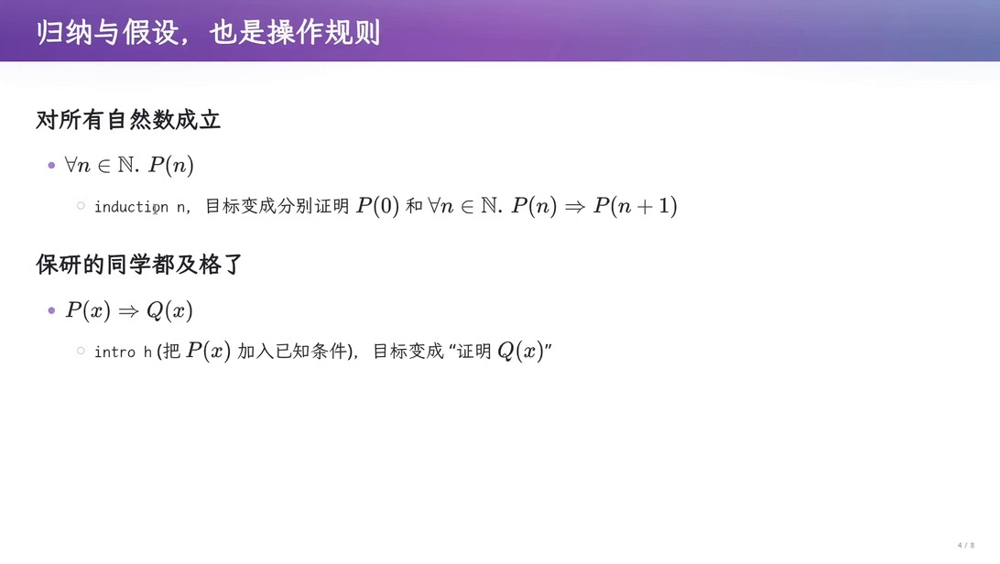

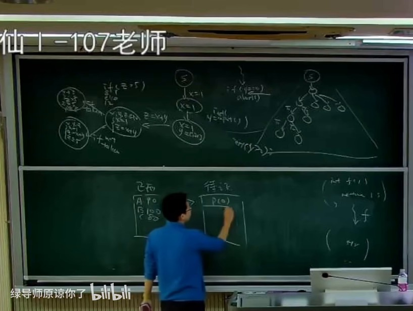

这套反馈对 Agent 特别有用，因为它把「构造证明」和「检查证明」分开了：tactic 可以很复杂，甚至可以由模型生成，但最终产出的证明对象必须通过内核检查。于是反馈是二值的、可自动获得的——哪个目标没关掉、哪个类型不匹配，都能立刻看到。模型不需要再问另一个模型「我的证明对不对」，它可以直接运行检查器。**创造证明很难，检查一个已经写清楚的证明却机械得多。**

## 17 命题即类型，证明即程序

Curry–Howard 对应把工作台和编程接在一起：命题对应类型，证明对应这个类型的对象。于是「证明 $P \Rightarrow Q$」变成了「构造一个从 $P$ 到 $Q$ 的函数」。

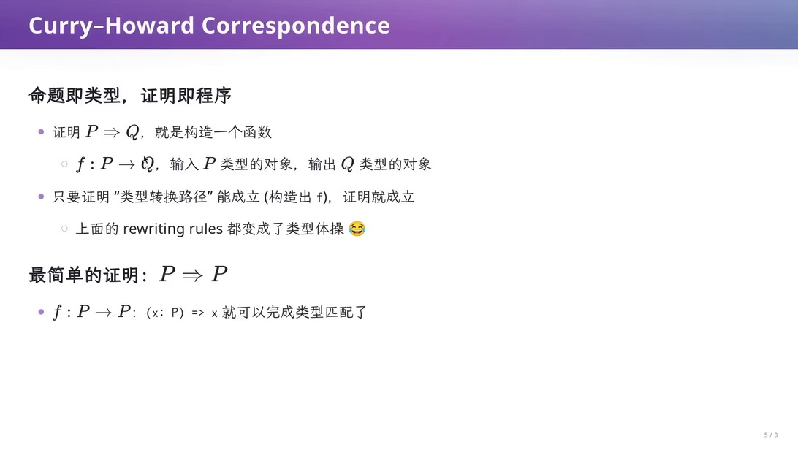

最简单的情形毫无神秘感：要证 $P \Rightarrow P$，就写一个恒等函数，输入已经是 $P$ 类型的对象，直接返回它，类型检查通过，蕴含成立。

归纳法在这个视角下也不再是「思维体操」，而是一个递归函数：基础情形给出 $P(0)$ 的证明，归纳步给出从 $P(k)$ 到 $P(k+1)$ 的函数。

```
(base, step) => {
  const f = (n: Nat): P(n) =>
    n === 0 ? base : step(n - 1, f(n - 1));
  return f;
}
```

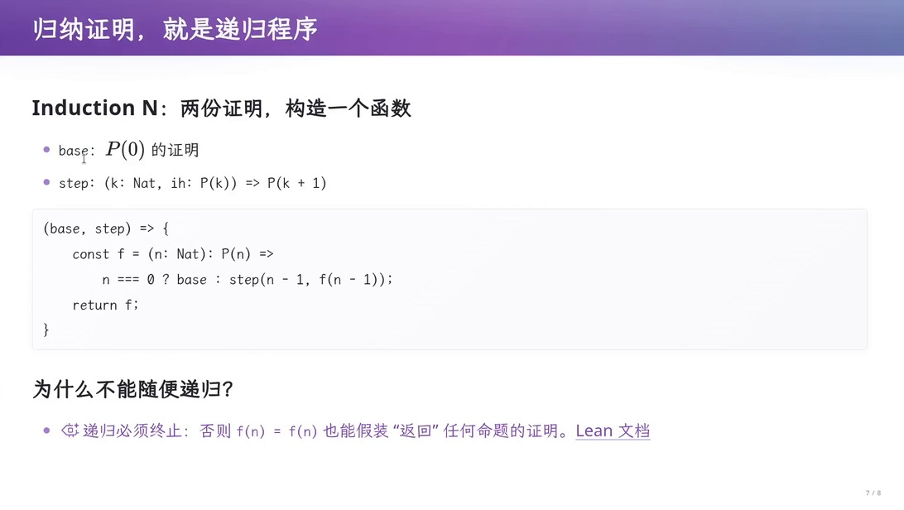

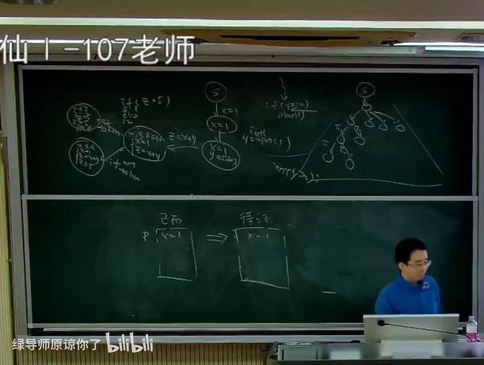

注意递归必须终止，否则 `f(n) = f(n)` 也能「返回」任何命题的证明，整个对应就失去意义。类型检查器要求结构递归，每次调用都把自然数减小，最终落到 0。

既然证明是对象，「把证明写出来」就等于「把这个对象的构造过程写出来」。存在性证明填入见证与证据 `(p: P(A)) => [A, p]`；蕴含证明则把「在假设 $h : H$ 下构造 $Q$ 的方法」封装成一个函数 `(body: (h: H) => Q) => (h: H) => body(h)`。

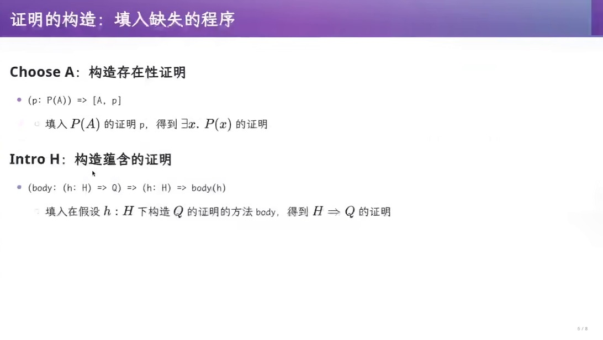

很多逻辑操作于是变成了「类型体操」：找一个合适的构造，让要求的类型确实有对象。模型擅长生成和修改程序，证明助手提供严格反馈，两者天然能接上。

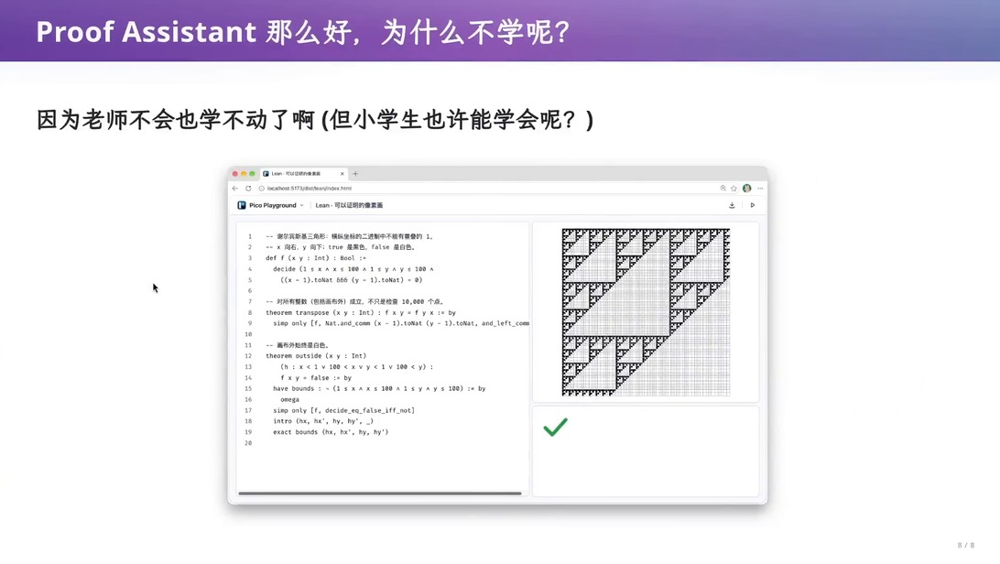

这张图解释了讲者为什么认为入口可以前移：`def f (x y : Int) : Bool` 是一个普通函数，画面上就是一张 100×100 的位图；「外面都是白色」这条性质被写成了对任意整数成立的定理，而不是逐点采样。同一个人在同一个环境里既写程序又写证明，学习的门槛就不再是「先学完离散数学」。

## 18 当 proof 也变成一种 tax

讲者讲了自己博士论文的经历。论文里留下一个猜想：记录得越少，恢复的代价就越大；记录得越多，记录本身的代价又上去了——两个代价无法同时做小。他只有一个非形式证明，反复看了很多遍，仍担心两件事：万一证错了，晚节不保；万一哪天被推翻，也晚节不保。这个猜想就这么搁置了很多年。


后来他让模型先写了一份非形式证明，中间放弃过一次，他凭直觉鼓励了一句，模型又证了出来；再让另一个模型交叉检查，然后写成 2 万行 Lean，交给证明助手检查通过。顺着这个结果继续推，又得到一些有用结论。

讲者的原话是「好消息：没有晚节不保；坏消息：连 proof 也开始变成一种 tax」。他把此前几讲的概念串成一条线：一个想法要被别人理解，要付 storytelling tax；要变成能跑的系统，要付 engineering tax；要变成机器可处理的形式表达，要付 formalization tax；现在连证明本身也成了 tax。后三种 tax 都被模型碾平之后，稀缺性就从「会不会做」转移到「知不知道该做什么」。

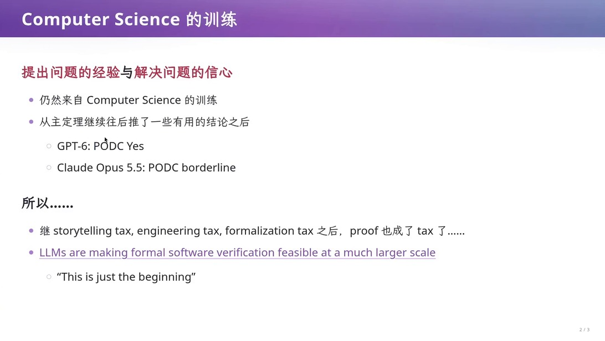

幻灯片上并列了两个模型对同一份工作的判断（一个给出乐观结论，另一个给出 borderline）。讲者并不在意哪个判断对，他在意的是判断的依据从哪里来：提出什么问题值得问、结果还能推出什么，这些仍然来自计算机科学的训练。

成本下降带来的第一波变化是规模。Anthropic 与 Theorem 的合作报告声称，用模型为 100 多个开源软件库在 RISC-V 汇编层面证明了安全性质。

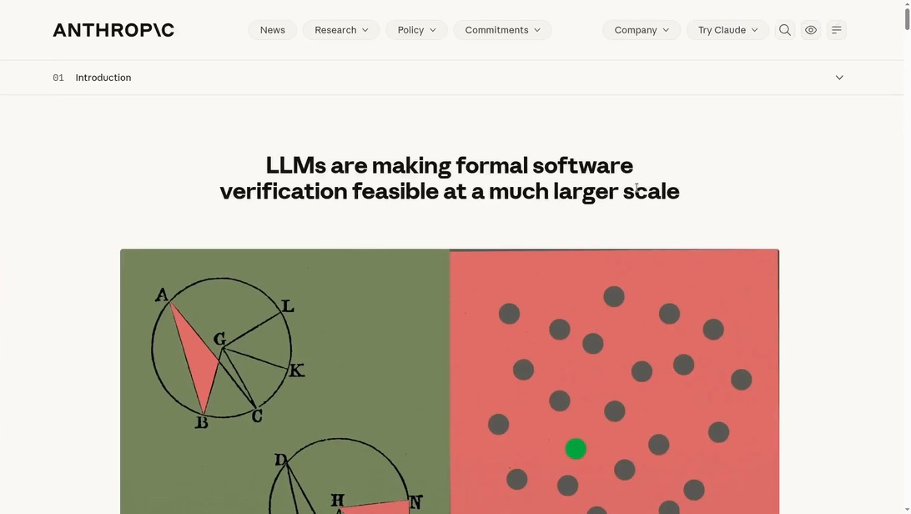

但讲者马上给出了反方向的可能：形式化验证可能变成「证了个寂寞」。要求账户余额非负，就给所有操作加上「原地不动」，确实很容易保持非负，却根本没有实现转账；或者把需要证明的结论偷偷塞进前提，后面的推导再严密也没有回答原问题；再一种是自然语言与形式语言在翻译环节失配，证明的是一个更弱或更窄的命题。这三种都不会被内核拒绝，因为**内核只检查推导，不检查意图**。

对策不是「更严格的形式化」，而是把形式化拉回可执行、可测试的世界：用熟悉的例子运行规格，看它允许和拒绝哪些行为；给错误实现构造反例，看规格是否真的排除了它；继续核对抽象模型与真实实现的对应关系。

这一节最后落在一种能力上：在一定程度上掌握自己无法独立完成的力量。去体验超出能力边界的事情，再把提出问题、审查关键步骤、组织反馈的能力变成自己的一部分。当证明可以被外包，留下的是选择证明什么。

## 19 携带证明的软件，与没有银弹的未来

如果证明变便宜，软件交付的形态也可能变：交付代码时同时交付一份「它满足某条安全策略」的证明，接收方检查证明后再决定是否接收。这个想法不是生成式 AI 时代才有的——1996 年 Necula 与 Lee 的 OSDI 最佳论文就给出了完整的分工图。

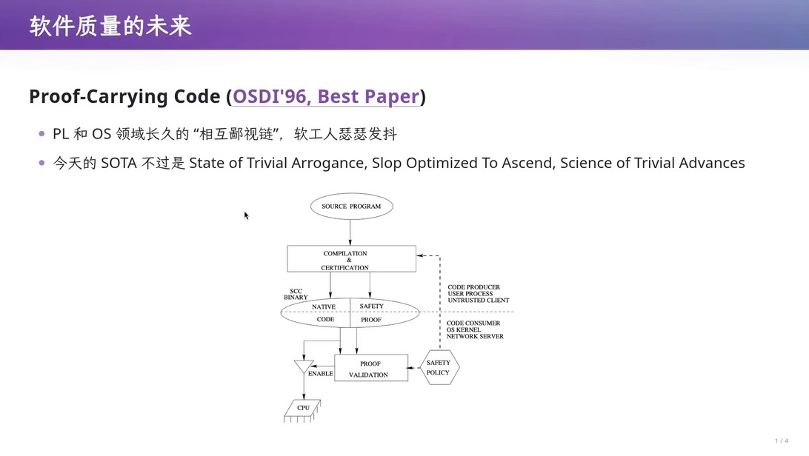

它把责任切得很干净：构造证明的成本由提供方承担，接收方只做校验，不需要相信「作者值得信任」或「模型看起来很厉害」。难点也一直很明确——证明必须能被独立检查，而且检查必须足够便宜。讲者顺手做了一个推演：如果 `assert` 能被模型翻译成正确的证明脚本，「写一个 assert 却过不了编译」就可能成为常态；到那时，教科书里关于可靠性的内容要整体重写。

但形式化有一个前提：我们能否用比实现更简洁、独立的方式表达「正确」。

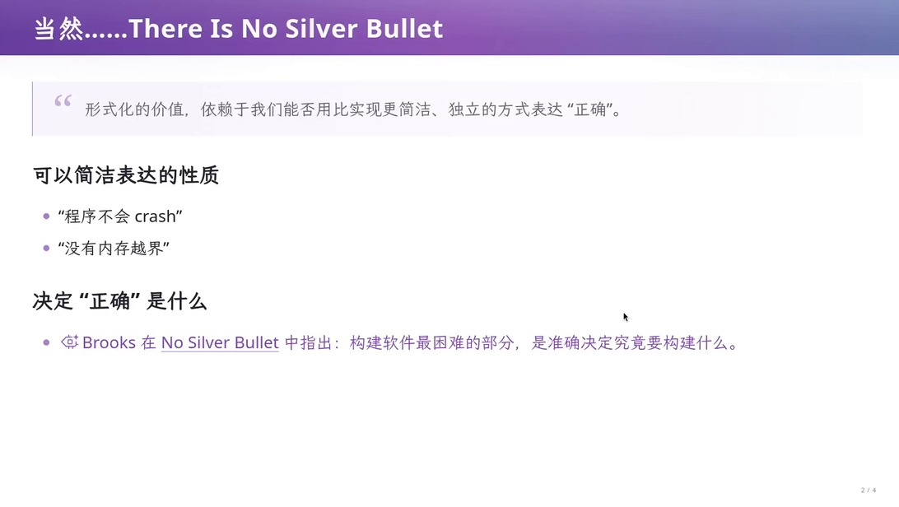

「所有数组访问都在合法范围内」「程序不会 crash」是可以反复套用的规则，它们不需要把实现细节重抄一遍，因此特别适合交给验证系统。**规格要比实现短，否则证明只是在复制代码。**

真正困难的案例出现在规格之前。

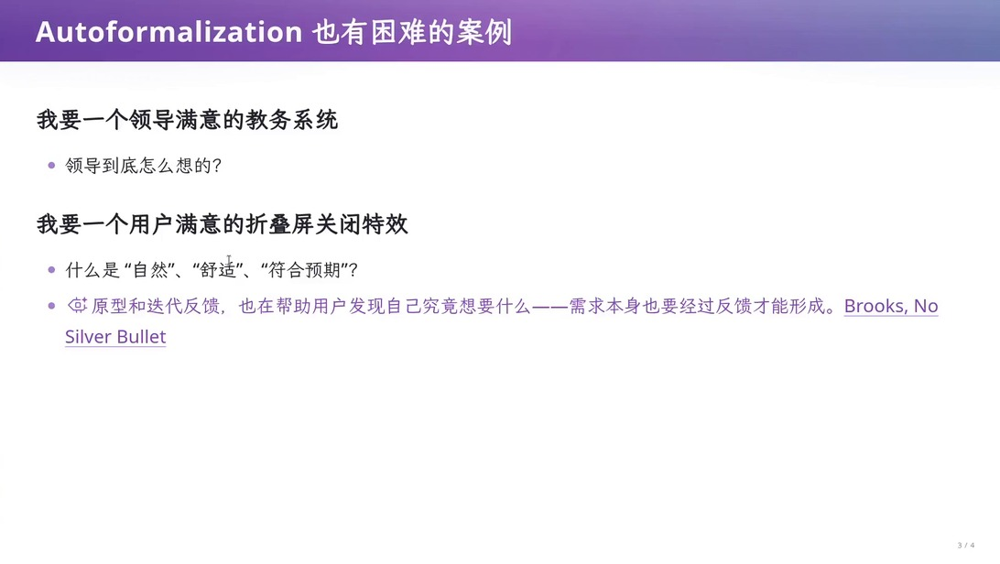

「我要一个领导满意的教务系统」，首先要回答领导到底怎么想：他关心性能、关心崩溃，还是关心向上交账时那个 dashboard 好不好看？「我要一个用户满意的折叠屏关闭特效」，什么叫自然、舒适、符合预期？可以记录帧率和延迟，却不能直接把它们等同于满意。

自动形式化（autoformalization）要把自然语言意图翻译成形式表达，而有些意图尚未清楚到可以翻译，甚至要在体验原型之后才逐渐形成。所以证明能力增强以后，问题向前移动了：从「实现是否符合规格」移向「规格是否符合意图」。测试、原型和人的反馈不会因此失去作用，它们正是用来决定究竟该证明什么。


讲者最后留了一个明确标注为「暴论」的猜想：人类的推理系统（System II）也许可以被理解为一个最终由形式推理系统裁决的过程，不稳定之处来自把现实转成形式表达时的随机性，以及推理中的错误注入。如果 AI 能不断解决这些问题，再接上更长程的反馈，人类还剩下什么？他把这个方向推到极端，开玩笑地说剩下就是「人类的灭亡」。这显然是用来挑战直觉的猜想，不是已经证明的认知理论；它对本讲的作用是反过来问：**当构造程序、寻找证明都越来越容易，谁来决定正确的含义？**

## 20 AI总结

把这一讲压成一句话：**测试能显示 bug 存在，证明才可能显示它不存在——而证明变便宜之后，贵的是决定证明什么。**

前面四节是测试故事的延伸。fault、error、failure 三个词不能互换，链条上有两个空档；测试与断言的工作就是在空档上补观测点，而补得上补不上由架构决定。Agent 给出的 `tests/unit|module|system` 加 `justfile` 是「合理」的答案，但它把同一份知识抄成了四份；把它收进 `docs/testing.md` 的一张表、再让 Registry 与 Repository 双向核对，才是可长期维护的做法。这里有一条值得记住的工程判据：**未被登记的测试，等价于不存在。**

中间六节是形式化的主干。Hoare 三元组把规格写成 $\{P\}\ C\ \{Q\}$，其中「并且 $C$ 终止」不是客套，它区分了部分正确性与总正确性。循环靠不变式处理：初始化、保持、退出三步，一条规律覆盖任意多轮执行；多数投票的 `cnt` 是抵消后的余量，parent 指针的树靠一条断言守住结构。这一步的难点不在推，而在找到那个恰好的 $I$。

再往后是穷举这条路。程序就是状态机，可达集 $R$ 包含初态且对转移封闭，于是「所有可达状态都属于 $R$」本身是归纳不变式；这就是穷举能算证明的原因。代价是状态爆炸，几十年的进展集中在「怎么表示和搜索状态」，而结论始终限定在模型之内——模型对了，代码不一定对，中间要一座 refinement 的桥，桥没修完就有「除零」和「掉两瓶」这样的漏网之鱼。

三条工程路线各自固定了证明的层次：TLA+ 在抽象模型上穷举（6 个参与者、50,816 个状态），KLEE 在程序路径上求解（$\mathrm{PC} \wedge \neg P$ 是否可满足），CompCert 与 seL4 直接在真实代码上做机械化证明（3 人年、4.2 万行 Coq，76% 是证明；25 人年、20 万行证明脚本）。它们共同的缺口是同一个：模型与代码之间、路径与全程序之间、规范与实现之间都要额外的桥。

把桥修到最细，就落到证明助手。工作台只有「已知」和「待证」两栏，四条操作规则覆盖存在、任意、蕴含与归纳；tactic 负责构造、kernel 负责检查，于是失败信号是二值的、机器可读的。Curry–Howard 再把这件事推到尽头：命题是类型，证明是对象，归纳是递归，构造证明是填程序。到这个程度，「证明程序正确」与「写一个类型正确的程序」在原理上是同一个动作。

最后一节是本讲的立场。proof 变成 tax 之后，证明本身不再是瓶颈：瓶颈前移到规格与意图之间。Proof-Carrying Code 给出了一个三十年前就设计好、今天才可能普及的责任分工；No Silver Bullet 提醒这种分工只在「规格比实现更简洁」时成立；autoformalization 则指出最贵的一段在规格之前。

所以这一讲真正留下的问题不是「怎么证明」，而是三个可以立刻动手的问题：你的项目里「测试策略」有几份副本？你能为手里最核心的那个循环写出初始化、保持、退出三句话吗？你的规格比实现短吗？前两个问题决定你能不能把劳动外包出去，第三个问题决定外包出去的东西还值不值得信。
