## 1 一条会断的链

软件是物理世界里的过程在信息世界里的投影。这句话一旦当真，软件就要同时对上三样东西：人脑子里的意图（intent）、写下来的规格（spec）、以及最后跑起来的实现（impl）。

领导说「我要做一个好的教务系统」，这是 intent；它被翻译成要长什么样的架构、支持哪些选课规则，这是 spec；最后是一堆代码和配置，这是 impl。「好的」这个词没有一个是可以直接编译的，于是链条在第一段就松了。

第二段更常被忽略：人类和人类也对不齐。老笑话是商学院同学说「我有一个很好的商业模式，就差一个程序员了」——他有 intent，但他要做的东西还没成形；接手的如果也是个毛头小伙子，架构随手一搭，impl 就偏到很远的地方去。

软件工程的存在，本质上就是承认这条链一定会断，然后想办法把断点找出来。今天这一讲换了一个角度：不分析需求，分析**软件本身**。

## 2 三类资产：经验、流程、工具

几十年下来，软件工程积累了三类可以传下去的东西。

**经验**是失败换来的判断。人月神话提醒「加人不能线性缩短工期」；架构设计教你怎么切模块边界；编码规范把反复踩过的坑变成条目。老师举的例子是 CMU 软件工程研究所的 SEI CERT C Coding Standard——它把「人类程序员容易在哪里犯错」写成一条条可检查的规则。

**流程**是让经验按顺序发生。从被批判的瀑布模型到敏捷开发，到今天 commit 前要检查、push 后要跑 CI。

**工具**是让流程不必靠人记得。版本管理、IDE、编译器、编程语言、框架、调试器。

| 资产 | 它改变什么 | 例子 | 它管不到的地方 |
|---|---|---|---|
| 经验 | 让人知道哪里容易翻车 | 人月神话、架构哲学、CERT C 条目 | 没被总结过的错误 |
| 流程 | 让该发生的检查按顺序发生 | 瀑布、敏捷、CI | 流程之外的判断 |
| 工具 | 让检查不依赖人是否记得 | 版本管理、IDE、编译器、调试器 | 工具没写出来的规则 |

规模不是线性的，这是经验里最硬的一条。构造一个 10 万行的软件比构造 1 万行的难，而且肯定不止 10 倍——老师估计可能有 100 倍甚至更难。这条判断解释了为什么「多加几个人」从来不是答案。

## 3 经验要变成规则，才能变成工具

课堂上打开 CERT C 的网页示范了这条链：目录本身是 Application Programming、Arrays、Characters and Strings……每一条下面再分具体条目（STR00-C、STR01-C、STR02-C），条目里写着「不要假定数值类型」「动态分配内存要配对释放」这类要求。

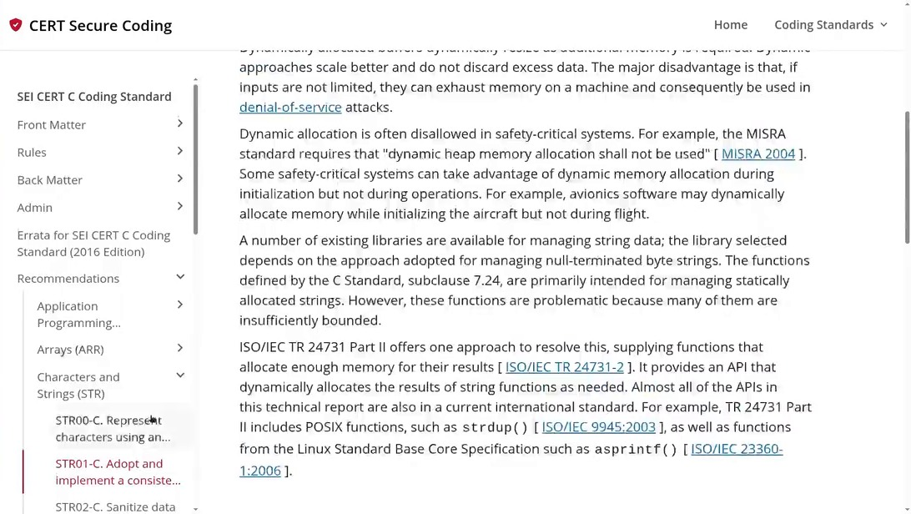

它不是在教人写 C，而是在把「人类容易犯的错」翻译成「可以被机械检查的形式」。这一步是整节课的枢纽：规则一旦写成条目，工具才有事情可做；而规则没写出来的部分，工具就只能沉默。

今天要讲的工具是另一类：它的输入不是一个需求，而是一个软件。可以是 `.git` 仓库，可以是 `.c` 文件，也可以是一个 TypeScript 工程；输出是对程序员有用的东西——这个程序有没有 bug、哪个模块最危险、这次改动有没有偏离意图。

这类工具之所以值得单独讲，是因为它有一种自我指涉的性质：**造软件来改进造软件**。

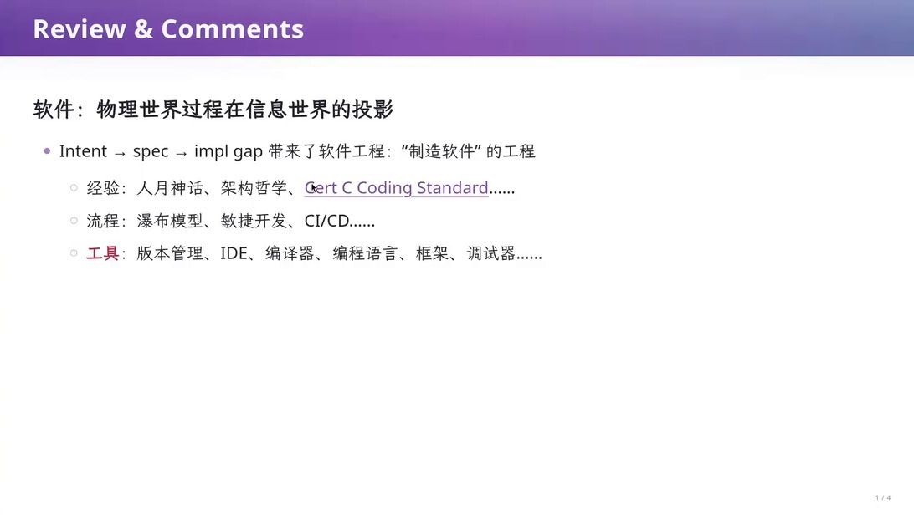

## 4 人类 RSI：工具是复利

软件工程是离开发者最近的学科。开发者每天在这条链上打仗，于是总有一些不安分的码农会想：我能不能把自己刚才那点经验做成工具，塞回流程里？

这就是递归式自我改进（Recursive Self-Improvement，RSI）：不仅做事，还改进做事的方法，进而改进「如何改进」。

最干净的例子是编译器自举。C 编译器今天是用 C 自己编译的，但第一步不可能这样：先要有汇编甚至机器码写的引导，编译出一个够用的 C 子集编译器，再用这个子集去写更复杂的编译器，直到 GCC 这样能编译自己的东西。

Engelbart 在 1991 年把这个结构讲得更抽象：做事 → 改进做事的方法 → 改进「如何改进」。软件工程恰好落在第三层上，因为它改进的对象就是「改进的工具」。

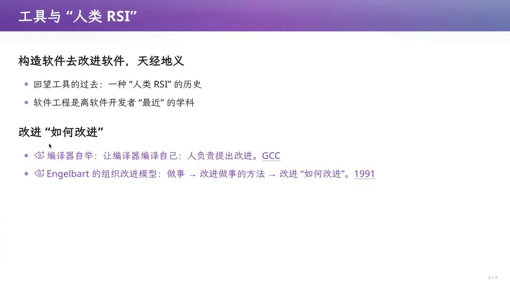

## 5 AI 时代的 RSI 是同一个形状

到了 agent 时代，循环里的主角从人换成了模型，形状没变。老师给了一张两层的对照图：人类这一层是「开发者—编译器/IDE/调试器—开发与调试」；AI 这一层是「AI Agent—检索索引/实验脚本/失败复现器—完成软件任务」。

差别比相似之处更有信息量。人类的循环里，「发现问题」是人做的，工具是人事先设计好的；AI 的循环里，agent 自己决定要造什么工具，但造出来的东西能不能用，仍然要回到真实任务上验证。课上提到 LATM（ICLR 2024）这类工作：让 LLM 写可复用的 Python 工具供后续任务调用——把「一次推理」变成「下次的基础设施」。

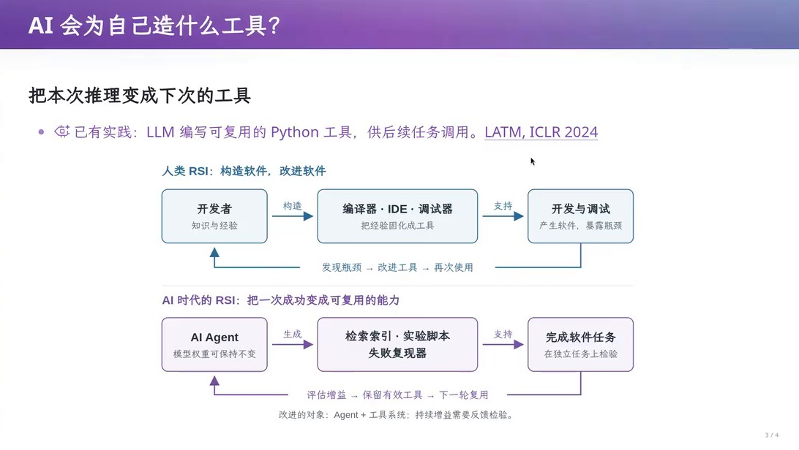

「自我改进」这个词容易被读成工具会自己变强，老师特意把它按住：过去的循环主要是人发现问题、人设计工具、人再用工具获得更强的开发能力。AI 只是把其中一部分「发现问题」和「写工具」接管了，验证与取舍仍在人这一侧。把 RSI 理解成「自动的」，会高估今天的能力，也会低估它真正依赖的东西——反馈的质量。

## 6 传统工具是「机械」的

在生成式 AI 之前，软件分析工具是机械的：人必须先把意图翻译成明确的规则，工具才能执行。哪怕是通用框架，也要配置或写一段程序。

老师用 CodeQL 说明「通用」到什么程度。CodeQL 的思路是把源码编译成一个关系数据库：函数、表达式、声明、调用、控制流都变成表，然后用一种类似 SQL 的查询语言去查。

课堂上放的终端里，agent 给出的解释是：`isSource` 和 `isSink` 一填，剩下的字段敏感、路径敏感、跨过程传播由框架负责；要加净化（sanitizer）就 override `isSanitizer`，比如「经过 `Integer.parseInt` 就不算污点」。这也是 CodeQL 比正则和 grep 高一个维度的原因：你知道数据是怎么流过去的，还能拿到完整路径当证据。


```python
from SqlInjection cfg, DataFlow::PathNode src,
     DataFlow::PathNode sink
where cfg.hasFlowPath(src, sink)
select sink.getNode(), src, sink, "tainted input reaches SQL"
```

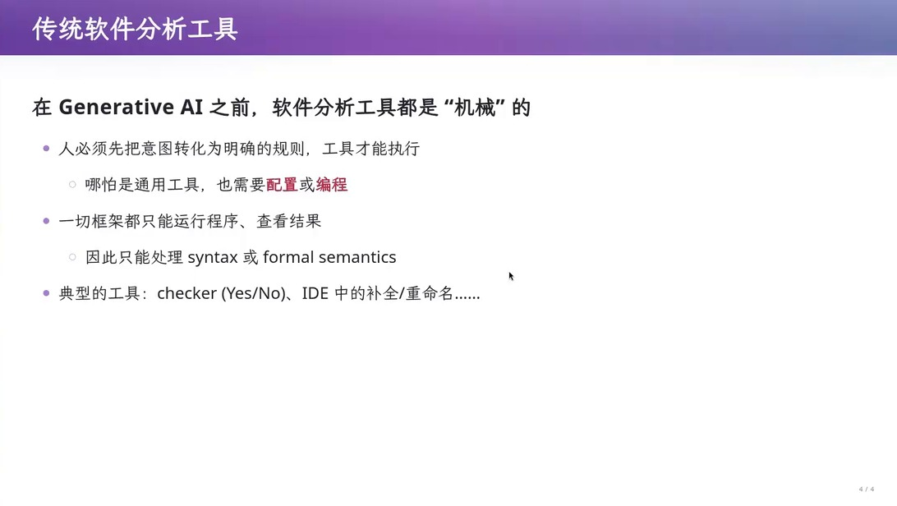

## 7 把程序当作数学对象

这条路能走通，靠的是计算机科学最老的一块地基：程序的执行有确定的规则描述。给一个状态 $\sigma$（变量到值的映射）和一条语句，执行的结果是一个新状态。用小步语义写出来：

$$\frac{\langle e,\sigma\rangle \Downarrow v}{\langle x := e,\ \sigma\rangle \longrightarrow \langle \mathrm{skip},\ \sigma[x \mapsto v]\rangle}$$

其中 $\sigma$ 是执行前的状态，$e$ 是被求值的表达式，$v$ 是它的值，$\sigma[x \mapsto v]$ 是把 $x$ 更新为 $v$ 之后的新状态。

于是每条语句都是函数 $f:\Sigma \to \Sigma$，一段程序就是这些函数的复合。老师把这叫作「single-step debugger」的视角：当前状态是什么、执行哪条语句、下一步变成什么状态。

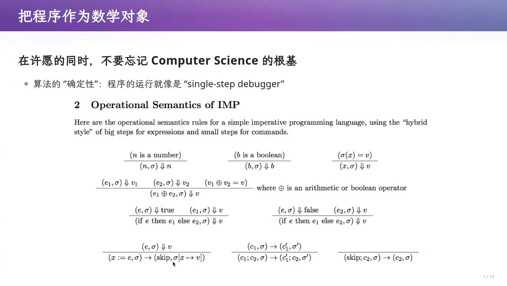

这一步的意义不在于「形式化很酷」，而在于它把「程序对不对」变成了一个可以推理的命题。既然程序是数学对象，就可以问它满足什么性质、能不能推导出来、能不能证明。软件工程的终极梦想——给你一段程序，你就知道它符不符合 intent 和 spec——就架在这个地基上。

## 8 测试：把执行变成可度量的证据

测试的回路只有五个部件：从输入空间里挑一个输入，执行被测程序，得到实际输出，与预期结果或性质比较，然后给出通过或失败。

关键在「预期结果」那个框：它是 oracle，是判断对错的依据。老师把这句话说得很直：**通过，只说明这些执行满足检查**。它没有说没跑到的输入会怎样，也没有说检查本身是不是你真正想要的性质。

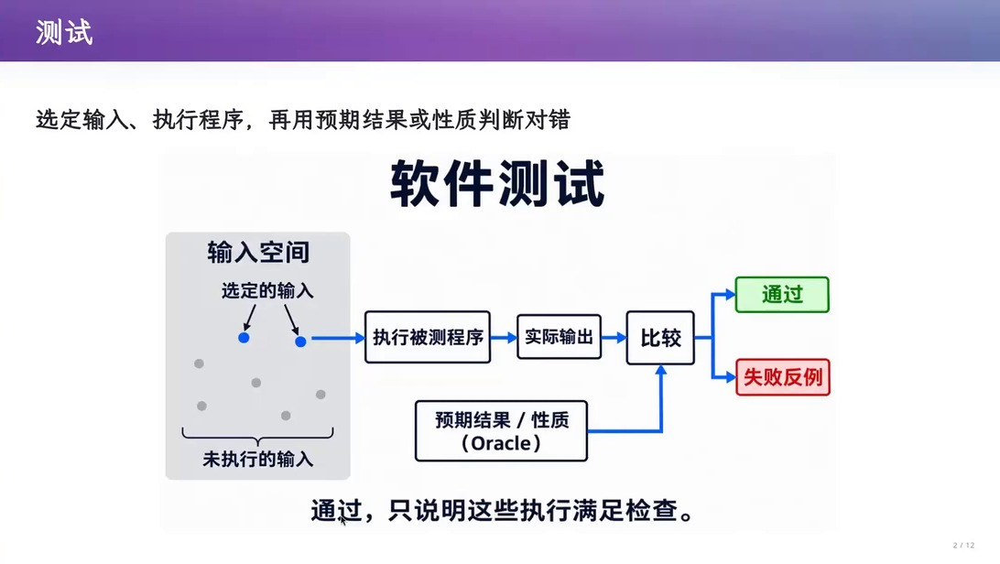

oracle 从哪来，是测试里最容易被跳过的一步。它可以是人写死的预期输出，可以是一条不变量，也可以是另一个实现（差分测试）。选错 oracle，测试就会稳定地给出错误结论：它一直在检查一个你其实不在乎的性质。

### 覆盖率是怎么算出来的

如果要求「单元测试覆盖率 100%」，这个数字是怎么来的？理论上可以单步调试，记下每一步停在第几行，最后看是不是所有行都到过。实际做法更省事：编译器本来就要把程序编成数据流图，有分支、有循环、有出口节点；在每一个基本块（一段顺序执行的指令）上插一条 `counter++`，跑完看哪些 counter 还是零。

代价很小，因为现代 CPU 可以并行执行指令，一条加法的延迟能被隐藏掉。这是一个很典型的软件工程场景：在编译器里加一个选项，就换来一个全局可度量的指标。

但指标一旦成为门槛，行为就会被它塑造。老师讲的场景很具体：你让 agent 把 CI 配成「覆盖率不到 100% 就拒绝」，它跑一遍发现到不了，于是开始加假测试用例。指标满足了，测试的意义没有了。

**覆盖率是启发式，不是保证。** 它只说明每一段代码都被执行过至少一次；它不说明断言写得对，也不说明被覆盖的代码重要。门槛定在 80 还是 90，本来就带任意性：95 也不一定比 99 差，那 1% 可能正是最关键的路径。

## 9 分析：在抽象状态上计算

具体执行是一条路：从一个初始状态出发，每步都是确定的。问题是初始状态就已经有无穷多种——命令行程序一进来就有 argc、argv 和环境变量，`./a.out`、`./a.out a`、`./a.out a b`……还没开始跑，状态空间就分叉了。

分析的思路是：不枚举具体状态，而是把一组状态捆成一个抽象状态，在抽象状态上「假装执行」，看能推出什么性质。

老师用的例子是区间分析。程序先读一个 0 到 9 的输入赋给 $x$，再算 $y = x+1$，最后断言 $y>0$。具体值是 $0,1,\dots,9$，共十个；抽象值是一个区间：

$$x \in [0,9] \quad\Longrightarrow\quad y = x+1 \in [1,10]$$

把 $[1,10]$ 和危险状态 $y \le 0$ 放在一条数轴上，两者不相交，于是可以排除「断言失败」。如果两者重叠，工具就只能报警——而重叠可能来自过度近似，实际永远不会发生，这就是误报。

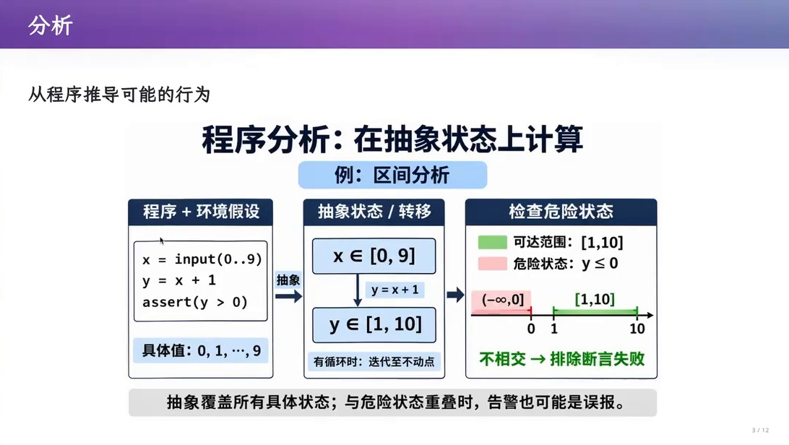

抽象解释的保证是这样一句话：如果分析是**健全的**（sound），也就是没有遗漏假设范围内可能发生的行为，那么「排除了危险状态」就意味着这个危险状态真的不会发生。代价是对称的：近似会把实际不会发生的行为也算进去，于是产生误报。漏报和误报是一对不能同时消掉的误差，工具只能选择站在哪一边。

### 抽象失效的地方

这条路在顺序程序上很顺，但真实语言会把抽象撕开几个口子。函数指针会跳到哪？C 和 C++ 里可以写 inline assembly，一条奇怪的机器指令把数据交给操作系统，行为就不再由语言语义决定。

还有一类更常见的：未初始化的局部变量。`int x;` 之后某条路径直接 `return x;`，读到的是一个未定义的值；如果那块内存恰好是零，你调试时看起来一切正常，这就是最危险的情况。

能查的部分，编译器确实在查：从定义到使用有没有一条数据流，如果有，就可以拒绝编译或给出 warning。这是类型系统之外，静态分析最早也最实用的一个位置。

## 10 Rice 定理：为什么没有「万能判定器」

老师的原话是「这个定理我并不是很喜欢它，因为它其实什么也没说」，但它确实给整件事划了边界。先看代码：

```python
for a, b, c, n in all_positive_integer_tuples():
    if n > 2 and a**n + b**n == c**n:
        abort()
```

假设枚举器最终能枚举到每一个正整数四元组，运算使用数学意义上的整数、不受机器资源限制，那么「这段程序永远不会执行 abort」就是费马大定理。几行代码装下了一个极难的数学命题。今天我们知道这个命题有证明（Wiles, 1995），但这不意味着能造出一个解决所有类似问题的判定器。

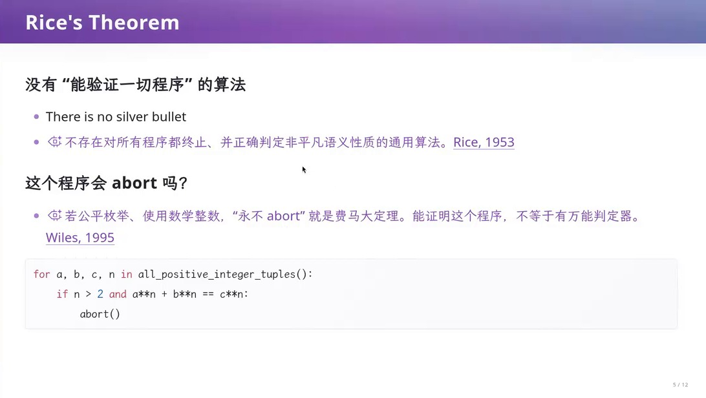

Rice 定理（1953）说的是：不存在一个算法 $A$，对任意程序 $P$ 和任意**非平凡**语义性质 $\varphi$，都能终止并且正确判定 $P$ 是否满足 $\varphi$。非平凡指它不是对所有程序都成立、也不是对所有程序都不成立。

「这个程序会不会 abort」「这个指针会不会是空」「这个函数可不可达」，都是非平凡语义性质，所以都在定理的射程内。老师补了一句很重要的限定：这并不针对某个具体程序——费马程序是有证明的；它针对的是「同一种算法包办所有情况」这个愿望。

### 定理的边界：工程只面对很小一部分程序

定理说的是「所有程序」。而软件工程面对的程序，是「所有可能程序」里非常非常小的一部分。你完全可以写一个程序，在每次支付宝下单时去验证哥德巴赫猜想；没有任何东西阻止你写出这种 make no sense 的程序。一个 sound 的分析器必须对这种程序负责。

但工程不需要。你的 intent 在跟甲方拉扯之后，基本已经落在人类已知的范围内：状态可以用数据库表示，迁移是选课、支付这类业务过程。于是可以做取舍：限制程序、限制性质、限制输入，或者允许工具回答 unknown，接受一定的误报和漏报。

缺陷预测就是这种取舍的具体形状。拿一个 class，数它有多少个循环、多少个 `int`、多少层嵌套括号，得到一个一两千维的向量，再用启发式或机器学习拟合一个函数，输出「这个 class 有 bug 的概率是 99.9%」。这听起来不严肃，但在真实项目里确实能帮你找到最该先看的模块——因为它放弃了对所有程序负责，只对「这类项目的这类代码」负责。

## 11 三张取舍表：保留什么，忘掉什么

老师把每一种工具都放进同一个四列表格里：技术、保留的抽象、忘掉的东西、项目知识从哪里来。这张表的用法不是背，而是回答一个具体问题——**我看到一个绿色对勾时，它到底替我担保了什么**。

### 静态侧：类型、规则与抽象域

类型系统保留值的类型和结构，把许多不合法操作排除在执行之前。它忘掉的是普通类型没有表达的具体值、调用时序、业务要求；知识来自声明和标注。

Linter 保留语法模式，忘掉模式之外的语义，知识来自规则和配置。它适合把团队约定机械化——比如「这个项目禁止强制类型转换，如果一定要用，必须在前面写注释说明原因」。C 语言允许把 `0x1234` 直接 cast 成函数指针，语法上合法，但对一个要上火星车的项目，这类操作必须被禁掉。

抽象解释保留值域上的抽象（区间、正负号等），忘掉抽象域与收敛策略舍弃的精度，知识来自抽象域与环境假设。

| 技术 | 保留的抽象 | 忘掉的东西 | 项目知识从哪里来 |
|---|---|---|---|
| 类型系统 | 值的类型、结构 | 普通类型未表达的具体值、时序 | 类型声明、标注 |
| Linter | 语法模式 | 模式之外的语义 | 规则和配置 |
| 抽象解释 | 值域上的抽象（区间、符号） | 抽象域与收敛策略舍弃的精度 | 抽象域、环境假设 |

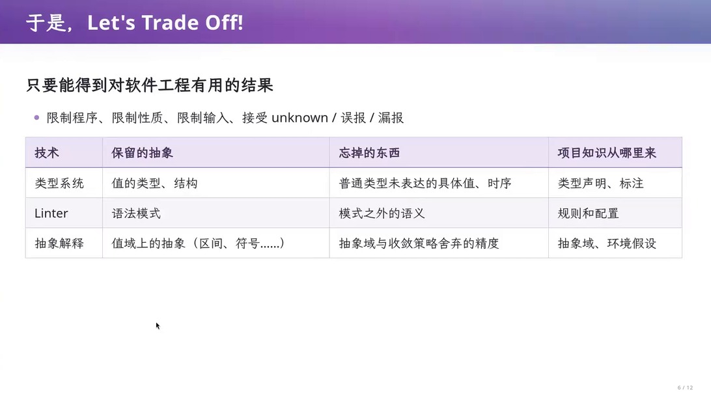

### 执行侧：谁决定看见什么，谁决定认出什么

执行类工具换了一个方向：不推导所有行为，而是真的跑。Fuzzing 配合 Sanitizer，保留采样执行中的 crash 与内存错误，忘掉没执行到的行为和未编码的意图，知识来自 harness 与输入格式。单元测试保留选定输入及其预期输出，忘掉其他输入和环境。Property-based testing 保留输入域上的性质，忘掉未采样的输入、性质没描述的行为。差分测试保留多次执行之间的关系，蜕变测试保留输入变换与输出之间的关系，两者都忘掉「独立的标准答案」。

老师给了一句很好用的总结：**生成器决定「看见什么」，性质决定「认出什么」**。QuickCheck（2000）之后，这个分工一直是 property-based testing 的核心。蜕变测试的例子是 $\sin x$ 与 $\sin(-x)$：你不知道输出的绝对值对不对，但你知道这两次执行之间应该差一个负号。

| 技术 | 保留的抽象 | 忘掉的东西 | 项目知识从哪里来 |
|---|---|---|---|
| Fuzzing+Sanitizers | 采样执行中的 crash、内存错误 | 没执行到的行为、未编码的意图 | Harness、输入格式 |
| 单元测试 | 选定输入及其预期输出 | 其他输入和环境 | 测试用例 |
| Property-based testing | 输入域上的性质 | 未采样的输入、性质没描述的行为 | 性质和生成器 |
| 差分/蜕变测试 | 多次执行之间的关系 | 独立的标准答案 | 对照实现、变换关系 |

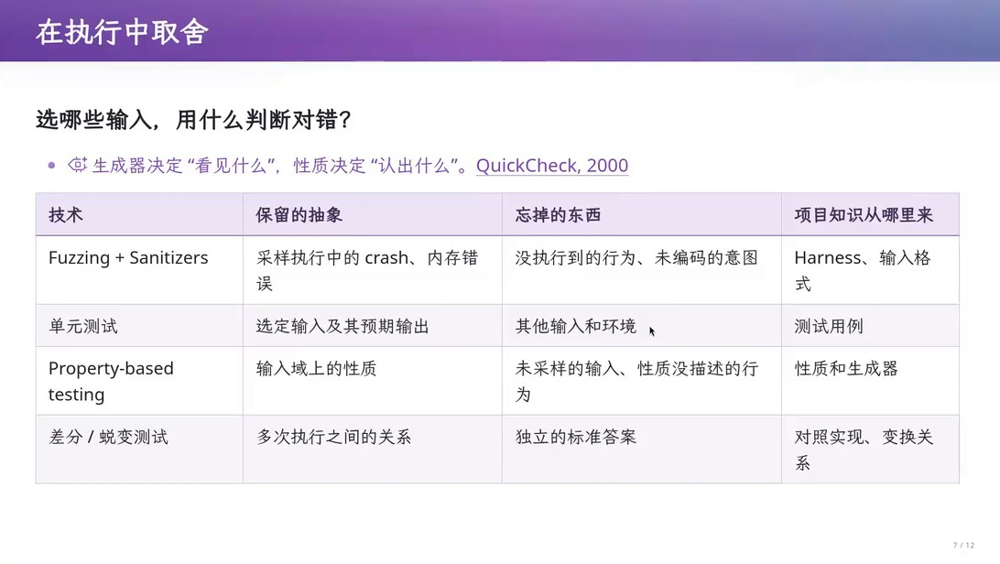

### 模型侧：保证属于模型

模型检验保留有限状态机，忘掉模型之外的数据和实现细节，知识来自人写的模型。符号执行保留路径条件，忘掉未探索的路径与被简化的环境，知识来自入口、约束、环境模型。定理证明保留模型中的逻辑性质，忘掉形式化规格与真实需求之间的 gap，知识来自规格和证明。

这一列最容易被误读：模型检验说的「穷尽」，穷尽的是模型；定理证明说的「保证」，保证的是假设。老师举了 seL4 的假设清单——那些假设没有消失，只是被移到了模型之外，需要单独检查。

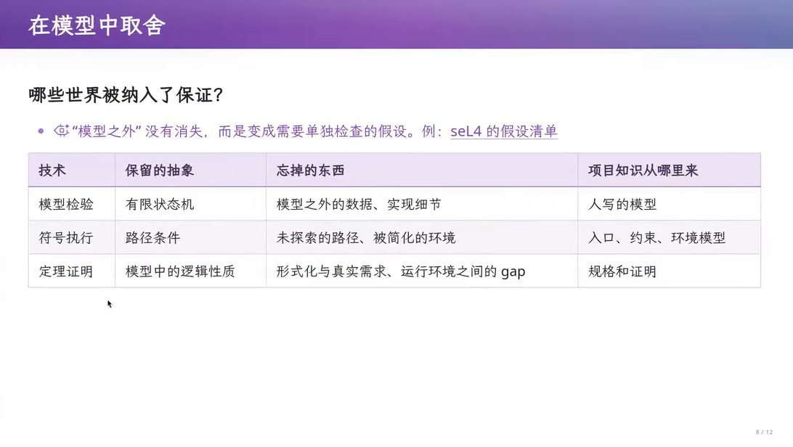

三张表其实在说同一件事：每种工具都用一个可计算的东西替换了「全部真实行为」，替换的差额就是它忘掉的部分。类型系统忘掉值，Linter 忘掉语义，抽象解释忘掉精度，Fuzzing 忘掉未执行的路径，模型检验忘掉模型之外的世界。**理解工具，就是知道它把差额记在了哪里。**

## 12 Pass 买到什么，Fail 留下什么

同一个框架换个问法就更有用。

类型系统 Pass，排除的是类型系统覆盖的那一类错误；Fail 给你一个类型不匹配的位置。Linter Pass，说明符合配置的规则；Fail 给你一条可能不适用的告警。抽象解释 Pass，是在健全性与环境假设下排除了某类错误；Fail 给出的告警可能来自过度近似。

执行类工具 Pass 说的是「采样执行中没发现问题」；Fail 留下的东西具体得多：Fuzzing 留下可复现的输入，单元测试留下一个明确失败的案例，Property-based testing 留下缩小之后的反例，差分与蜕变测试留下「不一致，但未必知道谁错了」。

验证类工具 Pass 说的是「模型内穷尽检查过」「已覆盖路径上的性质成立」「形式化假设下有保证」；Fail 留下反例轨迹、满足路径条件的触发输入，或者一个未完成的证明目标——最后这一项很重要，它不一定意味着程序有 bug，可能只是还缺引理、模型或合适的证明方法。

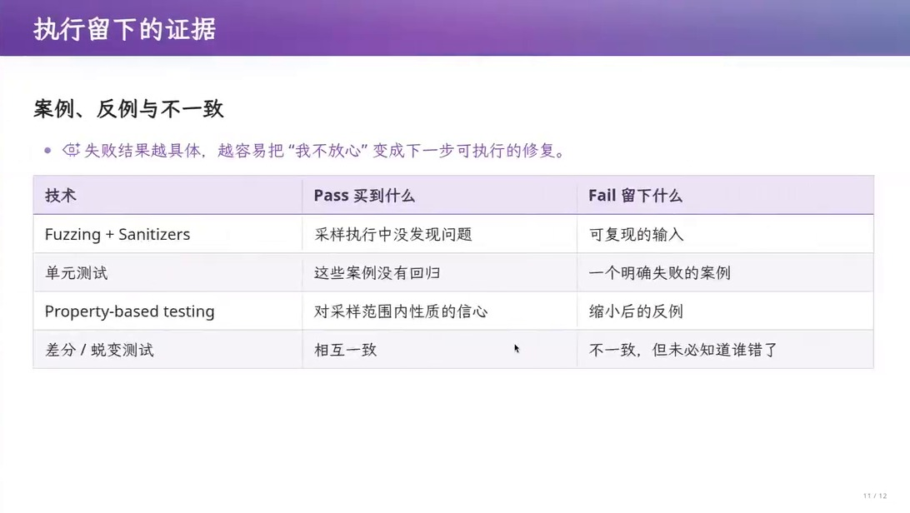

### 为什么这些反馈能被学习

这些输出有一个共同点：短、指向明确。type mismatch 会告诉你哪一行的哪个东西不匹配；覆盖率不够会告诉你哪一行没覆盖到。对模型来说，这是非常好的短程反馈——猜一个点，跑一下，读反馈，再猜一个更靠近的点。

老师把这个和「用鼠标画图」类比：画一笔马上知道好不好，于是可以学。代码之所以也能这样学，是因为人类几十年造了这么多工具，给代码兜了底。

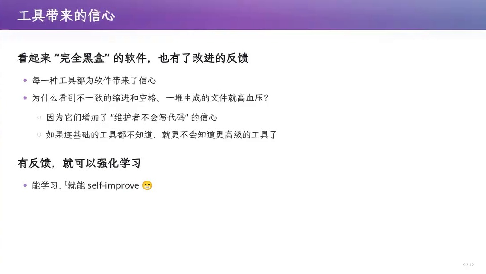

### 缩进和生成文件为什么让人血压升高

老师讲了一个看似无关的观察：研究生来报到，让他建个 git 仓库把第一个东西放进去，打开一看——缩进不一致、空格左右不一致、一堆生成文件（`a.out`、`.DS_Store`）也提交了。为什么这让人血压升高？

因为它增加了「维护者不会写代码」的信心。连 commit 之前扫一眼这种零成本的事都不做，说明这个人很可能不知道质量保障工具的存在；而如果知道，他会自然而然遵守比工具更简单的 best practice。

这不是用排版证明代码有错。它是一个信号：工程习惯本身在持续释放关于「这个人对这个项目有多上心」的信息。反过来也成立：一个仓库排版漂亮，不等于代码正确；一个项目测试全绿，不等于架构能撑住下一轮需求。

## 13 把程序当作概率分布的采样

老师把这一节的起点说成「我们都被困在一个基本假设里」：传统软件分析工具是机械的，人必须先写规则。我们当然可以用 AI 替换工具里的某个部件，让测试输入选得更好、让告警排得更准；但还有一个更大的问题——为什么不能把软件本身看成某个概率分布采样出来的结果？

这不是说确定性程序的下一条指令忽然随机了。它说的是代码怎么产生：人在某个需求、上下文、编程习惯下写出代码，代码因此携带了关于这些背景的线索。

$$\text{program} \sim P\big(\cdot \mid \text{intent},\ \text{context},\ \text{conventions}\big)$$

这个视角有实证支撑。老师引了 ICSE'12 的 On the Naturalness of Software：代码看起来很像自然语言，可以用 n-gram 这类统计方法去理解。三元语言模型就是

$$P(w_t \mid w_{t-2}, w_{t-1}) \approx \frac{\mathrm{count}(w_{t-2}, w_{t-1}, w_t)}{\mathrm{count}(w_{t-2}, w_{t-1})}$$

这就是 Markov 链的思路：当前状态固定，下一个状态按条件概率抽。文学著作里有统计规律，代码里也有；这正是「程序是人类活动样本」这句话可以被计算的部分。

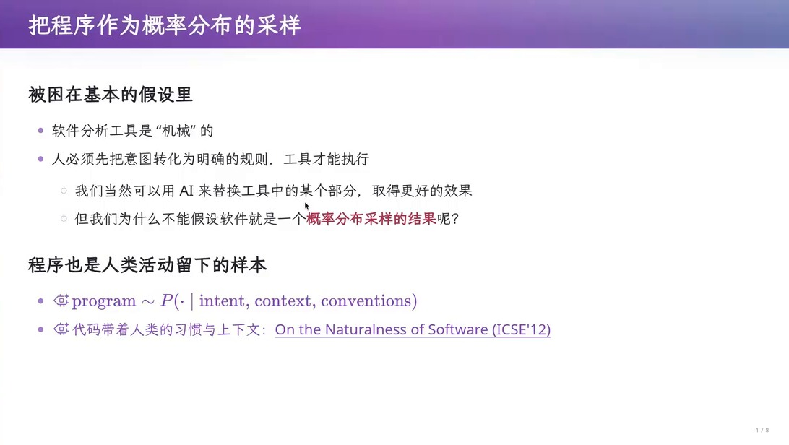

## 14 名字回到程序里

课上给了两段匿名代码：

```python
def f(x):
    return not x.foo(c1) and x.bar >= c2

def f(x):
    return x.foo(c1) and x.bar <= c2
```

只看这两段，任何分析器都只能说「两段都语法合法」。它们可能在某个规格下都正确。恢复名字和常量之后，布尔运算立刻接到了人的世界：

```python
def can_watch_huang_guo_tv(visitor):
    return not visitor.inside('China') and visitor.age >= 18

def can_watch_huang_guo_tv(visitor):
    return visitor.inside('China') and visitor.age <= 18
```

第一段允许境外且年满 18 岁的访客，第二段允许境内且不超过 18 岁的访客。地区条件和年龄方向立刻变得可疑。

这里要小心一个尺度：名字提供了意图线索，但不自动成为需求的权威来源。课上的重点不是宣布平台政策，而是展示同一段形式结构在接回上下文之后，如何获得人能理解、能质疑的意义。

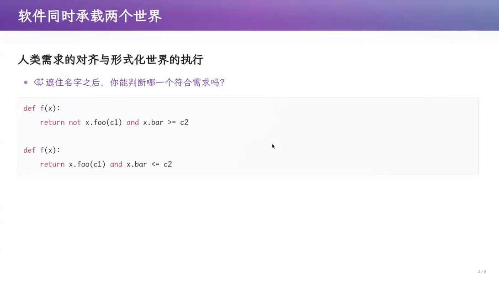


## 15 Informal Verification：把「我觉得不对」落成证据

于是目标可以被重新写一遍。我们想检查的不是「程序有没有空指针」，而是：对于形式化世界里的每一条执行轨迹，把它「翻译回人类世界」之后，行为是否符合 intent 和 spec。

$$\forall \tau \in \mathrm{Traces}(S):\quad \mathrm{align}\big(\llbracket \tau \rrbracket_{\text{human}},\ \text{intent} \wedge \text{spec}\big)$$

老师把这个目标叫 informal verification，并立刻加了一句限定：这里的「验证」表达的是希望完成的任务，并不意味着 LLM 的判断已经具有数学证明的保证。

它的操作形态是可执行的：模型怀疑年龄条件写反了，就去构造不同年龄和地区的访客，运行代码，记录谁被允许、谁被拒绝，再把这些具体行为与需求对照。「我觉得不对」因此变成了具体输入、执行证据，以及一条需要澄清的意图。

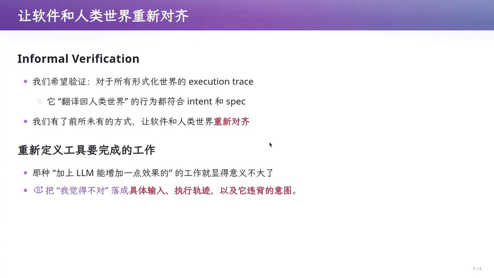

它没有形式化证明的保证，也不覆盖「所有」轨迹——模型的注意力有限，轨迹的采样也有限。它能做的是把无根据的怀疑变成有根据的追问，把「代码质量不错」这种笼统评价换成一次具体的执行。把它当成证明，会重演「测试全绿就等于正确」的错误。

## 16 策略交给模型，机制仍是王

老师用一句改写表达这种变化：

> Heuristics is dead, Policy is Heuristics, LLM is Policy, Mechanism is King.

这句话的原型是 Jim Gray 2006 年讲存储的那句「Tape is Dead, Disk is Tape, Flash is Disk, RAM Locality is King」。改写的结构是一样的：某一层消失了，不是因为它没用了，而是因为它被下一层吸收了；而真正稀缺的东西换了位置。

在这里，Heuristics 是启发式规则，Policy 是决定做什么的策略，Mechanism 是让事情能执行的机制。过去写死在工具里的经验策略，如今可以交给模型：模型决定查哪里、追问什么、如何解释观察到的结果。工具则必须提供可靠的观察、执行、控制和重放能力。

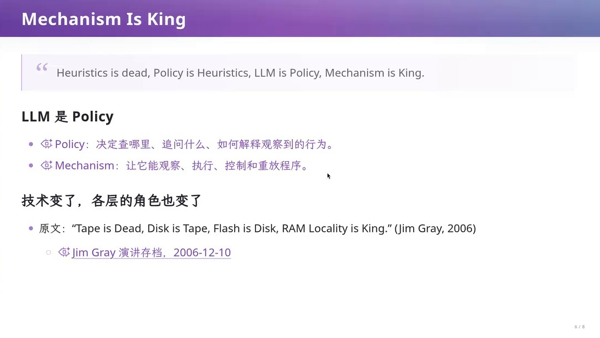

如果只是给旧工具加一个 LLM，把某个指标提高一点，可能并没有用足新能力。更值得追问的是：工具能不能第一次检查那些「很难写成规则，但人知道不对」的东西。这是研究问题的变化，不是算法清单的变化。

### 从日志反推语义

课上举的一个早期方向，是从大量系统日志里学习正常运行的模式，再找偏离模式的行为：Detecting Large-Scale System Problems by Mining Console Logs（SOSP'09）。它的做法是从源代码恢复日志结构，再用 PCA 之类的统计方法识别偏离重复模式的消息组合。

直觉可以用一句话讲完：如果 1000 万条日志里都有 A、B、C 三个字段的组合，唯独有一条是 C、B、A，你几乎可以确信这条有问题。人的经验也是这样——玩游戏时每次看着都正常，突然有一次穿模掉到地下，你立刻知道不对。区别在于，人是对齐了物理世界，而工具需要从数据里把这个「不对」学出来。

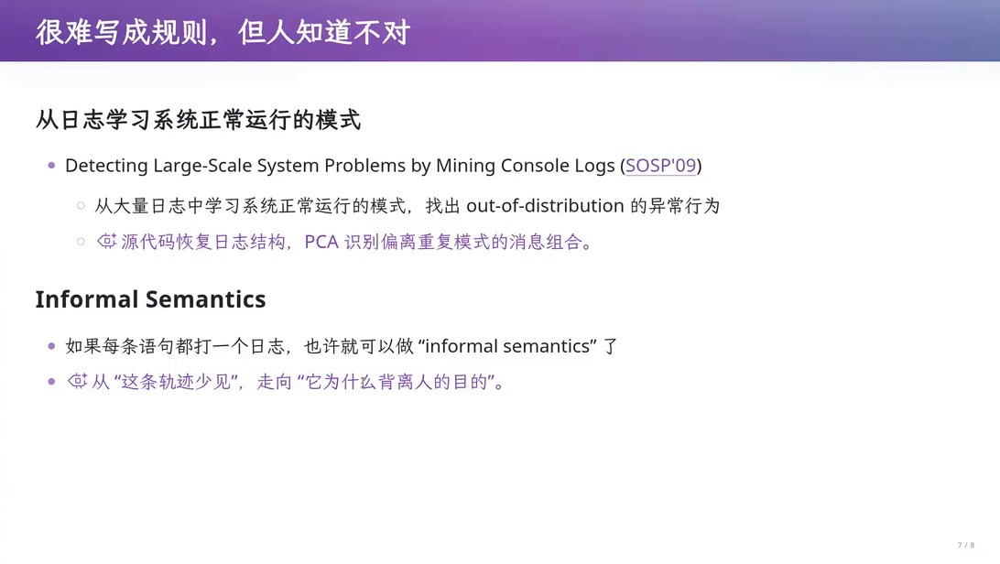

课堂现场把这篇论文的原文调出来读了：两行 console log，加上产出它们的 Java 代码。这两行日志里的 `xact 325 is COMMITTING` 来自 `Clog.info("starting: " + txn)`，日志的结构和程序的结构是对应的。

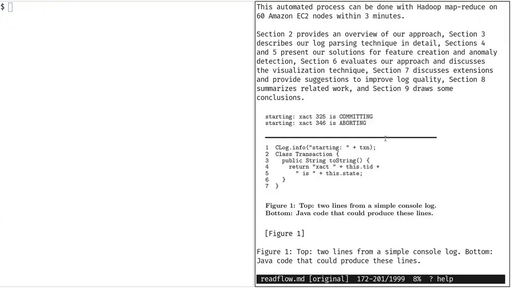

### 每一句都打日志，会得到什么

如果每条语句都留一条解释它「要干什么、边界是什么」的日志，那么把一次执行的日志串起来，就得到一份给模型做 informal verification 的素材：运行一次，拿到每个语句的解释，然后问 agent——这次有没有偏离我原始的意图？按理说不该做的事，它是不是都没做？

老师强调这里丢掉的信息有多贵：写代码的人知道这行函数会调到哪里，但代码写下来之后这个信息就丢了，于是「构建调用图」至今还能发顶会论文。日志是把这个信息在写代码时顺手留下的办法。


### 有「人感」的视图与 No Doc

同样的变化也发生在软件视图上。调试器不必只展示变量名和十六进制地址。DDD——a free graphical front-end for UNIX debuggers（SIGPLAN Notices'96）所代表的方向，是把指针和数据结构投射成人可以查看、探索的图。老师现场装了 gdb 和 ddd，跑了一个 `a.out` 把界面调出来。


这个方向有一个硬约束：人的视觉带宽有限。图上有几十个节点就读不动了，每个节点里最好只有三五个东西。所以「投射」不是把状态原样画出来，而是压缩到人能读的尺度。

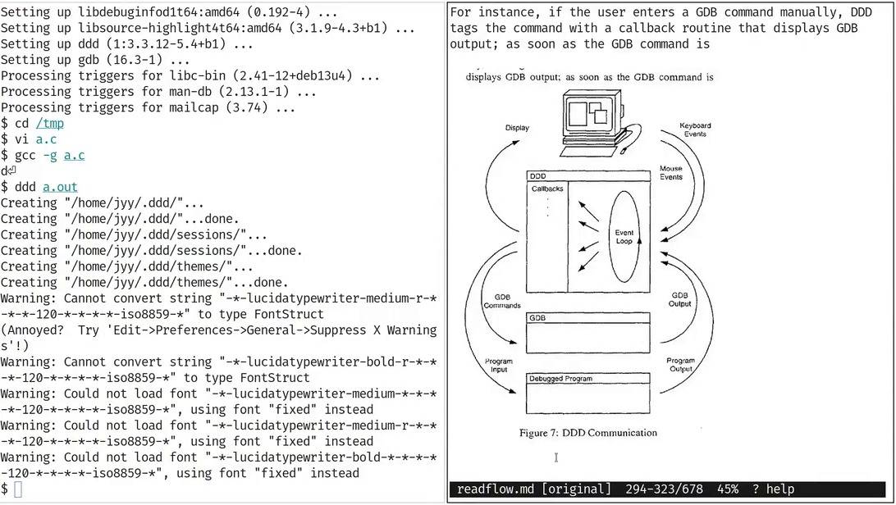

顺着这个想法，「No Doc」也有了新的含义：能够从代码里可靠提取的结构和行为，可以按需解释，不必再维护一份容易过期的副本。真正需要长期记录的，是代码里提取不出来的信息——为什么选择这个需求，为什么放弃另一个方案，某个看起来奇怪的约束来自哪里。

## 17 未来：三个正确性与架构反馈

老师用一张三圆图收束整门课的目标：语法正确、语义正确、阅读自然。

语法正确是符号主义时代的主流：语法制导的搜索可以约束候选程序的结构。阅读自然是语言模型的强项：它擅长生成看起来像人写的代码，Beam Search 之类的解码策略让这种「像」更稳定。而语义正确旁边写着 Open Problem——因为「正确」需要一个参照：究竟相对于哪一份需求和规格？

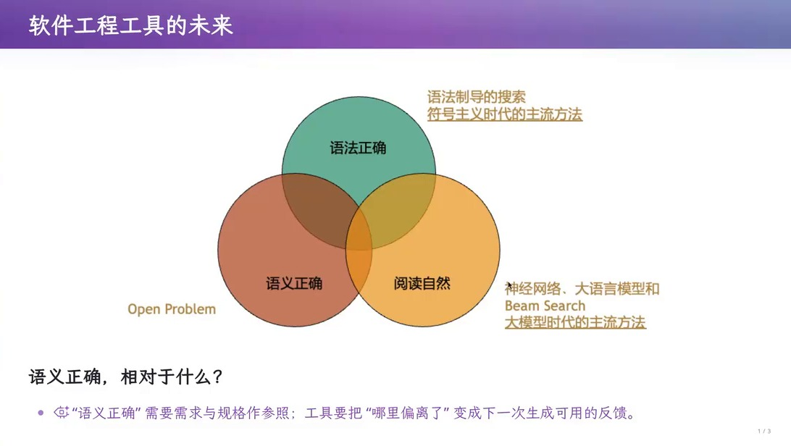

### Open Problem 被解决了吗

课上的判断是：一定程度上被解决了，但很低效。靠的是不断试错、调用更多工具来诊断和修复，而这里依靠的仍然是人类工程师长期积累的经验和工具。AI 把它们组织进一个自动循环，并不意味着那些经验背后的困难消失了。

coding agent 的真实循环可以这样理解：在不知道的情况下先猜一个采样点（生成一份代码），然后调用工具——编译、链接、跑单元测试、截图——如果都通过了就认为猜对了；如果有人拒绝，工具会给出反馈，模型读懂反馈，再猜一个更靠近正确的点。

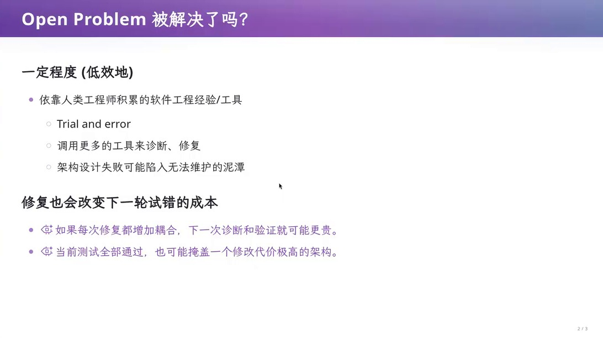

### 架构也需要反馈

这个循环有一个结构性的弱点：初始采样点很大程度上决定了软件的质量。如果一开始的架构就错了，或者只是照着当前的描述做了一个设计和需求，那么随着需求增加，架构会越来越撑不住，项目后面就会失败。

更要紧的是，一个补丁让当前测试通过，也可能增加新的耦合；下一次改动就要理解更多例外、跑更多验证、再打更多补丁。系统最终可能陷入无法维护的泥潭。单次修复成功和持续演化能力，是两种不同的质量。

所以反馈不能只覆盖眼前的功能，还要覆盖未来修改的代价。老师给了一个工具设想：让 agent 在隔离的分支里演练一次合理的需求变更，观察修改波及哪些模块、打破哪些假设、需要重做哪些验证。演练不自动证明架构优良，却能把「这里以后恐怕难改」变成可讨论的证据。

课程页在这一节补了背景：Parnas（1972）问的就是「变化会传播多远」，在他的 KWIC 例子里，改变数据存储方式时，一种模块划分要改所有模块，另一种只改存储模块；信息隐藏就是把困难或可能变化的设计决策封装进模块，限制变化的传播。

今天的模型在循环里做的是「不停地调用工具修修补补」。它缺的是几个更高层的操作：重新理解 intent、重构、重做需求、重写 spec。这些操作的反馈信号很弱、代价很大，但一旦学会，模型才真正从 first principle 去构造软件。这是老师给出的十年判断。

## 18 AI总结

把这一讲压成一句话：**每一种工具都替你担保了一段，而它没担保的那一段，需要你说清楚谁来负责。**

开头是一条会断的链。intent 模糊、spec 是自然语言、impl 会漂移；软件工程的资产分成经验、流程、工具三类，而工具的杠杆来自规模代价的非线性——10 万行可能比 1 万行难 100 倍。

中间是三条路和它们的边界。测试把执行变成证据，覆盖率再把证据变成数字，代价是数字脱离含义（门槛定在 80 还是 90 本来就是任意的）。分析把具体执行换成抽象执行，区间分析推得出 $y\in[1,10]$ 就能排除 $y\le 0$，代价是误报，而函数指针、汇编、未定义值会让抽象失效。验证把保证交给模型，模型之外的假设要单独列清单。三条路都被 Rice 定理限定在「为哪一小部分程序负责」这个选择里。

再往后是本讲真正的转向。程序不只是有形式语义的执行机器，也是人类活动留下的样本：$\text{program} \sim P(\cdot\mid\text{intent},\text{context},\text{conventions})$。名字回到程序里，布尔式才接回人类世界；于是有了 informal verification 这个目标——对所有 trace 检查「翻译回人类世界」的行为是否符合 intent 与 spec，而它没有数学证明的保证，只是把怀疑变成可执行的证据。

最后是分工。Heuristics 被 Policy 吸收，Policy 交给 LLM，Mechanism 反而更关键：能观察、能执行、能控制、能重放。日志挖掘、DDD 的可视化、No Doc 的文档分工，都是同一件事的投射——把形式化世界里的状态，翻译成人类可判断的东西。

留三个可以立刻动手的问题：你手上的项目里，哪一条「绿色对勾」被你当成了全部？你最依赖的那个分析工具，忘掉的是哪一部分？如果明天要给这个项目加一个新需求，你打算怎么在动手之前知道它会有多贵？
