## 1 本讲补的是链条的最后两段

前十三讲把软件工程拆成了一条链：人脑子里的意图（intent）、写下来的规格（spec）、跑起来的实现（impl）。两个断点分别在「人对自己说不清楚」和「spec 到 impl 之间隔着一门学科」。质量保障、分析工具、形式化验证，都是在第二个断点上架桥。

这一讲处理链条更后面的两段：软件写完之后，怎么交到别人手里，以及交出去之后谁来负责。

这两段有一个反直觉的性质：**困难不来自代码，而来自代码以外的世界**。同一份源码在别人机器上编译不过，是因为对方装的是另一个版本的共享库；同一个服务在你自己终端里跑得好好的，别人拿到链接打不开，是因为你给的是 `localhost`；同一个数据库表加一个字段，在你的测试库里是一行 SQL，在生产库里是一次要和业务抢时间的迁移。这些问题没有一个能被「再写点代码」解决。

讲者在正文之前花了半小时谈数学和 AI，看上去离软件发布很远，其实是在给这一讲定调：如果许愿越来越便宜，剩下的稀缺资源只有两样——**把需求说清楚的能力**，和**判断「做完了没有」的能力**。发布与运维恰好是这两样能力的试金石。

后面所有内容可以挂在三个问题上：

1. **发布的是什么？** 一个二进制、一组产物，还是一份能被别人重现的源码？
2. **发到哪里、给谁？** 操作系统、CPU 架构、发行版、显卡、终端形态，每一维都会把产物数量乘一遍。
3. **上线之后谁负责？** 服务一旦 public，运维就开始了；运维处理的不是「新写的软件」，而是「已经有一个版本在跑」这件事。

## 2 许愿时代：一条摘要，和一个被重新定价的技能

课堂开场先放了一条「热乎的消息」：一篇题为 *VP ≠ VNP OVER EVERY FIELD* 的摘要，作者栏写着 CLAUDE 和 ANTHROPIC，正文说明它由内部的 Claude 模型发现，并在 Lean 里完成了形式化。核心结论是一个门数下界：任何计算 $m\times m$ 矩阵 permanent 的算术电路，在实数域上都需要超过 $m^{\Theta(\log m)^{1/3}}$ 个门；同样的界对特征不为 2 的任意域成立。

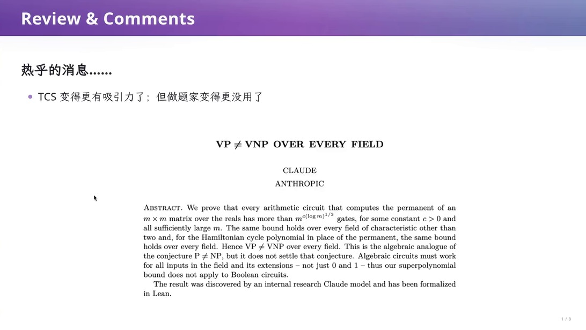

幻灯片上只有两行字，第二行才是这一段的主题：「TCS 变得更有吸引力了；但做题家变得更没用了」。它不是在说数学没用，而是在说**以「会做题」为计价单位的技能，正在失去计价基础**。

要理解这个下界为什么值得放在一门软件工程课的开头，得先看清 permanent 和 determinant 差在哪：

$$
\det A=\sum_{\sigma\in S_n}\operatorname{sgn}(\sigma)\prod_{i=1}^{n}a_{i,\sigma(i)},\qquad
\operatorname{per}A=\sum_{\sigma\in S_n}\prod_{i=1}^{n}a_{i,\sigma(i)} .
$$

- $\sigma$：$n$ 个下标的排列，求和跑遍所有 $n!$ 种排列；
- $S_n$：全体排列的集合；
- $\operatorname{sgn}(\sigma)$：排列的符号，奇排列 $-1$、偶排列 $+1$；
- $a_{i,\sigma(i)}$：第 $i$ 行取第 $\sigma(i)$ 列的元素；
- $\operatorname{per}A$：permanent，与行列式唯一的差别是把符号项去掉了。

学生共同的困惑是「为什么非要这个符号项」。讲者给了一个很具体的回答：把二分图编码成矩阵，

$$
A_{ij}=1 \iff \text{左 } i \text{ 与右 } j \text{ 之间有边},
\qquad\text{则}\qquad
\operatorname{per}A=\#\{\text{完美匹配}\}.
$$

于是 permanent 数的是「完美匹配有多少个」——一个天然的计数问题。行列式数不出来：乘上 $\operatorname{sgn}(\sigma)$ 之后，奇排列与偶排列的贡献互相抵消，计数信息被消掉了。

反过来的方向更神奇：在平面图上，只要给边定一个巧妙的定向（Kasteleyn 定向），permanent 就能变成 determinant，算出的行列式值恰好等于完美匹配数。这个算法不是数学家先想到的，而是物理学家为了算 Ising 模型的相变、算配分函数时发明的。讲者用它说明一件事：跨领域工具的迁移，经常比在本领域内硬推更有效。

至于 permanent 能不能被多项式大小的电路算出来，就是 Valiant 提出的 **VP ≠ VNP**，一个 open 了几十年的猜想。新结果给出的不是多项式界，而是带 $\log$ 的指数：$G_{\mathrm{per}}(m)>m^{\Theta(\log m)^{1/3}}$ ——比任何多项式都大，但远小于 $2^m$ 这种真指数。所以**「证明了下界」和「推翻了枚举的必要性」是两件事**：前者成立，后者还差得远。

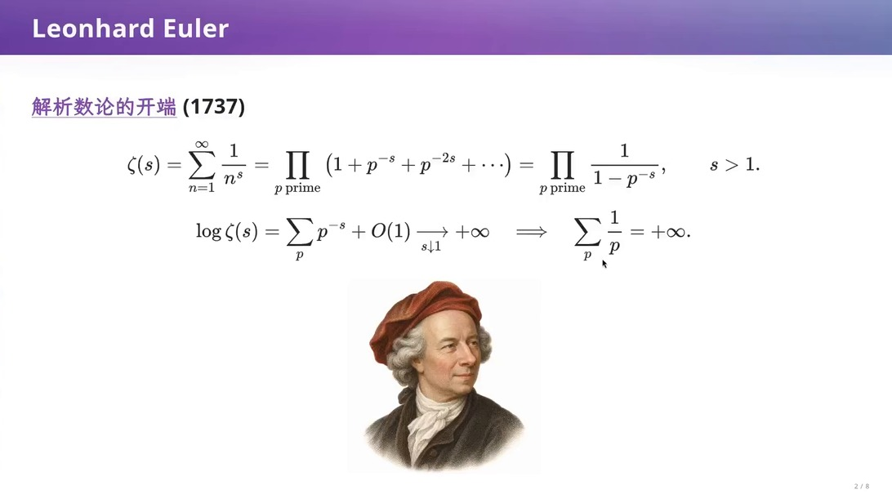

顺着这条线，讲者又回到欧拉 1737 年那篇论无穷级数的文章。幻灯片上只有两行公式：

$$
\zeta(s)=\sum_{n=1}^{\infty}\frac{1}{n^{s}}=\prod_{p}\frac{1}{1-p^{-s}},\quad s>1,
\qquad
\log\zeta(s)=\sum_{p}p^{-s}+O(1)\ \xrightarrow[s\downarrow 1]{}\ +\infty
\ \Longrightarrow\ \sum_{p}\frac{1}{p}=+\infty .
$$

- $\zeta(s)$：对所有正整数求 $n^{-s}$ 之和；
- $p$ 跑遍所有素数；等号成立是因为每个正整数有唯一的素因子分解；
- 取对数把乘积变成求和，每一项对应一个素数；
- 最右边：调和级数发散 $\Rightarrow$ 素数无穷多——用分析学重新证明了欧几里得。

这一段的教学价值不在公式，而在它示范了一种**翻译**：把一个关于整数的陈述，翻译成一个关于函数的陈述，然后借用函数的工具。讲者把这种能力和许愿联系起来——真正稀缺的不是把定理证出来，而是知道该往哪个方向翻译。

## 3 魔法的用法：两次反例、一个问句、一个实验

### 3.1 两次反例

接下来的幻灯片讲的是 Prompt 大师 Levent Alpöge：7 月用一句话的思路构造出 Jacobian 猜想的反例（一个三元多项式映射，Jacobian 行列式处处是同一个非零常数，却把三个不同的点映到同一点），11 月又与 Tristan Buckmaster 给出了 Navier–Stokes 的反例（三维流从光滑初值出发，即使没有外力，解也会在有限时间内失去光滑性）。讲者的评价是「牢牢掌握了引导 AI 的命门」，并把它类比为古罗马念咒语消字母的迷信——只不过这一次，咒语真的生效了。

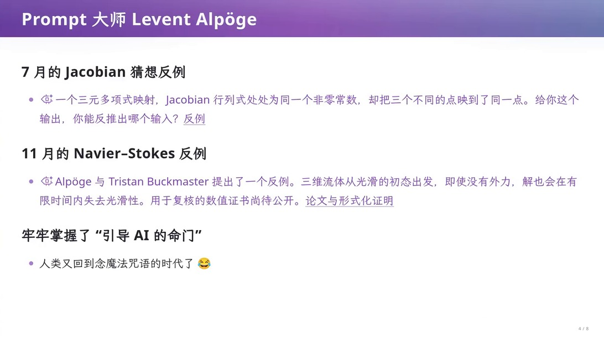

一个值得停下来看的细节：反例本身很容易验证（在 Mathematica 里一下就验完），难的是「想到要往哪里找」。两次成功都不是靠更强的算力，是靠对问题结构的判断——他先认出大问题里的哪一步对应哪个小模型，Claude 才有路可走。

### 3.2 如果伽罗瓦时代有大语言模型

现场有人问：既然模型能直接给结论，群论这种为了理解方程可解性而发明的理论，是不是就不会被发明了？

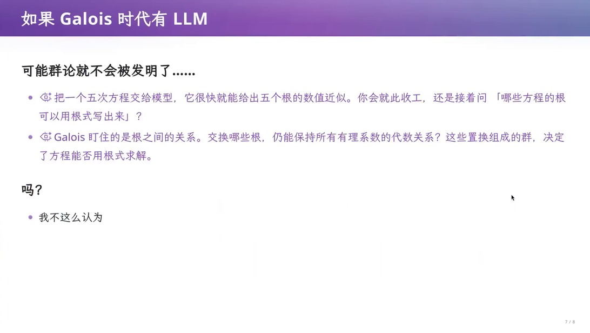

回答分两步。第一步否认「够用」：模型可以把多元多项式很快给出五根的数值近似——但你原本想知道的不是数值，是「哪些方程的根能用根式表示」，这个答案不在数值里。伽罗瓦打破的是「根与根」之间的关系：交换哪两个根，仍能保持所有有理系数代数关系不变？这些置换组成的群，决定了方程能否用根式求解。

第二步给出替代路径，而这个路径恰好是本讲后面反复要用的「对齐」。

### 3.3 蒸馏你自己


实验要求学生做三件事：

1. 构造一个评测集：一堆任务输入，加上「你自己的输出」作为参考。**这个集合绝对不能泄露给 AI**。
2. 写一个**正向**的 prompt：告诉模型你是怎么想的、在什么情况下会怎么判断。而不是列一张「不能这样、不能那样」的反例清单——那张清单只会越来越长，模型还是抓不到核心。
3. 让智能体在**隔离的上下文**里完成任务，拿它的输出和你的参考输出比对，让一个足够强的模型打分，然后改 prompt、再跑，直到分数稳定。

讲者给了自己在用的例子：让模型审稿。经过这样的对齐之后，「有些我能够看到的东西，他能够自己提炼出来，而不是不完全是我告诉他」。这个流程产出的不是一个更好的 prompt，而是一份**可传递的、关于「我怎么判断」的压缩**——正好对应伽罗瓦决斗前夜写的那份手稿。

两个前提缺一不可：**尺子统一**（所有任务用同一个标准打分，分数才有意义），**上下文隔离**（被训练的模型看不到参考答案，否则它学到的是抄答案）。

### 3.4 人类还剩什么

讲者把「人类智能 vs 机器智能」落在一个很具体的差异上：人类的智慧是**分布式、有 diversity** 的。每个人带着自己的偏见来到世界，两个不同偏见的人合作可以 $1+1>2$；而一个模型是把所有训练数据集中到一处，它因此有了最强的能力，也因此有了很强的偏执——「你做同一件事，它想的方向几乎一定是那个方向」。他的反例是评审：让 Claude 和 GPT 互相 review，解决复杂问题时通常会收敛到更好的方案。

再往下是他对 few-shot 的判断。机器学习的人常说「模型不能泛化，因为梯度下降只是把一两个样本变成一个 gradient」。讲者认为人不一样的地方在于：

> 你经历了某一件事情，突然三观尽毁或者豁然开朗，然后你举一反三。而这个举一反三是什么？是计算，是在 test time 要算。你只是把那个 gradient 重新传播一下，这个不叫举一反三。

结论是：taste、few-shot 这些能力「不是本质的技术困难」，只是还没足够多的人研究、也没有足够好的框架去实现。这是猜测，不是结论。

## 4 发布是什么：一本书、十五张软盘、一个二进制

### 4.1 1970 年的发布会

最朴素的答案：编译成 binary，把 binary 拷给别人。

```bash
gcc -o cs-go cs-go.c
# 把产物往邮件列表、QQ 群里一丢
```

今天这一步会立刻翻车：群友打开就报错——「哎呀，怎么缺少 libSDL2-2.0.so.0?」。这个报错把整节课的动机讲完了：**软件发布比 1970 年复杂，不是因为代码变多了，而是因为运行环境不再是你控制的那一台机器**。

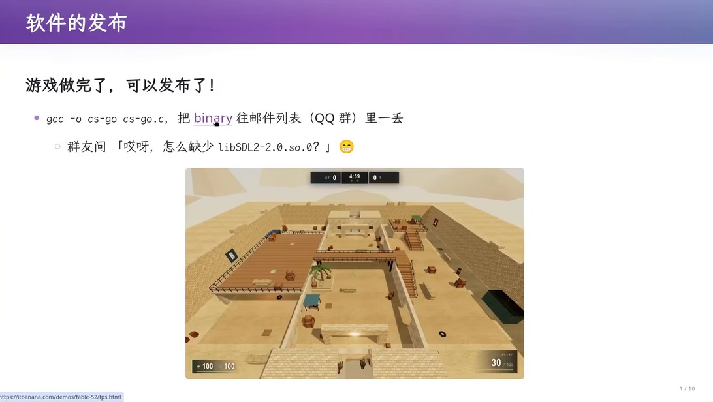

缺 `libSDL2` 的含义是：**你的二进制不是自足的产物，它是一组依赖的引用**。你把引用发给了别人，却把被引用的东西留在了自己机器上。用户既不知道 SDL 是什么，也不知道自己的发行版装的是哪个版本——你省下的打包工作，会以「在我这儿明明能跑」的形式，变成十条无法复现的报错。

### 4.2 书上印源码的年代

再往前追，发布的形式更原始。1978 年的《101 BASIC Computer Games》把源码和运行示例一起印在纸上，读者逐行敲进电脑、输入 RUN，再对着书检查有没有敲错。这本书的藏本现在在史密森尼博物馆。

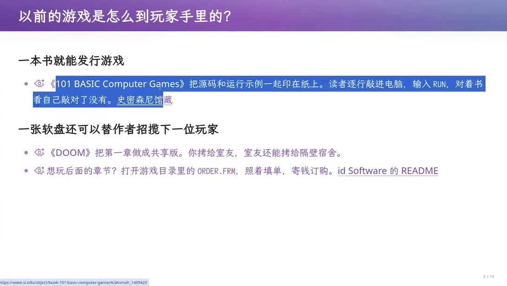

同一页的下半部分讲了发行模式的第一次演化：id Software 把《DOOM》第一章做成共享版，你拷给室友，室友再拷给隔壁宿舍；想玩后面的章节，就打开游戏目录里的 `ORDER.FRM`，照着填单、寄钱订购。这是「免费试玩 + 邮购解锁」的原型，也是「分发渠道本身就是产品设计」的早期证据。

### 4.3 十五张软盘与三代 PC

到 Windows 3.0a，发布已经变成需要写安装手册的工程：十五张软盘，每张 360K。

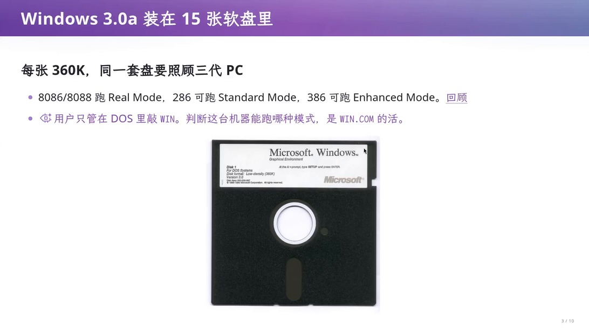

| 处理器 | 可运行模式 | 说明 |
|---|---|---|
| 8086 / 8088 | Real Mode | 16 位，无保护，内存寻址受限 |
| 80286 | Standard Mode | 有保护模式，仍受 16 位寻址约束 |
| 80386 | Enhanced Mode | 32 位保护模式，可跑多任务 |

用户只需要在 DOS 里敲 `WIN`。判断这台机器能跑哪种模式，是 `WIN.COM` 的活，不是用户的活。这是「发布」的一个核心技巧：**把平台差异吸收进一个启动器，而不是吸收进用户的说明书**。今天在 ARM 和 x86 上跑同一个安装包、由安装器选择后端，是同一件事的现代版本。

## 5 平台的乘法：为什么「支持 PC」是个陷阱


「支持 PC」这句话在 2026 年已经被拆成四个独立的问题：

1. **架构**：室友用 Windows，先问是 x86-64 还是 ARM64。
2. **芯片**：隔壁用 Mac，还得问是 Intel 还是 Apple 芯片。
3. **发行版**：终于来了个用 x86-64 Linux 的同学——他的发行版里有你链接的那个版本的 SDL 吗？
4. **显卡**：两个人都进了游戏，一个用新独显，一个用老核显。你承诺的最低画质，是在哪块 GPU 上跑过的？

现场还补了历史上的第四代：更早的 Mac 用 PowerPC，现在已停止支持；如果要支持中国的供应链，Linux 上还会多一个龙芯版本。把这些维度乘起来，「支持 PC」就变成十几个必须分别测试的组合：

$$
N_{\text{产物}}\ \approx\ N_{\text{OS}}\times N_{\text{arch}}\times N_{\text{打包}}\times N_{\text{验证}} .
$$

- $N_{\text{OS}}$：操作系统，决定系统调用和图形栈；
- $N_{\text{arch}}$：指令集，决定二进制能不能被加载；
- $N_{\text{打包}}$：同一个二进制的多种封装，供不同包管理器消费；
- $N_{\text{验证}}$：让下载者确认「这个包就是发布者发的那个包」的附加产物。

Linux 上最麻烦的一维不是架构，是「你的发行版里有没有我链接的那个版本的库」。这一维不受你控制：你链接 2.0，用户机器上是 2.28，符号可能对得上、也可能对不上。snap 和 flatpak 用「有点像虚拟机的容器」来解决它，把所有依赖一起打进去，代价是系统和包的膨胀。这个交易很清楚：**用磁盘和内存换「在任何发行版上都能跑」**。

### 5.1 为什么模型默认给你一个网页

这是全场最实用的一段，它解释了一个大家都遇到过却很少追问的现象：你让 AI「做一个 CS 游戏」，它给你一个 three.js 网页，而不是可执行文件。

原因不是审美，是成本。讲者算得很直白：

> 如果他真要生成这样的应用程序，那对不起，他要考虑我要不要在龙芯发布、在 Linux 上我应该怎么办、在 Windows 上我应该怎么办、在 macOS 上怎么办。这时候我的 token 消耗就会成倍地增加。那这个时候模型肯定选择偷懒——因为你没说。

一个单文件 HTML 只有 1.4 兆，双击就能跑，不需要安装、签名、构建矩阵。**只要跨平台发布的成本还在，模型就会默认选择成本最低的出口**。如果这个网页形态恰好符合你的产品，那很好；如果不是（必须离线、必须访问串口、必须上架），那这个默认值就是一个需要你显式推翻的决定——推翻它的方式不是抱怨模型偷懒，是在需求里写清平台清单和验收方式。

## 6 196 个产物：一次发布里到底有什么

### 6.1 从一次 tag 开始

讲者打开自己正在用的 Codex 的发布记录：两天前的一次预发布，一共 196 个文件。第一步不是编译，是推一个 tag。

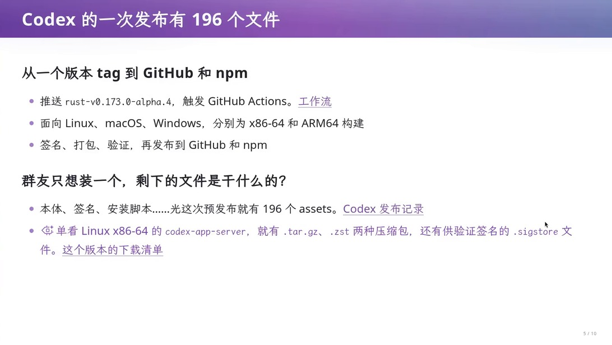

流程被压成四行：推送 `rust-v0.173.0-alpha.4` 触发 GitHub Actions；面向 Linux、macOS、Windows，分别按 x86-64 和 ARM64 构建；签名、打包、验证；发布到 GitHub 和 npm。tag 在 git 里就是一个指向某个 commit object 的指针——「这次提交就是我要的那一次」。

这一步的价值在于：**发布是由一个不可变的引用触发的，而不是由某台机器上的目录状态触发的**。有了这个引用，构建才可重复；没有它，「我本地能跑」永远无法与「用户拿到的是什么」对上。

### 6.2 为什么是 196 而不是 3

把上一节的乘积代进真实项目，196 就不神秘了。单看 Linux x86-64 上的一个 `codex-app-server`，就有 `.tar.gz` 和 `.zst` 两种压缩包，另有供验证签名的 `.sigstore` 文件。三个平台 × 两种架构，再乘上每个组件两三种封装，就能堆到三位数。

| 类别 | 例子 | 它替谁解决问题 |
|---|---|---|
| 本体 | `.tar.gz`、`.zst`、`.deb`、`.exe` | 让不同习惯、不同包管理器的用户都能装上 |
| 签名 | `.sigstore`、校验和文件 | 让下载者确认包确实出自发布者、且没坏 |
| 安装脚本 | `install.sh`、`setup.exe` | 代替用户完成解压、放路径、注册 |
| 元数据 | 版本清单、changelog | 让自动更新与依赖解析有依据 |

「群友只想装一个，剩下的文件是干什么的？」答案是：剩下的文件不是给群友的，是给**不确定的下载环境**的。

### 6.3 校验和与签名解决的是两个问题

课堂用「下载断线」这个场景解释校验和的意义：

> 浏览器下载下着下着断了，命令行它断了，然后命令行的结果你可能又没有看到，就看到留了一个 100 兆的文件在这儿。哎，那这 100 兆的文件到底对还是不对？我到底下完没有？有没有在传输当中出现什么问题，或者甚至被中间人给你篡改了？

两个威胁对应两种机制：

- **完整性**（校验和）：把文件过一个哈希函数得到短摘要，下载方用同一个函数再算一次，一致就说明字节没变。防传输中断、磁盘错误。
- **来源**（签名）：用只有发布者持有的私钥对摘要签名，下载方用公钥验证。防「有人把包换了，顺便把校验和也换了」。

一句话记住两者的分工：**校验和证明「这份数据和那份数据一样」，签名证明「这份数据出自谁」**。只发校验和，等于把锁和钥匙一起寄出去。

### 6.4 GitHub 只存源码

讲者顺带解释了 GitHub 的一条设计哲学：仓库只托管「人或机器创造性创建的部分」，也就是源码；所有工具链能生成的东西都不放进去——省空间、省时间、省带宽。生成的产物走 release。

这条哲学解释了为什么 release 页面会那么长，也解释了为什么「直接 clone 然后自己 build」在很多项目上是一条死路。**release 是源码的二阶产物，用版本号索引，用签名背书。**

## 7 需求的回声：从 PC 到手机，一切回到架构

演示很成功。老板看完说：「这个很好啊，手机上也要能玩。」于是需求变成：同步上架 Android、iOS、鸿蒙，而且 iOS 的国区和美区还要分开。


幻灯片上那两句话是本节的核心。具体的一句是：「把『按空格开火』换成『点屏幕开火』，命中判定要改几行？」判决的一句是：「最开始的那个 prompt 让 AI 一路狂奔，到这时候，屎山就扶不起来了。」

手机上没有空格键，这个事实在代码里的影响远不止改一个键位映射：

- 输入从「离散按键事件」变成「带坐标的触摸序列」，命中判定的输入类型变了；
- 屏幕比例从 16:9 变成各种竖屏比例，UI 布局和视野都要重算；
- 性能预算从「独显随便跑」变成「手机 GPU + 电池 + 发热」，画质分级要重新设计；
- 发布渠道从「下载一个 exe」变成「过审、分区、签名、上架」，每一环都有独立的等待时间。

如果架构一开始就把输入、渲染、资源加载硬编码在一个循环里，这些差异只能靠 `if (mobile)` 一个个塞进去，改到最后没人敢动。这也是为什么讲者说「最终还是回到软件的那个 intent、specification 和 implementation 的 gap」：**如果架构能在 intent 的层面就想到最终要部署给谁，这些差异就只是实现分支；如果想不到，它们就变成改造工程。**

判断跨平台能力的标准，不是「同一份代码能编译到几个平台」，而是「加一个新平台要改几个文件、要不要动核心循环」。前者是编译器的能力，后者才是架构的能力。

还有一句对许愿式开发最重要的警告：**屎山不是慢慢长出来的，是在最早那次 prompt 里定型的**。模型会沿着你给的第一版结构一路狂奔，它不会中途停下来问「你是不是以后要上手机」。等你想改的时候，改动量已经不是「改几行」，而是「重写渲染层」。所以许愿之前，先写下你最不想重写的那一层是什么——写下来，它才有机会被架构保护起来。

### 7.1 GPT Store：把发布外包给平台

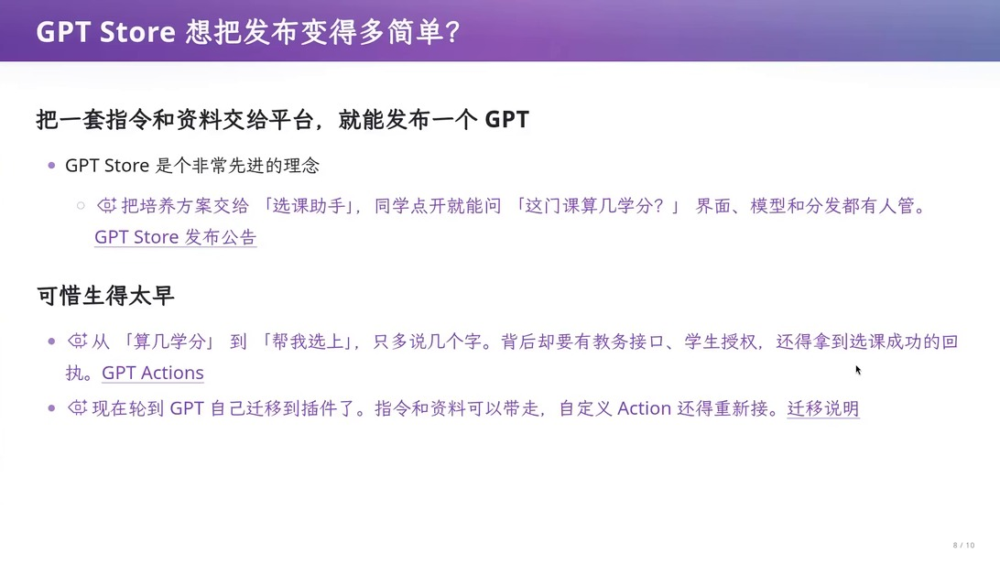

讲者用 GPT Store 说明另一条路线：不自己做发布与运维，把发布外包给平台。开发者交出一套指令和资料，平台负责界面、模型、分发；用户只为 token 付费，规模由平台弹性伸缩。他认为这是「非常先进的理念」，并预测这类模式会回到产品线上——因为绝大多数开发者做不出千万级用户的产品，也就不需要自己面对容量与运维压力。

代价也要看清：平台承担了分发渠道、弹性扩容、鉴权计费、部分安全责任；拿走了用户关系、数据、定价权，以及可迁移性。幻灯片上那句「现在轮到 GPT 自己迁移到插件了，指令和资料可以带走，自定义 Action 还得重新接」，说的就是迁移成本落在哪一层。

## 8 服务端：从 localhost 到「上线即负责」

### 8.1 localhost 笑话的门槛

从「发布应用」到「发布服务」，讲者用一张著名的推文截图开场：有人宣称自己完全不懂编程，几分钟就做出了功能完整的 web app，然后贴出链接 `http://localhost:3000/`。

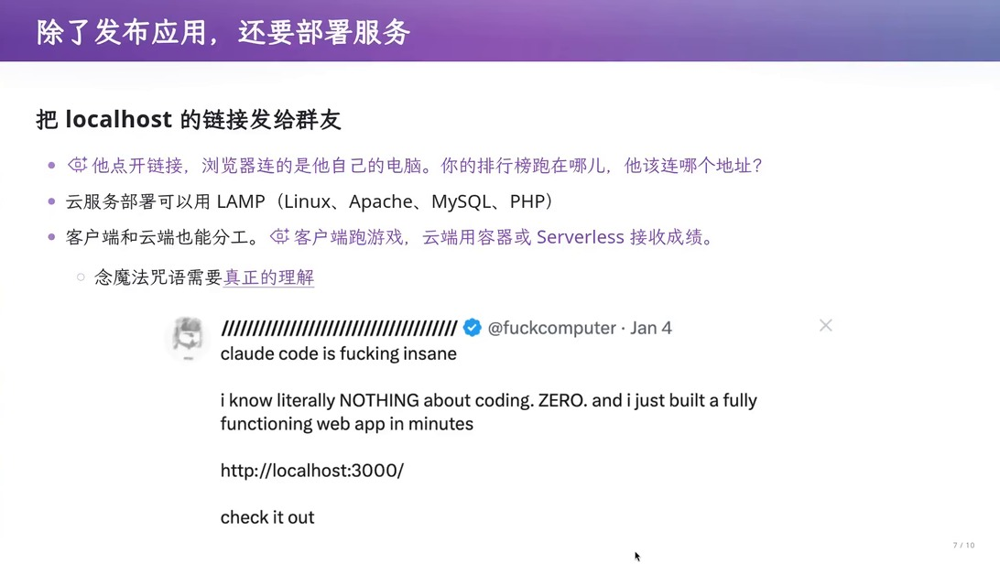

这个笑话好笑，是因为听的人有背景知识：`localhost` 指「这台机器自己」，别人点开只会连到自己的电脑。讲者随即把话题转到一个更严肃的问题上——如果要给四五年级的小学生做一个 harness，**就必须主动阻止它产出这种输出**，因为小学生没有这份背景知识。

这句话其实定义了发布服务的第一条要求：**地址必须是别人能解析的地址**。

### 8.2 LAMP 与 nginx

上一个时代的部署标准答案是 LAMP：Linux + Apache + MySQL + PHP，它之所以叫标准答案是因为成本最低——一台真实服务器（或家里的一台机器、一台云主机）装完就能用：Apache 管网关与负载均衡，MySQL 管持久化，PHP 管前端逻辑。

今天这一步变成了许愿：讲者当场让 agent 装 nginx、开 HTTP、让校内同学能访问、返回当前时间和系统状态，几分钟跑起来。但他特意强调：**许愿也要把需求说清楚**，比如「让校内的同学能访问」，否则模型可能给你一个 localhost。

### 8.3 上线一秒开始的攻击面

服务跑起来那一刻，讲者的语气变了：「你在部署服务上线的那一秒钟起，你就开始为他负责了……互联网上无数的黑客就开始盯着你这里面有没有一个漏洞，可以让他远程执行代码，把你的电脑变成肉鸡给他挖矿。」

这把「运维」从一个技术岗位还原成一个责任关系：**public 是一个不可逆的状态转换**。在它之前，出问题只影响你自己；在它之后，出问题会影响所有能访问它的人，而且攻击者不需要你邀请。现场的访问日志也提供了佐证：他看到有校内的其他机器在访问这个刚建好的服务（其中不乏扫 403 的请求），于是承认「我就感到很慌」。

### 8.4 证书链：为什么浏览器信我、wget 不信我

加上 HTTPS 之后，自签名证书立刻让浏览器给出红色警告。

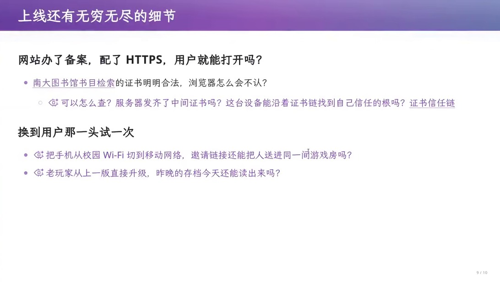

自签名证书不受信任，是因为信任不是由「证书本身对不对」决定的，而是由一条链决定的：

$$
\text{根证书（系统预装）}\ \longrightarrow\ \text{中间证书}\ \longrightarrow\ \text{站点证书（你的域名）},
\quad\text{每一环都要验签。}
$$

- 根证书：操作系统或浏览器出厂就装好、被无条件信任的少数证书；
- 中间证书：由根证书签发的「二级签发者」，让根证书不必直接签发每个站点；
- 站点证书：你为域名申请的那张，必须由某个中间证书签发；
- 验签：用上一环的公钥验证下一环的签名，任何一环缺失或不匹配，整条链就断了。

讲者用自己的翻车经历把这条链讲活了：他在 nginx 里没有把完整证书链发下去。结果是他自己的电脑和 curl 都认为证书合法——因为它们缓存了中间证书；而用 `wget` 这个更老、更保守的软件去下载课程代码时，`wget` 直接拒绝，因为它只能沿服务器发来的链往上找根。同一件事还有个更日常的版本：他在图书馆的老机器上查书，证书明明合法，浏览器却不认，因为那台机器的根证书库没更新过。

**信任是客户端的状态，不是服务器的属性。**你的机器上验得通，只证明你的机器认得这条链。

### 8.5 验收要换到用户那一头

这一节收在一个可操作的清单上：

1. **换网络**：把手机从校园 Wi-Fi 切到移动网络，邀请链接还能把人送进同一间游戏房吗？（地址是否可解析、防火墙是否放行、NAT 是否穿透。）
2. **换设备**：群里那台没装开发工具的 Windows 电脑也能玩吗？（依赖与运行库。）
3. **换版本**：老玩家从上一版直接升级，昨晚的存档今天还能读出来吗？（数据格式的向后兼容。）

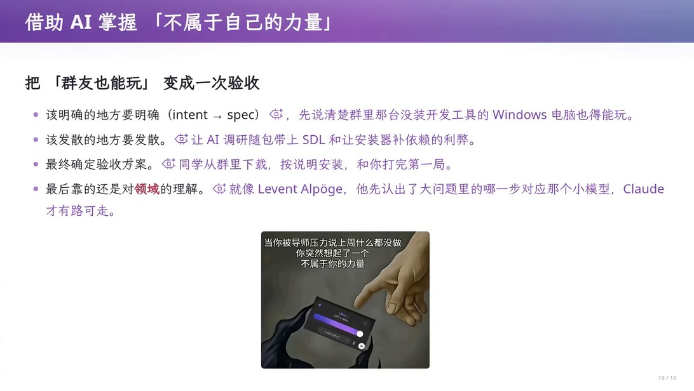

幻灯片给这个方法起了个名字：**借助 AI 掌握「不属于自己的力量」**。三个动作是：该明确的地方明确（intent → spec，先说清「群里那台没装开发工具的 Windows 电脑也得能玩」）；该发散的地方发散（让 AI 调研「随包带 SDL」和「让安装器补依赖」的利弊）；最终确定验收方案（同学从群里下载、按说明安装、和你打完第一局）。

最后一句是讲者的自我限定：「最后靠的还是对领域的理解。」Alpöge 之所以能用一句话指挥模型，是因为他先认出了大问题里的哪一步对应哪个小模型。

## 9 运维的真相：世界上已经有一个在跑的版本

### 9.1 发布没结束，只是把手交出去了

讲者先纠正一个心理错觉——发布完成的那一瞬间，工程并没有结束，而是换了责任人：

> 这个软件你只是发布了，发布到了用户的手里。一旦到了用户的手里，当这个软件 public 一秒，我就会担心它安全不安全；当它发布给用户以后，我就会担心会不会有 bug。

而且 bug 是必然的，因为 intent 本身就说不清楚：「有些事情是模棱两可的，到底怎么做可能我也不确定的时候，你先做一个吧。」即使 verification 把 spec 与 impl 之间的 gap 填平了、证明了这个 spec 是对的、程序永远不会 crash，需求依然会变。


「Intent-spec-impl gap 总可解决。需求可以靠 verification 正确实现，1000 个 asset 也可以都正确发布。可是，南京大学苏州校区落成了！数据库要加一个『校区』字段，正在跑的服务怎么办？」

这句话把运维和开发区分开了：**开发面对一个可以从 clean state 开始跑的软件，运维面对的是「世界上已经有一个正在运行的版本」，甚至「不止一个版本同时在跑」**。这段历史里有真实用户写进去的数据、有正在进行的请求、有别人依赖的接口，它们都不能被「重新开始」抹掉。

同一段论述也解释了 macOS 为什么每隔几年砍掉一个版本的支持：一旦承诺支持某个版本，每发一次版就要在「每一个版本 × 每一种硬件」上测一遍；而一个小问题（比如证书链）在旧机器上就足以让整个软件拒绝工作。

### 9.2 停机窗口：12306 的 5 点到 1 点

遇到「必须改数据库结构」这种硬骨头，最省事的办法是停机。讲者半开玩笑地称之为「用胆子肥嘟嘟的拒绝服务来解决」。

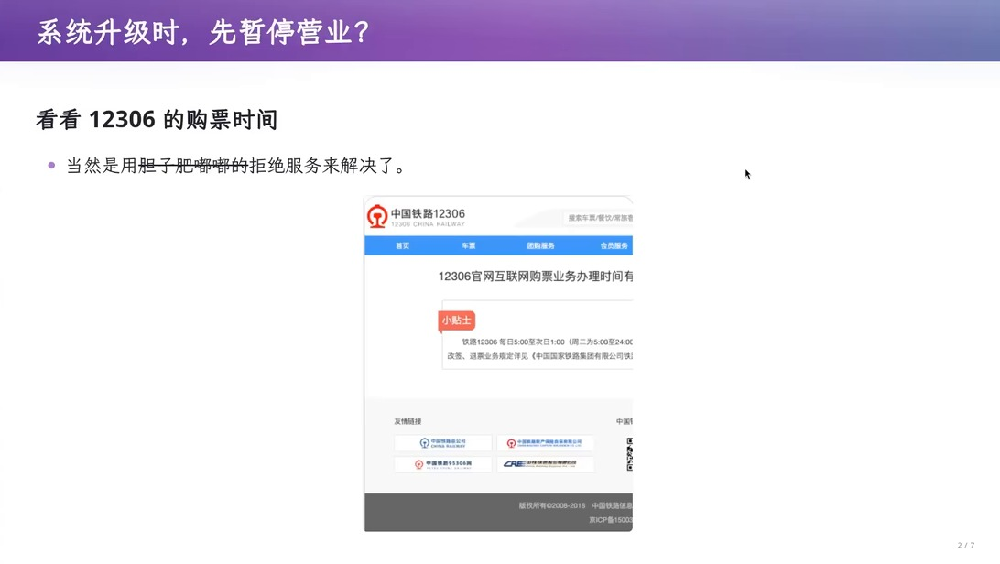

适用条件说得很清楚：「如果你是老大，你可以不看别人脸色的时候，你就可以这样。」12306 可以，因为乘客没有别的渠道；面向全球的服务不行——Google 的站点必须 24 小时提供分布式服务，你在欧洲和美国各开一个 Gmail，其中一处做的任何操作都要在另一处体现。

代价也很具体。人在国外有时差，回国落地上海想买一张到南京的高铁票，掏出手机是当地正常时间，12306 说「对不起，服务不在服务时间」。所以「几点到几点维护」这句话，等价于「我承认在这个时间段里我不提供价值」；能这么说，前提是你的用户在别的时间也离不开你，或者替代品不存在。

### 9.3 加一个字段：先加空列，再回填，最后收紧

如果不停机，这条约束就要落到具体操作上。方案分三步，每一步都以「新旧两版程序同时能跑」为前提：

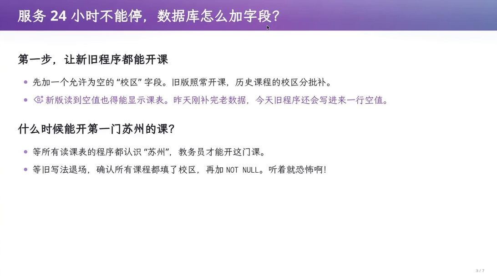

| 阶段 | 数据库做什么 | 程序做什么 |
|---|---|---|
| 一 | 加一个**允许为空**的 `campus` 列；历史行分批回填 | 旧版照常读写（不碰这一列）；新版读到空值时按默认校区显示 |
| 二 | 继续回填直到没有空值；校验一致性 | 所有「读课表」的程序都认识「苏州」，教务员才可以开第一门苏州的课 |
| 三 | 加 `NOT NULL` 约束 | 旧写法退场；确认没有代码再写空值 |

这个顺序可以形式化成一条约束的演化，中间那个「允许空值」的阶段是关键：

$$
\mathrm{campus}\in\{\bot\}
\ \longrightarrow\
\mathrm{campus}\in\{\text{仙林},\text{苏州},\bot\}
\ \longrightarrow\
\mathrm{campus}\in\{\text{仙林},\text{苏州}\}.
$$

- $\bot$：空值，表示「这一行产生时还不知道校区」；
- 第一段：只有空值合法，因为旧数据没有这个信息；
- 第二段：新旧写法的并集，是唯一能同时容纳两版程序的约束；
- 第三段：回填完成、旧写法退场之后，才能收紧到两个具体值。

讲者特意强调了中间阶段的并发细节：数据库是并发的，新请求可能正好在这个窗口插进来，插进来的也是空值；所以要等到「没有空值」之后再迁移应用版本。加 `NOT NULL` 看着只是一行 DDL，实际是把「所有写入方都已升级」这个事实写进数据库——只要还剩一个旧服务实例、一个定时任务、一条手工 SQL，这一步就会失败。

### 9.4 Event Sourcing：把状态变成事件流的投影

如果架构换一种记法，迁移可以更从容。event sourcing 不记「当前状态」，而是记「发生了什么」，当前状态是全部历史的投影：

$$
S_t=\operatorname{foldl}\bigl(\lambda s\,e.\ \mathrm{apply}(s,e)\bigr)\ S_0\ [e_1,\dots,e_t].
$$

- $S_0$：初始状态；
- $e_i$：第 $i$ 个事件，比如「开设操作系统课」「上课地点改到苏州」；
- $\mathrm{apply}(s,e)$：把事件作用到状态上的转移函数；
- $\operatorname{foldl}$：按时间顺序重放。

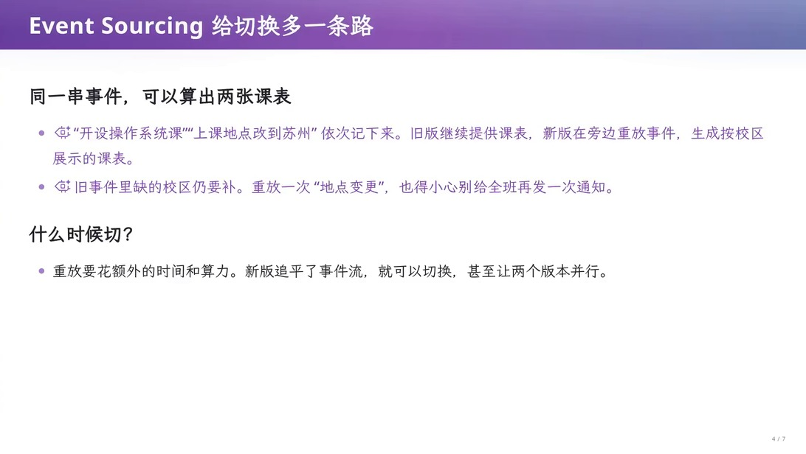

好处立刻显现：新版本可以在旁边用**新的 apply 函数**把这串事件重放一遍，生成一张「按校区展示」的课表，旧版本继续对外服务；等新版追平事件流就可以切换，甚至让两个版本并行。代价也如实列出：重放要花时间和算力；旧事件里缺的校区仍要补；重放一次「地点变更」还得小心别给全班再发一次通知。

切换条件可以写成两个不等式：重放来得及（$t_{\text{replay}}<$ 切换窗口），且追平后两版状态完全一致（$\Delta(S^{\text{old}}_t,S^{\text{new}}_t)=0$）。

同一个问题的三种解法，差别只在**代价落在哪里**：停机是把代价一次性付给所有用户；加空列三阶段是把代价摊成多次部署，靠「新旧都能跑」的中间状态兜住；事件重放是把代价换成算力与时间，换到「可以双版本并行、随时回滚」的从容。

### 9.5 性能 bug 与双 11

切换成功不等于结束。下一个事故：新版本里有一个 performance bug，选课一开始，教务系统又崩了，同学们开始在小红书上疯狂投诉。

讲者的判断很干脆：学校这个体量的系统，在今天的算力下，「一定是架构的问题」。但他马上补了一个限定：有些系统即便优化得很好，遇上超大规模负载或特殊情况还是很难扛住——早期双 11 就是这样：折扣是真的大，快递从正常的两三天变成两个星期，海量订单堆成山。运维在这种场景下的痛苦不是「代码有 bug」，而是「峰值是你平时的一百倍，而你的容量是按平时买的」。

## 10 SRE 与灰度：把「一定出错」写进流程

### 10.1 一行配置能让请求等多久

先看一个很小、很贵的例子：nginx 明明命中了内存缓存，请求却还是要排队等磁盘。


幻灯片上的数字很具体：一批请求在随机读盘，卡住了处理请求的 worker；另一批人反复下载同一个 4 MB 热门文件，平均也要等 7.42 秒。开启 `aio threads`，把磁盘 I/O 交给线程池之后，这批热门文件的平均响应时间降到 226 毫秒——大约 33 倍。

第二段故事讲超时预算。Amazon 的线上服务把远程调用的超时设在约 20 毫秒，平时复用连接绰绰有余；但新服务器上线后，光是建立安全连接（TLS 握手）就可能花光这 20 毫秒，于是「发布后超时」成了一个稳定的故障模式。团队先放宽建连超时，后来改成让进程在接流量前就把连接建好，这批超时就消失了。

$$
T_{\text{预算}}=T_{\text{建连}}+T_{\text{排队}}+T_{\text{处理}}\le 20\ \mathrm{ms}.
$$

- $T_{\text{预算}}$：一次调用允许花掉的总时间；
- $T_{\text{建连}}$：包括 TCP 与 TLS 握手，冷启动时最贵；
- $T_{\text{排队}}$：等 worker、等连接池、等磁盘；
- $T_{\text{处理}}$：真正执行业务逻辑的时间。

这个式子的用法不是算出一个数，而是提醒：**超时是预算，不是开关**。定了 20 毫秒，就等于说「建连 + 排队 + 处理」必须全部挤进 20 毫秒；只要有一项在新环境下变贵，超时就从「保护」变成「误杀」。反过来定到 500 至 600 毫秒也不行——真断了的时候，用户要等半分钟才看到失败。

### 10.2 配置的取舍：没有最优，只有适配

讲者列了一份 nginx 调优清单，并反复强调它没有统一答案：

| 配置 | 收益 | 代价 / 边界 |
|---|---|---|
| `worker_cpu_affinity` | 绑核，减少 cache 迁移 | 混合部署时 worker 可能被饿死，P99 抖动 |
| `worker_connections` | 决定并发上限，约 worker 数 × 768 / 2 | 真正卡住的是 fd，还要看 `rlimit_nofile` |
| `keepalive_timeout` | 减少重复握手 | 太长会占住 fd 与内存；内网轮询 5–15 秒更合适 |
| 压缩（gzip/brotli） | 用 CPU 换带宽，静态文件可高强度压 | 动态内容耗 CPU；对面是 ESP32 这类弱设备时反而更慢；图片/视频/字体再压没有收益 |
| 超时 | 太小误杀，太大拖死 | 20 毫秒在测试环境够用，上线后建连就花光 |
| 缓存 | 静态与半静态内容收益最大 | 失效策略错了会放大脏数据 |

总结很朴素：默认配置基本能满足需求，但「老师傅这么多个一个调，真的有可能给你成本省下一半，甚至省到四分之一」。这类经验在 agent 时代仍然有效，因为模型不会主动去改一个正在正常工作的配置——除非你让它分析负载、给出调优方案。

每加一个参数，就多一个「只在某种负载下才暴露」的故障面。有价值的顺序是：先建立基线（`wrk`、`hey`、`ab`），再一次只改一个参数，否则你不知道是变快还是变慢。

### 10.3 SRE：Why、What、How

为了对付这类问题，Google 专门设了一个工种，大约 4% 的 Google 工程师是 SRE（Site Reliability Engineer），并有一本出到第二版的《SRE Book》。三个词被拆得很干净：

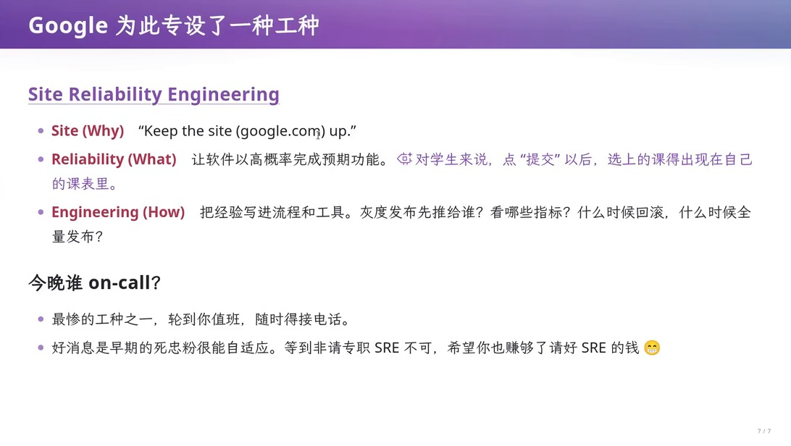

- **Site（Why）**：「Keep the site (google.com) up.」为什么需要这个角色——因为有一个必须一直开着的站点。
- **Reliability（What）**：让软件**以高概率完成预期功能**。幻灯片给的例子很具体：对学生来说，点「提交」以后，选上的课得出现在自己的课表里。
- **Engineering（How）**：把经验写进流程和工具——灰度发布先推给谁、看哪些指标、什么时候回滚、什么时候全量。

讲者对这份工作的评价很直白：「最惨的工种之一。」要 on-call，晚上睡觉也得接电话；而且一定程度上要替产品团队的 bug 背锅——那些 bug 在测试环境里根本不会暴露，因为测试环境没有那个规模、也没有那个奇怪的用户习惯，只有某个特定配置的真实用户会触发。一旦触发，量级完全不同：如果 bug 影响 1% 的人，那 1% 开始抱怨就是海量抱怨。

Reliability 的定语是「完成预期功能」，不是「功能正确」。需求怎么变成实现，SRE 相信产品团队已经交付了；他要保证的是这个版本能上线、并按预期提供服务。所以**即使新版本里有 bug，一定程度上也是 SRE 的责任**——这句话是理解这个工种的关键。

### 10.4 灰度：把「一定会出错」当成前提

既然产品团队一定会写出 bug，就不能一上来把所有功能推给所有人。

| 阶段 | 比例 | 目的与退出条件 |
|---|---|---|
| 一 | 1% | 收集故障信号；没有爆炸式增长才继续 |
| 二 | 10% | 看指标是否出现统计显著的恶化 |
| 三 | 50% | 确认容量、依赖、下游都能承受 |
| 四 | 100% | 全量，同时把旧版本下线 |

这里的指标不是拍脑袋定的。讲者举了个很细的例子：语音聊天结束后，用户会点返回或点别的，然后又在聊天框里「更正」——这个动作序列就是「语音识别可能错了」的信号。把这个比例在两个语音模型之间比较，就得到有统计显著性的指标。

同一条机制也用在模型自己身上：模型厂发新模型时不会告诉你，但会先推给一小部分用户，然后看下一次交互的反馈是正面还是负面；如果给 100 万个人推，就能收集到足够的数据判断「这次发布是提升了满意度，还是引发了频繁抱怨」。这也是他体感上「模型智力突然变高了」的来源。

没有预先定义的指标，灰度就只是「晚一点全量」。必须先回答三个问题：看哪几个指标、指标恶化到什么程度回滚、什么条件下允许进入下一级。

## 11 收束：三条主线

讲者最后把整门课串了一遍：「我觉得我已经讲了一个非常完整的软件的故事了——从总体的设计、需求，然后到最终软件全部都做好了，你需要把它发布出来。」他给第一次做产品的人留了三句话：

- 你的室友可能会是你的第一批用户，然后是社团、同学、开源社区；
- 早期用户一般是死忠粉：他们愿意在这个东西还不好用的时候继续用，是因为它戳中了一个别人提供不了的核心价值；
- 在一千到一万个用户的时候，你不需要专职 SRE，可以快速接反馈、快速迭代；等到「非请一个专职 SRE 不可」的时候，你应该已经赚了足够多的钱。

把九节内容压成三条，就是这一讲真正想留下的东西：

1. **产物是平台矩阵的投影。**发布不是「生成一个文件」，是「对每一个（操作系统、架构、打包格式、验证方式）的组合各生成一份，并让用户能确认拿到的是哪一份」。那个乘积式一旦看懂，196 这个数字就从「夸张」变成「算术」。
2. **运维是历史状态上的变更。**所有在线迁移技术（加空列、双写、重放、灰度）本质上都在做同一件事：**让任意时刻都同时存在两个能互相容忍的版本**。所谓「三阶段」，就是把这个容忍关系显式写出来。
3. **验收必须在别人的视角下完成。**localhost、证书链、老版本客户端、弱网、旧存档，这五个坑的共同点是：它们在你的机器上都不存在。所以验收方案的第一条永远不是「我这边跑通了」，而是「谁来试、在什么环境试、试到什么程度算过」。

## 12 一张可以照着做的清单

1. 写需求时，先写**部署目标**：哪些平台、哪些架构、谁安装、怎么验收。这一句决定后面所有产物的形状。
2. 写代码前，先写**你最不想重写的那一层**：输入抽象、渲染抽象、数据访问层。这一句决定需求变更时你是改几行还是重写。
3. 第一次发布时，先列**依赖清单**，再决定是随包带走（容器化）还是让安装器补（包管理器）。
4. 上线前，定**验收动作**：换网络、换设备、换版本各试一次，三个都过才算上线。
5. 上线后，定**指标与回滚线**：看什么、恶化到什么程度回、谁能批准回。
6. 每次迁移前，先问**能不能让两版同时活着**：能，就加空列或重放；不能，才考虑停机窗口。

讲者留下而没回答的问题，比回答的更有意思：许愿式开发让「做出一个能跑的东西」变便宜之后，架构判断力会不会变成唯一的护城河？如果「发布外包」模式成熟，独立开发者会不会集体迁移到平台侧，从而把发布与运维这门手艺变成平台内部的知识？灰度的指标来自用户行为序列，当用户自己也越来越多地借助 AI 使用产品时，这些信号会不会被「AI 代理人」的行为污染，让灰度判断失效？

这些问题没有标准答案。但它们的共同点是：**答案都不在代码里**。这大概也是这一讲最想传达的东西——软件工程的最后一段，考验的不是写代码的能力，而是把世界看清楚的能力。

> 本讲视频：[软件发布与运维 [14-Raw/26生成式软件工程/NJU]](https://www.bilibili.com/video/BV1pu1FzKEgk/)，时点均以视频时间轴标注。
