## 一、实验二

这一讲将开始收束到一个具体的问题上：**当写代码的相当一部分工作可以交给 Agent 时，我们应当怎样组织一个项目，让 Agent 在里面长期、可靠地工作**

### 1.1 [实验二：算力换智力](https://jyywiki.cn/GSE/2026/lab2.md)

第二次实验延续第一次实验的「个人数据库」部分：在已经积累的资料之上，让 Agent 更好地利用它们；即使上一个实验没有完成，也可以从一个能检索资料、读写文件的 Agent 开始。课程明确说明，这是一个建议性质的实验，不记分，遇到困难可以选择不做实现——但做过与没做过，观察到的东西完全不同。

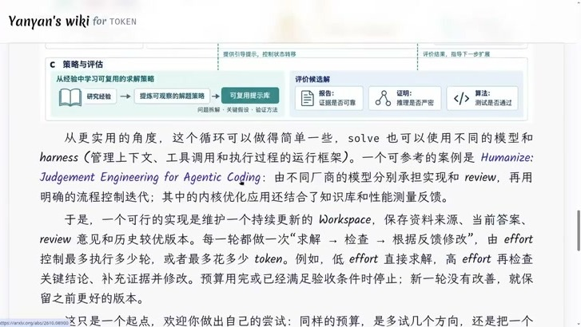

要求的核心：**在保留 Agent 基本使用方式的基础上，增加一个额外的 `effort` 选项，调节它投入的计算预算，让它在更高的努力程度下，通过更多探索、查证和修改得到更好的结果**。

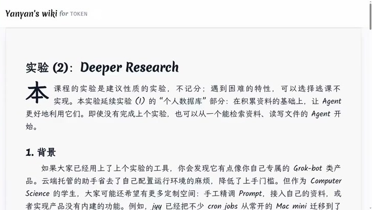

课上给出一条可以参考的路线。它的思想来自 Humanize 的 *Judgement Engineering for Agentic Coding*：**由不同厂商的模型分别承担实现与 review，再用明确的流程控制迭代**，而不是让一个模型一路做到底。

落到实现上，就是维护一个持续更新的 Workspace，保存资料来源、当前答案、`review` 意见和历史较优版本；每一轮都做一次「求解 → 检查 → 根据反馈修改」，由 `effort` 决定最多执行多少轮、最多花多少 token。例如 `low effort` 直接求解，`high effort` 再回头检查关键结论、补充证据并修改。停止条件是预算用完，或者已经满足验收条件；**如果新一轮没有带来改善，就保留之前更好的版本**。

如何选择一个候选解,老师提出三个角度：
- 报告——证据是否可靠；
- 证明——推理是否严密；
- 算法——测试是否通过。

而这些从经验中得到的求解策略，还可以沉淀成可复用的提示库，在班级里互相抄作业。

需要强调的是，这只是一条参考路线。同样的预算，是多试几个方向，还是把一个方向做深，正是本实验真正要你回答的问题——而这个「宽度与深度如何取舍」的问题，恰好也在这一讲反复出现。

### 1.2 软件工程要解决的问题没有改变

软件工程解决的就是这件事--搜索

从 intent 到 spec、从 spec 到 implementation，每一步都是**一对多**的：一句「让学生方便地选课」可以对应先到先得、志愿排序、抽签等完全不同的规约；即使规约定下来，也仍然有大量数据结构、模块划分与交互方式可选。

所谓软件工程，就是在这些空间里做搜索，并通过 review、讨论、迭代把选择收敛到一个点上。UML 也好，框架也好，它们的作用都是**约束空间里的行为，让你能在项目早期就和别人达成一致**；从 IDE 到 `git worktree`，也都是这个过程中的工具。

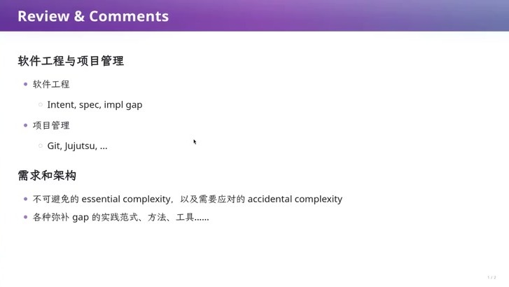

老师提出一个例子：数据库选型、要不要用 Event Sourcing，本身就是 spec 空间里的一个分叉；最近有人站出来说自己不用 Event Sourcing，而改用另一种 functional design——但同样要求持久化一切。

如果不进行筛选,一条线走到黑的实现，和经过几轮讨论后收敛的实现对比，**在可维护性、可观测性上会差了十万八千里**。

在此情境下,AI改变的是**搜索的成本**：

- **随时随地可以开始**。你不必等到「想清楚了」再动手，任何一个阶段都可以让 AI 往下做一段；
- **可以随时生成一个版本，并与上一个版本比较**——趋势上是变好了还是变坏了。变坏了，就再讨论、再让它做一个版本；
- **可以并行**。如果需求能分解成两个耦合很少的 subsystem，就可以开多个并行的 Agent,让自己当AI的监工；
- **let it fail**。很多问题只有真正实现出来才会暴露——「这个架构如果那个人来了会怎么样、用户多了以后会怎么样、两个模块之间有没有我未曾想到的交互」，都可以靠先做出来再观察来回答。

所以 AI 交给我们的一项能力，是**廉价地构建原型**；而怎么样让 AI 有条理地构建原型，就需要 Agent loop。

### 1.3 开始：构建原型

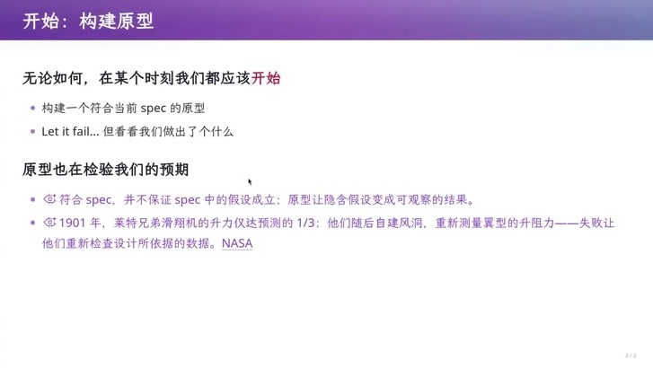

课上用一张幻灯片把这件事讲得很清楚：**符合 spec，并不保证 spec 中的假设成立；原型的作用，是让隐含的假设变成可观察的结果**。

>比1901 年，莱特兄弟的滑翔机升力只达到预测的 1/3；他们没有停在「数据错了」的抱怨上，而是自建风洞重新测量翼型的升力——**失败让他们回头检查设计所依据的数据本身**。

这也是把 prototype 交给 AI 的价值所在：花很小的成本，就能把一个「看起来说得通」的假设变成一次真实的观测。

### 本章小结

软件工程的工作是在 intent、spec、impl 三个空间里搜索并收敛；AI 把搜索的成本降到了可以随手验证原型的程度。于是问题从「如何一次做对」变成了「**如何组织一个循环，让每一步都可检查、可回退、可继续**」

---

## 二、Agent Loop：从一个 bash 工具到最小可用 Agent

### 2.1 从 ChatGPT 到 Claude Code

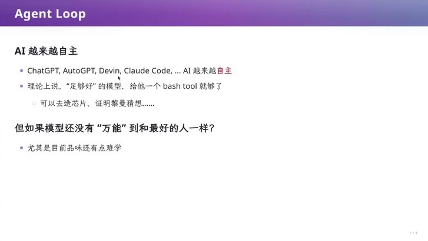

2023 年,社交媒体上有着「模型有幻觉、不能完全相信」的讨论。那时出现的 AutoGPT 和 Devin 已经号称能自己解决数学问题，但大家还是观望：GPT-4 的幻觉严重、也没有今天这样的思维链，模型说着说着就不知道在说什么了。

站在今天回看，那条路线本身是对的：**如果一个模型已经「足够好」，那么给它一个 bash 工具就够了**——理论上它可以去造芯片、去证黎曼猜想。UNIX 时代的那些大师，在还没有图形界面的日子里，本来就是在 shell 里和工具交互的。

但注意推论的边界。**今天的模型还没有「万能」到和最好的人一样好**，尤其是在「品味」这件事上。

老师认为,原因在于训练信号上：强化学习只对「完成任务」给奖励，因此模型倾向于一条最省事的路——如果花很多时间还没做完，就干脆停下。

老师说,自己给 DeepSeek 一个太难的任务时，它有时会在思维链里想一会儿，但有时直接说我无法完成。**所以我们不能只给模型一个任务和一把锤子，还要给它一个循环、一套约束和一批可检查的中间结果**。

>AI被训练成了做题家

### 2.2 一个 150 行的 Agent 长什么样

老师展示了一个agent的最小实现，全部代码 150 行左右，没有任何框架。

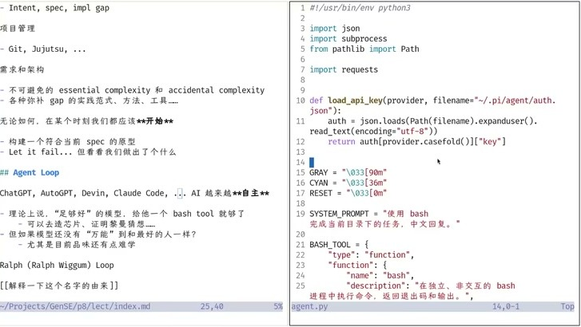

它只有三个部分：

1. **一个系统提示词**，规定它此刻要完成什么任务；
2. **一个工具**。这个工具是一个合法的 Python 对象，可以序列化成 JSON：`type` 是 `function`，`name` 是 `bash`，带一段 `description`，参数里只有一个 `command`——在独立、非交互的 bash 进程中执行命令，返回退出码和输出；
3. **一个 while 循环**。从终端读用户输入，构建 message，调用 API；如果回复里没有 tool call，就直接输出；如果带了 tool call，就取出参数执行，再把 `tool_call_id` 和执行结果塞回 message，进入下一轮。

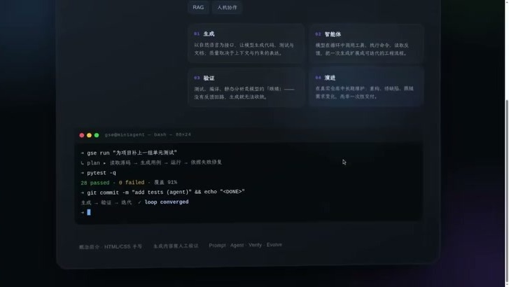


老师课上让它「生成一个介绍生成式软件工程的 HTML 卡片」，它写了很多，还想在浏览器里打开、自己截图验证。值得注意的是它的一些行为：**模型会受到项目里已有内容的污染**，而且它非常喜欢「验证」——截了图还会回来问「我已经用截图验证了，你是否满意」，而这可能并不是你要的。

### 2.3 Harness：把模型能做的事约束在可控范围内

于是就有了 harness 这个概念。你可以把模型自己的思维链也看成一种搜索，而 **harness 做的事，是把模型可以做的事情约束在一个你认为比较好的范围里**：给它哪些工具、在什么情况下停下来、每一轮必须留下什么、谁来检查。

今天 harness 的「版本答案」是一个叫 Ralph Loop 的东西，但真实系统的复杂度远高于此：比如 Claude Code 的某个版本开始，Agent 可以生成一段 TypeScript 脚本，在 for 循环里孵化 sub agent，并把自然语言模板里的字符串填进去，再 `await` 它完成,**一个 Agent 可以自己决定要不要开子 Agent**。

### 2.4 为什么模型需要被「管住」：漂移、舔狗与上下文

课程用三段很具体的经验解释了「管住」的必要性：

- **漂移**。长任务里上下文一旦超过窗口，就会触发压缩；压缩之后通常会经历一段「降智」，做着做着不对，等加载了足够上下文又恢复。
  
- **模型是提示词的舔狗**。模型有强烈的遵循指令的倾向，因此它不会主动去动用户已有的东西。模型如果上下文里加载了你的 slop 代码，它会倾向于「把这份 slop 扶起来」，而不是重构。
- **重构的代价是真实的**。重构很难保持行为百分之百一致，总会带来变化；如果代码正在线上跑着、你只想让它花一分钟把服务扶起来，那么模型选择遵循指令、不去重构，也是有道理的。**问题在于这两种选择无法靠模型自己判断，只能由你在流程里约定**。

## 三、Ralph Loop 与「一切皆状态机」

### 3.1 Ralph Loop：三行的循环

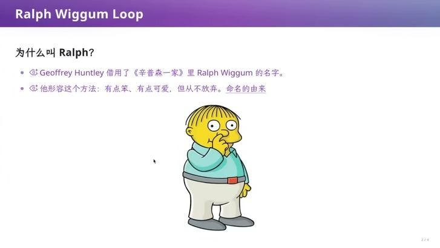

这个名字借用了《辛普森一家》里 Ralph Wiggum 的名字，来形容这个方法——**有点笨、有点可爱，但从不放弃**。

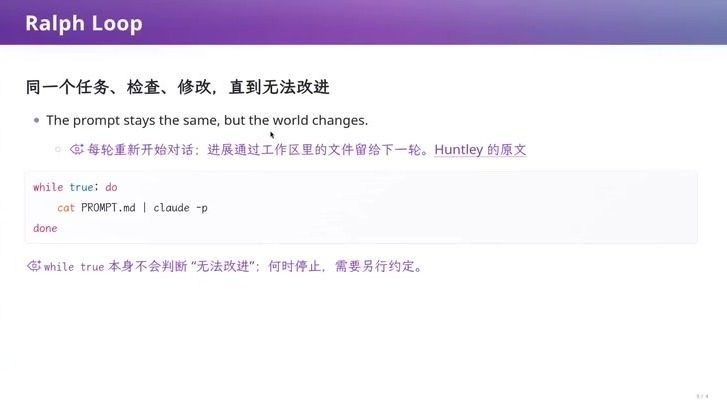

Ralph Loop 的全部实现只有三行：

```bash
while true; do
  cat PROMPT.md | claude -p
done
```

同一个 prompt 每一轮重新丢给模型，每轮重新开始一次对话，进展不靠上下文传递，而是靠工作区里的文件留给下一轮。


但是,**`while true` 本身不会判断「无法改进」；何时停止，需要另外约定**。这正是后面「每轮只推进一个明确步骤」和「门禁」要补上的地方。

### 3.2 把「一把梭」切成许多小步

Ralph Loop 的好处不在于循环本身，而在于**它把一个长任务切成了许多次小的状态迁移**。

每一轮结束可以做一个 `git commit`，于是「模型一把头往下做」变成了「状态 → 状态 → 状态」，中间每一个点上你都有机会介入,可以要求它每轮不要做太多、做完先检查、必要时叫另一个 Agent 来 review。

这也说明它是一个**非确定的状态机**

比如,在同一个状态下，你可以选择执行不同的动作——用 GPT 做一轮，让 Claude 来 review，或者换 DeepSeek 来干活。你还可以安排周期性的动作，比如每周做一次架构 review，看看这个项目有没有变成 AI slop；如果已经变成 slop，就起一个「重构 Agent」：把所有 AI slop 相关的东西直接删掉、提交，再让一个 Agent 用更好的架构重新实现一遍。

### 3.3 Everything Is a State Machine

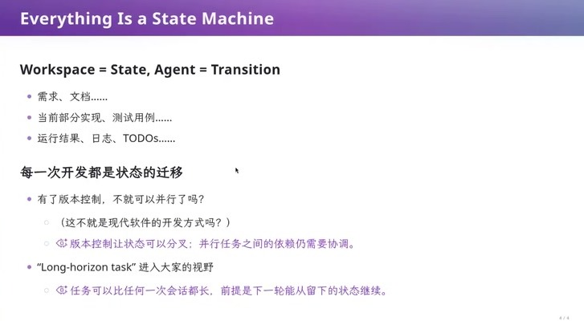

**Workspace = State，Agent = Transition**。所谓状态，包括需求与文档、当前的部分实现与测试用例、运行结果与日志、TODO；所谓迁移，就是一次开发动作。

由此可以很自然地推出现在各种 coding agent 的功能：

- **并行**。既然 workspace 是状态，状态就可以分叉——这不就是现代软件的开发方式吗？比如,从一个状态开始,同时做 A 模块和 B 模块的重构，最后两者合并成一个提交；**但并行任务之间的依赖仍然需要协调**。

- **长上下文任务**。任务可以比任何一次会话都长，前提是下一轮能从留下的状态继续。早期的 ReAct Agent、AutoGPT 或线性的 `claude -p`，跑着跑着就会漂移、越做越差；套一层外循环之后，它能完成的任务就上一个台阶。

- **左脚踩右脚**。循环让模型能完成更强的任务，模型厂商看到这一点就把「一次会话能完成的任务」调得更高，我们再在外面套一层循环，于是又能完成更复杂的任务。

### 3.4 老师实现的 Ralph Loop

老师展示了自己实现的一个极简版本，它同样由一个 prompt 驱动，但补上了「怎么停」和「怎么交接」：

- 每轮**先检查当前状态**，只推进一个明确的步骤；
- 推进之后要**验证并评估结果**；
- 未完成时，把说明下一步的文件写进工作区；
- 整个任务确认完成后，输出一个约定的标记(指定验证方法通过)，循环看到它就结束，否则一直跑下去。

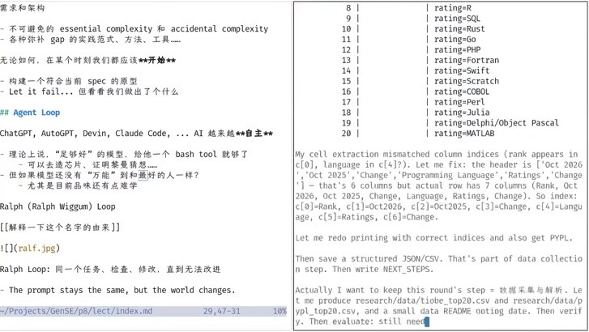

老师写的prompt 里最重要的一句是「**只推进一个明确的步骤**」。因为所有的假设都建立在「Agent 在当前上下文下可能漂移」之上，所以每一轮都让它只走一小步，然后**停下来**——由另一个模型 review 这次提交，或者跑一遍测试和检查脚本。

## 四、每轮只走一步：两种跑法的对比

### 4.1 例1:名片制作

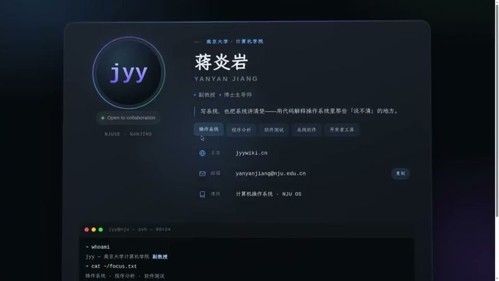

课上用同一个模型做了背靠背对比：一个 Agent 直接把任务做完，另一个跑 Ralph Loop，任务是「给我做一张属于我的名片卡片」。

- **直出的版本**很 fancy：玻璃动效、一个小的 macOS 终端窗口、主页和邮箱都排版得很漂亮——但**邮箱是错的、学校名也被写成了别的（课上吐槽「我也不是 NGUSE 的啊」）、GitHub 也没有找到**。

- **loop 的版本**朴素得多：没有花哨动效，但**计算机学院的职称、邮箱、个人主页、GitHub 全部正确**。

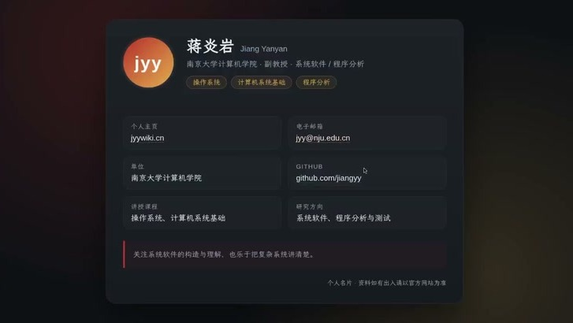

**同一个模型，投进去的算力和 prompt 不同，最后得到的东西可以完全不同**。不要迷信网上流传的 prompt 和 skill：最后最懂你的，通常还是你自己长期磨合出来的。

### 4.2 例2:调研谁是最好的编程语言

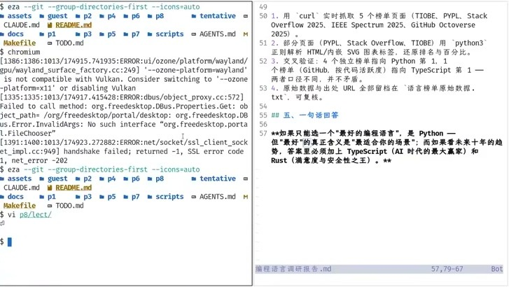

第二个例子是「调研一下世界上最好的编程语言」。这个任务的全部工具只有 bash——没有联网搜索插件、没有浏览器，模型自己用 `curl` 去抓 TIOBE、PYPL、Stack Overflow、IEEE Spectrum、GitHub Octoverse 这些榜单页面；做了一段时间它会停下来做个总结、把总结写进状态，然后开始下一轮。

这个例子很能说明 harness 的边界在哪里：**模型本身已经足够强，你给它什么工具、给它什么节奏，就决定了它能不能把这份强变成可靠的结果**。

### 4.3 没有「最好的设计」

**在这个 design space 里，没有所谓最好的设计**。

谁家agent更强,其实谁也不知道；

Pi 生态里光找 subagent 的插件就有不止一个，哪个更靠谱也没有共识——**地球人都不知道**。

更麻烦的是，**你调好的 prompt 与模型版本是耦合的**：上一个版本里工作得很好的 prompt，换一个模型可能就全部变了。

老师给出建议：**新模型发布时，最好先把系统提示词和 skill 全部拿掉，用一个你熟悉的任务做背靠背对比**，你甚至可能发现拿掉之后模型表现得更好。


### 4.4 为什么「每轮只走一步」能防漂移

Agent 一定会漂移：它自己的思路和想法会变，会去做不应该做的事。对抗漂移的办法不是要求它「想清楚」，而是**让它一次只做一个相对小的状态迁移，然后在这个状态上停下来等（wait）**：

- 停下来之后，可以叫**另一个 Agent（甚至另一个厂商的模型）**来 review 这次提交；
- 也可以跑测试、自己跑检查脚本,计算机不会撒谎；
- 而「停下来」这件事本身，就把一次不可回退的长动作，拆成了一串可回退的小动作。

如果开发者是不可信的，那么 Agent 就是最不可信的那种开发者；所以**每一小步之后都要有一次独立的检查**，而不是在最后交付时才发现方向错了。


## 五、CI/CD 

### 5.1 两条公理，一条推论

计算机系统基础课上讲过的两条公理：**机器永远是对的**（出了问题不要怀疑机器），以及**错误永远在你自己**（所有错都是自己的错，没有人可以埋怨）。但在软件工程里还有一条不属于机器的规律：**人是有自信的，而自信带来某种不可信**。

这种不可信非常日常：

- 「我今天就改一句话，文档里改一句话应该没事吧」；
- 「我就把这个循环变量从 1 开始改成从 0 开始，单元测试通过了，应该没问题吧」；
- 「样例过了，我是不是可以交 OJ 了？程序应该是对的吧」；
- 实习生推了一个 PR，然后整个生产系统挂掉了。

所以很自然会有下一步的想法：**既然在人身上不可信，那就不要相信「这一步应该没问题」，而是在`每一次状态推进之后都停下来做足够多的检查`；检查不通过就拒绝这次推进，回到循环里把问题修好**。这个想法听起来平平无奇，但它有一个很大的名字。

### 5.2 恭喜你，发明了 CI/CD

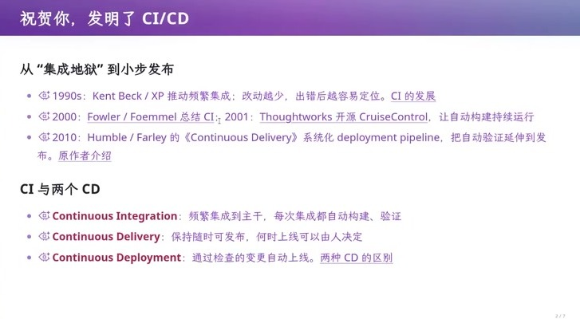

如果每次开发都被看成状态迁移系统的一部分，那么「在每个状态后面都做一次检查，检查都通过就发布」，就是 20 年前开始的实践：**CI/CD**。

今天大家挂在嘴边的三个缩写，其实只有第一个是 CI：

| 缩写 | 含义 | 谁来决定上线 |
|---|---|---|
| Continuous Integration | 频繁集成到主干，每次集成都自动**构建、验证**| —— |
| Continuous Delivery | 保持随时可发布 | 何时上线由人来决定 |
| Continuous Deployment | 通过检查的变更自动上线 | 全自动 |

**PR 时代的 CI 通常集成在一个真实的生产流程里**——要创建独立的、与你的机器隔离且不可信的环境，跑完全部流程，还要把结果同步回公司的流程里，让人在一个页面上看到。

这一整套复杂性需要先了解软件系统的设计，才能真正用起来。而在今天，你只需要有清楚的概念——**在什么样的状态迁移时应该做什么事情**——剩下的 YAML，让 AI 去写。

### 5.3 事件、Hook 与检查的位置

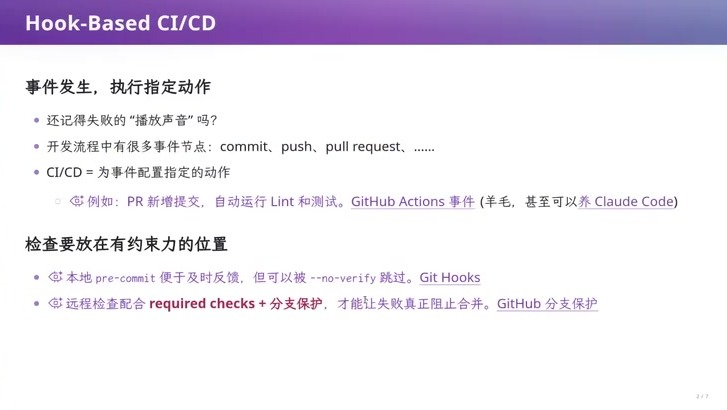

CI/CD 在实现上就是「**为事件配置指定的动作**」。开发流程里的事件很多：`commit`、`push`、`pull request`、合并到某个分支或受保护分支……你可以在一次迁移之前挂一个 hook，也可以在之后挂。

课上讲了一个具体的花絮：希望每次 Agent 输出结束时机器「叮」一声来提醒自己，一开始 hook 失败了听不到声音，后来成功了。这类小自动化正是 hook 的用法。

但更重要的是检查放在哪里。：

- **本地 `pre-commit`** 反馈快，可以做编译、lint 这类最基础的检查，**但它可以被 `--no-verify` 跳过**；
- **远程检查**必须配合 **required checks + 分支保护**，才能让失败真正阻止合并。

也就是说：**检查的价值不取决于它发现了什么，而取决于它能不能拦住合并**。这一点在后面讲机械门禁时还会以更极端的形态出现。

课上特别强调了 lint 的位置：lint(IDE中即时标红报错的工具) 泛指**不运行程序、只做静态分析就能发现的检查**，从缩进、空格到命名与规范都算。它是最基础一级的守门员——**如果连这些可读性规范都过不了，就不要谈软件工程了**。

### 5.4 你甚至能在 CI 里养一个 Agent

GitHub Actions 这类服务提供了一定的免费算力（课上提到每月大约 2000 分钟 CPU 小时），于是有了一些新的玩法：**你甚至可以在 GitHub Actions 里面「养 Claude Code」**——push 一个「我要做什么」的 issue，用这个 push 拉起 Claude Code，让它修改仓库并提交，再触发下一个 hook。

---

## 六、CI 在 Agentic AI 时代更重要

### 6.1 Agent 是「最不可信的开发者」

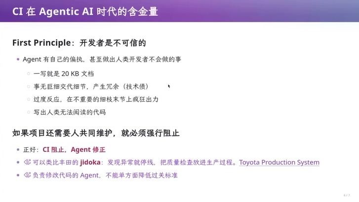

CI 的第一性原理是「开发者是不可信的」，而 Agent 恰恰是**最不可信的那种开发者**：它和人类天生不对齐——它的想法和人不一样，会做出人类根本不会做的事。

课上列了四类具体的偏执，值得记住，因为它们都是可以用门禁判定的：

- **一写就是 20 KB 文档**。你说「写个文档吧」，它直接产出一份 20 KB 的长文：你看了两行就进入无穷琐碎的细节，于是你不会看；
- **事无巨细地交代细节，产生冗余**。一段已经 self-explain 的代码，它还是要硬生生补上一堆注释，甚至把它在 loop 里遇到的问题也写进文档——这些都是技术债；
- **过度反应**。在不重要的细枝末节上疯狂出力，却对 design space 里真正重要的选择视而不见；
- **写出人类无法阅读的代码**，并且非常自信地认为自己可以维护它。

还有一类是上下文层面的：它会疯狂调用工具（`chrome-devtools`、截图）把上下文填满，甚至把一张截图一直带在上下文里。

**最麻烦的不是这些行为本身，而是代码和文档需要的关联**。一份 `doc.md` 和一份 `implementation.py` 之间是有关联的，但是当下一次换一个 Agent、或者上下文被压缩之后，它不记得这两份东西必须保持一致，于是改了代码没改文档——**文档与代码不一致时到底听谁的，没人知道，整个项目就开始滑向 slop**。

人类写文档的速度远远比不上 AI，所以「文档不能超过 1000 字」这种检查在人类时代不会有人做（人类根本攒不出那么多文档），而在 AI 时代，这类**可判定的规则**就变得非常重要。

老师举例一条推文,其解释了「为什么必须阻止」：狗无法理解人类创造的世界，对人类来说狗看世界就像面对一个超级智能，但世界上大约有 10 亿只狗活得非常快乐。

**不要把 AI 当成神**——如果你把任务给它就不管了，那确实可以不管；但只要你还需要人来共同维护这个项目，你就必须强行阻止它做上面那些事，因为**一旦发生就回不去了**：一份 20 KB 的文档，你想在中间定位到想看的地方都不可能，唯一的办法是让 Agent 继续改，直到项目维护不下去。


> **项目还需要人共同维护，就必须强行阻止。正好：CI 阻止，Agent 修正。一旦不阻止,就再也无法人为维护它了**

这里可以类比丰田生产方式里的 **jidoka（自働化）**：发现异常就停线，把质量检查放进生产过程，而不是留到最后一道工序。同理，**负责修改代码的 Agent，不能单方面降低过关标准**。

### 6.2 把 Agent 的偏执变成可执行的约束

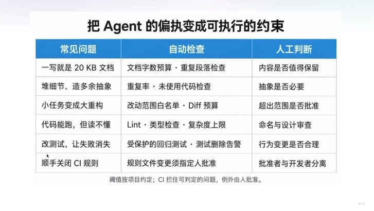

幻老师把这四类偏执整理成了一张三列表格，左边是「常见问题」，中间是「自动检查」，右边是「人工判断」：

这张表能落地的关键在于：**Agent 是看得见这些检查的**。你只要在 CI 里写一个硬条件（例如文档不能超过某个字数），超了就 fail，它永远合不进主分支；Agent 在本地跑 pre-commit 时就会自己发现失败，然后想起 `README.md` 或 `AGENTS.md` 里写着「文档禁止膨胀」这条规则，于是自己去修。**门禁同时是约束和提示**，这是 Agent 时代和以前最大的不同。

但这个机制有一个前提：**规则必须在 Agent 的注意力范围内**。今天的上下文即便到 100 万 token 也不够用；当它面对的是十万行以上的真实项目时，注意力会不断涣散，规则再全也会滑坡。所以规则不能无限膨胀——这也解释了后面要讲的「给根目录的 `AGENTS.md` 设字数上限」。

### 6.3 16 个 Agent 卡在同一个 Bug：验证方式改变任务的可分性

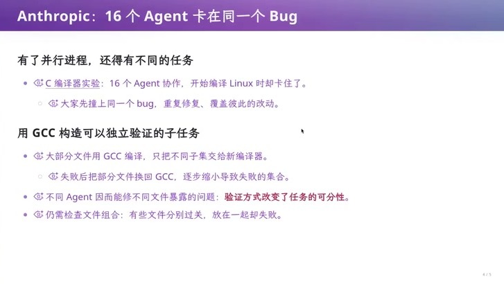

并行不等于可分。Anthropic 在做 C 编译器实验时发现：**16 个 Agent 协作，开始编译 Linux 时却卡住了——大家先撞上同一个 bug，重复修复、覆盖彼此的动作**。

他们的解法很值得学习：**用 GCC 构造可以独立验证的子任务**。

- 大部分文件先用 GCC 编译，只把不同的子集交给新编译器；
- 如果失败，就把部分文件换回 GCC，逐步缩小导致失败的集合；
- 于是不同的 Agent 能去修不同文件暴露的问题——**验证方式改变了任务的可分性**。

这是本讲里最漂亮的一个结论：任务的「可并行程度」不是任务自身的属性，而是**你为它设计的验证方式**的属性。但幻灯片也留了一条边界：**组合仍然要检查**——有些文件分别编译都能过，放在一起却失败。


---

## 七、Agent-native 开发：从公开的门禁到一个真实的项目

### 7.1 OpenAI 的「harness engineer」

课上提到 [OpenAI 发布过一篇讲 Codex 的工程文章](https://openai.com/index/harness-engineering/)，当时引起了一点轰动。这篇文章是目前少见的、**来自头部实验室的「我们内部怎么用 Agent 写代码」的一手材料**。

「**我们从一个人不写代码的仓库开始**」——人不再写代码了，但人依然要把流程定好：**环境、约束、反馈和验证机制**。这些约定很多是用自然语言写下来的，比如「我每次 push 之前都要确保没有泄露 API key」。

**以年为周期维护一个软件**，agent 的 flow 应该怎么设计，他们也没有想完。

文章里公开的 CI 分成三层：**PR 时跑快速门禁**（lint、格式、拼写，以及文件太大、函数太大这类 bad smell，再加上大文件策略与依赖检查），**main 上做全量认证**（把单元测试全跑一遍），**发布时再打标签发布**。

**只看这三层，你就知道 Codex 背后一定还有一整套巨大无比的门禁体系**。理由很简单——一个看起来「有人感」的项目，**是不可能只靠 lint 这种工具写出来的**。公开出来的只是最基础、最不泄密的那部分；真正维持质量的机制，藏在内部。

### 7.2 一个团队实际是怎么「看得见」Agent 的

课上举例出团队的做法，这套做法的目标只有一个：**让总架构师一眼看见现在发生了什么**。

- 有一个 `architecture.md`，可以自动生成一张架构图；
- agent loop 里有一个 **log book**，里面是一堆 task：有的已经完成，有的正在进行；
- 有一个 **agent dashboard**，把正在进行的任务推到 GitHub CI，并且在架构图上显示出来：**现在有几个 Agent 在做这个任务、估计完成百分比、进度条、正在改哪个模块**。

于是作为这个项目的总架构师，基本只需要看这张图，就能知道底下在发生什么、预估一小时之后这个项目会变成什么样、需要做什么调整。

团队结构是「lead + 几位写代码的同学 + 每位同学带的几个 Agent」：如果只靠人去管理，谁在做什么、做到哪一步，很快就问不清楚了；但因为有了 agent-native 的 loop 和这张图，**进展从「需要询问」变成了「默认可见」**。

课上也说，更激进的形态是让一个 master agent 统一分派所有任务.

### 7.3 一个「和别人不一样」的仓库

 **DeepSeek Harness**，老师把它称作 Agent-native 开发领域**标杆性质的项目**，并建议同学们从这里开始读开源项目——因为相比什么都藏起来的闭源方案，它把大量的好东西都放在明面上。

克隆下来的第一感觉是**奇怪：这个项目的 organization 和别的项目都不一样**。原因也很清楚：这是一个中国人的项目，作者用中文写文档——对中文母语者来说，读中文比读英文大约快一倍，这一倍的速度意味着**你的视觉能更快地从海量文字里定位到关键信息**。但一个要走向世界的项目必须同时维护中英文文档，用课上的原话说，**「这不就是地狱和灾难吗」**。

而 DeepSeek Harness 最值得学的，正是它怎么处理这场灾难。顺便说，课上还专门夸了一句：这个项目里**所有的交叉引用都是合法的**，找不到任何一个不合法的链接，文档之间的一致性是被维护住的。

**OpenAI 只把最基础的门禁放出来了**（lint 过、测试过），而 DeepSeek Harness 把整套 Agent-native 的机制都开源在明面上——包括那些「藏了非常多好东西」的目录结构、技能与门禁。用课上的说法，是**在内测群里一起讨论出来的真实经验**。 

---

## 八、双语文档的一致性：三件套、哈希与门禁

### 8.1 三件套与配对契约

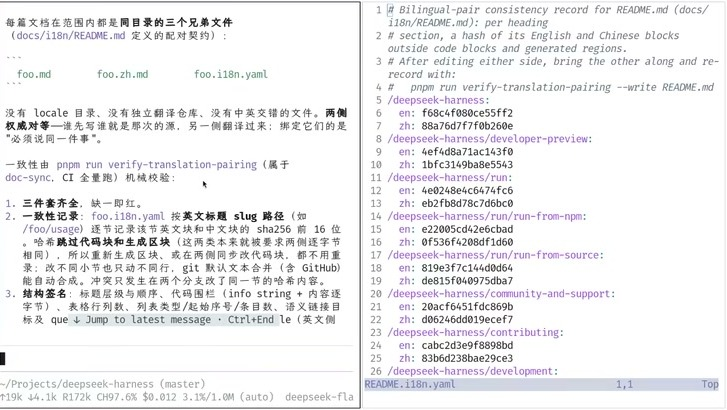

DeepSeek Harness 的答案是：**每一篇文档在范围内都是同目录的三个兄弟文件**。

```text
foo.md          # 中文（或英文）正文
foo.zh.md       # 另一侧正文
foo.i18n.yaml   # 配对契约与一致性记录,保证中英文档一致
```

注意这里没有 `locale` 目录、没有独立的翻译仓库、也没有把中英文塞进同一个文件的做法。**两侧权威对等——谁先写，谁就是那份源，另一侧翻译过来**；绑定它们的东西只有一条：**必须说同一件事**。

而「必须说同一件事」不是靠自觉，而是由门禁机械校验的：`pnpm run verify:translation-pairing`（属于 doc-sync，CI 全覆盖）会检查三件事：

1. **三件套齐全，缺一即红**；
2. **一致性记录**。`foo.i18n.yaml` 按英文标题的 slug 路径（例如 `/foo/usage`）**逐节记录该节英文块和中文块的 `sha256` 前 16 位哈希**；跨过代码块和生成区块（这两类本来就要两侧一致，所以重新生成区块、或在两侧同步改代码块，都不会误报）。改一侧不会自动流转，但 git 认文本合并，能自动完成；**冲突只发生在两个分支改了同一节的哈希内容**时；
3. **结构签名**。标题的层级与顺序、代码块围栏（info string + 内容字符串）、表格的行列数、列表类型/起始序号/条目数、语义链接目标，都必须一致。

这样一段很短的元数据，就保证了两侧文档的一致性。

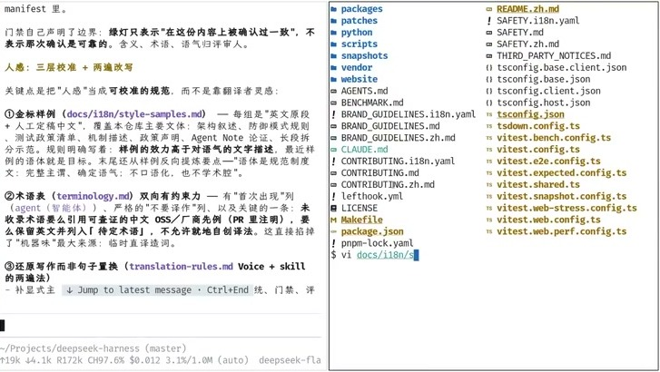

这个设计其实是把一件旧事情搬到了新场景。以前我们用 `docstring` 生成 Python 文档、用 JavaDoc、用 Doxygen，**代码和 API reference 可以保持百分之百一致**；在 agent-native 时代，这套「配对 + 生成」的思想被搬到了**人写的文档**和**它的翻译**之间。

### 8.2 谁先写谁就是源：哈希、补丁式翻译

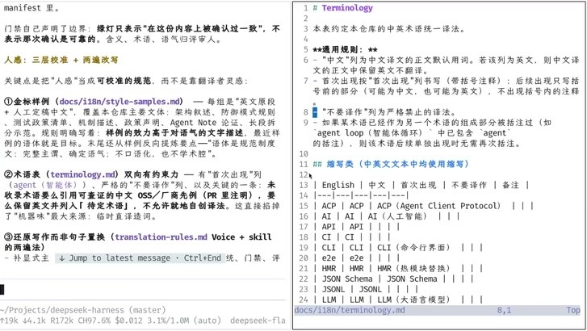

一致性记录里最有意思的一点是：**它不需要一个额外的「谁是源」字段**。因为所有历史都在 git 里，**谁新谁旧是已知的**——旧的那个哈希在新文件里找不到，就说明另一侧更新了。发现新旧不匹配时，就让 AI 去翻译，而且翻译是 **patch-based** 的：只看这份文档改了什么，把另一份文档对应位置改掉，**其他地方保持一致**——是最小补丁，不是重新翻译一遍。

### 8.3 IDE 投影：不同母语的人得到一样的开发体验

三个兄弟文件并排摆在目录里，缺点是**目录很脏**。解决办法很简单：**用 IDE 配置把它们投影掉**。

于是**每个人的开发体验都和在单语仓库里一样，但底层是一个 agent-native 的结构**。DeepSeek Harness 在这里做了一个明确的牺牲：牺牲目录的干净，换来关系的显式化——而这个代价还可以用 IDE 投影再收回来。

### 8.4 人感是可校准的规范，术语是有约束力的

在 `docs/i18n/` 下面还有两样东西，是对翻译规范校正的规则。

**第一样是金标样例 `style-samples.md`**。它是「英文原文 + 人工定稿中文」的成对样例，覆盖仓库里的主要文体：架构叙述、防御模式规则、测试策略清单、机制描述、故障声明、Agent Note 论证、长段拆分的示范。它的规则里写着一条很关键的约定：**样例的效力高于对语气的文字描述**。目标也写得很清楚：术语从样例里反复抽紧事点；**完整主语、确定语气、不口语化、也不学术腔**。这就是「人感」被当成**可校准的规范**而不是靠翻译者灵感的做法。

**第二样是术语表 `terminology.md`**，它是**双向有约束力**的：

- 有「首次出现」列（首次出现时按「首次出现」列书写，可以带括号注释；后续出现只写括号前的部分）；
- 有严格的「不要译作」列；
- 最关键的一条：**未收录的术语，要么引用可查的中文 OSS/厂商先例（在 PR 里注明），要么保留英文并列入「待定术语」，不允许就地自创译法。**

这一条直接掐掉了「机器翻译味」最大的来源：临时直译造词。术语表还能被门禁检查——例如约束「AI」和它对应的中文「人工智能」在中英两侧出现的频率不要偏离太多（留 2~3 的容差），从而防止术语漂移；当然，调整这条边界时要小心，不要把本来可以通过的文档筛掉。

**这些规范是按需加载的**。如果把所有 specification 都塞进 `AGENTS.md` 常驻上下文，就算有 100 万 token 也装不下。于是它们只在需要翻译文档、需要写文档的时候才被加载进去——这就是后面要讲的**渐进式披露**。

### 8.5 gitlog展示的开发历史--统一的规范最重要

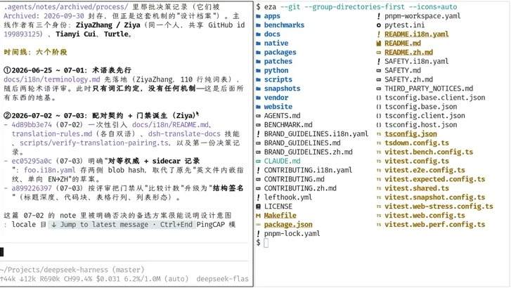

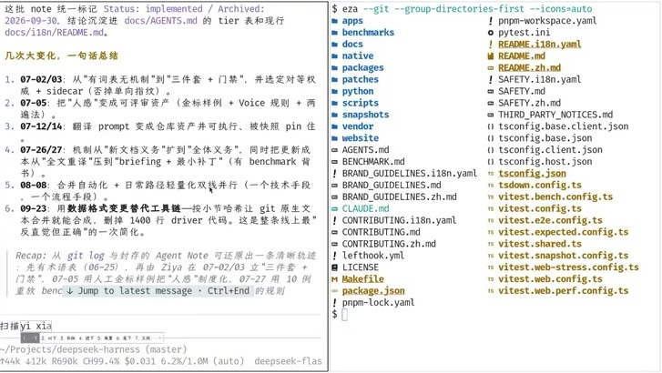

1. **2026-06-25 ~ 07-01：术语表先行**。`docs/i18n/terminology.md` 先落地，110 行纯词表。此时只有词汇约定，**没有任何机制**——但先有词表这件事本身就说明他们意识到了文档的重要性；
2. **2026-07-02 ~ 07-03：配对契约 + 门禁诞生**。一次性引入 `docs/i18n/README.md`、`translation-rules`、`dsh-translate-docs` 技能、`scripts/verify-translation-pairing`，以及第一份决策记录；同时选定「对等权威 + sidecar」；
3. **2026-07-05：把「人感」变成可审计的资产**（金标样例 + 语气规则 + 两遍法）；
4. **2026-07-12 ~ 07-14：翻译 prompt 变成仓库资产**，可执行、被跟踪、被 pin 住；
5. **2026-07-26 ~ 07-27：机械校验从「新增文案」扩到「全文重写 + 全量重译」**；
6. **2026-08-06：合并自动化与日常路径轻量化双轨并行**；
7. **2026-09-23：用数据格式变更替换整条工具链**——按小节单位自治，让原文生成与合并成为可能，**删掉 1400 行 driver 代码**，这是整条线上最反直觉但最正确的一次简化。

**这些决定绝大部分不是「凭空想出」的，而是被真实的失败逼出来的**

顺带说，这也回答了一个更大的问题：**「维护两份必须一致的文档」在人类时代是无解的**（你会忘记、会偷懒、会在评审时漏看），而在 Agent 时代它变成了一个可以被机械校验、被逐节追踪、被最小补丁更新的工程问题。真正难的从来不是翻译，而是**把「一致」定义成可以被机器判定的东西**。


---

## 九、把不变式搬进 CI：一个 agent-native 项目的机制清单

### 9.1 第一梯队：四个支柱

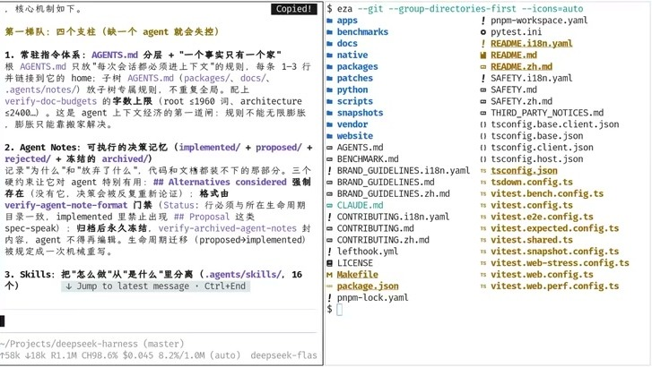

课上把 DeepSeek Harness 里「缺一个 agent 就会失控」的东西归为第一梯队，一共四个支柱。

**支柱一：常驻指令体系 —— `AGENTS.md` 分层 + 「一个事实只有一个家」。** 规则是：`AGENTS.md` 必须遵守每一条指令；它链接到自己的 home 树上的 `AGENTS.md`（`packages/`、`docs/`、`.agents/notes/`），**规则不在各处重复**；这棵树上每个目录都有自己的 `AGENTS.md`，只写本地规则。再配上 `verify-doc-budgets` 的**字数上限**（根目录 `AGENTS.md` ≤ 1960 词、`architecture.md` ≤ 2400 词）。

课上的解读是：这是「agent 上下文经济学」的第一道门。**规则不能无限膨胀**——因为规则太多，模型的注意力就会涣散，等于没有规则；而字数上限把这件事变成了一个可判定的门禁。

**支柱二：Agent Notes —— 可执行的决策记录。** 状态分四种：`implemented`、`proposed`、`rejected`，以及冻结的 `archived`。它要记录的是「为什么」和「放弃了什么」——也就是**代码和文档都装不下的那部分**。让这份记录对 Agent 真正有约束力的，是三个硬约束：

- `## Alternatives considered` **强制存在**——没有它，决策会被反复重新论证；
- 格式由 `verify-agent-note-format` 门禁：状态必须与它所在的生命周期目录一致，`implemented` 里禁止出现 `## Proposed` 这类 spec-speak；
- **归档后永久冻结**，已归档的 notes 不得再编辑，生命周期迁移（proposed → implemented）被规定成一次机械重写。

**支柱三：Skills —— 把「怎么做」从「是什么」里分离**（`.agents/skills/`，课上说是 16 个）。每个 skill 是一个可复用的工作流或判断标准：code review、error handling、prose standard、pre-push checks、archive notes、find simplifications……最关键的设计是**显式调用边界**：`dsh-translate-docs` 上标了 `disable-model-invocation: true` 与 `user-invocable: true`——**日常文档翻译绝不自作主张地加载这套流程**。课上的评价很到位：**agent 不该为了一个两行的改动去加载整套流程**。

**支柱四：机械门禁 —— 把不变式从评审人的记忆里搬进 CI**（`scripts/verify-*` 74 个 + `gen-*` 20 个 + `run-gates.ts`）。`doc-sync`、`ci-static`、`ci-coverage`、`ci-snapshot` 这些聚合任务由 `run-gates.ts` 负责依赖与调度。

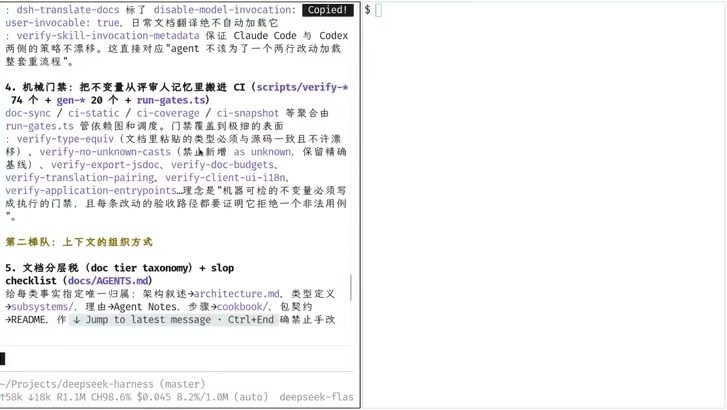

门禁的颗粒度细到让人吃惊：`verify-type-equiv`（**文档里粘贴的类型必须与源码一致，不许漂移**）、`verify-no-unknown-casts`（禁止新增 `as unknown`，同时保留精确基线）、`verify-export-jsdoc`、`verify-doc-budgets`、`verify-translation-pairing`、`verify-client-ui-i18n`、`verify-application-entrypoints`……它们背后的理念是一句话：

> **机器可检的不变式必须写成执行的门禁，而且每条改动的验收路径都要证明它拒绝了一个非法用例。**

在第一梯队之外，还有第二梯队：**上下文的组织方式**，主要是文档分层（doc tier taxonomy）+ slop checklist。它的规则是**给每一类事实指定唯一的归属**：架构叙述 → `architecture.md`，类型定义 → `subsystems/`，理念 → Agent Notes，步骤 → `cookbook/`，包契约 → `README`。

### 9.2 Skills 的分类：每一类负责什么

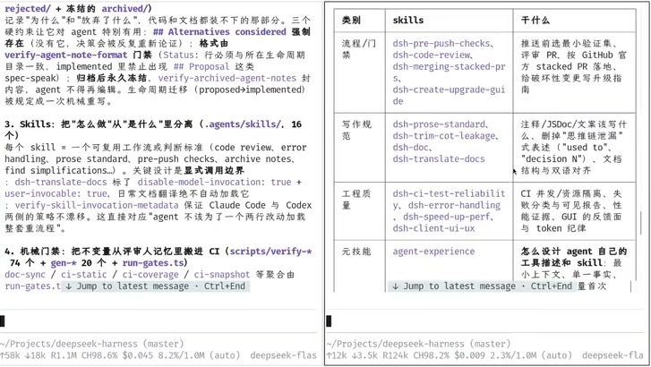

| 类别 | skills | 干什么 |
|---|---|---|
| 流程/门禁 | `dsh-pre-push-checks`、`dsh-code-review`、`dsh-merging-stacked-prs`、`dsh-create-upgrade-guide` | 推送前的最小验证集、评审 PR、按 GitHub 官方做法落地 stacked PR、给破坏性变更写升级指南 |
| 写作规范 | `dsh-prose-standard`、`dsh-trim-cot-leakage`、`dsh-doc`、`dsh-translate-docs` | 注释/JSDoc/文章该写什么、删掉「思维链泄漏」式表述（「used to」、「decision N」）、文档结构与双语对齐 |
| 工程质量 | `dsh-ci-test-reliability`、`dsh-error-handling`、`dsh-speed-up-perf`、`dsh-client-ui-ux` | CI 并发与资源隔离、失败分类与可见报告、性能证据、GUI 的反馈面与 token 纪律 |
| 元技能 | `agent-experience` | 怎么设计 Agent 自己的工具链和 skill：最小上下文、单一事实 |

### 9.3 Code review 怎么做：不是检查清单，而是溯源契约

课上花了一点时间讲 `dsh-code-review` 这个 skill，因为它是「把人类的评审经验写成规范」的样板。它开头就说了一句话：**这是指导，不是检查清单**；并且要求评审者先核实 base/head 再跑 change-scope。

它列出的六条阻断项大致是：

1. **新增文案必须通过语义评审**（`dsh-prose-standard`）；文档/JSDoc 与代码的词要对齐 diff，核心类型的词汇要同步更新 `subsystems` 页；
2. **注册即 effect**：必须能 `dispose`，所需证据存在，客户端文案必须 `locale` 存在；
3. **手检触发式 bug 类，但要溯源契约**：错误/取消/所有权/dispose；错误处理不允许吞掉失败变成 catch-and-continue；异步生命周期要审竞态与队列；**能力消费方必须幂等**——一个新公共方法如果只有一个内部调用者，就说明 API 被不当扩张了，应该改成构造时注入的私有闭包；
4. **配置与执行路径**：默认配置要有当前消费者的证据；从模型视角检查 prompt/schema/结果是否包含任务外前提；执行路径不能绕开 schema/prompt/包装层；区分借用状态与拥有状态；字节上限要覆盖最终产物而不是中间产物；测试要走真实的 Loader/bin/worker 入口；
5. **负向控制**：故意让规则失败，验证门禁真的会红；
6. **快照 diff 要当行为变更来审**。

课上顺便说了一句很有时代感的话：**以前面对一个陌生的项目，你是不可能像现在这样光速学习的**——你只要具备「什么东西是好的、什么东西是我没见过的」这种元级认知，就能从别人的项目里快速吸收。而评审这件事本身也被拆成了三层：**本地自证、CI 门禁、人工评审**，甚至还有分数。

### 9.4 这一切的代价与收益

代价是明显的：**提交之前要运行大量门禁**。但收益也同样明显：**你大部分时间不写代码，而是在写 plan**。大家会在 log book 里写 plan、在 plan mode 里先把「要做什么、做到什么程度」搞清楚，剩下的事情交给 Agent；而**改 log book 的时候不需要跑那些 CI**，因为代码根本没有动过。

课上还提到自己团队对这套思想做的一点扩展：**让文档里的代码块带执行语义**。也就是说，在一个 fenced code block 上可以标注「这段东西是干什么用的」——它需要出现在某个位置，或者需要以某种形式和另一个东西关联起来；再配一些轻量级的检查，就扩展了 Markdown 的语法。另外一个很实用的门禁是：**文档里的 interface 必须逐字出现在某个源码文件里**——这样就杜绝了「代码改了接口、文档没跟上」和「文档改了设计、代码没跟上」这两种最常见的不一致。

### 本章小结

这四条支柱的共同点是：**它们都不依赖人的记忆和自觉**。规则写在 `AGENTS.md` 里（而且有字数上限），决策写进 Agent Notes（而且有格式门禁），流程装进 skills（而且有显式调用边界），不变式变成 CI 里可执行的门禁（而且每条都要证明它拦得住一个非法用例）。**当你不写代码、只写 plan 的时候，这一整套机制就是你留在项目里的「判断力」**。

---

## 十、真正的经验与社会性的威胁

### 10.1 真正的经验：很难「凭空想出」

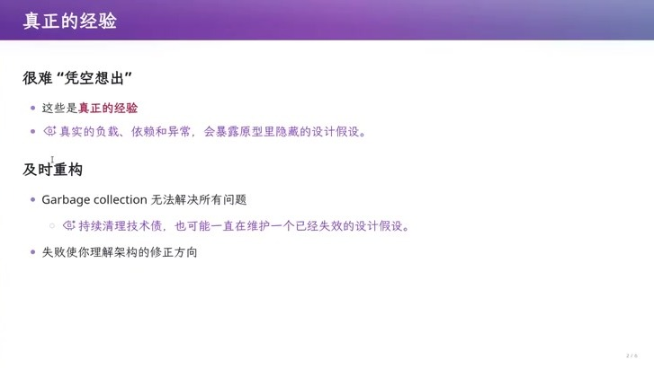

课上在讲完 DeepSeek Harness 之后，把话头收回到「经验」上：

- **很难凭空想出**。这些机制之所以看起来「确实应该是这样」，是因为它们来自真实的负载、依赖和异常——**真实的东西会暴露原型里隐藏的设计假设**；
- **及时重构**。Garbage collection 无法解决所有问题；而持续地清理技术债，也可能只是在维护一个已经失效的设计假设；
- **失败使你理解架构的修正方向**。

课上给了一条很具体的行动建议：当项目已经烂掉的时候，**开一份新的空白仓库，一点一点把旧功能迁进来，同时保持一个更好的架构**——而不是在原地继续打补丁。这和自己带学生的经历是连着的：你需要真的写过代码、真的失败过，才可能理解这些机制为什么长成这样。**如果只是坐在教室里做「语言律师」，思维就会被禁锢在当前的上下文里，看不到 design space 里还有巨大的空间可以朝另一个方向探索**。

### 10.2 一个社会性的威胁

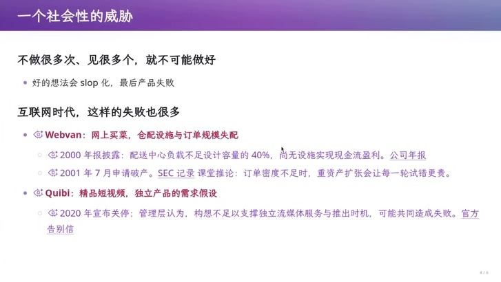

反过来说，**不做很多次、不见很多个，就不可能做好**：一个好的想法会因为执行队伍没有经验而 slop 化，最后产品失败。互联网时代这样的失败并不少，课上举了两个例子：

- **Webvan**：网上卖菜。仓配设施与订单规模失配。2000 年披露的信息是，**配送中心负载不足设计容量的 40%**，尚无法实现现金流盈利；2001 年 7 月申请破产。课上由此推出一个结论：**订单密度不足时，重资产扩张会让每一轮试错更贵**；
- **Quibi**：精品短视频。它的失败对应的是「独立产品的需求假设」问题。2020 年宣布关停时，管理层的说法是构想不足以支撑独立的流媒体服务，加上推出的时机，可能共同造成了失败。

课上还补了一个更早的例子：社交网络先驱 Friendster 曾经迅速吸引了大量用户，随后因为工程与产品上的失控而衰落——「不过这是 pre-LLM 时代的事情，在 Agent 时代也许能把它扶起来」。这三个例子的共同点不是技术不够好，而是**在真实约束（订单密度、组织结构、增长节奏）面前，团队没有能力把试错做完**。

### 10.3 推论：尝试的机会与「斩杀线」

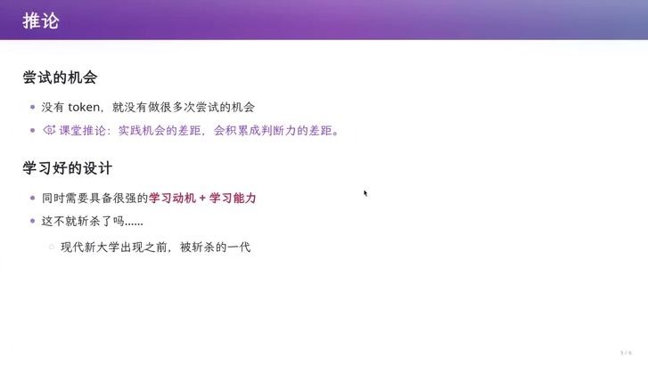

由此得到的推论有点冷：**你必须要有机会去尝试**。

课上的说法是：**没有 token，就没有做很多次尝试的机会；实践机会的差距，会积累成判断力的差距**。而要抓住这些机会，同时需要很强的学习动机和很强的学习能力——「这不就斩杀了么」。

于是就有了那条**斩杀线**：如果一个人读完博士，依然不如一个 Agent 好用，用人单位会怎么选？**他们会选一个 senior，给他无穷的 token，而不是去培养一个 PhD 学生**——因为博士的回报周期要 4 到 5 年，公司早就等不到了；而 Agent 现在就在这里，并且还在上涨。

课上对自己的处境做了一个诚实的评估：**一个 20 美元的订阅，配上 Opus 4.5 的额度，其实已经相当够用，而它真的很强**——一个本科毕业生要达到这个水平非常困难。但如果一个人作为 senior 有大局观，又有一个好的 agent harness，那么他能产出的东西会非常可观。


这也是为什么开源在这里格外重要：OpenAI 和 Anthropic 从没把这些东西开源出来（课上称之为 close AI），**如果这些机制永远只存在于公司内部，被斩杀的人只会越来越多**。

课上最后抛出了一个更激进的暴论：**大学肯定要崩溃**。理由是高校的考核指标不是上课，而是所谓的科研经费，高校本身越来越像公司化运营——只不过资本体系换成了基金委、科技部、优青杰青这个金字塔。如果学生永远追不上 Agent，老师和学生都被「斩」的时候，这个体系就会失效。他设想的替代形态是一种资本化运营的「新形态大学」：花 1000 万抢最好的天才来设计样板课，老师变成执行机器，再把执行机器换成「老师 + AI」，从而把整个教学体系颠覆掉；而传统大学的惯性太大，改不动。

但同一段话里也有另一面：**这个问题可能只有在大学里能解决**，因为大学应该是非盈利、不以 KPI 为导向的地方——只有这样的地方，才可能允许一个人「试很多次、失败很多次、见很多个」。所以课上的结论是感谢开源社区：**如果没有在开源社区里看到那些好东西，就不会有今天的理解**。他给所有人的建议也很直接：**去互联网上找那些真正优秀的项目，可以从 DeepSeek Harness 开始读**。

今天课上写的那个 mini ralph loop，用他自己的话说「**不能算 ralph loop，只能算一个 agent-native 的 POC**」——而 DeepSeek Harness 是同一个思想的完整形态：**一切皆插件**。


