## 1 从 150 行到产品：一次断网暴露的需求

这一讲讲者要回答的并不是「怎么写一个 agent」，而是「一个有 150 行代码就能跑起来的 agent，为什么做不成产品」。他把这个问题挂在两个很朴素的场景上：一是上周 150 行的 mini-agent 在高铁上断网后直接终止，二是 DeepSeek Harness 这个开源项目从空仓库起步，第一版就打算做「操作系统」。读者读完这一章应该能说清楚：需求是在什么时刻变成复杂性的，以及这种复杂性为什么无法靠多写几行代码消掉。

### 1.1 第一件事不是写代码，而是承认你已经有组织架构

讲者的开场是一个身份判断：学生写作业时是单线程 agent，自己学 C++、学 Python、写自己的项目；一旦你拥有 agent，你立刻拥有一家现代公司的架构——你是 CTO，下面有架构师、前端、后端，每个 agent 还能再带 subagent，subagent 再创建 subagent。「否则你不可能管理一个复杂的需求」，因为你要面对的是各种各样的 essential complexity 和 accidental complexity。

这个判断的价值在于它把「版本管理」从工具箱里的一个工具，变成了组织结构的推论。讲者提到上周 Anthropic 公开表示 Git 已经不够用，而他自己在讲版本管理那一节就预告过这一天。他的推演是：每个 task 从 first principle 看一定与仓库的某些部分相关，可能是重构一个 subsystem，可能是在某处加功能；那么 task 在系统里的形态就不同，覆盖范围也不同，所以更适合的抽象是**锁**：先给一段代码上锁，锁还分只读、可写、重构几种类型。一个 minor fix 虽然是写锁，但不产生 breaking change，只要彼此独立就该并行执行。这套思路在操作系统里是「先上锁」，在数据库里是「先做、再做冲突检测」，而放在 agent 协作上，答案要从组织架构里找。

> **背景：为什么这是「上一节课」的续集**
>
> 上一节课的产物是一个约 150 行的 mini-agent，它证明了 harness 的基本循环：一问一答，回答方可以是人，也可以是工具。讲者反复强调「几乎所有的 agent harness 都遵循这样的循环」。本章讨论的不是这个循环本身，而是把循环放进真实环境后，循环外面需要补什么。

### 1.2 one-shot 出一个校园 3D 图：能跑，不等于能用

为了说明「mini-agent 到底能不能用」，讲者在新模型发布后给了它一句话的需求：生成一个相对真实的南大仙林校区三维图。结果让他自己都意外——模型去 OpenStreetMap 上爬了数据，再按自己的理解建模：杜厦图书馆的建模相对准确，从 top down 看，楼的几何形状被正确保持了；但计算机楼是十层楼，十层楼的高度明显不对；地图上没有东西的地方被标成绿地，大门被划成了楼，门口铺满了树。

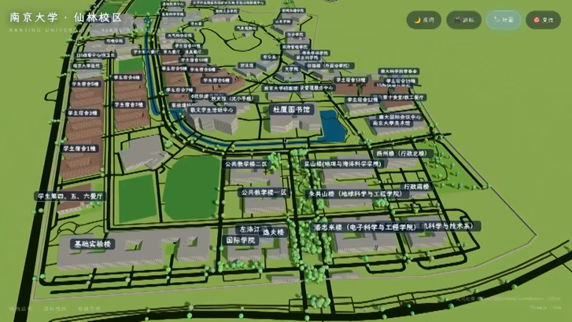

> 视频画面时间区间：00:09:30–00:09:45

这段演示的教学价值不在图好不好看，而在错误分布。几何形状是对的，因为数据源里有；高度是错的，因为数据源里没有；「这里是绿地」是错的，因为模型在信息缺失处必须编一个答案。讲者给出的修法是继续对话：告诉它应该是什么样，再让它精确建模，代价是「花更多的 token，大概 10 倍」，才能得到一个更好的版本。他还补了一句判断：网上那些用 GPT、Opus 或 DeepSeek 生成漂亮三维场景的演示，走的也是这条路——先有一个粗糙但可用的结果，再用十倍的 token 修。

**能跑**的证据到这里就结束了。紧接着讲者给出了**不能用**的证据：他在高铁上跑同一个 agent，已经跑了较长时间并有一些中间结果，网断了，进程直接终止。那个 150 行的 mini-agent 没有会话保存，没有恢复，也没有处理网络中断后重试的逻辑，于是他只有两个选择：从零开始，或者让它重新做一遍。

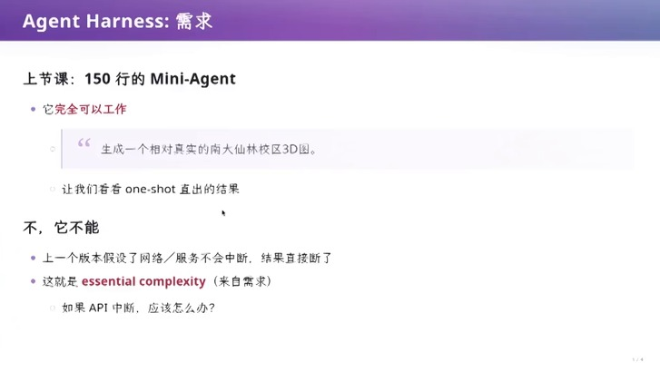

> 视频画面时间区间：00:10:30–00:10:45

### 1.3 本章小结

150 行的 agent 之所以「能跑」，是因为它只实现了 harness 的循环；它之所以「不能用」，是因为它默认循环之外的物理世界是稳定的。这个默认不是 bug，而是需求缺位：写作业时机器不会突然消失，做产品时网络随时会消失。下一章把这个缺口展开——当「中断」被当成一等公民，需求会膨胀成什么样。

## 2 需求的第一层：把「中断」当一等公民

如果 API 中断只是一个异常，捕获它、重试三次就够了。讲者花了近十分钟说明为什么不是这样：中断之后真正难的是**你不知道发生了什么**。这一章按他的推进顺序展开：先分类失败，再讨论重试的边界，最后落到一份真实的办公 Agent 需求规格说明书。

### 2.1 三类失败，和「接着做」会不会变成「再做一遍」

幻灯片把中断拆成三类，每类的正确处理方式不同：暂时断网或服务限流，可以保留进度、有限重试；输入损坏或权限不足，改变条件才有意义，原样重试没有用；执行结果未知，则要记住「没收到结果不等于没有执行」。

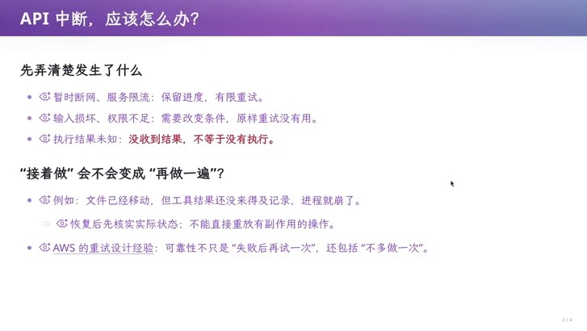

> 视频画面时间区间：00:12:45–00:13:00

第三类最容易被低估。讲者举的例子是文件已经被移动，但工具结果还没来得及写入日志，进程就崩了。恢复之后，如果直接重放那个有副作用的操作，你会得到「移动两次」或者「移动一个不存在的东西」。幻灯片给的规则是：恢复后先核实实际状态，不能直接重放有副作用的操作。它引用了 AWS 的重试设计经验——可靠性不只是「失败后再试一次」，还包括「不多做一次」。

**三类失败的判别表：决定「能否重试」的不是错误码，而是副作用是否已经落地**

| 失败类别 | 状态是否已知 | 允许的动作 |
| --- | --- | --- |
| 暂时断网、服务限流 | 已知：请求没被接受 | 保留进度，有限重试 |
| 输入损坏、权限不足 | 已知：请求注定失败 | 改变条件后重试，原样重试无用 |
| 执行结果未知 | 未知：可能已产生副作用 | 先核实实际状态，再决定是否重放 |

### 2.2 重试为什么会长成一个复杂问题

讲者把重试的复杂度拆成三个互相纠缠的参数。第一是间隔：在美国的数据中心访问 OpenAI，和在国内挂多层代理访问，网络环境不同，timeout 就不该一样。第二是退避策略：等间隔重试，还是像网络课里讲的 exponential backoff 那样 2 秒、4 秒、8 秒地拉长。第三是故障的物理尺度：他遇到的是物理世界故障，「启动可能就需要两三分钟」，退避要能覆盖到分钟级。

再往上一层是客户端与服务端的**状态不一致**。他举了淘宝下单和买机票的例子：客户端发一个支付请求，服务端收到后要把订单落下去，还涉及与银行或航空公司的确认，这个 transaction 在服务端已经结束了，不可能等你关闭。而你的手机恰好在订单发出后断网。此时订单可能成功也可能失败，但因为与服务端失去了同步，客户端无法判断自己处在哪个状态。应用不能崩，还得告诉用户「我不知道」。

> **要点：这一节的机制结论**
>
> 「中断」不是一个异常分支，而是一类**状态不可知**的问题。凡是引入了外部副作用（下单、发邮件、移动文件）的操作，重试语义都必须先回答「上一次是否已经生效」，否则重试会把一次失败放大成两次副作用。

### 2.3 一份真实的办公 Agent 需求清单

为了让读者看到需求膨胀的量级，讲者让 AI 扮演产品经理，对着 WorkBuddy 这类产品写一份需求规格说明书。文档的结构很标准：产品定位与目标、典型需求、核心价值、首版目标。典型需求写得很具体——「把这个文件夹里的本周项目记录整理成周报，列出延期事项，生成 Word 文件」，并要求产品去找相关记录、核对时间与项目、整理内容、生成文件，还要告诉用户哪些事项缺少依据；只在聊天窗口给一段建议，不算完成这项任务。

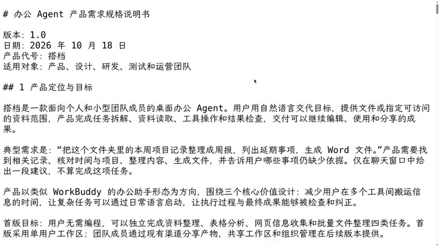

> 视频画面时间区间：00:15:30–00:15:45

需求点随后迅速分叉：围绕 Agent 的能力要覆盖项目、工具、Skills、沙箱和权限，上下文压缩、记忆、索引，用户交互与文件编辑，远程访问、App 同步、备份和恢复；而办公场景的非功能需求又单独列了一组——执行控制要支持排队、暂停/停止、中途改要求、预算与用量；交付与验收要支持可编辑产物、版本、来源、检查、部分完成；隐私与诊断要处理账号隔离、外部指令隔离、数据外发、脱敏反馈；使用体验要规定响应与停止时限、平台与格式兼容、键盘可访问性。

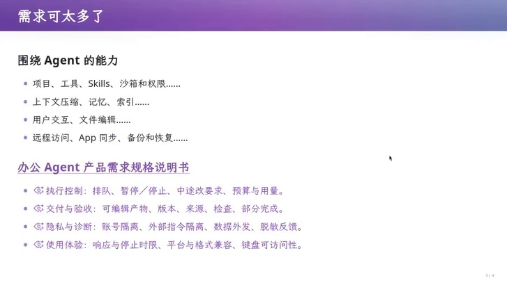

> 视频画面时间区间：00:14:30–00:14:45

讲者对这条路线的评价很直接：如果让 agent 直接实现这份需求，「大概率会陷入一个 slop 的状态」，因为 agent 有非常强烈的倾向——直接把任务完成，而不去想未来还会发生什么。产品与 MVP 的区别正在这里：MVP 的作用是让假设被 validate，他自己的 mini-agent 就 validate 出了一个不成立的假设——网络与 API 是稳定的。

### 2.4 本章小结

把「中断」当一等公民之后，需求从「调用模型」膨胀成「状态机 + 重试语义 + 权限 + 沙箱 + 预算 + 可审计」。这些需求无法靠更聪明的 prompt 消掉，它们来自外部世界的物理性。而下一章会说明更糟的一件事：即使你把这一版需求全都实现，需求本身还会变。

## 3 需求的第二层：需求会变

本章讨论的是产品经理最不愿意面对的场景：50 万行代码已经写完并上线，交互范式被一个新出现的产品推翻。讲者用一个具体的时间点把讨论锚住——2026 年 6 月 10 日 22:57，一个空仓库里出现了 README、AGENTS.md 和 CLAUDE.md 的 symlink。

### 3.1 Grok Bot 让上一版需求整体崩塌

Grok Bot 火起来之后，交互方式变成了「把 agent 当人」：每个人都有他自己的记忆，所以可以拉一个群让两个人协同完成工作，也可以安排「每天什么时间干什么事」。这与上一章那份围绕聊天窗口、PowerPoint 视图、各种 view 详细设计的需求完全不同。讲者的表述很刻薄也很准确：「你怎么杀死一个程序员？只要改需求三次就可以」——之前所有需求都建立在一个交互模式上，这个根基塌了，剩下的设计全部作废。

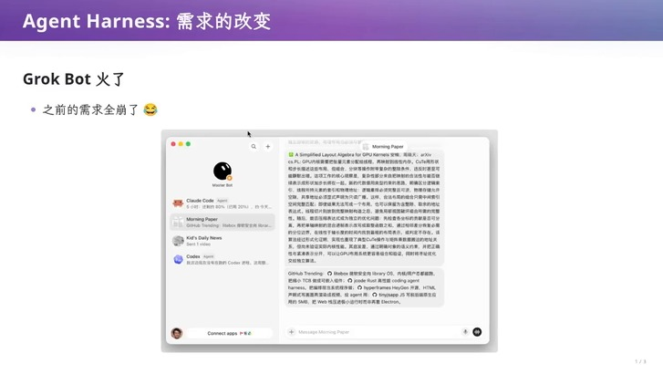

> 视频画面时间区间：00:18:00–00:18:15

### 3.2 两种应对：拉通对齐，或者几分钟复刻

面对这种冲击，大厂的选择是「疯狂拉通对齐、闭环、沉淀、复用」，再进入下一个版本。讲者没有嘲笑这个选择，反而解释了它的合理性：大厂有交付质量的要求，所以架构会做得相对保守，用保守换极高质量的交付。代价是转身慢。

另一条路是以 DeepSeek Harness 为代表的小内核路线。讲者展示了一个第三方做的 dsh-bot：它「跟刚才那个像素级复刻」——可以设置多个 bot、可以拉群、群还有群图标，可以聊天。他的判断是，复刻只是起点，真正的差别在于可改性：Grok Bot 面向普通人，不会给你编辑配置的权限；而对一个程序员来说，「我真的就是想把那个 configure.yaml 拿出来自己改一下，或者那个 prompt 给我改一下」，因为 99% 的人不知道怎么跟模型对话，而他懂。

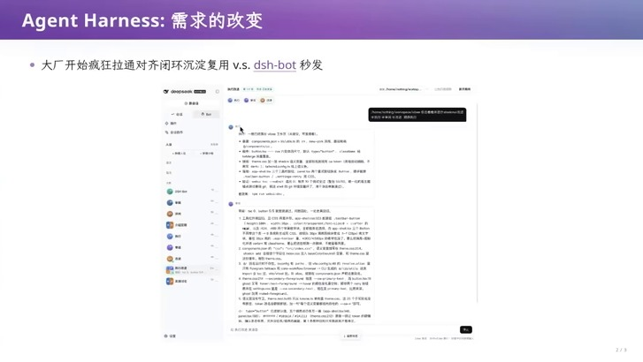

> 视频画面时间区间：00:19:15–00:19:30

### 3.3 2026 年 6 月 10 日 22:57：一个空仓库的野心

故事被倒回项目启动的时刻。当时的主流产品是 Claude Code、OpenCode、Trae、CodeBuddy；那天晚上的仓库里什么也没有，只有 README、AGENTS.md，以及一个 CLAUDE.md 的 symlink。讲者顺带解释了这个细节为什么重要：当一个项目要同时支持多种 agent，就得用它们都理解的方式组织项目文件，symlink 是最省事的兼容层。而 AGENTS.md 里链接的是两份文档——MVP 的需求分析，和微内核架构。

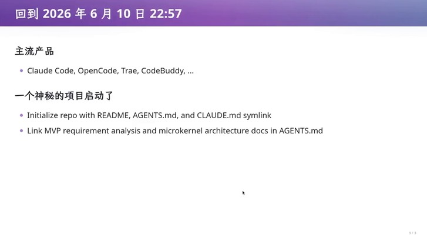

> 视频画面时间区间：00:22:15–00:22:30

「它从第一天开始就想做一个操作系统，想造一个航母。」这句话是后面三章的总纲：如果目标是操作系统，那么需求文档不该直接翻译成模块，而该先决定内核提供什么、不提供什么。

> **背景：时间线为什么值得记这么细**
>
> 2026 年 6 月 10 日 22:57 这个时刻的价值不在于日期，而在于它早于绝大多数开发者意识到「agent 需要自己的操作系统」。讲者用它说明一个产品决策：先确定要造什么形状的东西（微内核），再去找当下的需求；而不是把当下最热的需求直接翻译成模块。

### 3.4 本章小结

需求会变，而且变化往往发生在交互范式这一层，不是功能这一层。大厂用保守架构换交付质量，小内核用可改性换转身速度，两者都在为「下一次需求改变」付不同的保险费。接下来的问题是：架构到底买到了什么、抵押了什么。

## 4 架构是「受限」与「自由」之间的平衡

这一章是全篇的理论核心。讲者先用一个「顺着需求画出来的自然架构」说明架构是怎么长出来的，再用四个历史案例说明每一种架构都在用自由换约束，最后给出判断标准：架构与需求吻合时是便利，假设改变时是阻力。

### 4.1 顺着需求画，会画出一个什么样的架构

如果直接把需求文档交给 agent 做架构，agent 的注意力会落在需求上，于是它会为「工作区」设计一个 class，再设计工作区与模型的交互、工作区里链接的 session、session 向 agent 发 chat、agent 调用 agent loop 或工具、结果（例如画布）再挂回 session，最后用一个数据库存 session。讲者说这套设计「非常自然」，大厂里也经常这么设计。

自然的架构仍然要付账。「架构就意味着没有免费的午餐」：边界一旦确定，模块之间的耦合就被切断了，好处是开发某个模块时只需要较少地了解系统其余部分——所以架构一搭好，就可以「马上启动大量的 subagent」把产品堆出来；代价是你的自由度被限制，未来需求变化时，如果架构不能适应，就会不断出现抽象泄漏，项目越来越难维护。

反过来，完全自由的架构同样不成立。讲者设想的极端方案是「每个模块都是一个进程，进程之间发消息」——那确实干净、自由，甚至可以说是 actor model。但它「没有约束」：消息什么时候发、发什么、怎么管理，全都没有规定，「你等于没有架构」。越自由越不好开发，受限有受限的好处。

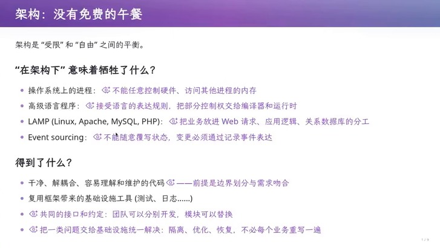

> 视频画面时间区间：00:23:30–00:23:45

### 4.2 四个历史案例：每一种抽象都收走了某样东西

幻灯片把这件事压成一张四行的对照表，讲者逐条解释，语气是「这不是我的观点，这是历史」。操作系统上的进程不能任意控制硬件、不能访问其他进程的内存；高级语言程序要接受语言的表达规则，把部分控制权交给编译器和运行时；LAMP 把业务放进 Web 请求、应用逻辑、关系数据库的分工里；Event Sourcing 不允许随意覆写状态，变更必须通过记录事件表达。

**四种架构的取舍：每一行都是「收走一种自由，换到一类基础设施」**

| 架构 | 牺牲了什么（限制） | 换到了什么（自由） |
| --- | --- | --- |
| 操作系统进程 | 不能任意控制硬件、不能访问其他进程内存 | 隔离、恢复、把一类问题交给基础设施 |
| 高级语言 | 接受语言的表达规则，控制权部分交给编译器与运行时 | 可移植、内存安全、更强的抽象能力 |
| LAMP | 业务必须落在 Web 请求 / 应用逻辑 / 关系数据库的分工里 | 测试、日志、部署等基础设施可复用 |
| Event Sourcing | 不能随意覆写状态，变更必须记录成事件 | 可回退到任意历史版本、状态可推导、可审计 |

讲者用操作系统解释「自由」那一侧的价格：为了「上层能搭任何东西」，人类为了「到底用什么语言开发」吵了几十年。用高级语言解释另一侧：C 这样的语言能更好地控制机器，代价是内存泄漏和各种麻烦。用 LAMP 解释规模：单机能扛时它是最好的架构，「PHP 是世界上最好的语言」这个老梗之所以流行，是因为那套分工确实引领了整个互联网世界十几年；但要服务 1 亿、10 亿人时，从单机到数据库每个点都是瓶颈，于是分库分表、拆服务，抽象开始泄漏。

Event Sourcing 的例子最贴近本讲主题，也最容易被讲成纯粹的好话。讲者的处理是给它加一个反面场景：当前状态完全由历史推导，性能更难做；而且有时候人真的只想 hack 当前状态——比如教务员想让你强行毕业，没有理由地让你毕业。在事件溯源里这件事很难办，你必须造一个特殊事件和特殊的处理规则；而这个事件会进入持久历史，被审计到，谁 committed 都查得出来。「所以这好像也是一件比较有趣但是有点危险的事情。」

### 4.3 判断标准：假设与需求是否吻合

讲者把上面所有案例收成一句话：架构与需求吻合时，就是便利；假设改变时，抽象开始泄漏，架构就成为阻力。这句话不是修辞，它在下一章会被一个具体的工程案例检验——MapReduce。

> **背景：术语：essential 与 accidental complexity**
>
> 讲者全程使用这一对词，但只在 mini-agent 的例子里给了定义性的用法：essential complexity 来自需求本身（网络会断、状态会不一致），accidental complexity 来自实现方式（用了什么语言、怎么分层）。架构能优化的是后者，前者只能被承认并建模。

### 4.4 本章小结

架构是「受限」与「自由」之间的一条线：线画得太紧，未来需求一来就泄漏；画得太松，等于没有架构、无法分工。四个历史案例说明这条线从来不是技术偏好，而是对「哪些假设会一直成立」的押注。押注会输，下一章看输的那一瞬间。

## 5 架构的假设会过期：MapReduce 的一课

讲者说这一章要讲「一个具体的架构变化的案例」，并且强调「这是 AI 帮我补充的，你们有兴趣回去看 slides」。案例是 2004 年 Jeff Dean 与 Sanjay Ghemawat 的 MapReduce 论文，标题就把主张写在了脸上：*Simplified Data Processing on Large Clusters*。

### 5.1 电力改变的不是动力源，是布局

在进入技术细节前，幻灯片先给了一个工业史类比：蒸汽工厂的机器布局受传动轴、皮带约束，独立电机让设备可以按生产流程重新排列。同样是用电，沿用旧厂房布局也能转起来，但只有重组设备与生产流程，才能兑现新技术的收益。更麻烦的是第三句——旧假设会固化在厂房、岗位、流程和投资里；技术已经变了，组织可能还在围着「传动轴」转（David, 1990）。

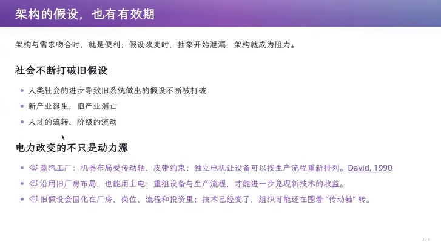

> 视频画面时间区间：00:31:30–00:31:45

这个类比解释了为什么架构换代总是滞后于技术换代：不是没人看见新技术，而是旧架构已经把组织、流程、投资都长在了自己的形状上。

### 5.2 用编程模型换集群能力

MapReduce 的交换条件很清晰。它限制你只能把计算写成 map 与 reduce 两个函数：map 把一堆数据变成另一堆数据，reduce 反复地把两个元素合成一个，如果这个函数满足结合律，就可以并行地先归约两部分再归约结果。作为交换，框架接手了并行、任务调度、负载均衡和失败重试。

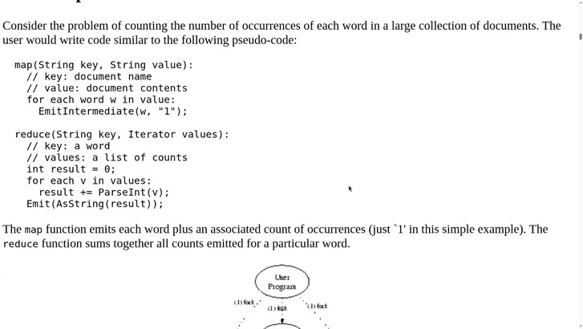

> 视频画面时间区间：00:34:00–00:34:15

讲者补充了当时的工程形态：在 Google 内部用 C++，`include` 一个 `mapreduce.h`，写一个 class 声明 Map 和 Reduce 即可，就像写普通程序，「只是我不再使用 pointer、list 这样的基础抽象，而是一个系统包裹的、可能跑在不同机器上的抽象」。任务可以申请最多 2000 台机器、每个任务 100 兆字节内存，剩下的调度由框架完成。

**MapReduce 论文中的词频统计骨架（幻灯片原文）**

```c
map(String key, String value):
  // key: document name
  // value: document contents
  for each word w in value:
    EmitIntermediate(w, "1");

reduce(String key, Iterator values):
  // key: a word
  // values: a list of counts
  int result = 0;
  for each v in values:
    result += ParseInt(v);
  Emit(AsString(result));
```

真正被打破的假设是「机器是好的」。讲者说，以前 LAMP 的基本假设是「这台机器是好的」，同学做大作业时机器不会突然消失；而 Google 要索引整个互联网，「几乎一定会有一台机器要么掉线要么出故障」，不能靠社会工程解决，只能用系统抽象解决。失败重试因此成了 MapReduce 的核心卖点。

### 5.3 「失败就重算」的边界

幻灯片没有把 MapReduce 讲成一个完美答案，而是专门列了「哪些细节仍要自己处理」。热门 key 会让大量数据汇聚到同一个 reduce 调用，自动调度无法替你拆开任意的归约逻辑，可能需要预聚合或重新设计 key；外部副作用更危险——如果 map 顺手发邮件，重试就可能重复发送，原论文 §4.5 因此要求应用作者保证额外副作用的原子性与幂等性。

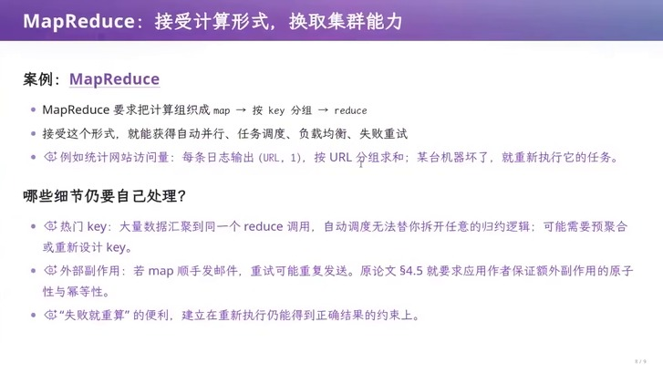

> 视频画面时间区间：00:36:30–00:36:45

这一段和第二章的「接着做会不会变成再做一遍」是同一个问题的两次出现。MapReduce 的答案是：只要你保证重新执行能得到正确结果，我就替你重算；这条约束被写在论文里，而不是被框架偷偷保证。

### 5.4 当计算不再是一轮批处理

MapReduce 的假设是「计算是一轮批处理」。讲者用两代后继系统说明假设如何继续失效。Spark 面对的是迭代计算：批处理不够灵活，于是用更一般的计算 DAG 组织多阶段处理，并缓存可复用的数据集；代价是新的取舍变成性能问题——哪些数据该缓存、怎么分区、内存不足怎么办。Flink 面对的是实时性：传统批处理难以满足低延迟，Flink 让算子持续处理到达的数据并维护状态；日志会乱序、会迟到，于是事件时间、水位线和迟到处理策略一起定义了「什么时候产出或修正结果」，技术栈也随之重组——输入来自 Kafka 这类可重放日志，执行变成常驻算子，恢复要协调输入位置与算子状态的检查点。

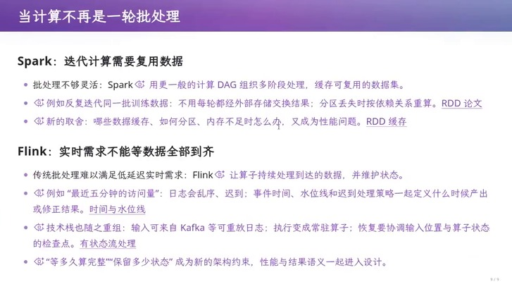

> 视频画面时间区间：00:37:30–00:37:45

**三代计算引擎：每换一次假设，编程模型就更宽，运维语义也更深**

| 系统 | 核心假设 | 强迫你接受的编程模型 | 新增的代价 |
| --- | --- | --- | --- |
| MapReduce | 计算是一轮离线批处理，机器会坏 | 只能写 map 与 reduce | 热门 key、外部副作用要自己保证幂等 |
| Spark | 需要在同一批数据上反复迭代 | 用 DAG 组织多阶段，显式缓存 | 缓存什么、怎么分区、内存不足怎么办 |
| Flink | 数据持续到达，不能等齐 | 常驻算子 + 事件时间语义 | 乱序与迟到、水位线、检查点与恢复 |

### 5.5 本章小结

MapReduce 用「只许写 map 和 reduce」换到了集群能力，Spark 和 Flink 又各自用新的限制换到了迭代与实时。这条线索和上一章的判断完全一致：架构的便利来自假设成立，架构的阻力来自假设失效。理解这一点之后，才有可能理解 DeepSeek Harness 为什么把「内核极小、其余皆插件」当成第一性原理——它试图把「假设会变」写进架构本身。

## 6 第一性原理：一切皆插件

讲者在这一章把话题从历史拉回设计：如果要设计一个 Agent Harness，first principle 是什么。答案来自幻灯片上的一句话——我们要做一个 micro kernel，要做一个操作系统；而操作系统的意思是，它不需要知道每一个进程在干什么。

### 6.1 微内核：内核不知道进程在干什么

Unix 诞生时没有桌面浏览器、没有图形界面，内核不需要理解进程的业务，但它能把进程组合起来，让进程之间互相使用。讲者据此推出 harness 的第一性原理：**Everything is a Plugin**，所有东西都是可插拔的。

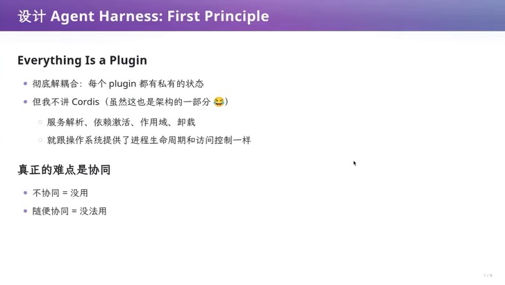

> 视频画面时间区间：00:38:30–00:38:45

他特意澄清这不是 actor model：把每个插件想象成一个进程或一个人、互相发消息，理论上可以实现任意架构；但这个架构真正想要的是「每个模块的 private state 封在自己里面」，需要交互时才发一条消息、拿一个返回。如果只是把函数调用换成远程过程调用，「任何一个软件都会变成这个样子」，那这个架构就没有意义。

幻灯片里那句自嘲值得单独记下来：「但我不讲 Cordis（虽然这也是架构的一部分）」。Cordis 负责服务解析、依赖激活、作用域和卸载，相当于操作系统里的进程管理：进程退出时，它持有的资源应该被回收。讲者用同学写 OJ 题从不回收内存来类比——因为你知道操作系统会回收。Cordis 的理想是让插件声明自己依赖什么、会产生什么副作用，依赖被自动加载，插件卸载时依赖被自动卸载。他同时承认这是理想情况：「不可能所有的 side effect 都能回收」。

讲者在口述里还列了 Cordis 之外的几件事，它们解释了「内核虽小，但要能约束人」：服务有定义、有 provider、有 consumer，插件声明自己提供什么服务、消费什么服务，装配时才有人替它解析；此外还有一系列的权限管理。这几项加起来，才让「小内核 + 多插件」不至于退化成「谁都能往同一个地址空间里乱写」。

> **背景：微内核与 actor model 的区别在哪**
>
> 两者都强调「模块之间只通过消息交互」，差别在于约束的来源。actor model 只规定「发消息」这一件事，消息的类型、顺序、谁能发、发给谁全部自由，所以讲者说「你可能确实能这样实现」，但那样「你等于没有架构」。微内核把约束放在服务定义与事件类型上：类型不匹配就编译不过，没有声明过的依赖就解析不到，于是「发消息」这件事被驯化成了可调试的接口。

> **注意：这里最容易误读的一点**
>
> 「一切皆插件」不等于「一切皆解耦」。解耦只是把状态收进各自私有的边界，代价是任何跨边界的协作都必须显式化。讲者的原话是：不协同 = 没用；随便协同 = 没法用。

### 6.2 真正的难点是协同

这一节只有两行幻灯片，却是整讲的转折：不协同没用，随便协同没法用。前面几章讲的是「不要过度约束」，这里开始讲「约束该加在哪」。答案在下一章：加在一个共享的世界模型上——这也是为什么 DeepSeek Harness 在插件系统之上还要有 Session。

### 6.3 本章小结

微内核的第一性原理把「内核知道多少」降到最低，代价是把「插件如何协同」抬到最高。这解释了后面所有设计的动机：Session 是协同的公共语言，Event Bus 是协同的传输层，Hook 是协同的裁决点。

## 7 世界模型：Session 是事件的列表

这一章回答「插件共享什么」。讲者的说法是：DeepSeek Harness 里有一个相当于所有进程共享的空间，关键的数据结构都放在这个空间上；它没有特权的内核，所有东西都是 Cordis 插件，但在 core 之下有更细一层的世界模型。

### 7.1 唯一的 ground truth：append-only 的事件日志

因为应用仍然以大模型为中心，Session 就成了世界的原点。幻灯片把它压成一行等式：`Session = list[Event]`。模型上下文、业务状态，全都是 Session state 的投影。讲者在口述里补充了两个关键限定：Append-only 的 SessionEvent 日志是唯一的 ground truth；模型的历史不是存储的，而是由 `deriveMessages()` 从日志派生的。

![「操作系统的进程、文件、网络」与「Session = list[Event]」的对照：历史类比指向 Event Sourcing 与复式记账](media/L9/fig_15_world_model.jpg)

> 视频画面时间区间：00:47:15–00:47:30

幻灯片顺势问了那句自问自答的话：「这不就是 Event Sourcing 吗？」并给了一个历史类比：Pacioli 在 1494 年记述的记账簿，把每一笔交易按账户组织，形成分类账。讲者没有把这个类比讲成装饰，而是用它解释为什么「派生」是自然的：账簿记事实，报表是投影，报表算错了可以重算，账簿不能改。

> **背景：Event Sourcing 的代价在这一讲里被两次提到**
>
> 第四章说它「不能随意覆写状态」，第六章说它「当前状态由历史推导，性能更难、hack 当前状态要造特殊事件且会被审计」。同一件事在「架构取舍」和「世界模型」两个语境下各出现一次，指向同一个结论：可审计性是用灵活性换来的。

### 7.2 投影：同一个历史的两种长相

投影这个概念最直观的演示是 trajectory。讲者说，你看到的聊天窗口本质上就是从 message history 算出来的一个东西；如果你不满意，可以把它设成不可见，换成自己的东西。DeepSeek Harness 自己就提供了两种投影：一种是给人看的 chat，一种是给开发者看的 trajectory——后者能看到工具调用、payload、执行结果和额外信息。

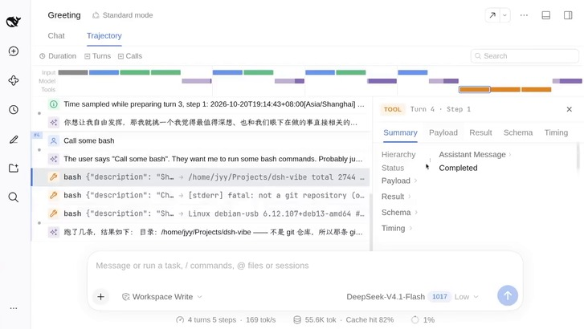

> 视频画面时间区间：00:46:15–00:46:30

这段演示解释了一个设计判断：UI 不是系统的一部分，而是系统的一个消费者。讲者说如果 event 或 session 的设计崩了，「整个 DeepSeek Harness 不可能维护下去」；反过来，只要概念体系建得好，上层插件绝大部分时候只需要消费，不需要侵入。

界面能被这样拆分，是因为 UI 层又做了一层 slot-based 的抽象：插件把自己的界面片段绑定到某个 slot 上，主界面负责装配。这就是为什么同一个 session 既能渲染成聊天窗，也能渲染成侧边栏，还能被一个第三方插件整成 VS Code 的样子：变的只是投影与装配，事实没有变。

### 7.3 open entry：还没结束的那一轮

口述里有一个幻灯片没写的实现细节，值得单独记：大模型的输出是不 committed 的，它在历史里可以有一个 open entry，代表这一轮还没结束；模型不断往里送新的 token，这个状态不 persist，但依然可以被看到。正是这个「可见但不持久」的中间态，让界面能实时显示思维链，也让插件能在推理过程中统计 token 与 cache hit。

> **要点：这一节要记住的三句话**
>
> 一，事实只有一份，就是 append-only 的事件日志；二，模型消息与业务状态都是投影，可以重算；三，正在生成的那一轮是 open entry，可见但不持久。

### 7.4 本章小结

Session 作为世界模型，把「插件之间怎么协同」变成了「谁能读哪些事件、谁能追加哪些事件」。这一个转换同时解决了三个问题：状态一致性（只有一份事实）、可观测性（投影可以随便加）、可扩展性（新插件只要消费事件）。下一章进入代码层，看这些概念对应的接口长什么样。

## 8 插件挂在总线上：接口长什么样

这一章是全篇最「工程」的部分。讲者把世界模型落到三组 API 上：写事实与读投影、向 agent 提交输入、在决策执行前介入。读者可以把它当成一份最小接口清单来读。

### 8.1 写事实，读投影

幻灯片上的两段代码正好对应上一章的两句话。写事实是
`session.append(type, data)`，同时可以注册
`session/event` 的监听；读投影有两个入口，一个是 session 上的
`deriveMessages()`，另一个是
`ctx.sessionProjections` 上的 `stateOf()`（传入 session 与 key）。

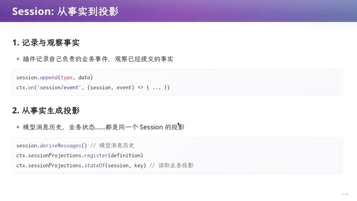

> 视频画面时间区间：00:49:45–00:50:00

**记录事实与生成投影（幻灯片原文）**

```c
session.append(type, data)
ctx.on('session/event', (session, event) => { ... })

session.deriveMessages()                      // 模型消息历史
ctx.sessionProjections.register(definition)
ctx.sessionProjections.stateOf(session, key)  // 读取业务投影
```

讲者强调这个 API 表面「很平常」，但它在架构上定了一件事：插件不能直接改模型的消息历史，只能追加事实，然后由投影决定消息历史长什么样。这也是他能把整个 session 投影成 VS Code 那样的界面的原因——投影是可替换的。

### 8.2 对 agent 说话：followup、inject 与 steer

第二组接口处理「用户或插件想在 agent 运行时插话」这个需求。幻灯片给了三个动词，讲者用他在 Codex 上的使用经验解释它们的差别：模型正在推理输出时你可以继续提问，但这次提问是应该等这一轮工具全部完成再注入，还是在下一次 chat completion 之后立即注入，还是干脆让模型停下来重来。


> 视频画面时间区间：00:50:30–00:50:45

**三种输入的语义差异：区别不在「内容」而在「是否唤醒、在第几步生效」**

| 接口 | 语义 | 典型场景 |
| --- | --- | --- |
| `followup` | 新的一轮用户输入，唤醒执行 | 用户追问、开新任务 |
| `inject` | 补充上下文，等待后续 step，不唤醒 | 追加资料、补充约束 |
| `steer` | 尽快进入后续 step，可以唤醒 | 打断、改方向、纠正 |

幻灯片还给了「持续贡献动态上下文」的写法：`ctx.systemPrompt.context({ ..., text: () => describeCurrentState() })`。注意 `text` 是一个函数而不是字符串——上下文在每次组装时才被求值，因此插件可以贡献「当前状态」，而不是贡献一份会过期的快照。

### 8.3 Hook：在事实与决策之间

第三组接口是最危险也最有价值的一组。幻灯片把系统里的事件分成两类：已经发生的事实，与尚未执行的决策。`session/event` 属于前者——你观察到已提交的事实，如果想补充或纠正，只能追加新事件；`agent/pre-step` 属于后者——你参与待执行的决策，必须调用 `next()` 才会委托后续处理链。


> 视频画面时间区间：00:51:15–00:51:30

**在执行前介入 pending 决策（幻灯片原文）**

```c
ctx.on('agent/pre-step', async (payload, next) => {
  const decision = await next()
  return decision
})
```

讲者用一个具体需求说明这个能力的价值：如果你希望每一轮对话都把当前时区、所在环境、甚至一些设备指纹注入模型上下文，那么有两种实现。一种是在 `buildContext` 里直接写死——他自己的 150 行 agent 就是这么做的；另一种是在 `agent/pre-step` 挂一个 hook，把内容改掉。前者改需求就要改内核，后者改需求只是换一个插件。

> **注意：Hook 的边界：能改写，但不等于能撤销**
>
> 讲者的措辞是「篡改」：有些事件刚进入系统、还没 persist 时是可以改的，而已经提交的事实只能通过追加新事件来纠正。把这两件事混为一谈，会写出「既改历史又追加事件」的插件，最后没人能解释状态是怎么来的。

### 8.4 总线：少量协作接口，连接各自维护状态的插件

把上面三组接口画成图，就是本讲最重要的一张架构图：业务插件（记忆、上下文压缩、计划、子 Agent）与 Agent/Loop 之间传「输入/上下文」和「改写待执行决策」；Agent/Loop 调用 LLM 与 Tools 插件，拿回结果；执行被记入 `Session` 的 `list[Event]`（只追加）；Session 再投影出模型消息投影（`deriveMessages()`）与业务投影（`sessionProjections`）；UI 插件通过 slots 装配界面。

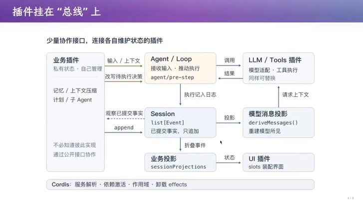

> 视频画面时间区间：00:52:45–00:53:00

讲者用一段话总结这张图：绝大部分状态留在插件本地，但因为插件能感知全局的 agent loop、session 和各种 projection，每个插件都能拿到它想要的关于当前推理进展的信息。这就是「小额接口 + 大额状态私有」的具体形态。


> 视频画面时间区间：00:54:15–00:54:30

幻灯片在这里留了一个反问：「那为什么不允许插件呢？恭喜，你发明了 Creator Mode（Agent 可以直接热插拔插件）」。这个反问是下一章的引子，也是全讲最激进的一步。

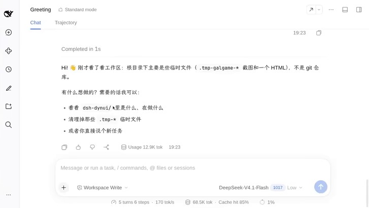

> 视频画面时间区间：00:55:45–00:56:00

### 8.5 本章小结

三组接口对应三种协作角色：写事实与读投影让插件成为观察者，followup/inject/steer 让插件成为输入源，`agent/pre-step` 让插件成为裁决者。所有接口都很小，但组合起来能覆盖从 TUI 到 IDE 的整条界面谱系。代价也随之出现：当任何人都能在总线上挂钩子，钩子之间的语义冲突由谁负责。

## 9 代价：语义冲突与 1/1024

讲者的转折句是「所有的好处都是有代价的」。这一章先展示代价的三个层次——插件之间、插件组合之间、生态与维护之间——再给出他自己对这个项目的评价。

### 9.1 白板一块，然后长出一个生态

讲者回顾内测版本的形态：原生什么也没有，「真的就是白板一块」。但第一天就有开发者在群里做了 token 统计、上下文统计的插件，因为它只需要观察 event bus 上模型吐出的 token，再更新自己内部的状态，完全不需要干扰系统其他部分。这个例子的意义在于证明「不侵入」是可行的默认值。

### 9.2 Creator Mode：让 agent 改自己的 harness

最激进的演示是 Creator Mode。讲者对界面不满意，于是提了一个愿望：在 token 消耗旁边放一个超大号的数字。这个请求需要危险权限——`cordis install_bundle`——他点了 allow，然后 agent 自己安装插件、改写界面，界面右下角出现了巨大的 token 计数。

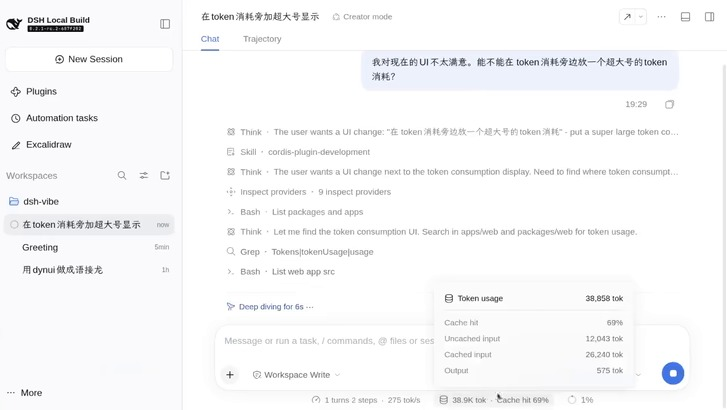

> 视频画面时间区间：01:00:15–01:00:30

这段演示的技术前提是 Cordis 的全动态插件生命周期：agent 一边运行，一边往总线上挂东西。讲者用操作系统类比——「我可以在操作系统里随时启动一个进程，然后随时把一个进程杀掉」。他说这个能力看起来像白板，实际上是一个核弹。

### 9.3 十个压缩插件：$(1/2)^{10}$

代价的第一层是语义冲突。幻灯片列了三种典型：A 改写输入、B 检查输入，先后顺序可能改变结果；两个 hook 都合法，但一个要求继续、另一个要求停止；插件开始依赖另一个插件产生的事件、注册顺序或副作用。讲者用电话系统作类比：「遇忙转移」遇上「呼叫等待」，新来电该转走还是留下？这在电信领域有个名字，叫 feature interaction。

代价的第二层是组合爆炸。幻灯片给了一个极端但诚实的例子：装 10 个自动上下文压缩插件，每个都压缩 1/2。

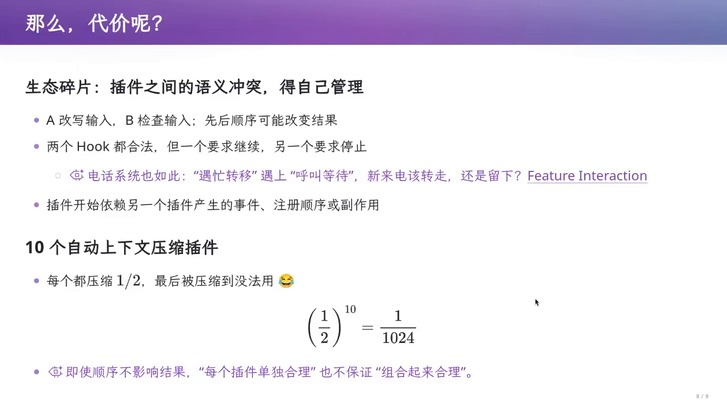

> 视频画面时间区间：01:03:00–01:03:15

$$
\left(\frac{1}{2}\right)^{10}=\frac{1}{1024}
$$

- $\frac{1}{2}$：单个压缩插件保留下来的上下文比例；
- $10$：叠加安装的压缩插件个数；
- $\frac{1}{1024}$：十轮压缩之后，原始上下文还剩下的比例。

讲者在这一页的落点是全讲最锋利的判断：「即使顺序不影响结果，每个插件单独合理，也不保证组合起来合理。」

> **注意：组合正确性不是局部性质的加总**
>
> 每个插件的契约只约束「它自己那一步」，而系统的行为由所有步骤的复合决定。当插件数量从 3 涨到 30，你需要的不再是「每个插件都写对」，而是「组合后的语义有人负责」。DSH 的选择是把事件类型对齐（类型不匹配 TypeScript 直接不编译），但把插件内部状态的管理留给插件自己——于是组合语义仍然是开发者要自己承担的部分。

### 9.4 维护和生态：把试错留在用户现场

代价的第三层是维护。讲者给出他对这个项目的正面评价：接口简单、复杂性低，「可以随便 vibe」，「说什么就 vibe 什么」。紧接着是自我否定：「所以其实我觉得 dsh 的开源社区走远了」——他看到社区把这种能力用来做「高达驾驶舱」这类花活，而他自己如果在第一方，会用它做「一些更了不起的东西」。

他把这种设计选择归到一个经济学概念上：von Hippel 在 2001 年提出的「用户创新工具箱」——把依赖具体需求的设计交给用户，减少反复转述需求的成本。这也解释了为什么发布时「release 了一个 nothing」：内核只给基础抽象和少量第一方功能，剩下的交给生态。

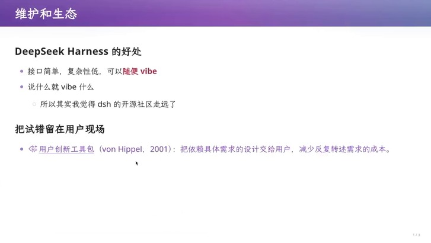

> 视频画面时间区间：01:06:00–01:06:15

> **背景：讲者的立场与他的证据要分开看**
>
> 「dsh 的开源社区走远了」是讲者的评价，不是可测结论；它的证据是他在活动上看到的插件类型。可以作为事实记下来的是：社区在项目发布后一周内自发组织了线下活动，且第一方没有参与。读者可以不同意这个评价，但应该保留它的推理结构——能力越通用，早期采用者的用途越偏离设计者预期。

### 9.5 本章小结

代价分三层：单插件之间的语义冲突（feature interaction）、插件组合的语义坍塌（1/1024）、以及生态方向与设计者预期的偏离。前两层是技术债，可以靠契约与工具还；第三层是路线选择，只能靠时间检验。下一章讲讲者认为值得押注的两个方向。

## 10 两个方向：把 App 接进来，让模型画出界面

讲者说这一章是「方向」，不是产品方案。两个方向共享同一个前提：既然事件总线可以被任意 hook，那么「应用」和「界面」都可以变成总线的消费者与生产者。

### 10.1 方向一：现有 App 只需要三个最小操作

第一个方向是给大型 App 做 AI 增强。幻灯片的判断是「对现有应用只需接入一个非常小的抽象层」：lock objects + serialize objects + UI。讲者在口述里把它展开成三个操作：把一些对象锁住（比如第二页幻灯片先别编辑），把锁住的对象 hand off 到模型上下文，把模型改好的对象拿回来替换。

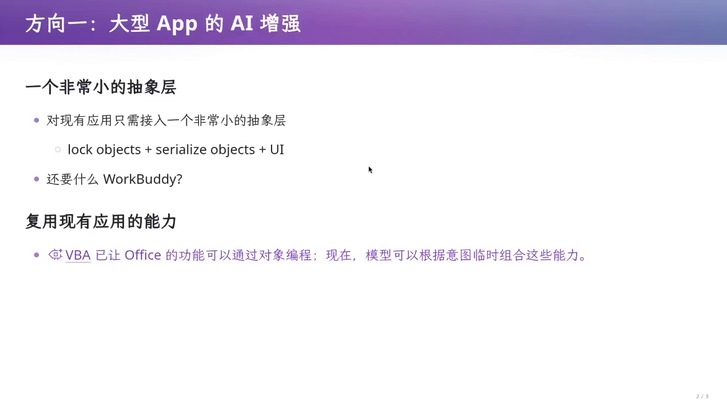

> 视频画面时间区间：01:07:30–01:07:45

他用 VBA 作类比：VBA 早就让 Office 的功能可以通过对象编程，现在只是把「写宏的人」换成了「按意图临时组合能力的模型」。演示里他花五分钟把 Excalidraw 当成 WPS，做了一个 bridge：在画布上锁定一个框，让模型在框里画一只 turtle，画完再替换回去；期间所有其他编辑照常进行。

**把现有 App 接进 agent 生态的三个最小操作：难点不在协议，而在应用愿意暴露对象**

| 最小操作 | 应用侧要提供什么 | 换来什么 |
| --- | --- | --- |
| lock objects | 对象标识 + 锁定语义（锁定期间不可写） | 模型只能改被授权的对象 |
| serialize / hand off | 把选中对象序列化进上下文 | 模型看到的是结构化对象，不是截图 |
| replace | 用模型输出替换原对象 | 改动可见、可撤销、可人工继续编辑 |

讲者在这里顺带批评了另一种产品思路：让模型生成 PPT 的产品，往往自己再做一个编辑器，「然后你可以拖那个框，加一个 comment，再让它改」。他的反问是「你为什么不反过来做这件事」——直接嵌进已有的编辑器，把生态让给总线。幻灯片上那句「还要什么 WorkBuddy?」是这个反问的浓缩版。

### 10.2 方向二：GenUI 与上下文回注

第二个方向是把界面本身变成模型的输出。幻灯片的两条规则很短：允许模型输出一个 HTML + JS 卡片；允许卡片里的代码把信息注入上下文。讲者补充了实现细节：卡片可以放到界面的任何 slot 上，卡片里的 JS 意味着可以放按钮、输入框，理论上可以放一个 React 组件。

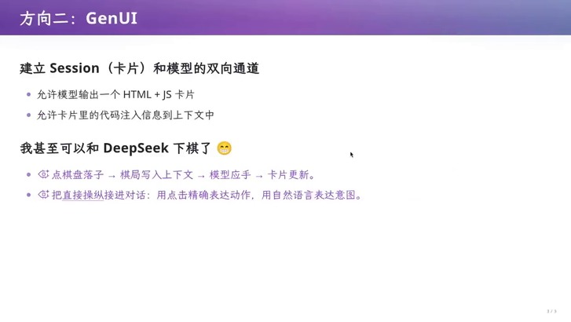

> 视频画面时间区间：01:12:30–01:12:45

演示是成语接龙与五子棋。以接龙为例：卡片上点一个按钮，JS 把「我选了惊弓之鸟」这句话注入上下文，模型接着输出下一个成语和一个新的卡片；棋类则是反过来——棋盘状态在 UI 里，但每一次落子都由模型思考后决定，模型返回的是一张新卡片（讲者承认现在还是整张重生成，不是 patch，但「你总是可以设计一个好的方式去复用已有的东西」）。


> 视频画面时间区间：01:14:15–01:14:30

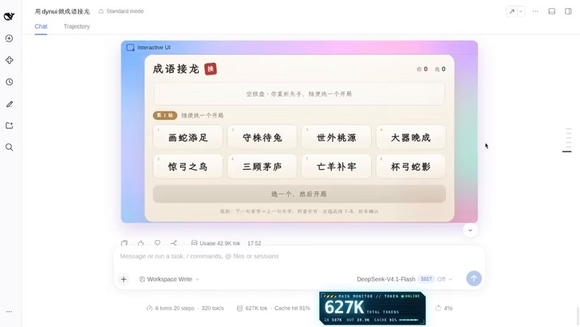

> 视频画面时间区间：01:14:30–01:14:45

讲者对这类演示的评价很克制：有 bug，也不是成熟产品；但他把时间尺度拉长到 GPT-3.5 时代——那时候让它从 50 数到 100 都会出错，「但当你看到一种可能性的时候，就意味着一定有办法可以做得非常好」。

### 10.3 事务化编辑：选区锁 + 暂存 + 成功才提交

最工程化的一段在最后：当模型真的要改一个应用里的对象时，怎么写才不会把用户的画布搞坏。设计文档给出的方案是把「模型回合」当成一个事务：`POST /edit` 触发 `store.begin()` 生成 job，并把选区 ID 锁在画布上（此时 `save` 对这些 ID 返回 423，其余仍可编辑）；`replace_selection` 执行时只做校验，把结果塞进内存里的 `run.result`，回一句「已暂存，请结束回合以提交」；只有回合成功结束，`store.finish(..., 'completed', text, run.result)` 才真正提交；失败、超时（180 秒）、用户取消或进程重启，则只解锁，原样一字不丢。

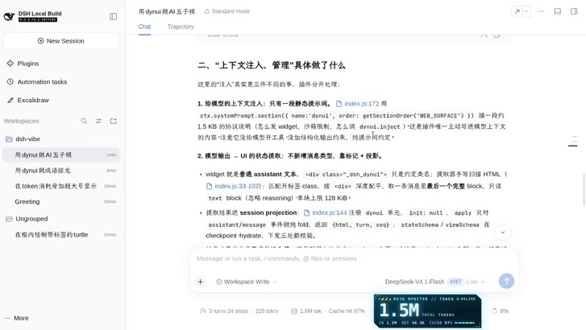

> 视频画面时间区间：01:21:45–01:22:00

这段设计里最值得学的是它对模型输出的态度。文档明确要求：模型输出是不可信输入，ID 必须在选区内，不允许新建或删除对象，不允许新建 image 资源，坐标与 schema 全部校验后再合并。讲者用一句话概括了这种边界感：应用不是给 agent 写一套 RPC，而是把应用做成 agent 的宿主插件——画布等于 session，编辑请求等于 tool call，提交等于回合结束的 commit。

### 10.4 入侵点清单：插件到底动了什么

为了让「不侵入」这句话可检验，讲者最后展示了一张入侵点清单：每个宿主暴露什么挂点、这些挂点的性质是什么。幻灯片上的几行足以说明尺度：投影注册走 sessionProjections 的 register，提示词贡献走 systemPrompt 的 context，浏览器侧通过模块加载器注册客户端 bundle，本地服务与 UI 装配则分别走 locals 与 slots 的 register。

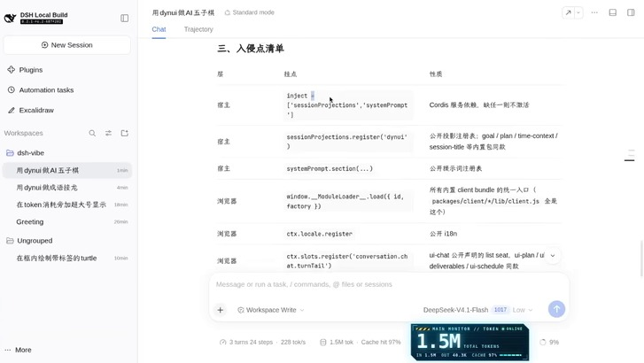

> 视频画面时间区间：01:23:15–01:23:30

他还补了一个机制层面的保护：插件如果「干坏事」，它声称的能力与它实际匹配的东西对不上时，会自动 fail，相当于被隔离开了；旁听全局事件时则要自己做对象同一性过滤，别人的 agent 不匹配就不处理。

### 10.5 本章小结

两个方向其实是同一条思路的两面：把外部世界的东西（App 的对象、模型的界面）都变成事件与投影，于是它们都能被同一个总线消费。三个最小操作说明了接入成本有多低，事务化提交说明了接入之后如何不把用户的东西搞坏。这也回到第三章的问题——需求会变，而变的成本取决于你的接入面有多薄。

## 11 总结与延伸

讲者的收尾没有总结要点，而是给了一个判断和一个正在进行的项目：他觉得 DeepSeek Harness 的架构值得学，因为「一个干净的架构可以给我们带来什么」这件事大多数人还没有意识到；他自己在做的保密项目叫 Agent OS，思路类似——everything is a plugin——但位置在 DSH 之下，为它提供更多能力。

### 11.1 讲者的落点

落点可以拆成三句。第一，DSH 是一个非常小、非常薄的内核层，「什么也没有」，但底下有一整个插件生态，任何一个 super app 都可以用三个最小操作接进来。第二，这个能力的方向不是「更花的界面」，而是「让应用与模型共享同一个世界」——他用填表的例子说明：填论文列表这种任务不需要 computer use，不需要疯狂截图，只要数据库插件把必要信息提供给总线，剩下的协作在生态内闭环完成。

那个例子值得展开一句，因为它把「生态」具体化了：他要填一张表，要列出 2021 年至今发表的全部论文；如果交给通用 agent，就要截图、识别、复制粘贴，花很多时间和 token。而在自己的生态里，数据库插件知道论文、学生、个人信息，超级应用把「该填哪几列」丢到总线上，插件把数据取回来，表格就填好了。第三，界面层还会继续变：「每一个 Super App 应该怎么设计，可能今天又有今天的版本答案」。

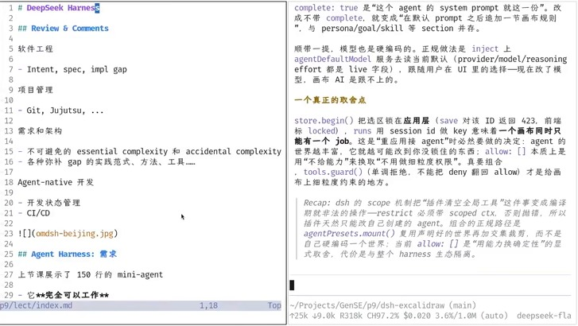

> 视频画面时间区间：01:28:15–01:28:30

### 11.2 本讲义的压缩

如果把 89 分钟压成一条因果链，它是这样的：150 行的 agent 证明了循环是对的，高铁断网证明了循环之外的世界没有被建模；把中断建模之后，需求膨胀成状态机、重试语义、权限与审计；需求会变，所以架构必须在「受限」与「自由」之间选一个位置，而任何位置都押注了某些假设长期成立；MapReduce 的例子说明假设会失效，失效时抽象泄漏、架构变成阻力；于是 DeepSeek Harness 把「假设会变」写进架构——内核只提供 Session 与总线，其余全是插件；插件靠事件协作，事件组成唯一的事实来源，投影负责让同一份事实长出 chat、trajectory、VS Code 侧栏等不同界面；代价是插件之间与插件组合之间的语义冲突，最极端的量化是十个压缩插件把上下文压到 1/1024。

**全讲的读者问题与答案索引**

| 读者问题 | 一句话答案 | 在文中的位置 |
| --- | --- | --- |
| 为什么 150 行不够 | 循环之外的物理世界没有被建模 | 第 1 章 |
| 需求为什么膨胀 | 中断带来状态不可知，副作用需要幂等 | 第 2 章 |
| 架构在买什么 | 用自由换基础设施，用约束换可分工 | 第 4 章 |
| 假设为什么会失效 | 技术与组织换代不同步，抽象开始泄漏 | 第 5 章 |
| DSH 的第一性原理 | 微内核 + 一切皆插件 + Session 即事件日志 | 第 6、7 章 |
| 插件的代价是什么 | 语义冲突与组合坍塌，组合语义要有人负责 | 第 9 章 |
| 怎么接一个 App | 锁对象、hand off、替换，三步即可 | 第 10 章 |

### 11.3 边界与下一问

有三处边界值得读者自己守住。第一，「一切皆插件」的有效性依赖于事件类型被严格对齐，这一点靠 TypeScript 的类型系统兜住；换到动态语言环境，同样的架构会退化成「谁都能往总线上扔东西」，代价会立刻显现。第二，Creator Mode 把内核权限交给 agent，讲者自己也要点 allow，这说明它目前仍是开发者工具，而不是终端用户产品。第三，1/1024 那个例子是极端情形，但它揭示的问题不极端：任何「每个插件都合理」的系统，都需要有人为组合语义负责，而在 DSH 里这个人是插件作者。

讲者预告下一讲会讲 Agent Native 开发的细节，也就是在这个架构上如何真正写插件、跑 CI/CD。留给读者的问题可以更具体一些：如果你的应用要接入这条总线，你愿意锁住哪些对象、暴露哪些事件，又准备为哪些组合语义签字？

> **要点：带走这一条**
>
> 判断一个 agent 产品的架构，不要看它支持多少功能，而看它把「状态」放在哪里、把「扩展」放在哪里。DSH 的答案是把状态收进 append-only 的事件日志，把扩展放在总线上的钩子里——前一半保证可解释，后一半保证可生长，两者之间的缝隙就是要付的代价。

> **背景：延伸阅读（讲义内提及，未在视频中展开）**
>
> MapReduce 原论文（Dean & Ghemawat, 2004）第 4.5 节关于副作用与幂等性的要求；Cordis 的插件生命周期设计；Spark 的 RDD 与 Flink 的事件时间/水位线；von Hippel（2001）的用户创新工具箱。以上均按讲者在视频中的提及记录，未做额外考证。
